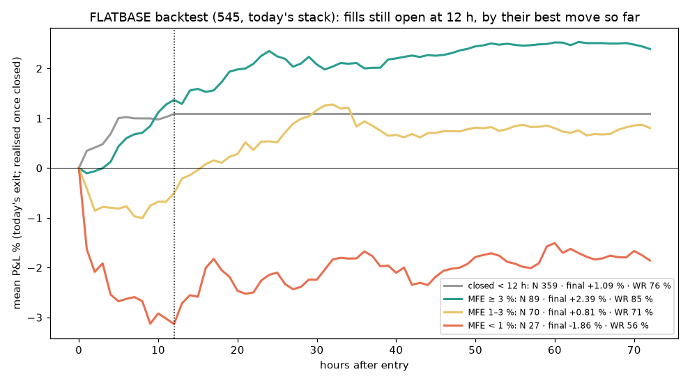

# BATCH28 (paper 11-18 → 11-27) — winners vs losers per sleeve + "is Flatbase's 72 h hold luck?" (2026-11-27, research only — no bot / config change)

Operator (11-27): "Run winners vs losers for each sleeve, to understand if there is a signal, variable or market condition that divides
winners vs losers … FLATBASE cannot last 72 h of max holding … 72 h holding is LUCK rather than technical analysis."

## 0 · Prior-study check (CLAUDE.md rule, DL 623)

| Sleeve | Already tested (DL · date · verdict) | NEW in this ask |
|---|---|---|
| FLATBASE hold | DL 622 (11-21) plain caps 24 / 48 / 60 / 120 h vs 72 h → keep 72 h (24 h −0.17, 48 h −0.06 %/fill) · STATE_EXIT (DL 608–610) FB_4H / FB_VWAP / FB_BASE / FB_VOL state exits → null | a CONDITIONAL "never went our way" stop: at T h close if the best move so far < X % (21 cells) |
| FLATBASE W/L | OOS_REAL_FLATBASE WL (11-17: 3,848 tests, top-5 failed holdout) · DL 649 base trend / entry timing (null) · DL 601 funding (armed) | the batch's 6 closed + 2 open fills; the batch losers' stamps re-read on the backtest |
| EXH W/L | ENTRY_WL (11-18, nothing at entry) · DL 643 breadth · DL 649 EXH first 30 min (93 vars, exhaustive 2D, 0 survivors) · DL 642 no-spot | 5 fills since 11-26 (ME ×2, INIT, PORTAL …); every real-fill candidate re-read on the backtest at TP 7 |
| DIST W/L | DIST_WL (11-18) · DL 602 losers round 2 · DL 627 squeeze fuel · DL 639 big red / batch check 11-24 | 3 fills since 11-24 (MANTRA, CFG, PORTAL) — nothing new is testable on 10 fills |
| HT W/L | DL 600 · HT_FILTER_BT (11-26: CROWDED_LONGS observe, PRE_VOL refuted) · DL 618/619 burst | none — 0 HT fills since 11-21 02:30 → a repeat; the real-fill sweep is shown, nothing re-studied |
| WILLY W/L | many (WILLY_GAP, FAILED_SPIKE, runner …) | 2 fills — a repeat |

---

## 1 · FLATBASE — is the 72 h hold luck? (NEW part: the "never went our way" stop)

**Question.** The two open shorts (MOVE peak +2.79 %, LAYER +0.18 %) never really went our way. Should a short that has not worked after
T hours be closed instead of held toward the 72 h cap?

**Method.** Every backtest Flatbase fill on today's stack (545, the rebuild used by DL 601 / 622 / 649; parity with the entry-timing sim
exact) + the 17 master kept fills + 5 batch kept fills, walked on 5m bars from the real entry. Rule: at T h after entry, if the best
favourable move so far (MFE, from the 5m lows) is below X %, close at market (taker + slip); otherwise today's exit (TP −5 maker / stop
+10 incl. funding / 72 h). Pre-registered grid T ∈ {2, 4, 8, 12, 24, 36, 48} × X ∈ {1, 2, 3} = 21 cells; real funding to the exit;
one-size DCR (0.61 × equity).

**How long Flatbase really holds** (backtest 545, today's exit):

| Exit | N | median hold | p90 | closes after 24 h | avg net |
|---|---|---|---|---|---|
| TP −5 | 402 | 6.4 h | 27 h | 13 % | +4.72 |
| stop +10 | 118 | 6.2 h | 31 h | 14 % | −10.56 |
| 72 h cap | 25 (4.6 %) | 72 h | — | 100 % | −1.39 |

Real: all 17 master kept fills hit TP within 17 h (median 3.2 h); the batch's 4 losers stopped within 5–18 h. **No real fill has ever
reached the 72 h cap.** This batch's losses were the +10 stop being hit fast by squeezes, not slow holds.

**Result — every cell loses on the backtest** (Δ %/fill vs today; P = one-sided day-bootstrap P(Δ > 0)):

| Cell (T h · MFE < X %) | fills closed | their result if HELD (today) | closed at T | Δ ALL | Δ HOLDOUT | P | DCR %/day | max DD | master 17 | batch 5 (in-sample) |
|---|---|---|---|---|---|---|---|---|---|---|
| 2 h · 1 % | 139 | −0.57 · 65 % WR | −2.41 | −0.47 | −0.51 | 0.00 | 0.38 → 0.21 | −41 → −41 | 0 | +2.86 |
| 4 h · 2 % | 178 | −0.17 · 67 % | −2.11 | −0.63 | −0.62 | 0.00 | 0.38 → 0.15 | −41 → −42 | −0.63 | +4.40 |
| 8 h · 2 % | 105 | −0.48 · 64 % | −2.36 | −0.36 | −0.34 | 0.00 | 0.38 → 0.25 | −41 → −36 | −0.63 | +1.78 |
| 12 h · 1 % | 27 | −1.85 · 56 % | −3.69 | −0.09 | −0.09 | 0.08 | 0.38 → 0.34 | −41 → −43 | 0 | +1.83 |
| 12 h · 3 % | 97 | +0.07 · 67 % | −1.83 | −0.34 | −0.29 | 0.00 | 0.38 → 0.26 | −41 → −41 | −0.19 | +1.83 |
| 24 h · 3 % | 40 | −1.02 · 55 % | −2.04 | −0.07 | −0.05 | 0.14 | 0.38 → 0.35 | −41 → −34 | 0 | 0 |
| 36 h · 3 % | 22 | −1.51 · 50 % | −2.05 | −0.02 | −0.00 | 0.31 | 0.38 → 0.37 | −41 → −35 | 0 | 0 |
| 48 h · 3 % | 16 | −1.81 · 44 % | −2.73 | −0.03 | −0.01 | 0.24 | 0.38 → 0.37 | −41 → −39 | 0 | 0 |

(all 21 cells: reports/FLATBASE_NOPROGRESS_STOP_2026-11-27_cells.csv — none positive on ALL or HOLDOUT; best P 0.49.)

**Meaning.** A Flatbase short that has not worked in its first hours is a worse trade, but it is not a lost one: the fills with less than
+1 % after 12 h still win 56 % of the time and average −1.86 % at the end, while closing them at 12 h books ≈ −3.1 to −3.7 %. Holding
recovers ≈ +1.2 to +1.8 points on average. Cutting them early sells near the low of the squeeze. The 72 h cap itself is almost never
reached (4.6 % of fills), and when it is, those fills average −1.39, not −10. The only place a "no progress" stop helps is this batch's 5
fills (in-sample, the motivating trades), and it costs on the master's 17.

**Verdict: NO CHANGE — keep TP −5 / stop +10 / 72 h; no observe line.** The "72 h is luck" theory is not supported: the long tail of
holds is small and slightly positive (fills closing after 24 h: +33 pts total on the backtest). Re-open only if real fills start reaching
the cap (none so far) or if the stop / TP changes. **The two open shorts:** both are inside the normal path of a Flatbase fill
(LAYER ≈ the "MFE < 1 %" group, MOVE ≈ "MFE 1–3 %"); the rule says hold them to TP / stop. MOVE carries a real cost the backtest
under-states: −4.05 % funding in 18 h (hourly funding), which the funding-counted stop (DL 607) already folds in.

---

## 2 · WINNERS vs LOSERS per sleeve

Method: ① the real-fill sweep (scripts/sweep_separators.py, master on today's stack + this batch; booked P&L and the path label) against
a shuffled null (scout_sweep_all: P&L permuted within each era, same tests); ② every top real-fill candidate re-read on the sleeve's
2-year backtest at TODAY's exit (BATCH28_WL_BTCHECK_2026-11-27.py): better half minus worse half, DESIGN (< 2025-07) / HOLDOUT, half-year
sign count; a candidate counts only if both blocks and ≥ 5 / 7 halves agree; ③ market condition in DAY units.

### Real fills vs a shuffled null (every entry_* column; 1D · every-pair 2D · 3D-from-2D; booked P&L and the path label)

| Sleeve | Real fills (master · batch) | 1D best gap vs luck | 2D best vs luck | Path label (worked / never) | Verdict |
|---|---|---|---|---|---|
| FLATBASE | 34 (28 · 6) | 2.51 vs 3.76 (p 0.71) | 3.01 vs 3.01 (p 0.56) | 30 / 1 — the +10 stop is so wide that almost every fill "works" +1 % first → the label cannot separate | **nothing above luck** |
| EXH | 22 (0 · 22) | 3.88 vs 7.40 (p 0.94) | 4.94 vs 5.70 (p 0.55) | 11 / 4 · p 0.94 | **nothing above luck** |
| DIST | 10 (0 · 10) | too thin to split into two eras | — | 6 / 2 | **keep collecting** |
| HT | 28 (15 · 13) | 3.27 vs 4.16 (p 0.42) | 4.22 vs 4.57 (p 0.09) | 26 / 2 · p 0.27 | **nothing above luck** |
| WILLY | 26 (24 · 2) | 1.75 vs 2.07 (p 0.19) | 2.06 vs 2.07 (p 0.07) | 23 / 3 | **nothing above luck** |

Coverage: FB 35 columns tested (+ 74 never stamped on the sleeve; the BTC / pair-indicator block is < 80 % scored on FB → blind spot,
covered by the backtest rebuild's own BTC / breadth columns below) · EXH 98 · DIST 97 · HT 81 · WILLY 63. The real-fill "survivors" are
the number luck alone produces on the same data (e.g. EXH 68 consistent 1D tests vs 63 expected by chance) — so each sleeve's top
real-fill candidates were taken to the backtest (next table) instead of being trusted.

### Backtest cross-check of the real-fill candidates (TODAY's exit)

| Sleeve | Real-fill variable (what the batch says) | Backtest analog | ALL Δ | DESIGN | HOLDOUT | halves | Backtest agrees? |
|---|---|---|---|---|---|---|---|
| EXH | BTC above its 5m EMA13 (better) | BTC 1 h return > 0 | +0.32 | +0.24 | +0.38 | 5/7 | ✅ (90 % CI −0.03 … +0.67) |
| EXH | BTC 1 d return (higher better) | BTC 1 d return | +0.28 | +0.34 | +0.28 | 5/7 | ✅ (CI −0.03 … +0.62) |
| EXH | hours after spike (later better) | hrs since spike | +0.37 | +0.77 | +0.07 | 5/7 | weak (HOLDOUT ≈ 0; = DL 648 line) |
| EXH | own stops in the prior 24 h (fewer better) | st_stops24h | +0.14 | +0.22 | +0.15 | 5/7 | weak |
| EXH | market cap (bigger better) | mcap | +0.01 | +0.20 | +0.12 | 6/7 | ≈ 0 |
| EXH | bearish breadth (lower better) | breadth | 0.00 | +0.34 | −0.13 | 2/6 | ✗ |
| EXH | volume trend (lower better) | 15m volume mult | −0.20 | −0.18 | −0.19 | 3/7 | ✗ (flips) |
| EXH | market heat (fewer Frenzy flags) | Frenzy flags 24 h | −0.16 | +0.36 | −0.35 | 5/7 | ✗ |
| FB | off the peak (deeper better) | off_peak_pct | +0.39 | +2.06 | +0.05 | 4/6 | ✗ |
| FB | flat base 14 d (looser better) | flat14 | +0.47 | −0.87 | +0.70 | 2/6 | ✗ |
| FB | BTC 24 h (up better) | BTC 24 h return | −0.44 | +0.49 | −0.63 | 3/6 | ✗ |
| FB | peak age (older better) | peak_age_h | +0.57 | +0.25 | +0.62 | 4/6 | ✗ (4/6) |
| FB | market up-breadth 24 h | breadth_pos24 | −0.06 | −0.28 | −0.01 | 1/5 | ✗ |
| FB | entry funding | funding_rate_pct | −0.09 | −0.12 | −0.08 | 3/6 | ✗ |

**EXH × BTC direction (the one pattern both real and backtest show):** real batch 15 fills with BTC above its 5m EMA13 at entry → +1.67
%/fill vs 7 with BTC below → −2.32 (re-priced at TP 7); backtest 1,679 · +0.77 vs 1,679 · +0.45. The theory: a pumped coin that rolls
over while BTC is firm is relative weakness (its own sellers); one that rolls over while BTC dips is following the market and bounces
with it. **But the weak side still earns +0.45 %/fill on 2 years → never a filter (it would remove profitable trades)**; the 90 % CI of
the gap touches 0; it was already in ENTRY_WL's T4 family (old exit) without surviving; and this read is post-hoc (picked from the real
screen). At most an OBSERVE line or a size tilt candidate — not a block.

---

## 3 · Market condition — the cross-sleeve read (DAY units)

BTC fell 71k → 60k (11-12 → 11-27). All three short sleeves lost together on 11-21 and 11-25 → 11-27 (EXH 1 W / 9 since 11-25, Flatbase
0 / 2 + 2 open losing, DIST 1 / 3). The losers were Frenzy coins squeezing against a falling BTC (BIGTIME, MANTRA, KERNEL, PORTAL, INIT,
ME): coins traded by ≥ 2 short sleeves lost −$4,283, single-sleeve coins made +$735. This is the "uniform degradation" signature
(CLAUDE.md sleeve-kill checklist ③): a market state, not the entries — but the market variables we can measure at entry (BTC 1 h / 1 d /
24 h, daily regime, breadth, Frenzy heat, funding) do not separate it on 2 years (table above), and it is 3–4 market days of evidence.
Short after a loss on the same coin (DL 649): backtest 841 EXH after a loss +0.63 = no prior +0.63 → no rule; in this batch first
shorts also lost (26 · −1.32 vs after a loss 11 · −2.51).

## 4 · Verdicts

| Sleeve | Signal found? | Call |
|---|---|---|
| FLATBASE | No entry separator (batch losers' stamps flip on 2 years); no hold-time rule (all 21 cells lose) | KEEP rules · KEEP OBSERVING · the streak is extreme (0.13 % of backtest windows) → next study: does the 2-year rebuild take and lose these same 8 setups (market) or skip them (live ≠ backtest)? |
| EXH | BTC direction (1 h / 1 d) agrees in sign; weak side still positive | KEEP; optional OBSERVE line EXH_BTC_DOWN (operator call); BEAR80 / EARLY_SPIKE decisions stay in the batch review |
| DIST | nothing testable on 10 fills; backtest priors (DL 602 / 627 / 639) unchanged | KEEP OBSERVING |
| HT | no new fills since the 11-26 study | repeat — refused; CROWDED_LONGS stays observe |
| WILLY | 2 new fills | repeat — refused |

Files: scripts/FLATBASE_NOPROGRESS_STOP_2026-11-27.py · scripts/BATCH28_WL_BTCHECK_2026-11-27.py · scripts/BATCH28_REVIEW_EXH_2026-11-27.py ·
reports/FLATBASE_NOPROGRESS_STOP_2026-11-27_cells.csv / _chart.png / _data · reports/BATCH28_REVIEW_2026-11-27_data/.

---

## 5 · Follow-ups (same day)

### 5a · FLATBASE rebuild through 11-27 (scripts/FLATBASE_REBUILD_1127_fetch.py · reports/FLATBASE_REBUILD_2026-11-27_data/)
The 2-year rebuild (oos_real_flatbase_recon, logic unchanged) re-run on the 138 coins the bot's journal tracked since 11-12, 5m data to
11-27 14:30; today's stack applied (flat ≤ 44.4 % · TRADE route · confirm · no higher high · NEAR_BASE > 2.09 · last settled funding ≤
0.005 %). Setups with entry ≥ 11-18 04:45:

| Setup | Rebuild (today's stack) | Live |
|---|---|---|
| PIPPIN 11-19 04:00 | kept · TP +4.94 | traded · TP +4.98 |
| KERNEL 11-20 20:00 | kept · STOP −10.12 | traded · STOP −11.69 |
| ENSO 11-21 12:00 | kept · STOP −10.26 | refused PAIR_HELD (EXH held the coin) — saved |
| SAHARA 11-24 12:00 | kept · TP +4.94 | refused PAIR_HELD (EXH) — missed |
| BIGTIME 11-26 08:00 | kept · STOP −10.15 | traded · STOP −10.15 |
| SLX 11-26 12:00 | kept · STOP −10.24 | traded · STOP −10.13 |
| LAYER / MOVE 11-26 | kept · open | traded · open |
| PHAROS 11-19 08:00 | funding-blocked today (+0.025 %) · rebuild TP +4.94 | traded (pre-DL 601) · STOP −9.94 — live filled 0.33 % lower, best move 4.91 % < the 5 % TP |
| AIGENSYN 11-22 16:00 | NEAR_BASE skip (would have stopped −10.6) | NEAR_BASE skip ✅ |
| MMT 11-19 08:00 | no confirm within 24 h (not traded) | traded · STOP −9.90 — journal for 11-17/19 not exported, cause unread |

**Verdict:** the backtest machinery takes the same setups and loses the same way (4 / 4 shared setups same outcome; rebuild 2 / 6 closed,
avg −5.1 %). The Flatbase batch is a real bad stretch of the strategy, not a live ≠ backtest gap (MMT and PHAROS are single-fill
differences: one unread selection case, one 0.33 % fill-price knife-edge).

### 5b · Market variable for the losing days (operator: "there MUST be a market variable")
Correction first: EXH (+0.09 vs +0.66 expected, ≈ 0.5 standard errors) and DIST (−1.01 vs +0.82, ≈ 0.8 SE) are inside normal noise for
their N; only FLATBASE is far outside its history. New market variables tested (never tested before):
- **Trailing fade success of the pumped-coin crowd** (other-coin EXH signals closed in the prior 48 h: win rate / avg / stops; scripts/
  SHORT_BOOK_REGIME_2026-11-27.py): dose-response tiny (WR ≤ 30 % → +0.50 vs ≥ 60 % → +0.71 %/fill), CI spans 0, 2–4 / 7 halves → no.
- **BTC distance below its 30-day high** (scripts/SHORT_BTC_DRAWDOWN_2026-11-27.py; batch days −23 … −30 %): EXH is monotone — near the
  high +0.72 %/fill · −5…−10 +0.68 · −10…−15 +0.40 · −15…−20 +0.53 · ≤ −20 % **192 · +0.01** (HOLDOUT −0.14, but DESIGN +1.58 → sign
  flips between blocks; 55 days from a handful of drawdown episodes = few independent windows). FLATBASE is the OPPOSITE: ≤ −20 % is its
  best bucket (46 · 85 % · +2.23), so it does not explain the Flatbase stretch. → EXH × BTC-drawdown is a candidate OBSERVE line (market-
  wide → judged in window units), not a filter.
