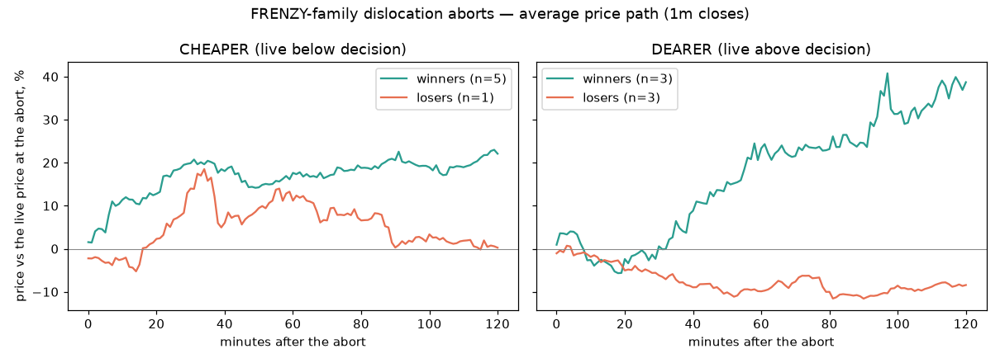

# FRENZY-family dislocation guard — would a one-sided guard pay? (2026-11-28, research only)

**Prior studies:** DL 85 / 87 (09-19) tested the Bull-run sleeve's 0.3 % guard in both directions; far entries lost there, and the "cheaper" side turned out to be a paper tick-size bug. The FRENZY-family 1 % guard was never priced or split by direction: this is the first read.

## Question
The guard cancels a FRENZY / WILLY / WILLY_HT / LITE long when the live price at the order is more than 1 % away from the decision price — **either way**. Would cancelling only when the price ran UP (dearer) and filling when it fell (cheaper) have made money?

## Data
- 13 aborts in 116 decisions exports (2026-10-23 → 2026-11-27; older exports no longer exist): FRENZY_WILLY_HT_DISLOC 8, FRENZY_WILLY_DISLOC 2, FRENZY_LITE_DISLOC 2, FRENZY_CATCHUP_MOVED 1. Also 6 lateness refusals (descriptive: SPIKE_FADE_BLOCK_FADE_LATE_WEAK 3, FRENZY_WILLY_LATE 2, FRENZY_WILLY_HT_LATE 1).
- Exact prices from the server log for 2 (14-day log retention); the rest rebuilt from Binance trades (the walkers' tick cache; decision = the last trade 3 s after the bar close, as calibrated on AIOT). Calibration on the 2 with both: direction agrees 2 / 2, decision price error median 0.49 %, live price error median 0.56 %.
- Unresolved (no > 1 % trade in the 20 s after the decision): 1 — listed in the CSV, not counted. Not priceable: 0.
- Priced AS IF FILLED at the live price + 0.10 % slip, entry 8 s after the abort, taker fee, each sleeve's live exit today (scout_blocked_filters pricer: WILLY_HT +6 / −4 / 24 h; LITE flat TP; plain WILLY its spike-high target — spike time approximated, flagged).

## Result by sleeve × direction

| Sleeve · direction | N | days | WR | avg net % | Σ % | TP / STOP / TIME |
|---|---|---|---|---|---|---|
| FRENZY_LITE · 🟢 CHEAPER | 2 | 2 | 50% | -0.01 | -0.03 | 1 / 1 / 0 |
| FRENZY_WILLY · 🟢 CHEAPER | 1 | 1 | 100% | +8.00 | +8.00 | 1 / 0 / 0 |
| FRENZY_WILLY · 🔴 DEARER | 1 | 1 | 0% | -4.00 | -4.00 | 0 / 1 / 0 |
| FRENZY_WILLY_HT · 🟢 CHEAPER | 3 | 3 | 100% | +6.00 | +18.00 | 3 / 0 / 0 |
| FRENZY_WILLY_HT · 🔴 DEARER | 5 | 4 | 60% | +2.00 | +10.00 | 3 / 2 / 0 |
| **ALL · 🟢 CHEAPER** | 6 | 6 | 83% | +4.33 | +25.97 | 5 / 1 / 0 |
| **ALL · 🔴 DEARER** | 6 | 5 | 50% | +1.00 | +5.99 | 3 / 3 / 0 |
| **ALL aborts** | 12 | 10 | 67% | +2.66 | +31.97 | 8 / 4 / 0 |

Kept fills of the same sleeves over the same span, same pricer:

| Sleeve | N | days | WR | avg net % | Σ % | TP / STOP / TIME |
|---|---|---|---|---|---|---|
| FRENZY_LITE (kept) | 43 | 19 | 60% | +0.59 | +25.25 | 25 / 17 / 1 |
| FRENZY_WILLY (kept) | 51 | 25 | 57% | -0.86 | -43.68 | 29 / 20 / 2 |
| FRENZY_WILLY_HT (kept) | 62 | 23 | 44% | +0.35 | +21.57 | 27 / 35 / 0 |

## CHEAPER side by move size (is it a crash starting?)

| move | N | days | WR | avg net % | Σ % | TP / STOP / TIME |
|---|---|---|---|---|---|---|
| 1–2 % | 3 | 3 | 67% | +1.99 | +5.97 | 2 / 1 / 0 |
| 2–4 % | 2 | 2 | 100% | +6.00 | +12.00 | 2 / 0 / 0 |
| > 4 % | 1 | 1 | 100% | +8.00 | +8.00 | 1 / 0 / 0 |

## CHEAPER cohort — robustness

- N 6 on 6 days · WR 83% (one-sided 95 % Wilson floor 50%) · avg +4.33 % · day-clustered bootstrap 95 % CI [+0.99, +6.67]
- Pair concentration: AGTUSDT +8.00, ACEUSDT +6.00, AIOTUSDT +6.00, PARTIUSDT +6.00, INITUSDT +3.00, AKEUSDT -3.03 · top pair = 28% of the winners' Σ
- Leave-one-out avg: min +3.59 · max +5.80
- Breakeven WR on the priced aborts (|avg loss| ÷ (avg win + |avg loss|)): 39%
- In-sample haircut 30–50 %: avg +2.16 … +3.03 %

## Chart

Average price path from the abort (1m closes, % vs the live price): winners vs losers, CHEAPER vs DEARER.

## Verdict (locked gates: N ≥ 15 · ≥ 8 windows · CI above 0 · no pair ≥ 50 %, then a 30–50 % haircut)

🟡 **Below the bar → OBSERVE line, no change** — CHEAPER N 6 on 6 days; CI [+0.99, +6.67]; top pair 28%.

## Caveats
- Small N: the decisions exports only reach back to late October; older aborts are not recorded anywhere.
- Rebuilt prices: Binance trades, not the order book the guard read; the 3 s decision offset is calibrated on ONE log-confirmed abort (the bot's scan-start time varies).
- Paper fills: the bot was in paper for most aborts; a real order into a falling book can fill worse than +0.10 %.
- 1m walker: intra-minute stop / TP order is not visible (both ways).
- Crash-start risk: a cheaper live price can be the first second of a collapse; the move-size table is the check.
- Plain WILLY's spike time is approximated (highest-volume 5m bar in the 12 h before), so its target is approximate.
- Direction near the line: 8 rebuilt aborts moved < 1.5 % — inside about one calibration error of the 1 % line, so their side (and that the guard even fired on that side) is uncertain; the CHEAPER side's rebuilt moves of ≥ 1.5 %: 2.
- The guard as a whole: all 12 priced aborts avg +2.66 % vs the kept fills above — on this N the guard removed trades that did no worse than the ones it let through, on BOTH sides; small N, not a finding on its own.

