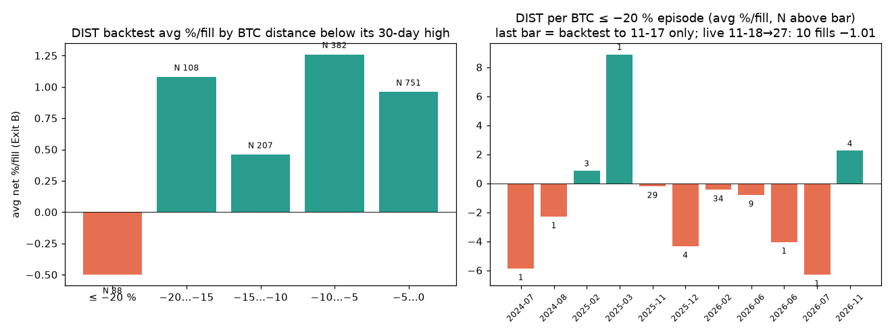

# DIST deep dive — 2026-11-27 (research only, no bot change)

**Question (operator):** DIST lost 10 live fills at −1.01 %/fill while its 2-year backtest earns +0.89. Why so different? If it is the
market, which market variable marks those trades? Otherwise, is it a disable candidate?

**Prior studies (not re-run):** DIST_WL 11-18 (entry W/L, 1D + 2D: nothing beyond luck) · DL 602 losers round 2 · DL 603 TP grid · DL 627
squeeze fuel · DL 639 big red candle · DL 645 ATR trail · DL 649 short after a loss. **New here:** how unusual the batch is, live vs backtest
profile, market variables at sign level in day / episode units (BTC 30-day drawdown and BTC distance from its 24 h low are new for DIST),
path decomposition. Script: scripts/DIST_DEEP_DIVE_2026-11-27.py · data reports/DIST_DEEP_DIVE_2026-11-27_data/.

**Method:** backtest = the 1,536 kept fills (RSI1h ≥ 74.07, Exit B at today's costs, 2023-07 → 2026-11-17); live = the 10 closed fills
11-19 → 11-27; one size 0.61 × equity for daily compound / max drawdown / worst day; DESIGN < 2025-07 ≤ HOLDOUT.

## Results

**A · How unusual is the batch?** Not unusual. 20.5 % of all 10-fill windows in the backtest are as bad (≤ 3 wins and avg ≤ −1.01). After
such a window the next 30 fills averaged +0.85 (sleeve +0.89) — a bad stretch alone predicts nothing.

**B · Stability:** positive in 7 / 7 half-years (2026-H2 +1.56, the best); 8 of 41 months negative, only 2 followed by another negative month.

**C · Market variables (sign granularity):**

| Variable | Side A | Side B | DESIGN a / b | HOLDOUT a / b |
|---|---|---|---|---|
| BTC daily regime | bull 1,008 · +0.79 | bear 527 · +1.07 | +1.05 / +1.02 | +0.47 / +1.07 |
| BTC 1 d return | up 897 · +0.74 | down 638 · +1.09 | +0.96 / +1.20 | +0.60 / +1.04 |
| BTC 1 h return | up 745 · +0.52 | down 790 · +1.23 | +0.87 / +1.22 | +0.32 / +1.24 |
| Breadth (coins up) | above median 767 · +0.60 | below 768 · +1.17 | +0.89 / +1.31 | +0.36 / +1.12 |
| BTC above its 24 h low | < 2 % 807 · +0.77 | ≥ 2 % 416 · +0.78 | +1.33 / −0.01 | +0.66 / +1.09 |
| **BTC below its 30 d high** | **> −20 % 1,448 · +0.98** | **≤ −20 % 88 · 34 % WR · −0.50** | +1.06 / +0.55 | **+0.93 / −0.58** |

A weak market normally HELPS DIST — except one state: **BTC 20 % or more below its 30-day high**, DIST's only losing condition. Buckets:
≤ −20 % −0.50 · −20…−15 +1.08 · −15…−10 +0.46 · −10…−5 +1.26 · −5…0 +0.96 (a threshold, not a slope).

**Episode units (window-units rule — market-wide = one observation per episode):** 11 drawdown episodes with DIST fills, **8 negative**,
mean of episode means −1.12; biggest episode = 28 % of the zone loss. EXH in the same episodes: 3 of 11 negative, mean +0.75 → **EXH is not
affected; FLATBASE is the opposite (its best bucket)**.

**Today:** every live day 11-18 → 11-27 had BTC 23–30 % below its 30-day high — **the whole live batch sits inside DIST's one losing state**.
That is why live differs from the 2-year average: the backtest's +0.89 comes from normal markets.

**Pattern-C bar on the zone (episode bootstrap):** WR 34.1 % < breakeven 35.6 % ✅ · avg −0.50 ✅ · P(mean < 0) **0.87 < 0.95 ✗** ·
13 episodes ≥ 8 ✅ · biggest episode 28 % < 50 % ✅ · N 88 ≥ 15 ✅ → **fails on confidence only**. Trade-level sign flips by block
(DESIGN +0.55, HOLDOUT −0.58); the −20 % bucket edge was set for the EXH / FLATBASE read before DIST was looked at (not fitted on DIST).

**Before → after, blocking DIST while BTC ≤ −20 % below its 30 d high (backtest, one size):**

| Scope | Before: N · avg · DCR · max DD | After | Blocked |
|---|---|---|---|
| ALL | 1,536 · +0.89 · 0.56 %/day · −61.9 % | 1,448 · +0.98 · **0.59** · **−56.9 %** | 88 |
| 2024-H2 | 0.26 | 0.30 | 2 |
| 2025-H1 | 0.39 · −30.6 % | 0.35 · −35.2 % (worse) | 4 |
| 2025-H2 | 0.74 · −61.9 % | 0.84 · −56.9 % | 33 |
| 2026-H1 | 0.31 · −41.7 % | 0.43 · −33.8 % | 44 |
| 2026-H2 | 1.42 | 1.45 | 5 |

Live batch: all 10 fills in the zone → −1.01 %/fill · −0.69 %/day → 0 fills (0 %/day).

**D · Live vs backtest profile:** the live fills are typical (median percentile 25–76 on every stamp; 0–2 of 10 outside the 5–95 % range).
Live red candles were smaller (−1.68 vs −3.01 %) and volume spikes lower (5.8 vs 6.85×) — the backtest's best DIST trades are the very big
red candles (DL 639), and few came live.

**E · Paths:** live losers 7 = 2 never worked · 4 gave back from +1…+5 % · 1 from > +5 % (MANTRA +8); backtest losers 22 % / 53 % / 25 % —
the same shape. The exit is not behaving differently live.

## Meaning

DIST's edge is real in normal markets and does not decay over time (7 / 7 half-years). Its one losing state is a deep BTC drawdown, and
today's market has been in that state for the whole live run. Theory: after a 20 %+ BTC drop the market is short-crowded; "top traders cutting
longs" (DIST's signal) is no longer news, and pumped alts squeeze shorts on relief bounces.

## Verdict

- **Do not disable DIST.** Its 10 live fills are a normal bad window, and they fall entirely inside the one market state where DIST loses.
- **Candidate: a market switch — DIST off while BTC ≥ 20 % below its 30-day high.** It is a sleeve on / off switch (window-units rule), fails
  the 95 % bar (0.87), so arming it = a **declared override** under the "no breakeven bot" rule (the zone is below breakeven and adds drawdown:
  DCR 0.56 → 0.59, max DD −61.9 → −56.9 %). Cost: 2025-H1 slightly worse. Proposed revert gate (frozen): price the DIST signals the switch
  refuses at Exit B; after ≥ 3 new episodes (or 15 priced signals) → refused mean ≥ 0 → flag revert.
- Not for EXH (3 / 11 episodes negative) and the opposite for FLATBASE.

---

## Follow-up 1 · theory test (prediction checks on the 1,536 backtest fills)
- **Relief bounce — REFUTED:** in-zone losers came while BTC kept FALLING (next 4 h −0.06 %, 24 h −0.16 %; winners +0.31 / +0.14).
- **Short crowding in the zone — described:** global L/S 1.13 vs 1.38 · premium −0.52 vs −0.10 % · OI 4 h +71 vs +53 % · pumps +48 vs +39 %.

## Follow-up 2 · crash zone × crowding, 2D (scripts/DIST_ZONE_2D_2026-11-27.py; pre-registered cells, 16 with N ≥ 15, shuffled-label null)
The crowded-short cells are NOT the losers — the theory direction was reversed. The losers are the in-zone coins whose longs still pay:

| Cell (BTC ≥ 20 % below its 30 d high ∧ …) | N | episodes | WR | avg | DESIGN | HOLDOUT | P(mean < 0) |
|---|---|---|---|---|---|---|---|
| funding ≥ +0.005 % (base or above) | 43 | 9 (8 negative) | 23 % | **−2.01** | −2.30 | −2.00 | 0.98 day · 1.00 episode |
| funding below base (negative) | 45 | 11 | 44 % | +0.94 | +1.13 | +0.92 | 0.21 |
| OI 4 h growth ≤ median | 37 | 9 | 24 % | −1.86 | −3.17 | −1.74 | 0.96 |
| global L/S ≥ median | 29 | 10 | 24 % | −1.84 | −4.28 | −1.56 | 0.91 |
| zone alone | 88 | 13 | 34 % | −0.50 | +0.55 | −0.58 | 0.74 |

Dose-response inside the zone (funding terciles): low +0.38 · mid −0.42 · high −1.48. Family-wise luck p **0.026** (best cell −2.01 vs shuffled
5th pct −1.68). Concentration: top episode 34 % of the loss, top pair 6 % (38 pairs). Sleeve before → after blocking the cell: DCR 0.56 →
0.61 %/day · max DD −61.9 → −56.9 % (43 fills blocked vs 88 for the plain switch).
**Revised theory:** in a crash, a coin pumping with NEGATIVE funding is a short squeeze — once covering ends it collapses (DIST wins); a coin
pumping while longs still PAY funding has real demand behind it and keeps going (DIST loses).

## Follow-up 3 · live batch (OUT OF SAMPLE — the backtest ends 11-17, the cell was fixed before the live fills were mapped)
Live funding stamp = entry_funding_rate (premiumIndex at the decision; the backtest used the last settled rate — source caveat).

| | N | WR | avg | Σ | DCR | max DD | worst day |
|---|---|---|---|---|---|---|---|
| Today | 10 | 30 % | −1.01 | −10.1 | −0.69 %/day | −10.3 % | −9.0 % |
| Blocked (zone ∧ funding ≥ +0.005 %) | 4 | **0 %** | −5.65 | −22.6 | | | |
| **After** | 6 | 50 % | **+2.08** | +12.5 | **+0.72 %/day** | −3.7 % | −3.7 % |
| Plain BTC-drawdown switch (for comparison) | 0 | | | | 0.00 | | |

Blocked: PORTAL −6.22 (funding exactly +0.005 %), BLESS −6.03, EVAA −4.38, NAORIS −5.97. Kept: CFG +9.47, ON +9.59, CYBER +9.95, MANTRA −6.01,
KERNEL −6.11, SENT −4.41.

## Verdict (updated)
The cell meets the locked Pattern-C bar (WR 23 % < breakeven 35.6 % · avg < 0 at P 0.98–1.00 · 9 episodes ≥ 8 · no episode / pair ≥ 50 % ·
N 43 ≥ 15), beats the luck null (p 0.026), holds in both blocks, is monotone in funding, and the out-of-sample live batch agrees (4 / 4 blocked
were losers). Caveats: the BTC −20 % zone was found this session (post-hoc variable), the theory was written after the result, 9 episodes,
funding source differs (premiumIndex live vs settled in the backtest), ties at exactly +0.005 % (base) are common. → **FILTER CANDIDATE
that passes the bar**; apply the 30–50 % haircut to the gain; preferred over the plain BTC switch (keeps the negative-funding winners).
