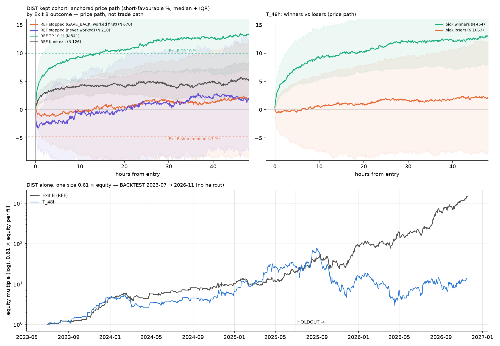

# DIST_EXIT — can a different exit beat Exit B on DISTRIBUTION_SHORT? (2026-11-18, BACKTEST)

**Verdict: keep Exit B.** No exit in the 54-cell family beats it.
- On DESIGN, only one cell survived the pre-registered selection: **T_48h** (ATR stop, no TP, exit after 48 h).
- On HOLDOUT (read once), T_48h lost badly: **+0.23 %/trade vs Exit B +0.88** (paired Δ −0.73, CI −1.18 … −0.19).
- Over the full span, **every** profit-taking exit (fixed TP, break-even, lock, trail, shorter time exit) is **below** Exit B. The family-wise null is not even close (best observed t = 0.0 vs the 2.68 bar).
- The "give-back" is real, but it is the price of the tail. Every rule that rescues the GAVE_BACK losers cuts more from the 10 % TP winners than it saves.
- On **random entries** in the same coins and days, the same small-TP exits *help*. On DIST they *hurt*. So the effect is **entry-specific**: DIST's edge lives in the big move, and Exit B is matched to it.

Pre-registration: `reports/DIST_EXIT_2026-11-18_PREREG.md` (frozen 22:27 UTC, before any sim). Survivor list frozen 22:39 UTC (`reports/DIST_EXIT_data/survivors.json`) before HOLDOUT was read.
Scripts: `scripts/dist_exit_fetch.py` → `dist_exit_rnd.py` → `dist_exit_sim.py` → `dist_exit_eval.py --phase design` → `--phase holdout` → `dist_exit_extras.py`.
Trades: `reports/DIST_EXIT_2026-11-18_trades.csv.gz` (REF + T_48h, every fill). Chart: `reports/DIST_EXIT_2026-11-18.png`. Data: `reports/DIST_EXIT_data/`.
Everything here is **BACKTEST**. Any projected Δ takes a 30–50 % in-sample haircut (moot here: no Δ is positive).

---

## 1. Question
DIST loses mainly on the exit side: 43 % of trades reach about +3 % our way, then hit the stop, and the 10 % TP fills on only about a third. Can a different exit, priced with live costs, do better than Exit B?

## 2. Method
- **Entries are frozen.** No entry search.
  - **PRIMARY `DIST`** = the DL 586 cohort: L1 rows with RSI1h ≥ 74.07 (`rows.pkl`, `keep_mask`), one position per pair re-run per exit cell.
  - **SECONDARY `L1`** = the full L1 trigger (direction check only).
  - **CONTROL `RND`** = 3 random 15m-close bars per DIST candidate, same pair, same UTC day (4,824 trades).
- **Exit engine** = the NOSPOT_EXIT engine (`scripts/nospot_exit_sim.py` logic), reused so the two studies match. One extension: an ATR-stop / ATR-TP flag per cell.
- **Realism:**
  - 1m paths for 100 % of DIST / L1 trades (4,933 of 4,935 on 1m; 2 fall back to 5m), 99.9 % of RND.
  - Same-bar ordering is pessimistic: the stop is checked first on the HIGH, then the TP on the LOW.
  - The TP is a resting maker order. It fills only when a 1m low trades ≥ 1 tick through it (fee 0.02 %, no slip).
  - Every stop, break-even, lock, trail and time exit is a market order: 0.05 % fee + slip = max(0.10 %, −0.042 + 0.276 · √(6,100 ÷ q5)). The 0.10 % floor binds on almost every DIST trade.
  - Stops are gap-aware: they fill at max(stop, bar open).
  - Real funding at every settlement (hourly where Binance switched the coin).
- **Family (54 selectable cells + REF):**
  - A. Fixed TP {1, 1.5, 2, 3, 5, 10} % × SL {2, 3, 4, 6 %, ATR} (30 cells).
  - B. Break-even after +{2, 3, 4} % (3).
  - C. Profit locks +3→+1, +4→+2, +5→+3 (3).
  - D. Trail: arm {2, 3, 4} % × giveback {1, 1.5, 2, 3} %, plus arm 3 % × {1, 2} × ATR (14).
  - T. Time exit {4, 12, 24, 48} h, ATR stop, no TP (4).
  - B, C and D are Exit B plus one mechanism. Trades that never reach the arm must show Δ = 0 vs Exit B. **Asserted, and it holds on all 20 mechanism cells** (max |Δ| = 0.000 on 394–718 never-armed fills each).
- **Split:** DESIGN 2023-07 → 2025-06 (559 REF fills). HOLDOUT 2025-07 → 2026-11 (988 REF fills), read once.
- **Selection on DESIGN:** N ≥ 30 · avg above REF · paired Δ > 0 · ≥ 2/3 of half-years with Δ > 0 · ≥ 2/3 of grid neighbours with Δ > 0.
- **Paired Δ** = cell − REF on the same entries (REF's one-position set). Day-block bootstrap, 10-day blocks.

## 3. The reference: Exit B on 1m

Exit B = TP min(20 × ATR15, 10 %) resting maker / SL min(1.5 × ATR15, 6 %) / 24 h. On this cohort the median stop is **4.7 %** (higher ATR than L1's 3.7 %).

| block | N | trades/day | WR | avg %/trade | avg win | avg loss | exit mix TP / stop / time | DCR @0.61 %/day | max DD | worst day |
|---|---|---|---|---|---|---|---|---|---|---|
| DESIGN | 559 | 0.77 | 42.0 % | **+1.03** | +8.13 | −4.13 | 30 / 57 / 13 % | 0.41 | −34.5 % | −19.2 % |
| HOLDOUT | 988 | 1.96 | 42.7 % | **+0.88** | +9.11 | −5.26 | 38 / 57 / 5 % | 0.85 | −54.9 % | −21.8 % |
| FULL | 1,547 | 1.25 | 42.5 % | **+0.93** | +8.76 | −4.85 | 35 / 57 / 8 % | 0.59 | −54.9 % | −21.8 % |

**Parity with DIST_WL (5m, flat 0.10 % slip):** 1,548 · +0.90 (DESIGN +1.02, HOLDOUT +0.83). The 1m engine reproduces it within 0.05 %. Before the 1m download, the engine's 5m fallback reproduced DIST_WL's 5m trades exactly on a test pair (same r and exit kind on all 17 fills).

Per half-year (REF avg %/trade): 23-H2 +2.71 · 24-H1 +0.62 · 24-H2 +0.63 · 25-H1 +0.76 · 25-H2 +0.71 · 26-H1 +0.55 · 26-H2 +1.63. **7 of 7 positive.**

## 4. DESIGN grid (PRIMARY cohort, read before HOLDOUT)

"Δ" = paired Δ vs REF on the same entries, % per trade. Selected rows; the full grid is in `reports/DIST_EXIT_data/design_grid.csv`.

| cell | N | WR | avg | Δ | halves Δ>0 | plateau | TP / stop / dyn / time % | DCR @0.61 | max DD |
|---|---|---|---|---|---|---|---|---|---|
| **REF Exit B** | 559 | 42.0 | **+1.03** | 0 | — | — | 30 / 57 / 0 / 13 | 0.41 | −34.5 |
| A TP1 SL ATR | 588 | 84.4 | +0.09 | −0.95 | 0/4 | 0/3 | 84 / 16 / 0 / 0 | 0.04 | −14.6 |
| A TP2 SL ATR | 587 | 72.2 | +0.24 | −0.82 | 0/4 | 0/4 | 72 / 28 / 0 / 0 | 0.11 | −17.8 |
| A TP3 SL ATR | 585 | 62.4 | +0.26 | −0.82 | 0/4 | 0/4 | 62 / 38 / 0 / 0 | 0.11 | −33.9 |
| A TP5 SL ATR | 573 | 52.0 | +0.52 | −0.55 | 0/4 | 0/4 | 51 / 48 / 0 / 1 | 0.22 | −32.9 |
| A TP10 SL4 | 559 | 42.8 | +0.96 | −0.09 | 1/4 | 0/3 | 29 / 56 / 0 / 15 | 0.38 | −35.4 |
| A TP10 SL6 | 555 | 49.7 | +0.80 | −0.24 | 1/4 | 0/2 | 33 / 48 / 0 / 19 | 0.29 | −46.1 |
| B BE after +2 % | 566 | 66.8 | +0.66 | −0.37 | 1/4 | 0/1 | 16 / 28 / 52 / 4 | 0.28 | −23.3 |
| B BE after +3 % | 563 | 56.7 | +0.72 | −0.29 | 0/4 | 0/2 | 21 / 38 / 36 / 6 | 0.29 | −30.4 |
| B BE after +4 % | 561 | 50.3 | +0.77 | −0.25 | 0/4 | 0/1 | 24 / 44 / 26 / 6 | 0.31 | −31.6 |
| C lock +3→+1 | 565 | 60.9 | +0.53 | −0.47 | 0/4 | 0/1 | 16 / 38 / 41 / 4 | 0.22 | −25.5 |
| C lock +5→+3 | 563 | 51.7 | +0.40 | −0.65 | 0/4 | 0/1 | 13 / 48 / 36 / 3 | 0.15 | −37.9 |
| D trail arm 3 / 1.5 % | 579 | 62.0 | +0.22 | −0.84 | 0/4 | 0/4 | 1 / 38 / 61 / 0 | 0.09 | −46.0 |
| D trail arm 4 / 3 % | 566 | 55.5 | +0.16 | −0.89 | 0/4 | 0/2 | 6 / 44 / 50 / 0 | 0.05 | −49.3 |
| D trail arm 3 / 2 × ATR | 565 | 46.0 | +0.52 | −0.53 | 0/4 | 0/1 | 18 / 39 / 42 / 1 | 0.20 | −30.3 |
| T 4 h | 551 | 46.1 | +0.68 | −0.19 | 1/4 | 1/1 | 0 / 49 / 0 / 51 | 0.26 | −40.0 |
| T 12 h | 551 | 41.9 | +1.12 | +0.28 | 2/4 | 1/2 | 0 / 57 / 0 / 43 | 0.43 | −47.2 |
| T 24 h | 551 | 37.9 | +1.12 | +0.32 | 2/4 | 2/2 | 0 / 61 / 0 / 39 | 0.40 | −52.8 |
| **T 48 h (only survivor)** | 551 | 34.1 | **+1.33** | **+0.46** | 3/4 | 1/1 | 0 / 65 / 0 / 35 | 0.47 | −51.6 |

- **The plateau is one-sided.** Every TP, break-even, lock and trail cell is below Exit B on DESIGN, in every family and at every grid point. The only cells above it are the ones that take *less* profit: no TP and a longer hold (T 12 / 24 / 48 h).
- A TP10 SL ATR is Exit B itself (the 20 × ATR TP is below 10 % on only 0.4 % of trades), so its Δ is 0.
- **Survivor: T_48h only.** It went to HOLDOUT alone.

## 5. HOLDOUT: the survivor fails (read once)

| ship-bar item | T_48h | pass? |
|---|---|---|
| 1. paired Δ vs REF, day-block 95 % CI excludes 0 | **−0.73** (CI −1.18 … −0.19): significantly *worse* | ✗ |
| 2. ≥ 2/3 of half-years with Δ > 0 | 3 / 7 (23-H2 +0.50, 24-H1 −0.54, 24-H2 +0.24, 25-H1 +1.42, 25-H2 −0.69, 26-H1 −0.71, 26-H2 −0.83) | ✗ |
| 3. holds at 0.20 % slip (avg > 0 and Δ > 0) | avg +0.03, Δ −0.76 | ✗ |
| 4. best-5 %-out avg > 0 | −1.41 (REF +0.40) | ✗ |
| 5. Kelly at the Wilson floor > 0, per trade and per day | −0.016 / −0.032 (REF +0.056 / +0.034) | ✗ |
| 6. family-wise null p < 0.05 | t = −1.40 vs 95 % bar 2.68; p = 1.0 | ✗ |
| 7. no pair / day ≥ 50 % of Δ | not applicable: Δ is negative and broad (leave-one-pair-out worst −0.84) | — |
| 8. joint add and one-size DCR | joint DCR 1.33 vs 1.69 %/day, max DD −82 % vs −65 %; DIST alone HOLDOUT DCR −0.18 vs +0.85 %/day | ✗ |

**→ keep Exit B.** T_48h fails 7 of 8 items. Its DESIGN gain was the 2024-25 run: it lived in 25-H1 (+1.42) and 23-H2. On HOLDOUT, holding past 24 h with no TP turns 10 % winners into round trips.

HOLDOUT for every cell (descriptive only, read after the decision): **no cell has Δ > 0.** The closest are A TP10 SL6 (−0.03), D trail 3 / 2 × ATR (−0.16), A TP5 SL ATR (−0.21), C lock +5→+3 (−0.25). Every small-TP cell is −0.6 to −0.95.

| HOLDOUT (descriptive) | N | WR | avg | Δ | DCR @0.61 | max DD | worst day | Kelly / day |
|---|---|---|---|---|---|---|---|---|
| **REF Exit B** | 988 | 42.7 | **+0.88** | 0 | **0.85** | −54.9 | −21.8 | +0.034 |
| A TP10 SL6 | 985 | 46.7 | +0.85 | −0.03 | 0.79 | −54.0 | −23.0 | +0.027 |
| D trail 3 / 2 × ATR | 993 | 42.0 | +0.71 | −0.16 | 0.71 | −42.8 | −15.0 | +0.037 |
| A TP5 SL ATR | 1,009 | 58.2 | +0.63 | −0.21 | 0.69 | −26.9 | −14.1 | +0.048 |
| C lock +5→+3 | 997 | 58.1 | +0.61 | −0.25 | 0.63 | −33.9 | −13.8 | +0.046 |
| B BE after +4 % | 993 | 58.0 | +0.55 | −0.31 | 0.53 | −44.8 | −23.0 | +0.046 |
| A TP3 SL ATR | 1,017 | 70.2 | +0.46 | −0.40 | 0.52 | −20.8 | −11.0 | +0.057 |
| D trail 3 / 1.5 % | 1,014 | 68.7 | +0.39 | −0.48 | 0.42 | −24.5 | −9.9 | +0.034 |
| A TP1 SL ATR | 1,020 | 87.2 | +0.08 | −0.78 | 0.08 | −24.0 | −9.0 | −0.110 |
| T 48 h | 966 | 27.5 | +0.23 | −0.73 | −0.18 | −96.3 | −24.5 | −0.032 |

One side note, not a decision: the smaller TPs (3–5 %) cut max DD from −55 % to about −21 … −27 % and halve the worst day. They do it by giving up about half the edge. At a smaller size, Exit B gets the same drawdown cut and keeps the edge (DIST_WL §12).

## 6. The family-wise null
- White reality check over all 54 cells, full span: day-block (10-day) bootstrap of the paired-Δ matrix, re-centred, 2,000 draws, statistic = max studentised mean Δ.
- **95 % bar = t 2.68.** The best observed t is **0.00** (A TP10 SL ATR, which is Exit B). Every other cell has a **negative** full-span t, from −1.3 (A TP10 SL6) to −5.3 (A TP1 SL2).
- Nothing comes close. There is no data-mining question to answer: the whole family is below the reference.

## 7. The control: is this a pure exit effect, or entry-specific?

Paired Δ vs Exit B, % per trade. RND = random 15m entries in the same coin and day.

| cell | DIST DESIGN | DIST HOLDOUT | L1 DESIGN | L1 HOLDOUT | RND DESIGN | RND HOLDOUT |
|---|---|---|---|---|---|---|
| REF Exit B (avg) | +1.03 | +0.88 | +0.38 | +0.26 | **−0.40** | **−0.84** |
| A TP1 SL ATR | −0.95 | −0.78 | −0.39 | −0.32 | **+0.21** | **+0.56** |
| A TP2 SL ATR | −0.82 | −0.64 | −0.29 | −0.20 | +0.15 | +0.41 |
| A TP3 SL ATR | −0.82 | −0.40 | −0.26 | −0.10 | +0.10 | +0.33 |
| A TP5 SL ATR | −0.55 | −0.21 | −0.18 | −0.07 | +0.08 | +0.21 |
| B BE after +3 % | −0.29 | −0.40 | −0.10 | −0.16 | −0.07 | +0.09 |
| C lock +3→+1 | −0.47 | −0.42 | −0.20 | −0.20 | −0.02 | +0.14 |
| D trail 3 / 1.5 % | −0.84 | −0.48 | −0.35 | −0.18 | +0.02 | +0.24 |
| T 48 h | +0.46 | −0.73 | −0.05 | −0.15 | +0.07 | −0.44 |

- **The sign flips between DIST and random entries.** On random entries Exit B loses (−0.40 / −0.84), and a quick TP limits the damage (+0.2 to +0.56). On DIST the same TP costs −0.6 to −0.95.
- So this is **not** a generic "lock profits" effect. DIST's edge is the large follow-through after a distribution candle (CAPTURED trades average +9.2 %). Exit B keeps that tail. Any early exit sells it.
- L1 (no RSI cut) points the same way as DIST, only weaker. Not one locking cell is positive on L1 on both blocks.

## 8. Saved vs deeper (on the trades Exit B actually stopped)

On REF's own entries, full span (1,547). Σ = summed % points per trade (× 0.61 for equity points). "Saved" = cell beats REF by > 0.05 %; "deeper" = worse.

| cell | GAVE_BACK (REF stopped after +1 %): saved · Σ | never-worked stops: Δ | REF TP 10 % winners: cut short · Σ | REF time exits: net Σ | net Σ |
|---|---|---|---|---|---|
| B BE after +2 % | 498 of 670 · **+2,506** | 0 (210 same) | 303 of 541 · **−2,933** | −341 | **−768** |
| B BE after +3 % | 376 · +1,954 | 0 | 233 · −2,251 | −262 | −559 |
| B BE after +4 % | 269 · +1,430 | 0 | 173 · −1,672 | −205 | −446 |
| C lock +3→+1 | 376 · +2,206 | 0 | 289 · −2,597 | −282 | −673 |
| C lock +5→+3 | 205 · +1,645 | 0 | 300 · −2,114 | −134 | −603 |
| D trail 3 / 1.5 % | 376 · +2,753 | 0 | 510 · −3,514 | −184 | −945 |
| D trail 3 / 2 × ATR | 344 · +1,268 | 0 | 169 · −1,497 | −222 | −451 |
| A TP3 SL ATR | 374 · +3,024 | 0 | 541 · −3,718 | −158 | −852 |
| A TP5 SL ATR | 203 · +2,090 | 0 | 541 · −2,648 | +50 | −508 |
| T 48 h (no TP) | 0 (same stop) | 0 | 277 better / 261 worse · −477 | +16 | −462 |

- Every rescue works as designed on the GAVE_BACK trades. A break-even at +2 % turns 498 of 670 give-backs into ≈ 0.
- **But the same rule fires on the winners first.** 4 to 6 in 10 of the eventual 10 % TP winners dip back through a +3 / +2 % break-even on the way down (233 and 303 of 541), and are stopped out flat. A 1.5 % trail cuts 510 of them. Each one costs about 10 %, while each rescued give-back saves about 5 %.
- Trades that never reached the arm show Δ = 0 exactly (asserted). Never-worked stops are untouched by every mechanism, as they should be.
- HOLDOUT shows the same split (B BE +3 %: +1,478 saved vs −1,754 cut −120 time; D trail 3 / 1.5: +2,031 vs −2,403).

## 9. Path decomposition before → after (full span, kept fills)

| group | REF Exit B: N · share · avg · eq-pts @0.61 | T_48h: N · share · avg · eq-pts |
|---|---|---|
| NEVER_WORKED | 95 · 6.1 % · −4.26 · −247 | 93 · 6.1 % · −4.23 · −240 |
| STOPPED_RECOVERED | 115 · 7.4 % · −4.81 · −337 | 114 · 7.5 % · −4.80 · −334 |
| **GAVE_BACK** | **680 · 44.0 % · −4.94 · −2,047** (median reach +3.3 %) | 856 · 56.4 % · −5.14 · −2,683 |
| DRIFT_LOSS | 0 | 0 |
| LEFT_ON_TABLE | 102 · 6.6 % · +6.54 · +407 | 97 · 6.4 % · +5.64 · +334 |
| CAPTURED | 555 · 35.9 % · +9.17 · +3,104 | 357 · 23.5 % · +16.09 · +3,505 |

- Exit side (GAVE_BACK, −2,047) is still 3.5 × the entry side (NEVER + RECOVERED, −584) under Exit B.
- But section 8 shows the GAVE_BACK loss cannot be bought back by an exit rule without paying more on the winners. It is the cost of holding for +10 %.
- T_48h makes it worse: more trades reach +3 % and then give it back (56 %).

## 10. Per period and regime (paired Δ, REF's entries)

| | REF avg | T_48h Δ | B BE +3 % Δ | D trail 3 / 2 × ATR Δ | A TP5 SL ATR Δ | A TP10 SL6 Δ |
|---|---|---|---|---|---|---|
| 23-H2 | +2.71 | +0.50 | −0.69 | −1.20 | −1.10 | −0.64 |
| 24-H1 | +0.62 | −0.54 | −0.07 | −0.53 | −0.22 | −0.13 |
| 24-H2 | +0.63 | +0.24 | −0.41 | −0.49 | −0.65 | +0.06 |
| 25-H1 | +0.76 | +1.42 | −0.16 | −0.19 | −0.43 | −0.35 |
| 25-H2 | +0.71 | −0.69 | −0.14 | −0.06 | −0.04 | +0.03 |
| 26-H1 | +0.55 | −0.71 | −0.36 | +0.02 | −0.11 | +0.02 |
| 26-H2 | +1.63 | −0.83 | −0.96 | −0.59 | −0.66 | −0.18 |
| HOLDOUT · BTC daily bull (EMA50 > 200), N 456 | +0.54 | −0.52 | −0.08 | +0.09 | +0.07 | +0.02 |
| HOLDOUT · BTC daily bear, N 531 | +1.15 | −0.88 | −0.67 | −0.37 | −0.43 | −0.06 |
| HOLDOUT · BTC 5m bull label, N 280 | +0.80 | −1.10 | −0.09 | +0.10 | −0.22 | −0.02 |
| HOLDOUT · BTC 5m bear label, N 226 | +1.33 | −0.28 | −1.09 | −0.46 | −0.26 | −0.11 |
| HOLDOUT · BTC 5m chop label, N 481 | +0.69 | −0.69 | −0.26 | −0.17 | −0.16 | +0.01 |

- DESIGN has only 1 BTC-daily-bear trade, so the daily regime can only be read on HOLDOUT. The 5m label is categorical (bull / bear / chop), so "sign granularity" here means those three groups (a disclosed deviation from the PREREG wording).
- **Exit B works in both daily regimes and is strongest in BTC bear (+1.15).**
- In BTC-daily-bull HOLDOUT, a trail / TP5 sits about +0.07 to +0.09 above Exit B. That is one regime, one block, in window units a handful of market phases, and far below any gate. It is not a candidate; at most a line to glance at if the bull leg's DIST avg keeps falling.

## 11. Slip, Kelly and size

| | REF Exit B | T_48h |
|---|---|---|
| HOLDOUT avg, model slip (≈ 0.10 % floor) | +0.88 | +0.23 |
| HOLDOUT avg, flat 0.20 % per taker leg | +0.72 | +0.03 |
| 2 × slip on dynamic exits (B / C / D only) | n/a (no dynamic exits) | n/a. For B / C / D it costs −0.04 to −0.08 more |
| Kelly per trade at the Wilson floor (HOLDOUT) | +0.056 → 1.07 × equity notional | −0.016 |
| Kelly per day at the Wilson floor (HOLDOUT) | +0.034 → 0.65 × | −0.032 |
| Kelly per day (full span) | +0.060 → 1.23 × | +0.008 |

- Exit B holds at 0.20 % slip (+0.72). Its fills are mostly maker TPs or 4.7 % stops, so slip is a small share of the trade.
- Sizing is not this study's question. DIST_WL's haircut and clustering reasoning still applies: 0.61 × equity sits at or above half-Kelly before the in-sample haircut on the RSI cut, and max DD at 0.61 is −55 % on HOLDOUT.

## 12. Clustering (squeeze days, full span, at 0.61)

| | stops per active day: mean · p99 · max | 10 worst days: avg day · stops per day | worst day |
|---|---|---|---|
| REF Exit B | 1.69 · 5 · 8 | −17.2 % · 5.4 | −21.8 % (2026-05-03) |
| T_48h | 1.83 · 6 · 8 | −21.1 % · 6.1 | −24.5 % (2026-04-18) |

The bad days are squeeze days with 5–8 stops at once. No exit in the family changes that, because none of them touches the initial stop. Only size or the entry can.

## 13. Joint book (scripts/joint_short_sim.py, one account, 0.609 × equity per fill, flat 0.10 % slip)

| book | trades/day | DCR %/day (full) | DCR %/day (HOLDOUT window) | max DD | worst day | DIST fills taken |
|---|---|---|---|---|---|---|
| EXH + FB + L4 (no DIST) | 4.05 | 1.20 | 2.13 | −63.7 % | −42.3 % | 0 |
| + DIST Exit B (5m, as JOINT_SIM) | 4.99 | 1.66 | 2.84 | −64.6 % | −42.1 % | 1,374 |
| + DIST Exit B (1m, this study) | 4.99 | **1.69** | **2.90** | −64.6 % | −42.1 % | 1,374 |
| + DIST T_48h (1m) | 4.86 | 1.33 | 1.91 | −82.0 % | −42.1 % | 1,325 |

- DIST on Exit B adds about +0.5 %/day to the book (in-sample, uncapped, before haircut) at almost no extra drawdown.
- T_48h would take back most of that and deepen the drawdown by 17 points.
- These DCRs compound at 0.609 × equity per fill with no capacity cap. They are backtest ceilings, not forecasts. See JOINT_SIM for the depth-capped paths.

## 14. Concentration
- Exit B is not concentrated on this cohort: DIST_WL measured top pair 9 % and top day 7 % of HOLDOUT profit.
- T_48h's HOLDOUT loss is broad: dropping its single most damaging pair (TACUSDT) still leaves Δ −0.84.
- T_48h's DESIGN gain *was* concentrated: HIPPOUSDT carried 36 % of it, and one day 32 %. That is the profile of a lucky in-sample cell.

## 15. Cross-check only: the same exits on EXHAUSTION trades
`BASELINE_TRADES_EXHAUSTION_2026-11-18.csv`, DL 582-kept rows, 1m, same engine and costs. Not decided on.

| | DESIGN N · avg · Δ | HOLDOUT N · avg · Δ |
|---|---|---|
| Exit B (EXHAUSTION's own live exit) | 1,349 · +0.59 · 0 | 2,019 · +0.74 · 0 |
| T_48h | 1,344 · +0.13 · −0.46 | 2,002 · +0.97 · +0.21 |

- T_48h flips sign between blocks on EXHAUSTION too: no support.
- Parity: the recorded 5m net (no slip) is +0.65 on all 3,998 trades; the 1m engine with model slip gives +0.48, which matches once the 2 × ≈0.10 % slip is subtracted.

## 16. Chart

- **Top left:** the anchored price path of the kept DIST fills, split by how Exit B ended them, with the Exit B TP (10 %) and median stop (4.7 %) drawn in.
  - TP winners keep falling to about +13 % by 48 h.
  - The GAVE_BACK group pops early and then drifts back to about 0 and the stop. Its median path is near zero for the first 10 h, so a +2–3 % arm is touched only briefly.
- **Top right:** T_48h winners vs losers. Losers are flat-to-positive on average, but the 25th percentile goes to the stop.
- **Bottom:** DIST alone at 0.61 × equity, one size. Exit B (grey) vs T_48h (blue). They track each other on DESIGN; T_48h breaks down after 2025-07.
- These are price paths, not trade paths. They run past each trade's exit.

## 17. Verdict
- **Keep Exit B** (TP min(20 × ATR15, 10 %) resting maker, SL min(1.5 × ATR15, 6 %), 24 h). No change is proposed.
- **Why:**
  1. DESIGN: 51 of 54 cells are below Exit B. The three above it are time exits with no TP (12 / 24 / 48 h); only T_48h passed every selection step, and it fails 7 of 8 HOLDOUT items with a significantly negative Δ.
  2. HOLDOUT (descriptive): no cell beats Exit B. The family-wise null's best t is 0.0 against a 2.68 bar.
  3. The give-back cannot be fixed at the exit. Every rescue rule stops out more 10 % winners than it saves 5 % losers (section 8).
  4. The control shows the effect is entry-specific. Quick profit-taking helps random entries and hurts DIST, whose edge is the tail.
- **What this means for the open DIST questions:**
  - The remaining levers are the **entry** (avoiding the trades that give back, e.g. the observe lines from DIST_WL) and **size** (DIST_WL's 0.10–0.20 × equity).
  - The drawdown and the worst day (−55 % / −22 % at 0.61) come from squeeze days with 5–8 stops. No exit in this family touches the initial stop, so none can fix that.
- Nothing here is a ship or arm. No haircut is needed because no Δ is positive. Everything is BACKTEST.
- Blind spots:
  - Partial exits were excluded (operator).
  - Stops wider than 6 % with the 10 % TP were only tested as fixed SL 6 %.
  - Depth / capacity is not modelled beyond the slip floor (DIST trades are thin coins; see JOINT_SIM's capped paths).
  - The RND control uses Exit B's ATR on random bars, so it shares the ATR-scaled stop, not the entry signal.
