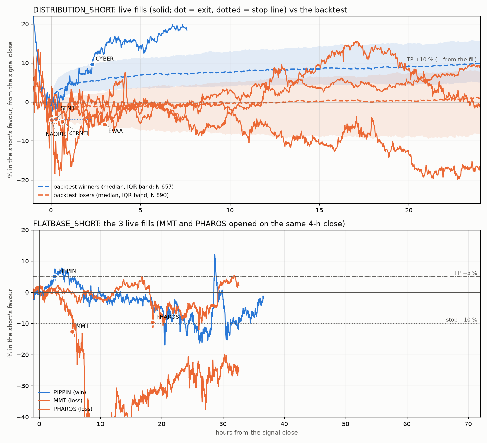

# DIST_FB_LOSERS: why the DISTRIBUTION and FLATBASE shorts lost in this batch (2026-11-20)

Research only. No bot code, config, UI or test file was changed. Nothing committed.
Batch: `exports_archive/scalpars_orders_paper_2026-11-20_16-01-39.csv` (paper, fills 11-18 08:30 → 11-20 15:45 UTC, CLOSED, no probes).

## Summary

| sleeve | batch | what killed the losers | entry | exit | size | slippage | funding | market window | verdict |
|---|---|---|---|---|---|---|---|---|---|
| **DISTRIBUTION_SHORT** | 5 fills · 1 W / 4 L · avg −2.18 % · −$708 | **Short squeezes.** Each of the 4 losers was hit by a fresh leg up that ran 12–21 % past the stop. 3 of 4 first went +2.4 to +4.6 % our way, then reversed (GAVE_BACK). NAORIS never worked (stopped in 2.4 min). | Signal fine by every test we have. No entry variable splits winners from losers (13 mapped variables, AUC 0.43–0.57, none consistent). | Not the cause. A wider stop fails: the squeezes ran past 8–20 %. On 1,547 backtest fills no stop width beats Exit B. A tighter stop is clearly worse. | 0.61 × equity per trade, so each stop cost ≈ 2.5–3.5 % of the account. Sizing is already flagged for review (DIST_WL: Kelly supports ≈ 0.10–0.20). | Entry drift 0.45–0.76 % on 3 of 4 losers (fills 17–27 s after the close; the backtest assumes 0.10 %). ≈ $100 in total. Did not cause any stop. | ≈ 0 | 4 losers on 4 separate windows over 2 days. Not one market event. BTC daily was in a bear trend, where the backtest DIST does *better* (+1.15 vs +0.54). | **Bad luck at N = 5.** No change. The backtest gives a batch this bad 1 time in 5 or 6. Keep the watch lines; the first real read is the frozen 30-fill gate. |
| **FLATBASE_SHORT** | 3 fills · 1 W / 2 L · avg −4.95 % · −$622 | **Second pumps.** MMT ran +62 % after the stop (a late, 174 % runner). PHAROS came within 0.09 % of its TP, then a new Frenzy pump (11-20 02:35) took it through the stop. PHAROS reached the TP 31 h later. | Both losers worked first (+2.0 and +4.9 %). Real-fill sweep: nothing beats the shuffled null. One lead: **funding above the base rate** (PHAROS yes; MMT no). | A +15 % stop flips sign between eras (DESIGN −0.37, HOLDOUT +0.23 per trade). A +7 % stop loses. No change. FBX_RISK (+8 / −15) already tracks the wider exit. | MMT −$691 ≈ 6 % of the account in one stop (0.61 × equity × 10 %). PHAROS was cut to 35 % by the exit-side depth cap (−$245). | Paper stops filled at or better than the line. | ≈ 0 | **Both losers opened on the same 4-h close (11-19 08:00).** That is one market moment, not two. | **Bad luck, one window.** No change. Register one OBSERVE line (funding > +0.005 %). It fails the confidence leg of the expectancy bar (92 % < 95 %). |

**Bottom line.** Neither sleeve shows a fixable flaw. These losses are what a 42 %-WR / +8 / −4.5 sleeve (DIST) and a 74 %-WR / +5 / −10 sleeve (FLATBASE) are expected to produce in a short run. The real lever is **size per stop**, which is already an open item, not a new filter or exit.

---

## 1. Question
"Study the DIST and FLATBASE losers in detail." Why did 4 of 5 DISTRIBUTION shorts and 2 of 3 FLATBASE shorts lose? Was it the entry, the exit, the size, costs, or one market moment? Is there anything to change?

## 2. Theory first (what *should* make these shorts lose)
**DISTRIBUTION_SHORT** shorts a Frenzy coin on a heavy red 15m candle while top traders cut longs and the 1h RSI is still high. The bet: large holders are unloading into late buyers. It fails when:
- **(a) Fresh buyers.** The red candle is a pause inside a live pump. A new leg (often a short squeeze) runs the stop. Expect: early in the episode, strong 1h trend, crowded shorts (very negative funding).
- **(b) Weak exit.** Top traders barely cut (the 4 h change sits just past −0.011).
- **(c) Capitulation.** A huge candle marks the low, not the top (extreme volume multiple).
- **(d) Thin coin.** Sellers run out quickly and the book is easy to push back up.
- **(e) Cost / timing.** A late fill gives away part of the move.

**FLATBASE_SHORT** shorts a coin that pumped off a flat 14-day base, after the pump fails (a 4-h close below the spike VWAP, then a confirm). The bet: the coin drifts back toward its dead base. It fails when:
- **(a) Second pump.** Operators or new buyers pump it again.
- **(b) Near the base.** No room left to fall. This is already filtered by NEAR_BASE.
- **(c) Still crowded long.** Positive funding means longs are still paying to hold, so demand is still there.
- **(d) Late or stale.** The signal comes long after the spike.

What separates them would be visible at entry only for (b)–(d) and FB (b)–(d). A pure "second leg" (DIST a, FB a) is mostly **not** visible at entry. That is why earlier studies found little.

## 3. Method
- **Case files.** Every current-batch DIST / FB fill (losers and winners) is read on its own 1m path (data.binance.vision daily zips; fapi only for today, peak used weight 190 of 1,200).
  - We record the signal close → fill (lag, drift), the stop / TP lines, MFE / MAE, time to stop and booked vs stop-line slip.
  - We record funding, capacity stamps, where price went after the stop (did it reach the TP within the hold?), the coin's prior move, BTC over the same minutes, and other bot fills in the same window.
  - Each path also gets descriptive stop-width what-ifs.
- **Path labels:** `scripts/path_labels.py` (DL 406).
- **Cohorts, each sleeve on its own:**
  - **DIST real** = 5 fills. The master has 0 DIST fills, and `sweep_separators.py` refuses fewer than 6.
  - **DIST backtest** = the 1,547 DL 586 fills (ENTRY_WL / DIST_EXIT cohort: Exit B on 1m, model slip ≥ 0.10 %, real funding). DESIGN < 2025-07 ≤ HOLDOUT.
  - **FB real** = 28 master fills kept on today's stack + 3 batch fills = 31.
  - **FB backtest** = the OOS_REAL_FLATBASE rebuild kept by NEAR_BASE = 614 trades (today's exit, real funding).
- **W/L.**
  - *Not redone:* the exhaustive backtest screens with nulls already exist. They are cited (ENTRY_WL_2026-11-18 for DIST: 193 variables, family-wise null; WL_DEEP_FLATBASE_2026-11-17: 45 variables, 5 periods).
  - *Here:* every real-stamped variable that maps onto a backtest column, on the ENTRY label (WORKED) and on booked net; where each live fill sits; BTC daily regime at sign granularity, with day units beside it.
  - *FB:* `sweep_separators.py FLATBASE_SHORT --label path / reach / pnl` plus a 200-permutation shuffled null (new script).
- **Exit side.** A stop-width counterfactual on the STOPPED cohort, two-sided (saved vs deeper), by era, with a day-block bootstrap.
  - *DIST:* a new re-walk with the DIST_EXIT engine, wider and tighter ATR stops under Exit B's TP. This was never tested before.
  - *FB:* the rebuild's existing +7 / +15 stop columns.
- **Before → after** for the leads: three blocks (backtest by era, master per batch, current batch), one-size DCR at X = 0.61 × equity, the expectancy bar, LOO, and per-pair / per-window concentration.

## 4. Case files

### 4.1 DISTRIBUTION_SHORT (Exit B: TP min(20×ATR, 10 %) maker · SL min(1.5×ATR, 6 %) · 24 h)

| | SENT | NAORIS | EVAA | **CYBER (win)** | KERNEL |
|---|---|---|---|---|---|
| signal close (UTC) | 11-19 04:15 | 11-19 09:15 | 11-19 14:30 | 11-20 09:00 | 11-20 12:30 |
| hours after the spike | 0.17 | 1.17 | 22.3 | 0.92 | 1.17 |
| prior move: 24 h / 7 d | +15 % / +39 % | +39 % / +15 % | +36 % / +362 % | +40 % / +15 % | +32 % / +16 % |
| 24 h volume | $24.6M (thin) | $25.4M (thin) | $331M | $54.8M | $54.0M |
| red candle: vol × mean · return | 29.4× · −1.38 % | 5.2× · −0.67 % | 6.2× · −2.02 % | 6.2× · −1.11 % | 5.4× · −1.70 % |
| top-trader L/S 4 h change | −0.149 | −0.040 | **−0.016** (barely past −0.011) | **−0.369** | −0.147 |
| RSI 1h | 83.6 | 89.1 | 81.1 | 90.3 | 90.4 |
| funding at entry | −0.11 % | +0.01 % | +0.05 % | **−1.49 %** | **−1.61 %** |
| fill lag · drift vs signal close (+ = cost) | 16 s · +0.51 % | 17 s · **+0.76 %** | 82 s · −0.98 % (helped) | 26 s · −0.01 % | 27 s · +0.45 % |
| book within 0.2 % (entry side) · cap | $4.3k · 98 % (shrunk) | $4.1k · 81 % (shrunk) | $21.8k · full | $13.7k · full | $6.9k · full |
| stop · TP line | 4.10 % · 10 % | 6.00 % · 10 % | 4.65 % · 10 % | 4.53 % · 10 % | 6.00 % · 10 % |
| best move our way before the exit (MFE) | +3.65 % at 2 min | +0.16 % | +4.55 % at 68 min | +10.25 % | +2.39 % at 1 min |
| minutes to exit | 15 | 2.4 | 178 | 137 (TP) | 37 |
| booked · $ | −4.41 % · −$273 | −5.97 % · −$338 | −4.38 % · −$288 | +9.95 % · +$585 | −6.11 % · −$395 |
| stop fill vs line | +0.21 % (cost) | −0.12 % | −0.28 % | maker TP | +0.02 % |
| after the stop: worst move against | +12 % | +21 % | +20 % | n/a | +19 % |
| TP reached later inside 24 h? | no (+8.1 % at 24 h) | **yes, 15 h later** | no (−15.8 % at 24 h) | n/a | not yet (24 h still open) |
| stop needed to survive to the TP (this path) | none ≤ 20 % (open +8.1 at 24 h with ≥ 15 %) | none ≤ 20 % | none ≤ 20 % | n/a | none ≤ 15 % |
| path label (DL 406) | GAVE_BACK | STOPPED_RECOVERED (never worked) | GAVE_BACK | CAPTURED | GAVE_BACK |
| BTC 4 h before · during | +0.87 % · +0.06 % | +0.50 % · +0.07 % | +0.18 % · −1.39 % | +0.50 % · −0.07 % | −0.52 % · −0.01 % |
| same window | FB PIPPIN +5.0 | — | — | HT CYBER +5.0 | HT EVAA +5.0 |

**What each case says.**
- **SENT.** Thin coin. A 29× candle (99th percentile of the backtest): theory (c), a capitulation-like flush 10 min after the spike. A +3.6 % dip was bought within 2 minutes, then a +12 % squeeze followed.
- **NAORIS.** Thin coin with a $4k book. It filled 0.76 % below the signal close (17 s lag) and never went our way. It was stopped in 2.4 minutes by a +21 % leg. Theory (a) fresh buyers, plus (d). It did fall to the TP 15 h later.
- **EVAA.** The weakest top-trader exit of the five (98th percentile = least selling): theory (b). It went +4.6 % our way over an hour, then a +20 % second leg. EVAA was in a 362 % weekly runner, and WILLY_HT longs on it won 5 times in this batch. The coin was in a strong uptrend.
- **KERNEL.** A +2.4 % dip in the first minute, then a +19 % squeeze while funding sat at −1.6 % per 4 h (shorts crowded). The EXHAUSTION sleeve shorted KERNEL again 2 h later and won +9.95 %. Same idea, too early.
- **CYBER (the winner)** had the same "fresh spike / RSI 90 / deep negative funding" profile as KERNEL. That is the core problem: the losing and the winning setups look alike at entry.

### 4.2 FLATBASE_SHORT (TP −5 % resting · stop +10 % · 72 h)

| | **PIPPIN (win)** | MMT | PHAROS |
|---|---|---|---|
| confirm close (UTC) | 11-19 04:00 | 11-19 08:00 | 11-19 08:00 (same close as MMT) |
| hours after the spike | 8.3 | **60.7** | 12.6 |
| pump size (run) · above the base · off the peak | ≈ 101 % · +58 % · −21 % | **174 %** · +90 % · −31 % | 40 % · +9 % · −22 % |
| vs spike VWAP | −1.3 % | −1.5 % | −10.2 % |
| 14-day flat range | 36.7 % | 35.2 % | 30.1 % |
| funding at entry | +0.005 % (base) | +0.003 % | **+0.011 % (above base)** |
| 24 h volume | $200M | $941M | $49M |
| exit-side book within 0.2 % · cap | $12.9k · full | $17.6k · full | **$2.3k · cut to 35 %** |
| lag · drift (+ = cost) | 15 s · −0.16 % | 18 s · +0.28 % | 19 s · +0.33 % |
| MFE before the exit | +5.44 % | +1.96 % at 3 min | **+4.91 % at 16.7 h (TP is 5.0 %)** |
| minutes to exit | 151 (TP) | 323 | 1,110 |
| booked · $ | +4.98 % · +$314 | −9.90 % · −$691 | −9.94 % · −$245 |
| stop fill vs line | maker TP | −0.17 % | −0.12 % |
| after the stop | n/a | **+62 % further against** (second pump) | new Frenzy spike on PHAROS at 02:35, 5 min after the stop; TP reached 31 h after entry |
| stop width that would have reached the TP (this path) | n/a | none ≤ 20 % | ≥ 15 % |
| path label | CAPTURED | GAVE_BACK | GAVE_BACK |
| BTC during | +0.54 % | +0.01 % | **−3.5 %** (the coin pumped against BTC) |

**What each case says.**
- **MMT** was the latest signal (61 h after the spike, 98th percentile) on the biggest pump (174 %, 98th percentile). It then had a second, larger pump. Theory (a). But in the backtest **late signals do better**, not worse (HOLDOUT late tercile +1.31 vs early +0.38), so lateness is not a usable separator.
- **PHAROS** was a near-miss. The TP missed by 0.09 % after 17 h. Then the coin re-pumped (a new Frenzy episode, idiosyncratic, as BTC fell 3.5 %). It had the highest funding of the three (94th percentile of the backtest): theory (c).
- **Both losers share one 4-h close.** In window units this batch's FB result is **1 losing window and 1 winning window.**

## 5. Winners vs losers on the cohort

### 5.1 Coverage and blind spots
- **DIST real fills:** all universal stamps plus every `entry_dist_*` stamp are present on all 5 fills. Thirteen of them map onto backtest columns and are read below.
- **DIST blind spots:** open-interest change, taker flow, spot share, premium, candle wick shape, BTC breadth, and the sleeve's own recent-stop state. These exist only in the backtest (ENTRY_WL tested all of them against a null: nothing passes). Five real fills cannot carry a W/L test of their own: they are case evidence only.
- **FB real fills (31):** `sweep_separators` tested 35–38 numeric plus 3–4 level columns.
- **FB blind spots** (below 80 % coverage, not tested): ADX set (70 %), alt beta / correlation (74 %), the book / exit-depth bands (10 %, new since 11-18), `run_pct` (87 %, tested), `peak_age_h` (68 %).
- **Window units:** DIST losers sit on 4 separate windows. FB losers sit on 1 window.

### 5.2 DIST — luck first (`wl_tables.md`)
| backtest pool | N | WR | avg | P(5-fill avg ≤ −2.18) | P(≤ 1 win in 5) |
|---|---|---|---|---|---|
| ALL 2023-07 → 2026-11 | 1,547 | 42 % | +0.93 | 17 % | 30 % |
| HOLDOUT | 988 | 43 % | +0.88 | 21 % | 29 % |
| 2026 only | 531 | 44 % | +1.02 | 21 % | 27 % |

A run this bad happens about **1 time in 5** on the sleeve's own history. 58 % of all backtest fills lose: 450 GAVE_BACK, 200 NEVER_WORKED, 183 other, out of 890 losers. Four stops in five fills is ordinary.

### 5.3 DIST — every mapped variable (backtest AUC by block; net by DESIGN tercile; live percentile, L = loser, W = winner, in the order KERNEL · CYBER · EVAA · NAORIS · SENT)
| var | AUC DESIGN | AUC HOLDOUT | AUC WORKED (HOLDOUT) | DESIGN T1 / T3 net | HOLDOUT T1 / T3 net | live percentile |
|---|---|---|---|---|---|---|
| rsi1h | 0.52 | 0.49 | 0.53 | +0.70 / +1.23 | +0.93 / +0.95 | L84 W83 L40 L79 L52 |
| top_pos_chg4h | 0.52 | 0.49 | 0.50 | +1.19 / +1.38 | +1.10 / +0.90 | L62 W33 L98 L89 L61 |
| top_pos_ls | 0.45 | 0.47 | 0.44 | +1.90 / +0.80 | +0.80 / +0.85 | L27 W55 L62 L82 L42 |
| vmult15 | 0.53 | 0.51 | 0.53 | +0.75 / +1.72 | +0.69 / +0.90 | L14 W36 L36 L9 L99 |
| bar_ret_pct | 0.48 | 0.43 | 0.45 | +1.13 / +1.02 | +1.30 / +0.48 | L70 W80 L65 L89 L76 |
| atr15_pct | 0.51 | 0.55 | 0.56 | +1.45 / +0.86 | +0.41 / +0.93 | L77 W47 L49 L83 L37 |
| di_diff1h | 0.54 | 0.50 | 0.53 | +0.51 / +1.14 | +1.19 / +0.71 | L86 W88 L16 L82 L21 |
| gap15 | 0.48 | 0.51 | 0.56 | +1.14 / +0.77 | +0.78 / +0.87 | L74 W76 L60 L85 L36 |
| hrs_since_spike | 0.52 | 0.51 | 0.49 | +1.13 / +1.67 | +1.05 / +0.75 | L58 W53 L84 L58 L6 |
| vol24 (thin coins) | 0.57 | 0.51 | 0.48 | −0.01 / +1.54 | +0.69 / +1.14 | L56 W57 L95 L16 L13 |
| q5 (book proxy) | 0.56 | 0.52 | 0.54 | +0.21 / +1.73 | +0.85 / +1.14 | L73 W84 L87 L41 L3 |
| funding | 0.50 | 0.48 | 0.46 | +0.88 / +1.04 | +1.00 / +0.83 | L1 W1 L94 L80 L11 |
| BTC 1d return | 0.50 | 0.49 | 0.54 | +1.17 / +0.99 | +1.00 / +0.81 | L12 W12 L4 L4 L4 |

- **No variable splits winners from losers in both blocks.** Every AUC is between 0.43 and 0.57. The live winner sits in the middle of the live losers on every row.
- **Thin coins** (vol24 / q5): DESIGN shows a gap (−0.01 vs +1.54), but HOLDOUT shrinks it (+0.69 vs +1.14). This is the existing ENTRY_WL observe line. The batch adds 2 thin losers (SENT, NAORIS: 0 / 2 thin vs 1 / 3 rest). That is consistent with the line but tiny.
- **Theory (a) "fresh spike", frozen DESIGN tercile ≤ 0.42 h:** fresh fills earn **more**, not less. DESIGN +1.13 vs +0.95, HOLDOUT +1.05 vs +0.83, 2026 +1.08 vs +1.01. The idea is **refuted** (as DIST_WL P9 already said).
- **Theory (b) weak top-trader exit:** AUC 0.49–0.52. No effect. EVAA's marginal value is anecdote.
- **Theory (c) capitulation candle:** the bigger the volume multiple, the better (T3 +1.72 / +0.90). SENT's 29× is not a loser marker.
- **Funding (crowded shorts):** no effect (AUC 0.46–0.50). The winner and KERNEL both sat at the 1st percentile.

### 5.4 DIST — BTC daily regime, sign granularity
| block | BTC daily | fills | days | WR | avg | day-average | WORKED |
|---|---|---|---|---|---|---|---|
| DESIGN | bull | 558 | 298 | 42 % | +1.03 | +1.02 | 84 % |
| HOLDOUT | bull | 456 | 179 | 41 % | +0.54 | +0.70 | 86 % |
| HOLDOUT | bear | 531 | 232 | 44 % | **+1.15** | **+1.18** | 89 % |

The batch traded in a BTC bear trend (4 h EMA50 ≈ 10 % below EMA200, BTC −1.7 … −2.9 % on the day). That is the regime where the backtest DIST did **best**. The regime does not explain the losses. DESIGN has only 1 bear-daily fill, so the bear row can be read only on HOLDOUT.

### 5.5 FLATBASE — luck and windows
- Backtest (614): WR 74 %, avg +0.87. P(≤ 1 win in 3 fills) **17 %**. P(3-fill avg ≤ −4.95) **14 %**.
- In the backtest, 63 four-hour windows held ≥ 2 Flatbase entries. In 4 of them, every entry was stopped. Same-window double stops happen.
- Real fills (31): 27 W / 4 L, avg +3.02. The 4 real losers: BANK 10-26, DODOX 11-13, MMT and PHAROS 11-19 (one window).

### 5.6 FLATBASE — sweep on real fills, with a shuffled null (`data/sweep_FLATBASE_*.txt`, `sweep_FLATBASE_null.txt`)
| target | fills | 1D consistent splits (null 95th pct) | best 1D strength (null p) | 2D consistent cells (null 95th) |
|---|---|---|---|---|
| ENTRY label (WORKED) | 30 | 0 (all 30 worked, so there is no contrast) | — | 0 |
| REACH | 28 | 46 (46) | p 0.75 | 103 (138) |
| booked P&L | 31 | 34 (45) | p 0.14 (funding sign) | 148 (204) |

**Nothing beats the null.** Every FB fill, losers included, went at least 1 % our way first. FB losses are always "came back" losses: this matches WL_DEEP (91 % worked first; 65 % of the loss is GAVE_BACK).

### 5.7 FLATBASE — mapped variables (backtest 614; real 31; live percentile in the order PHAROS · MMT · PIPPIN)
| var | AUC DESIGN | AUC HOLDOUT | DESIGN T1 / T3 | HOLDOUT T1 / T3 | real W median | real L median | live |
|---|---|---|---|---|---|---|---|
| hours since spike | 0.52 | 0.55 | +0.78 / +1.33 | +0.38 / +1.31 | 10.1 | 12.4 | L67 L98 W43 |
| run_pct | 0.48 | 0.53 | +0.69 / +0.22 | +0.68 / +1.06 | 40.7 | 33.5 | L57 L98 – |
| vs_vwap | 0.50 | 0.49 | +0.29 / +0.86 | +1.06 / +0.31 | −5.2 | −2.7 | L7 L79 W82 |
| off_peak_pct | 0.53 | 0.50 | +0.62 / +0.65 | +0.65 / +0.56 | −16.6 | −14.7 | L21 L10 W31 |
| peak_age_h | 0.49 | 0.53 | +1.32 / +0.42 | +0.81 / +1.93 | 6.5 | 5.9 | L5 L89 W54 |
| flat14_pct | 0.52 | 0.52 | +0.58 / +1.03 | +0.67 / +1.21 | 38.6 | 27.9 | L50 L69 W75 |
| **funding rate** | **0.43** | **0.43** | **+1.21 / −0.78** | **+1.38 / −1.47** | −0.04 % | +0.01 % | L94 L63 W64 |

Only **funding** holds the same direction in both blocks and in the real fills. Its top tercile starts exactly at +0.005 % (Binance's base rate), so the cut has a natural meaning: **longs paying more than the base = still crowded long = demand still there** (theory c).

## 6. Exit side (stopped cohort only, two-sided)

### 6.1 DIST — stop width, new re-walk (1,547 fills, DIST_EXIT engine, Exit B TP, model slip, real funding)
Parity: today's stop re-walk matches DIST_EXIT REF_B on 1,546 / 1,547 fills (1 differs by 1.8 % on a funding source). Fills that never touched today's stop show Δ = 0 under every wider stop (asserted).

| stop | block | avg / trade | WR | Δ / trade vs today | Σ Δ (day-block 95 % CI) | today's stops: saved (Σ) · deeper (Σ) |
|---|---|---|---|---|---|---|
| min(1.0×ATR, 4 %) | ALL | +0.48 | 31 % | −0.45 | −699 (−1,123 … −303) | (tighter: every fill changes) |
| min(1.25×ATR, 5 %) | ALL | +0.74 | 38 % | −0.19 | −289 (−567 … −28) | (tighter) |
| **min(1.5×ATR, 6 %) = today** | ALL | **+0.93** | 42 % | — | — | 880 stopped |
| min(2×ATR, 8 %) | DESIGN | +0.97 | 48 % | −0.05 | −29 (−170 … +107) | 34 (+340) · 285 (−369) |
| min(2×ATR, 8 %) | HOLDOUT | +1.02 | 49 % | +0.14 | +141 (−55 … +343) | 73 (+951) · 488 (−810) |
| min(2.5×ATR, 10 %) | ALL | +0.91 | 53 % | −0.02 | −31 (−348 … +310) | 174 (+2,112) · 706 (−2,143) |
| min(3×ATR, 12 %) | ALL | +0.94 | 56 % | +0.01 | +21 (−400 … +458) | 243 (+2,893) · 637 (−2,873) |

By half-year, the 2×/8 % stop's Σ Δ is −26 / +17 / −10 / −9 / +79 / +73 / −11. It is positive in 3 of 7 halves and loses in the first and the latest.
- **Verdict: keep today's stop.** Wider stops save as much as they lose. Every CI spans 0. DESIGN and HOLDOUT disagree. A wider stop also raises the $ lost per stop (≈ +33 % at 2×). Tighter stops lose with confidence.
- Already refuted, not re-run: break-even, locks, trails, small TPs and time exits (DIST_EXIT, 0 / 54), and funding-settlement exits (DIST_FUNDING_EXIT, 0 / 16).
- Live costs: wider stops are still market orders. The thin-coin live stop slip is ≈ 0.22 % median (master proxy), which only makes the wider stops worse.

### 6.2 FLATBASE — stop width (rebuild 614, NEAR_BASE-kept, today's TP −5 %)
| stop | block | avg / trade | Δ / trade | Σ Δ (day-block 95 % CI) | P(gain) | today's stops: saved · deeper |
|---|---|---|---|---|---|---|
| +7 % | DESIGN | +0.59 | −0.30 | −35 (−109 … +34) | 0.16 | — |
| +7 % | HOLDOUT | +0.47 | −0.40 | −197 (−368 … −32) | 0.01 | — |
| +15 % | DESIGN | +0.52 | **−0.37** | −43 (−102 … +16) | 0.07 | 6 (+53) · 20 (−96) |
| +15 % | HOLDOUT | +1.09 | **+0.23** | +112 (−26 … +256) | 0.94 | 39 (+507) · 79 (−395) |

- **Verdict: keep +10 %.** +7 % loses (as did −6 … −9 in DL 540's grid). +15 % flips sign between eras.
- +15 % also costs ≈ 9 % of the account per stop at 0.61 × equity.
- The +8 / −15 variant already has its own frozen gate (FBX_RISK, DL 531). In this batch MMT would be stopped at any width ≤ 20 %, and PHAROS would survive at 15 % (one each way).

## 7. Before → after (three blocks) for the leads

### 7.1 DIST "fresh spike" (≤ 0.42 h after the spike; frozen DESIGN tercile)
Refuted in §5.3. Fresh fills earn more in DESIGN, HOLDOUT and 2026. The live batch is 1 fresh fill (SENT, loss) vs 4 others (1 W). The master has no DIST block. **No line.**

### 7.2 FLATBASE "funding above the base rate" (block when entry funding > +0.005 % per settlement; threshold frozen from DESIGN, not fitted to the losers)
| block | fills | before avg · DCR/day | after avg · DCR/day | blocked N (windows) | blocked WR vs breakeven | blocked avg | P(blocked mean < 0), window bootstrap | top pair / window share of the blocked loss |
|---|---|---|---|---|---|---|---|---|
| backtest DESIGN | 117 | +0.89 · +0.14 | +1.30 · +0.18 | 23 (23) | 61 % vs 67 % | −0.78 | 70 % | 13 % / 13 % |
| backtest HOLDOUT | 497 | +0.87 · +0.43 | +1.10 · +0.53 | 46 (46) | 59 % vs 68 % | −1.47 | 91 % | 6 % / 6 % |
| backtest ALL | 614 | +0.87 · +0.31 | +1.14 · +0.38 | 69 (69) | 59 % vs 68 % | −1.24 | **92 %** (CI −3.03 … +0.51) | 5 % / 5 % |
| master B24 | 1 | +4.94 · +3.01 | same | 0 | — | — | — | — |
| master B25 | 20 | +4.19 · +2.52 | +4.15 · +2.36 | 1 (BTR, win) | — | +4.94 | — | — |
| master B26 | 5 | +1.95 · +1.86 | +4.95 · +2.99 | 2 (TAC W, DODOX L) | 50 % | −2.55 | — | 100 % |
| master B27 | 2 | +4.95 · +6.04 | same | 0 | — | — | — | — |
| batch B28 (current) | 3 | −4.95 · −4.54 | −2.46 · −1.51 | 1 (PHAROS, loss) | 0 % | −9.94 | — | 100 % |
| real ALL | 31 | +3.02 · +1.90 | +3.84 · +2.14 | 4 (2 W / 2 L) | 50 % vs 67 % | −2.53 | 69 % | 50 % |

- By half-year (backtest), blocked vs kept: 24-H2 −0.99 vs +0.93 · 25-H1 +1.38 (N 2) vs +1.49 · 25-H2 −3.78 vs +0.46 · 26-H1 +0.20 vs +0.65 · 26-H2 −0.57 vs +2.47. **Blocked is worse in 5 of 5 halves; negative in 3 of 5.**
- Real-fill LOO (Δ of blocking): +10.10 pts. Without DODOX: +0.00. **One fill carries all of it.**
- **Expectancy bar:**
  - ① WR below breakeven: ✓ (59 vs 68).
  - ② avg < 0 at ≥ 95 % (window bootstrap): ✗ (92 %; this study read 14 cuts, so a fair bar is ≈ 99.6 %).
  - ③ ≥ 8 windows, no window or pair ≥ 50 %: ✓ in the backtest; ✗ on real fills (4 fills, DODOX 50 %).
  - ④ N ≥ 15: ✓ backtest, ✗ real.
- With the 30–50 % in-sample haircut, the backtest Δ is ≈ +0.14 … +0.19 per trade over all fills (UNVERIFIED: model fills, 0.10 % slip; the real FB entry slip averaged 0.25 %).
- **Verdict: OBSERVE line, frozen** (it fails only on confidence; observe-first rule). Nothing is armed.

## 8. Chart

The chart is anchored at the signal close, and the y-axis is the % the short is ahead.
- **Top panel, DIST.** The 4 live losers (orange) dip our way at first, as the backtest losers do, then squeeze through their stop lines within 3 h. Two of them later fell far (NAORIS to +15 % our way, SENT to +8 %), too late for the 24 h trade. The winner CYBER tracks the backtest winners' band. The backtest bands show the same split: winners and losers start together and separate within the first hours.
- **Bottom panel, FB.** MMT ran +60 % against after its stop. PHAROS touched +4.9 % (TP +5 %) at hour 17, then the 11-20 02:35 pump took it through the stop. It came back to the TP at hour 31.
- There is no backtest band for FB: the rebuild did not store paths.

## 9. What it means (plain English)
- **DIST lost because these coins kept pumping.** The sleeve bets that a big red candle on a hot coin marks the end of the pump. Four times out of five this week it marked only a pause. That is how this sleeve normally loses: in the backtest, 58 % of trades lose and the winners pay for them. Five trades cannot tell us more than that. The backtest says a week like this comes about 1 time in 5.
- **No change to the DIST entry or exit is justified.** Nothing we can measure at entry told the winner (CYBER) from the losers. Earlier studies found the same with 193 variables and 1,547 trades. A wider stop would not have helped: the squeezes ran 12–21 % past the stop. A tighter stop is worse.
- **Small real costs showed up.** Fills came 16–27 s after the signal and gave away 0.45–0.76 % on 3 of the 4 losers (≈ $100 in all). The fast-entry change (DL 599) went live after all five fills, so the next batch is the first read of it.
- **FLATBASE lost two trades in one moment.** Both coins pumped a second time. PHAROS missed its target by 0.09 % before it did. Two stops on one 4-h close is a known Flatbase pattern (backtest: 4 such windows). The sleeve's real record is still 27 wins / 4 losses.
- **The one lead worth tracking is funding.** When longs still pay more than the base funding rate at entry, Flatbase shorts did worse in every half-year of the rebuild. It is not strong enough to switch on (92 % confidence vs the 95 % bar), and our real trades are only 4. Track it.
- **The real risk is size per stop.** MMT's single stop cost ≈ 6 % of the account; each DIST stop cost ≈ 2.5–3.5 %. Earlier sizing studies already say both sleeves run above their edge-based size (DIST_WL: ≈ 0.10–0.20 × equity; SIZING_EXH_FLATBASE: FLATBASE 0.30 × equity). That decision is already on the list for the pre-live sizing review. It is restated here, not re-opened.

## 10. Verdicts
- **DISTRIBUTION_SHORT:** **KEEP AS IS** (entry, exit, filter). The losses are consistent with the sleeve's history (P ≈ 17–30 %).
  - The live gates stay the judge: first ≥ 30 fills over ≥ 10 days (scout_distribution_586), the RSI1h gates, and the thin-coin observe line (+2 thin losers, now 0 / 2 thin vs 1 / 3 rest).
  - New by-hand read for the next review: `entry_order_lag_s` and drift after DL 599.
- **FLATBASE_SHORT:** **KEEP AS IS.**
  - Gate status by hand: the last 3 FB fills are W, L, L (no 3-stops-in-a-row trigger). The real record is 27 / 4.
  - **New OBSERVE line (frozen, alert-only):** `FB_FUNDING_ABOVE_BASE`: a FLATBASE fill whose `entry_funding_rate` > 0.00005 (+0.005 % per settlement).
  - *Count:* the line counts real fills from 2026-11-20 on, against the rest, under today's +5 / −10 / 72 h exit.
  - *Review:* at ≥ 15 such fills over ≥ 8 windows, judge on the expectancy bar (WR below the sleeve breakeven, window-bootstrap avg < 0 at 95 %, no window or pair ≥ 50 %).
  - *Arming:* only through the operator, as a filter with a tight revert. It is not registered in code; registering it in `observe_registry` / the scout is a separate build that needs the operator's OK.
- **Refuted here (do not re-run):**
  - DIST "fresh spike" block.
  - DIST stop width (1×–3× ATR).
  - FB stop +7 / +15 (+15 era-flipping).
  - FB "late signal" (late does better).

## 11. Blind spots
- **DIST real N = 5.** No real-fill W/L, no sweep, no master block. Everything about DIST cohorts is backtest (model costs: slip floor 0.10 %, paper fills, so real entry drift of 0.45–0.76 % is not in it).
- **The DIST stop-width study** holds the entry set fixed at today's one-position cohort. A longer hold could block a later signal on the same coin (small).
- **The FB rebuild has no stored paths** (no backtest band in the chart). Its funding is the settled rate at entry; hourly-funding coins mix 1 h and 4 h / 8 h rates in one column.
- **Paper stop fills** were at or better than the line. Live thin-coin stops will be worse (≈ 0.2 % median, more in squeezes).
- **KERNEL's and the FB fills' post-stop windows** are not complete yet (24 h / 72 h still running), so "TP reached later" may change.
- **The "second leg / squeeze"** itself is not measurable at entry with any column we stamp. Order-book and tape data from the Route B recorder (DL 597) is the first new data source that could see it. It needs ≈ 3 weeks of data.

## 12. Files
- Report: `reports/DIST_FB_LOSERS_2026-11-20.md` · chart `reports/DIST_FB_LOSERS_2026-11-20_chart.png`
- Data: `reports/DIST_FB_LOSERS_2026-11-20_data/`
  - `cases.csv`, `paths.pkl`
  - `k1m/`, `k1h/` (klines)
  - `stopwidth_dist.csv`, `stopwidth_dist_halves.csv`, `stopwidth_dist_rows.csv.gz`, `stopwidth_fb.csv`
  - `wl_tables.md`, `wl_dist_vars.csv`, `wl_fb_vars.csv`, `wl_fb_funding_beforeafter.csv`, `wl_fb_funding_above_base.csv`
  - `sweep_FLATBASE_{path,reach,pnl}.txt`, `sweep_FLATBASE_null.txt`
- Scripts (all in `scripts/`):
  - `DIST_FB_LOSERS_2026-11-20_fetch.py` (klines; vision first, weight-capped fapi)
  - `DIST_FB_LOSERS_2026-11-20_cases.py` (case files)
  - `DIST_FB_LOSERS_2026-11-20_stopwidth.py` (two-sided stop-width counterfactual)
  - `DIST_FB_LOSERS_2026-11-20_wl.py` (luck, W/L, regime, before → after)
  - `DIST_FB_LOSERS_2026-11-20_sweepnull.py` (shuffled null for `sweep_separators`)
  - `DIST_FB_LOSERS_2026-11-20_chart.py`
- Cited, not redone: DIST_WL_2026-11-18 · DIST_EXIT_2026-11-18 · ENTRY_WL_2026-11-18 · DIST_THIN_DEEPDIVE_2026-11-19 · DIST_ENTRY_TIMING_2026-11-20 · DIST_FUNDING_EXIT_2026-11-20 · FUNDING_RULE_2026-11-19 · WL_DEEP_FLATBASE_2026-11-17 · OOS_REAL_FLATBASE_2026-11-17 · VERIFY_FLATBASE_SHORT_2026-11-17 · SIZING_EXH_FLATBASE_2026-11-18 · DL 540 stop grid.
