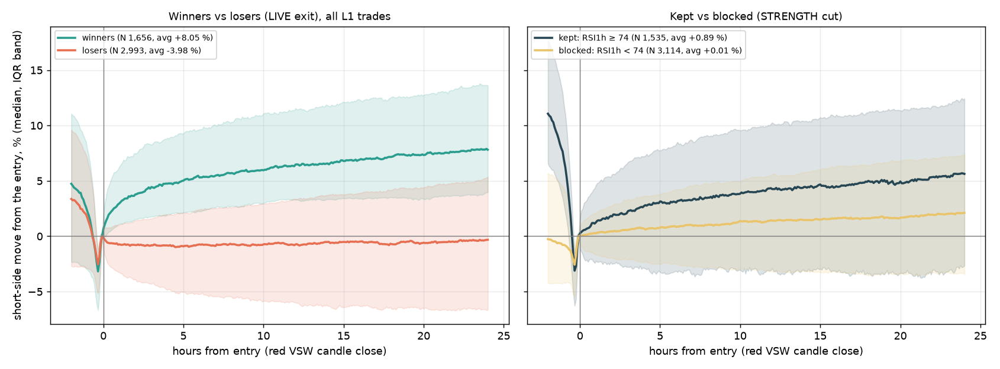

# DIST_WL — what splits winners from losers in DISTRIBUTION shorts (L1), 2026-11-18

**Verdict: OBSERVE (strong).** One factor separates winners from losers: **the coin is still strong when the red VSW candle prints.**
- The representative cut is **RSI(14) on 1h ≥ 74.07**. It keeps about 1 trade in 3.
- On HOLDOUT (read once), the kept trades made **+0.79 %/trade against the +0.26 % baseline**.
- The blocked two-thirds are at **≈ 0 %** (+0.01 % overall).
- It does **not** clear the pre-registered ship bar, for two reasons:
  1. On booked P&L, no cut anywhere beats the family-wise shuffled null. The cut passes that null only on REACH (how far price moved in our favour).
  2. The blocked side is breakeven, not provably negative, so it fails the locked filter EXPECTANCY bar.
- **What the cut buys is risk, not $.** At the same size, the daily compound is about the same, but max drawdown and the worst day fall by about half.
- **No cut of L1 justifies 0.5 × 5× (0.61 × equity per trade).**
  - The baseline's daily Kelly is about 0. It is negative on HOLDOUT.
  - The cut supports about **0.10–0.20 × equity per trade**, after the haircut and the clustering caveat.

Pre-registration: `reports/DIST_WL_2026-11-18_PREREG.md` (19:32 UTC, before any result was read).
Scripts: `scripts/dist_wl_build.py` → `dist_wl_analyze.py` → `dist_wl_survivors.py` → `dist_wl_final.py` → `dist_wl_kelly.py`.
Data: `reports/DIST_WL_2026-11-18_data/`. Trades: `reports/DIST_WL_2026-11-18_trades.csv.gz`. Chart: `reports/DIST_WL_2026-11-18_paths.png`.

---

## 1. Question
"Is there something that divides winners vs losers in DISTRIBUTION shorts, to improve the +0.30 %?"

## 2. Theory of the trade (written first, in the PREREG)
Distribution means large holders unload into late buyers after a pump. The short pays when their supply overwhelms the demand that is left. It fails in four ways:
- **(a) Fresh buyers.** The "selling" is liquidations or profit-taking inside a trend that still has buyers, so a squeeze or continuation follows.
- **(b) Weak exit.** Top traders cut only a little, or flip to shorts instead of leaving.
- **(c) Capitulation.** The red candle is a capitulation low: sellers are exhausted and a bounce follows.
- **(d) Already dumped.** The coin is far below its high, so there is nothing left to distribute.

Nine predictions (P1–P9) and two hints already seen (H1, H2) were frozen, each with the variable that measures it. Results are in §6.

## 3. Method
- **Trade set.** Frozen L1: `g_VSW15` ∧ `top_pos_chg4h ≤ −0.01097`, Frenzy-coin pool, one position per pair.
- **Exit.** The EXHAUSTION live exit (`LIVE`):
  - TP = min(20 × ATR15, 10 %), resting maker, fills only when traded through by 1 tick.
  - SL = min(1.5 × ATR15, 6 %), gap-aware taker.
  - 24 h time stop.
- **Costs.** Taker 0.05 % + 0.10 % slip, maker 0.02 %, real funding.
- **Split.** DESIGN = 2023-07 → 2025-06 (1,660 trades). HOLDOUT = 2025-07 → 2026-11 (2,989 trades). Bin edges are frozen on DESIGN.
- **Path labels** (5m bars, from each trade's own path):
  - WORKED = −1 % in our favour before the trade's own stop distance.
  - REACH = the best favourable move before the stop distance or 24 h.
  - Groups follow `scripts/path_labels.py`.
- **Screen.**
  - 115 entry-time variables at sign, tercile and quintile granularity.
  - Every variable pair in 2D (sign × sign, tercile × tercile).
  - 41,021 tests (720 1D + 40,301 2D) on 3 outcomes: booked net %, WORKED, REACH.
  - Welch t against a family-wise null of 200 label shuffles.
- **Survivor steps (DESIGN).** Half-years · BTC regime · day-block bootstrap CI · pair / day concentration · best-5 %-out · 0.20 % slip.
- **HOLDOUT.** Read once.

## 4. Reproduction check: both numbers reproduce exactly

| set | N | WR | avg % / trade | frozen card |
|---|---|---|---|---|
| L1, exit T5A | 4,811 | 46.8 % | **+0.167** | 4,811 · 46.8 % · +0.167 ✓ |
| L1, EXHAUSTION live exit | 4,649 | 35.6 % | **+0.302** | 4,649 · 35.6 % · +0.302 ✓ |

How the live exit behaves on L1:
- The TP sits at the 10 % cap on 99.6 % of trades, because 20 × ATR15 is almost always ≥ 10 %.
- The median stop distance is 3.7 %.
- Exit mix: 1,161 TP · 2,939 stops · 549 time exits.

## 5. Path decomposition: losses are mainly an EXIT problem

All 4,649 trades. "eq-pts" = Σ net % × 0.61, the summed equity points at one size.

| group | N | share | avg % | eq-pts | median reach |
|---|---|---|---|---|---|
| NEVER_WORKED (stopped before −1 %) | 529 | 11.4 % | −3.24 | −1,044 | 0.37 % |
| STOPPED_RECOVERED | 324 | 7.0 % | −3.67 | −725 | 0.39 % |
| **GAVE_BACK (was +1 %, then stopped)** | **1,997** | **43.0 %** | −4.10 | **−4,999** | 3.17 % |
| DRIFT_LOSS | 0 | 0 % | | | |
| AMBIG (one 5m bar hit both) | 143 | 3.1 % | −5.77 | −503 | 2.43 % |
| LEFT_ON_TABLE | 301 | 6.5 % | +5.31 | +975 | 9.07 % |
| CAPTURED | 1,355 | 29.1 % | +8.65 | +7,153 | 12.85 % |

- **Exit side (GAVE_BACK): −4,999 eq-pts. Entry side (NEVER_WORKED + STOPPED_RECOVERED): −1,769.** The exit side is 2.8× bigger.
- A typical loser went about +3.2 % our way, then reversed to the stop. The 10 % TP is rarely reached (25 %).
- DESIGN and HOLDOUT show the same split (43 % vs 42 % GAVE_BACK).
- A caveat on the +1 % WORKED threshold: it is small next to a 3.7 % stop, so 78 % of trades count as "worked". REACH is the more informative entry measure.
- **Next lever:** the exit, priced with live costs (a partial take or breakeven move near +3 %). That is outside this study's scope.

## 6. Theory first: which predictions held (DESIGN only, LIVE exit, avg net % per tercile)

Two nulls apply on booked P&L. The theory-family null (max |t| over the theory variables only) is 3.65. The screen-wide null is 5.62.

| # | prediction (better for the short) | variable | low tercile | mid | high tercile | max \|t\| net / reach | held? |
|---|---|---|---|---|---|---|---|
| P1 (d) | nearer the high | `dist_vwap_pct` | +0.01 | +0.43 | +0.69 | 1.9 / 2.4 | ✓ direction, weak |
| P1 (d) | | `dd_peak_pct` (far below high → near) | +0.00 | +0.56 | +0.56 | 1.9 / 2.0 | ✓ direction, weak |
| P2 (c) | not a capitulation (RSI15 not oversold) | `rsi15` | +0.04 | +0.12 | **+0.97** | **3.40** / 4.95 | ✓ (just under the theory null on net) |
| P2 (c) | close at the low, not bounced off it | `close_pos15` | +0.21 | +0.52 | +0.41 | 1.6 / 1.0 | ✗ no pattern |
| P2 (c) | small range (no climax bar) | `range15_pct` | +0.47 | +0.26 | +0.40 | 1.4 / **8.1** | ✗ on P&L (range only scales the move) |
| P3 (a) | OI FALLING across the candle | `oi_chg15m` | +0.05 | +0.26 | **+0.82** | 2.2 / 5.2 | ✗ **opposite**: rising OI is better |
| P3 (a) | | `oi_chg1h` | +0.01 | +0.58 | +0.54 | 2.0 / 5.5 | ✗ opposite |
| P4 (b) | a few whales sell, accounts hold | `top_acct_chg4h` | **+0.89** | +0.28 | −0.03 | 2.5 / 5.6 | ✗ **opposite**: broad account exit is better |
| P4 (b) | not flipped net-short | `top_pos_ls` | +0.53 | +0.19 | +0.41 | 2.4 / 3.0 | ✗ no pattern |
| P5 (b) | bigger position drop | `top_pos_chg4h` (biggest drop → smallest) | +0.42 | +0.30 | +0.41 | 1.6 / 4.1 | ✗ on P&L (bigger drop moves further, but no gain) |
| P6 (a/c) | selling accelerates into the close | `last5_share` | +0.04 | **+0.91** | +0.18 | 2.7 / 3.4 | ✗ mid-hole only (a confound by our rules) |
| P6 | first distribution candle | `n_prior_vsw_red` (0 / 1 / 2) | +0.39 | +0.23 | +0.90 | 1.0 / 1.4 | ✗ |
| P7 (a) | perp-led (spot share low) | `spot_share1h` | +0.21 | +0.40 | +0.54 | 0.9 / 1.3 | ✗ flat / opposite |
| P8 (a) | longs crowded (funding / premium high) | `prem_last` | +0.03 | +0.21 | +0.55 | 1.4 / 2.7 | ✓ direction, weak |
| P8 | | `fund_last` | +0.31 | +0.43 | +0.38 | 1.4 / 2.2 | ✗ flat |
| P9 (d) | early in the episode | `hrs_since_peak` (≤ 0.17 h / to 9.7 h / > 9.7 h) | +0.32 | +0.56 | +0.12 | 1.9 / **6.2** | ✓ direction (late = no edge) |
| P9 | | `hrs_since_spike` | +0.52 | +0.50 | +0.11 | 1.4 / 3.6 | ✓ direction |
| H1 | 1 h price change ≥ 0 | `ret1h_pct` (sign) | < 0: +0.13 | | ≥ 0: +0.49 | 1.3 / 3.3 | ✓ direction, weak |
| H2 | BTC daily bull | `btc_d1_regime` | — | | — | — | untestable in DESIGN (4 of 1,660 trades bear). **On HOLDOUT: bear +0.27 vs bull +0.23, so the hint did not hold** |

**What the theory got right:** (c) and (d). Shorts fail when the coin has already capitulated or dumped. That shows up as low RSI15, far below the high or VWAP, and late in the episode.

**What it got wrong:** (a) and (b) as written.
- Rising OI into the red candle is better, not worse.
- Many top accounts leaving is better than a few whales selling.

Both fit the core idea better than the sub-predictions did. Late longs keep piling in (OI up) while the informed top accounts leave. That is exactly "distribution into late buyers". The P&L effect still clears no P&L null, though.

## 7. Coverage and blind spots
- **115 variables tested.** 108 have ≥ 99 % coverage. The other 7:

| variable | coverage all / DESIGN / HOLDOUT |
|---|---|
| `prem_last`, `prem_chg1h`, `prem_vs24h` | 90 / 74 / 99 % |
| `spot_share1h`, `ssc` | 69 / 85 / 60 % |
| `mcap`, `mcap_le50` | 79 / 67 / 85 % |

Unscored rows are excluded from each test. They are never counted as "rest".

- **The full list is in `reports/DIST_WL_2026-11-18_data/coverage.csv`.** In short, it covers:
  - every co-firing trigger bit;
  - ATR15 / 1h, 24 h volume, q5, vd / vd24;
  - hours since spike / peak, run %, distance from the peak / VWAP / base;
  - vmult15, RSI 5 / 15 / 1h / 4h, ADX / DI, EMA gaps, bar return, upper wick;
  - 1 / 4 / 24 h returns, listing age;
  - funding (last, hourly), premium ×3, OI (1 h, 15 m, 30 m, OI/volume, quadrant), taker ratio;
  - top position / account and global L/S levels plus 1 h / 4 h changes (absolute and relative);
  - spot share and its change;
  - BTC 1 h / 4 h / 1 d return, 5m regime / ADX / RSI, 1h / 4h RSI, 1h slope sign, daily EMA50/200;
  - breadth, Frenzy counts, rank variables, market cap;
  - EXH flag, close position, range, last-5m volume share, prior red VSW count.
- **Blind spots:**
  - **Volume AFTER the candle.** Not known at entry, so it is not tested. It would need a delayed-entry variant, which is a different trade.
  - **BTC daily bear.** It cannot be tested in DESIGN (4 trades), so the regime check moved to HOLDOUT. That is a disclosed deviation from the PREREG.
  - **2022.** Top-trader data is blank, so L1 cannot fire there.
  - **Order-book depth / capacity.** Not in the pool.
  - **3D cells.** Not screened.
  - **The shuffled null shuffles trades, not days.** Same-day clustering makes the real data look more significant than the null, so "322 cells with |t| > 3 vs 136 expected" overstates the signal.

## 8. Top winners-vs-losers tables (DESIGN, cell vs rest)

**1D, by booked P&L (|t_net|):**

| variable | bin | N | avg in | avg rest | t net | WORKED in | t worked | median REACH in | t reach |
|---|---|---|---|---|---|---|---|---|---|
| rsi15 | Q4 (69–77) | 332 | +1.36 | +0.13 | 3.40 | 83 % | 1.8 | 5.3 | 3.5 |
| rsi5 | Q2 | 332 | −0.45 | +0.58 | −3.32 | 75 % | −1.9 | 4.1 | −3.2 |
| **rsi1h** | **T3 (≥ 74.07)** | 554 | **+1.05** | +0.04 | **3.24** | 86 % | 4.8 | 5.5 | **6.0** |
| glob_chg4h | Q5 (global L/S rising) | 332 | −0.40 | +0.57 | −3.12 | 70 % | −4.1 | 3.8 | −5.4 |
| pos_minus_acct_rel | Q5 | 332 | +1.31 | +0.14 | 3.08 | 86 % | 3.9 | 5.6 | 5.0 |
| rsi4h | T3 | 554 | +0.98 | +0.07 | 2.97 | 83 % | 2.5 | 5.2 | 4.3 |
| ret24h_pct | T3 (≥ 14.1 %) | 554 | +1.01 | +0.06 | 2.95 | 86 % | 5.2 | 5.6 | 7.4 |
| q5 (5m quote volume, 1 h median) | T3 | 554 | +1.00 | +0.07 | 2.94 | 85 % | 4.5 | 5.5 | 6.5 |
| di_diff1h | Q5 | 332 | +1.28 | +0.15 | 2.93 | 88 % | 4.8 | 5.8 | 6.1 |
| rsi15 | T3 (≥ 71.4) | 554 | +0.97 | +0.08 | 2.90 | 84 % | 3.4 | 5.2 | 4.3 |
| glob_chg4h | Q1 | 332 | +1.26 | +0.16 | 2.88 | 87 % | 4.5 | 5.7 | 5.3 |
| last5_share | T2 | 553 | +0.91 | +0.11 | 2.71 | 82 % | 2.1 | 5.0 | 2.6 |

**1D, by REACH.** Volatility mechanics dominate these. They move the path but not the P&L.

| variable | bin | avg in | t net | t reach |
|---|---|---|---|---|
| atr15_pct | T1 (low ATR) | +0.24 | −0.8 | −10.4 |
| range15_pct | Q1 | +0.39 | 0.1 | −8.1 |
| ret4h_pct | T3 | +0.88 | 2.4 | 7.9 |
| gap15 | T3 | +0.95 | 2.7 | 7.6 |
| ret24h_pct | T3 | +1.01 | 3.0 | 7.4 |

**2D, by booked P&L.** The top |t_net| is 5.0, which is below the 5.62 null. All are 50–230-trade cells.

| var × var | cell | N | avg in | avg rest | t net |
|---|---|---|---|---|---|
| adx15 × mcap_le50 | T2 × ≤ $50M | 51 | −1.89 | +0.63 | −5.0 |
| rsi4h × top_pos_chg1h | T1 × T1 | 158 | −1.47 | +0.57 | −4.7 |
| rsi4h × top_pos_chg4h_rel | T1 × T1 | 161 | −1.40 | +0.57 | −4.4 |
| list_age_d × mcap | T2 × T1 | 109 | −1.40 | +0.72 | −4.3 |
| ret24h_pct × last5_share | T3 × T2 | 229 | +2.08 | +0.11 | +4.2 |
| dist_base_pct × rsi4h | T2 × T3 | 207 | +1.90 | +0.16 | +4.2 |
| rsi1h × last5_share | T3 × T2 | 220 | +2.03 | +0.13 | +4.1 |

The same theme recurs: low 4h / 1h RSI (already dumped) loses, and still-hot coins win.

## 9. The family-wise null

| outcome | null 95 % max \|t\| | observed max \|t\| | cells beyond the null | \|t\| > 3: observed vs luck | theory-family null / passers |
|---|---|---|---|---|---|
| **booked net %** | **5.62** | **5.01** | **0** | 322 vs 136 | 3.65 / **0** |
| WORKED | 7.64 | < 7.64 | 0 | 5,967 vs 165 | 3.54 / 25 |
| REACH | 5.06 | 10.4 | 2,116 | 8,876 vs 123 | 3.74 / 37 |

- **On booked P&L, nothing in the whole screen beats the null.**
- On REACH, 2,116 cells beat it.
  - Most are mechanical: higher ATR or a bigger range means bigger moves both ways.
  - The rest are the STRENGTH factor.
- The pipeline followed the PREREG: any outcome's null admits a candidate, and the candidate is then judged on P&L.
  - 2,175 candidates went through the DESIGN steps. 559 passed every DESIGN step.
  - 538 of those had passed a null and were read on HOLDOUT. The other 21 had not, and were not read.
  - 336 of the 538 passed HOLDOUT.
  - **Random cuts of the same size pass that HOLDOUT test 50 % of the time (observed 62 %).** The base is positive, so a random cut "beats" it half the time. The count of passers is therefore not evidence. Only the chosen representative's own HOLDOUT test is.

## 10. Survivors: one factor, STRENGTH AT THE TRIGGER
The HOLDOUT passers are one correlated family (Spearman ρ 0.5–0.95). They are:
- RSI 1h / 4h / 15m, +DI−−DI 1h, EMA13/50 gap 15m;
- 4 h / 24 h return, 1h-high ret1h;
- q5 (recent activity);
- top-account L/S falling.

**Representative, picked by a mechanical DESIGN rule:** the 1D null-passer with the highest DESIGN |t_net|. That is `rsi1h` T3 (≥ 74.07; t = 3.24). It is the top of all 1D passers. The rule was stated after stage 2 printed sibling HOLDOUT rows (disclosed).

**Mechanism:**
- A red, ≥ 5× volume candle while the 1h trend is still overbought is the first heavy supply at the top, which is distribution.
- The same candle after the 1h RSI has already cooled is a late or capitulation red bar with no edge left.
- This matches theory (c) and (d).
- The cut is an ENTRY effect:
  - NEVER_WORKED is 6 % of kept trades vs 14 % of blocked.
  - Median REACH is 6.1 % vs 3.6 %.
  - TP hits are 35 % vs 20 %.
- It is not an ATR proxy. It works inside every DESIGN ATR tercile: +0.78 / +1.59 / +0.73 kept vs +0.17 / −0.04 / −0.09 blocked.

**Siblings, for robustness** (kept-cohort avg %; base DESIGN +0.38 / HOLDOUT +0.26):

| cut (keep only) | DESIGN kept / blocked | HOLDOUT kept / blocked | HOLDOUT N kept | halves > 0 |
|---|---|---|---|---|
| **rsi1h ≥ 74.07 (T3)** | **+1.05 / +0.04** | **+0.79 / −0.00** | 981 | 7/7 |
| rsi1h ≥ 80.0 (Q5) | +1.25 / +0.16 | +0.76 / +0.12 | 672 | 7/7 |
| di_diff1h ≥ 31 (T3) | +0.84 / +0.15 | +0.62 / +0.08 | 996 | 7/7 |
| di_diff1h ≥ 40 (Q5) | +1.28 / +0.15 | +0.83 / +0.09 | 694 | 7/7 |
| gap15 ≥ 3.38 (T3) | +0.95 / +0.09 | +0.55 / +0.05 | 1,277 | 7/7 |
| ret24h ≥ 14.1 % (T3) | +1.01 / +0.06 | +0.45 / +0.12 | 1,304 | 6/7 |
| ret4h ≥ 9.6 % (T3) | +0.88 / +0.13 | +0.45 / +0.15 | 1,098 | 6/7 |
| ret1h ≥ 9.4 % (Q5) | +1.08 / +0.20 | +0.40 / +0.22 | 690 | 7/7 |
| q5 T3 | +1.00 / +0.07 | +0.67 / +0.13 | 721 | 7/7 |
| rsi15 ≥ 71.4 (T3) | +0.97 / +0.08 | **+0.12 / +0.31** | 743 | 6/7 |
| top_acct_chg4h ≤ −0.42 (T1) | +0.89 / +0.12 | +0.34 / +0.25 | 448 | 6/7 |
| pos_minus_acct_rel Q5 | +1.31 / +0.15 | +0.16 / +0.27 | 310 | 6/7 |

The 1h / 15m-trend measures hold out. The faster ones (RSI15, the L/S-account measures) do not.

**Representative, per period** (avg % / trade):

| period | N | base | kept N | kept | blocked |
|---|---|---|---|---|---|
| 23-H2 | 199 | +1.12 | 95 | +2.77 | −0.40 |
| 24-H1 | 335 | +0.21 | 141 | +0.60 | −0.07 |
| 24-H2 | 493 | +0.46 | 143 | +0.67 | +0.37 |
| 25-H1 | 633 | +0.17 | 175 | +0.79 | −0.07 |
| *HOLDOUT →* 25-H2 | 1,226 | +0.23 | 455 | +0.62 | +0.01 |
| 26-H1 (the weak half) | 1,026 | +0.02 | 294 | **+0.47** | −0.16 |
| 26-H2 | 737 | +0.64 | 232 | +1.56 | +0.22 |
| BTC 1d bull · DESIGN | 1,656 | +0.38 | 553 | +1.05 | +0.04 |
| BTC 1d bear · HOLDOUT | 1,693 | +0.27 | 526 | **+1.08** | −0.09 |
| BTC 1d bull · HOLDOUT | 1,295 | +0.23 | 454 | +0.45 | +0.12 |

**DESIGN survivor steps for the representative:**

| step | result |
|---|---|
| half-years | ✓ Δ > 0 and kept > 0 in 4/4 |
| day-block bootstrap 95 % CI of Δ | ✓ +0.24 … +1.09 |
| top pair / top day share of the Δ | ✓ 10 % / 10 % |
| best-5 %-out (kept) | ✓ +0.58 (base −0.12) |
| 0.20 % slip (kept) | ✓ +0.88 |
| BTC regime | ✓ bull only (DESIGN has no bear) |

## 11. HOLDOUT (read once) and the ship bar

| ship-bar item | result |
|---|---|
| beats the baseline on HOLDOUT | ✓ +0.79 vs +0.26. Δ +0.53, day-block CI **+0.20 … +0.86**. Random same-size cut p = 0.001 |
| positive in ≥ 2/3 of half-years | ✓ 7/7 |
| BTC daily regime, both signs (HOLDOUT) | ✓ bear Δ +0.80, bull Δ +0.21 |
| 0.20 % slip | ✓ +0.63 HOLDOUT |
| top pair / day share (HOLDOUT) | ✓ 9 % / 7 % |
| **family-wise shuffled null** | **✓ on REACH (t 6.0 > 5.06) · ✗ on booked P&L (t 3.24 < 5.62)** |
| **blocked side vs the locked EXPECTANCY bar** | **✗** blocked avg +0.01 % (HOLDOUT −0.00). WR 32.4 % vs breakeven 33.1 %. One-sided 95 % upper bound **+0.18** (must be < 0). It is breakeven, not a loser |

**→ OBSERVE.** It fails 2 items. The HOLDOUT evidence is good, but the pre-registered bar does not move.

## 12. Before → after
One size = 0.61 × equity per trade, one position per pair re-run, 2023-07 → 2026-11, LIVE exit.

| block | set | N | /day | WR | avg % | @0.20 slip | best-5 %-out | DCR %/day @0.61 | max DD @0.61 | worst day | WR floor (day-n) | Kelly / day | Kelly notional |
|---|---|---|---|---|---|---|---|---|---|---|---|---|---|
| ALL | before (L1) | 4,649 | 3.76 | 35.6 | +0.30 | +0.13 | −0.20 | +0.42 | **−86.6 %** | −37.7 % | 33.2 % | +0.002 | 0.04 × |
| ALL | after (RSI1h ≥ 74) | 1,548 | 1.25 | 42.2 | **+0.90** | +0.73 | +0.42 | +0.57 | −64.7 % | −21.8 % | 39.2 % | +0.056 | 1.15 × |
| ALL | blocked side | 3,135 | 2.54 | 32.4 | +0.01 | −0.17 | −0.51 | −0.14 | −93.8 % | −27.2 % | 29.9 % | −0.035 | < 0 |
| DESIGN | before | 1,660 | 2.27 | 34.6 | +0.38 | +0.20 | −0.12 | +0.38 | −75.2 % | −29.0 % | 31.3 % | +0.003 | 0.08 × |
| DESIGN | after | 560 | 0.77 | 42.0 | +1.02 | +0.85 | +0.55 | +0.41 | −34.5 % | −19.2 % | 37.4 % | +0.056 | 1.35 × |
| HOLDOUT | before | 2,989 | 5.92 | 36.2 | +0.26 | +0.09 | −0.25 | +0.48 | −86.6 % | −37.7 % | 32.8 % | **−0.021** | < 0 |
| HOLDOUT | after | 988 | 1.96 | 42.4 | +0.83 | +0.67 | +0.35 | +0.80 | −64.7 % | −21.8 % | 38.5 % | +0.029 | 0.55 × |

Per-trade Kelly (n = trades): before 0.020 (0.51 × notional) · after 0.071 (1.45 ×).

**The same cut under exit T5A (joint entry × exit check):** +0.17 → **+0.56**. Kelly / day −0.010 → +0.056. Max DD −74 % → −34 %. It holds across both exits.

**DCR at smaller sizes (ALL; before → after):**

| size × equity / trade | DCR %/day | max DD | worst day |
|---|---|---|---|
| 0.05 | 0.055 → 0.055 | −12.2 → −6.8 % | −3.1 → −1.8 % |
| 0.10 | 0.106 → 0.109 | −23.3 → −13.4 % | −6.2 → −3.6 % |
| 0.20 | 0.198 → 0.212 | −42.6 → −25.7 % | −12.4 → −7.2 % |
| 0.61 | 0.417 → 0.567 | −86.6 → −64.7 % | −37.7 → −21.8 % |

At the same size the cut gives the same $. It halves the drawdown and the worst day, and removes about 900 zero-edge trades a year (3,135 over 3.4 years) that tie up slots.

**Clustering:**

| | open positions at entry: mean · p95 · max | trades per active day: mean · p95 |
|---|---|---|
| before | 2.6 · 6 · 16 | 4.5 · 11 |
| after | 1.4 · 3 · 6 | 2.2 · 5 |

## 13. Kelly and the size question

**30–50 % in-sample haircut on every Δ:**
- Δ avg is +0.59 → after the haircut, **+0.30 … +0.41**, so the kept cohort is expected at **+0.60 … +0.72 %/trade**.
- The HOLDOUT Δ (+0.53) is itself about 21 % below the DESIGN Δ (+0.67).

| set | haircut | avg % | Kelly / day | Kelly notional / trade | DCR @0.20 | max DD @0.20 |
|---|---|---|---|---|---|---|
| baseline L1 | — | +0.30 | +0.002 (HOLDOUT −0.021) | **0.04 ×** (≈ 0) | 0.198 | −42.6 % |
| cut, in-sample | 0 % | +0.90 | +0.056 | 1.15 × | 0.212 | −25.7 % |
| cut | 30 % | +0.72 | +0.036 | 0.71 × | 0.167 | −30.4 % |
| cut | 50 % | +0.60 | +0.022 | 0.43 × | 0.137 | −33.3 % |

- **Is any cut good enough for 0.5 × 5× = 0.61 × equity per trade? No.**
  - Full Kelly per trade at the haircut is 0.43–0.71 × notional. That is before clustering: up to 3 positions are open at once (p95), and they share market moments.
  - At 0.61 the cut still draws down −65 … −75 % with a −22 % worst day.
- **Baseline L1: Kelly ≈ 0.** The daily Wilson floor gives 0.04 × in-sample and is negative on HOLDOUT. It supports no meaningful size: PAPER or OFF, under the "profitable machine" rule.
- **Best cut: about 0.10–0.20 × equity per trade.** That is half-Kelly at the 50 % haircut, divided by the p95 concurrency of 2–3.
  - DCR ≈ 0.07–0.14 %/day.
  - Max DD ≈ −18 … −33 %.

## 14. Chart

- **Left panel:** winners vs losers. Both come off the same red-candle drop (about −3 % in the last 15 min). Losers stall at about −1 % and never extend.
- **Right panel:** kept vs blocked. Kept coins were still up about 11 % over the 2 h before the candle, so the pump was still running. After entry the kept median keeps falling to about 5–6 % by 24 h. The blocked median drifts only about 2 %.
- These are price paths, not trade paths: they continue past each trade's exit.

## 15. Verdict
- **OBSERVE.** The STRENGTH factor (RSI1h ≥ 74.07 at the red VSW candle) passes HOLDOUT with a mechanism behind it. It fails two pre-registered items:
  - the P&L-outcome family-wise null;
  - the blocked-side EXPECTANCY bar (the blocked side is breakeven, not negative).
- **What held:**
  - Theory (c) and (d): shorts fail after capitulation or a dump, and pay when the coin is still hot.
  - The H1 hint, in direction.
- **What failed:**
  - P3: OI falling is not better; rising is.
  - P4: whales-only selling is not better; a broad account exit is.
  - P5 size of the drop, P6 candle microstructure, P7 spot share, P8 funding.
  - H2: BTC bull is not better on HOLDOUT.
- **For the sleeve being built (DISTRIBUTION_SHORT):**
  1. Stamp `entry_rsi1h` (and di_diff1h / gap15) on every fill so this observe line is tracked from day one.
  2. Do not run 0.61 × equity on the unfiltered sleeve. Its Kelly is about 0 and its max DD at that size is −87 %.
  3. If the operator chooses to arm the cut as a declared override, it should carry a size of about 0.10–0.20 × equity and a priced, tight revert gate. Suggested gate: revert if kept-cohort avg ≤ +0.30 % on N ≥ 60 live / paper fills, or blocked-side shadow avg ≥ kept.
- **Bigger lever not studied here:** the exit. 43 % of trades reach about +3 % and then give it all back to the stop, and the 10 % TP fills 25 % of the time. That needs a live-cost exit study (partial or breakeven near +3 %), joint with this cut.
