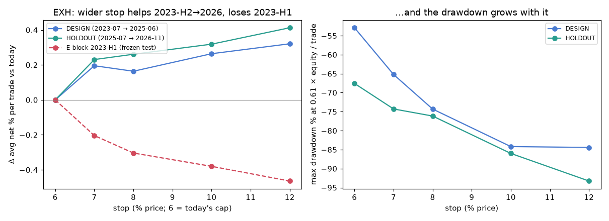

# EXH_THEORY_EXIT — is there a better exit for EXHAUSTION_SHORT, starting from what the trade is? (2026-11-21)

**Verdict: no exit change passes.**
- Every pre-registered theory exit fails on recent backtest years: take profits anchored to the pump, a stall exit, a stop at the pump top, a funding budget.
- The one near-pass (stop at the pump top) turned out to be just a **wider stop**.
- A plain wider stop (7–12 %) wins on 2023-H2 → 2026, but **loses on the untouched 2023-H1 block** that was frozen as the confirmation test.
- It also makes the worst day and the drawdown deeper at today's size.
- Recommendation: keep today's exit; track a 7 % stop shadow on real fills (observe only).

Pre-registration: `EXH_THEORY_EXIT_2026-11-21_PREREG.md` (cells frozen before any simulation; addendum frozen before the E block was read).

## Question
- **RARE #26** peaked at +7.87 % and was stopped at −7.42 %: −5.90 % on price against a 5.63 % stop, 0.20 % slippage, and **1.43 % funding paid**.
- **ENSO #29** peaked at +9.62 %, against a 10 % target. 15 hours later it sits near break-even on price, with **3.72 % funding paid**.
- The operator calls the exit a disaster. What does the trade's own logic say the exit should be?

## Theory of the trade
EXH shorts a Frenzy coin after its pump has run out of buyers: 15m RSI falls back through 70, volume is decaying, and the spot share is falling. It is a **mean-reversion trade on the pump**. That implies four exits:
1. **Target:** a level of the pump (its average price, a 38 / 50 / 62 % retrace, or the pre-pump base) instead of 20 × ATR.
2. **Stall:** once the drop stops making new lows, the reversion is over.
3. **Invalidation:** only a new high above the pump's top proves the buyers are back.
4. **Funding:** being in a crowded short costs money. Once a budget is spent, the trade's edge is gone.

Already tested and not repeated here:
- break-even, locks and trails;
- small TP × tight stop;
- 4 / 8 / 12 / 16 / 48 h holds and no-progress exits;
- TP 4–10 % and stops 4–6 %;
- RSI / volume / OI / taker-buy / EMA state exits;
- closing before a deep funding settlement;
- a stop that counts funding;
- skipping or halving entries on funding.

## Method
- **Data:** 3,368 EXH backtest fills (2023-07 → 2026-11, today's entry rule + DL 582) on 1m paths, with real funding.
- **Parity:** my "today's exit" replay matches the EXH_EXIT2 reference on **3,367 / 3,367** fills (exit type, P&L and funding).
- **Pump landmarks** are known at entry: Frenzy episode, pre-pump base, top, and average price (VWAP).
- **Periods:** DESIGN (< 2025-07, picks one exit per family) and HOLDOUT (≥ 2025-07, read once).
- **Six frozen gates:** confidence interval > 0, ≥ 2/3 of half-years positive, still positive at 0.20 % slippage, no single pair/day ≥ 50 %, saved > cut, daily return not worse.
- **Real fills:** 7 closed EXH trades (18:44 export), re-priced with the same engine. The open ENSO / ORCA / RARE (14:30) trades are not in the export.

## Results — pre-registered families (Δ = avg net %/trade vs today's exit)
| Family | DESIGN pick | DESIGN Δ | HOLDOUT Δ (95 % CI) | Gates |
|---|---|---|---|---|
| A: TP at a pump level | 62 % retrace | −0.14 | −0.08 (−0.28 … +0.13) | 0 / 6 |
| N: nearer of pump level / today's TP | pre-pump base | +0.04 | −0.07 (−0.16 … +0.03) | 0 / 6 |
| B: stall exit | +7 %, 4 h no new low | −0.03 | −0.13 (−0.21 … −0.03) | 0 / 6 |
| C: stop at the pump top | top × 1.00 | +0.09 | **+0.20 (−0.05 … +0.45)** | 5 / 6 (CI) |
| F: funding budget | ≥ 1 % paid | +0.00 | −0.11 (−0.19 … −0.04) | 0 / 6 |

**Why they fail:**
- **Pump-level targets:** they sell big winners early and give away more than they save. The average pump level sits closer to entry than 10 %.
- **Stall exit:** most stalls are pauses before the target, not the end of the move.
- **Funding budget:** the coins that charge the most funding are also the ones that drop the most. The same finding as FUNDING_RULE.

## Control (post-hoc, labelled) — the pump-top stop is just a wider stop
| Stop | Block | WR | Avg / trade | Δ (CI) | Worst day | Max DD | %/day |
|---|---|---|---|---|---|---|---|
| **Today: min(1.5 × ATR, 6 %)** | DESIGN / HOLDOUT | 40 / 43 % | +0.59 / +0.75 | — | −26 / −34 % | −53 / −68 % | 0.50 / 1.37 |
| Pump top | HOLDOUT | 52 % | +0.95 | +0.20 (−0.05 … +0.45) | −53 % | −93 % | 1.68 |
| Fixed 7 % | DESIGN / HOLDOUT | 53 / 52 % | +0.79 / +0.98 | +0.20 / **+0.23 (+0.04 … +0.43)** | −38 / −39 % | −65 / −74 % | 0.65 / 1.81 |
| Fixed 8 % | DESIGN / HOLDOUT | 55 / 55 % | +0.76 / +1.01 | +0.16 / +0.26 | −38 / −45 % | −74 / −76 % | 0.58 / 1.79 |
| Fixed 10 % | DESIGN / HOLDOUT | 60 / 60 % | +0.86 / +1.06 | +0.26 / +0.32 | −35 / −51 % | −84 / −86 % | 0.65 / 1.75 |

- Fixed stops do as well as the pump-top stop, with smaller tails. **The structure adds nothing; the width does it.**
- The old grid stopped at 6 %, which was its edge, so wider stops were never tried.

## Frozen confirmation (E block 2023-H1, 215 fills, never used for any pick)
| Stop | Avg / trade | Δ vs today (CI) | Worst day | Max DD | %/day |
|---|---|---|---|---|---|
| Today | +0.36 | — | −12 % | −37 % | +0.18 |
| **Fixed 7 % (frozen pick)** | +0.15 | **−0.20 (−0.61 … +0.23)** | −18 % | −51 % | **−0.06** |
| Fixed 8 / 10 / 12 % | +0.05 / −0.02 / −0.11 | −0.30 / −0.38 / −0.46 | −21 / −26 / −31 % | −54 / −59 / −65 % | −0.14 / −0.24 / −0.35 |

**→ FAIL.** The wider stop is a regime bet: it paid in 2023-H2 → 2026 and lost in 2023-H1.

## Real fills (7 closed EXH trades, re-priced; booked in brackets)
| Trade | Peak | Today's stop | Today's exit | Fixed 7 % | Pump top |
|---|---|---|---|---|---|
| ZKP 11-18 | +4.9 | 5.9 % | +9.83 (+4.94, old TP 5 era) | +9.83 | +9.83 |
| ZKC 11-19 | +10.0 | 6.0 % | +6.54 (+6.83) | +6.54 | +6.54 |
| LUNC 11-19 | +10.0 | 3.8 % | +9.83 (+9.96) | +9.83 | +9.83 |
| **YB 11-19** | 0.0 | 6.0 % | −6.30 (−6.58) | **+9.12** | +9.12 |
| KERNEL 11-20 | +10.0 | 6.0 % | +9.83 (+9.95) | +9.83 | +9.83 |
| **RARE 11-20** | +7.9 | 5.6 % | −7.38 (−7.42) | **−8.75** | −10.89 |
| RARE 11-21 13:45 | +0.7 | 5.3 % | −5.56 (−4.95) | +0.99 (still open on that path) | −5.69 |
| **Average** | | | **+2.40** | **+5.34** | +4.08 |

- The real-fill gain is essentially **one trade (YB)**: it was stopped at 6.3 %, then dropped to the target.
- RARE #26, the trade that started this, gets **worse** with any wider stop. That pump made a new high.
- Seven fills over four days can't outweigh the frozen test.

## What this means
- **The EXH exit is not the disaster.** On real fills today's exit averages +2.40 %/trade (booked +1.82 %), and on recent backtest years it is +0.75 %/trade.
- **RARE and ENSO are the sleeve's normal cost:** in the backtest, 44 % of fills give back after going our way. Every exit that tries to bank that give-back cuts more from the +10 % runners. That is now shown over four studies and about 70 exit designs.
- **The real exposure is size and clustering:** today's exit already has a −68 % worst drawdown on recent backtest years at 0.61 × equity per trade.
- **Funding:**
  - ENSO's −3.72 % is real money, but the coins that charge the most funding are also the ones that drop the most. Exiting on funding loses (F family; DIST_FUNDING_EXIT; FUNDING_RULE).
  - Separate from the exit, **funding is now shown live on Open Orders** (DL 606).

## Recommendation
1. **Keep today's EXH exit** (TP min(20 × ATR, 10 %) maker / SL min(1.5 × ATR, 6 %) / 24 h).
2. **Observe only:** an `EXH_SL7_SHADOW` watch line that prices every new real EXH fill with a 7 % stop versus today's.
   - Frozen bar: ≥ 20 fills on ≥ 8 days, Δ > 0, and saved > cut.
   - It answers whether the 2023-H2 → 2026 regime still holds live.
   - Build only if the operator agrees.

## Files
- **Scripts:** `scripts/EXH_THEORY_EXIT_2026-11-21_{sim,eval,risk,real,eblock}.py`
- **Data:** `reports/EXH_THEORY_EXIT_2026-11-21_data/` (sim_BT.npz, sim_BT_ctrl.npz, sim_BT_ctrl_E.npz, eval.pkl, risk_ctrl.csv, real_fills.csv)
