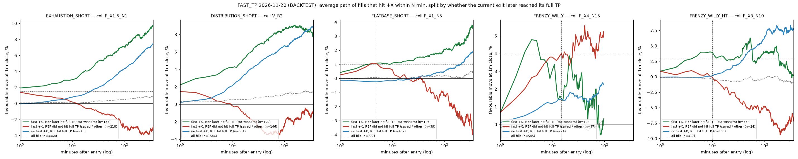

# FAST_TP: should a sleeve take a profit that arrives very fast? (2026-11-20)

**BACKTEST plus real fills.** Research only. No engine, config or test change. Nothing committed.
- Pre-registered in `FAST_TP_2026-11-20_PREREG.md`, before any cell was simulated.
- DESIGN picks were frozen in `FAST_TP_2026-11-20_data/design_picks.json` before HOLDOUT was read.
- HOLDOUT was read once.

## Verdict: REJECT for all 5 sleeves. Keep each sleeve's current exit.

| sleeve | DESIGN pick (frozen) | DESIGN Δ %/fill (t; null 95th) | HOLDOUT Δ %/fill [95 % CI] | halves Δ>0 | real fills | verdict |
|---|---|---|---|---|---|---|
| EXHAUSTION_SHORT | F_X1.5_N1 (+1.5 % within 1 min) | +0.036 (t 0.76; 2.68) | **−0.095** [−0.24, +0.04] | 2/7 | 0 of 4 current-batch fills triggered | **REJECT** |
| DISTRIBUTION_SHORT | none: all 29 eligible cells ≤ 0 on DESIGN | best V_R2 −0.022 | V_R2 **−0.383** [−0.65, −0.13] | 3/7 | V_R2: 0 of 5 triggered | **REJECT** (the rule hurts) |
| FLATBASE_SHORT | F_X1_N5 | +0.020 (t 0.12; 2.19) | **−0.248** [−0.53, +0.08] | 1/7 | master: 9 changed, **−$1,349** (contradicts) | **REJECT** |
| FRENZY_WILLY | F_X4_N15 | +0.127 (t 1.37; 2.33) | **−0.327** [−0.75, −0.01] | 1/4 | 24 master fills, 0 triggered | **REJECT** |
| FRENZY_WILLY_HT | F_X3_N10 | +0.237 (t 1.37; 2.55) | **+0.015** [−0.23, +0.26] | 3/4 | current batch: 4 changed, +$118 (too few to judge) | **REJECT** (closest; fails CI and null) |

**Why it fails.** The hypothesis was that a very fast +X % is a liquidity flush that reverses, while the big winners build slowly. The data says the opposite: **the big winners are the fast ones.**

Share of trades that reached +2 % within 5 minutes:

| sleeve | full-TP winners | stop losers |
|---|---|---|
| EXH | 35 % | 20 % |
| DIST | 66 % | 36 % |
| FLATBASE | 9 % | 5 % |
| WILLY | 43 % | 8 % |
| HT | 37 % | 15 % |

So a fast take-profit hits winners more often than losers. For every short sleeve, the winner $ it cuts is larger than the loser $ it saves, in nearly every cell. This is the same trade-off that refuted the plain small TP, lock, BE and trail exits on 2026-11-18 (EXH_EXIT2 / DIST_EXIT / NOSPOT_EXIT). Adding a speed condition does not change it.

The two motivating trades are anecdotes only (section 9):
- **KERNEL (DIST):** +2.39 % within about 1 minute, then stopped at −6.11 %. Here every F cell with X ≤ 2 would have banked +0.9 to +1.9 %. The backtest shows the same cell type loses over 295 DIST triggers (F_X2_N1: −0.30 %/fill, HOLDOUT −0.44 %).
- **NAORIS (HT):** this was **not a fast move**. The peak of +2.81 % came 48 minutes after entry. No cell fires on it, so this rule would not have helped.

---

## 1. Question
- Can a resting take-profit at entry ± X %, live only for the first N minutes, improve each sleeve? If it does not fill in time, it is cancelled and the normal exit runs.
- Can a "speed ratio" exit do it instead? That exit leaves at a 1m close when the best move so far ÷ minutes ≥ R %/min, within the first 30 minutes.
- The aim is to bank a fast move that later reverses, without cutting the slow winners that reach the sleeve's full TP.

## 2. Method (pre-registered)
- **Entries are frozen and paired.** Each sleeve is its own row.
  - EXH: 3,368 fills (EXH_EXIT2).
  - DIST: 1,546 REF_B fills on 1m (DIST_EXIT).
  - FLATBASE: 777 of 779 fills.
  - WILLY: 545 fills.
  - HT: 417 fills (BASELINE_TRADES_WILLY_HT).
- **REF = each sleeve's CURRENT exit** (trading_config.json today):
  - EXH and DIST: TP min(20×ATR15, 10 %) maker / SL min(1.5×ATR15, 6 %) / 24 h.
  - FLATBASE: TP 5 / SL 10 / 72 h.
  - WILLY: TP 1.25 with a high target up to 8 · late TP 0.25 after 30 min · runner trail · SL 4 · 90 min.
  - **HT: TP 5 / SL 4 / 24 h, with no late TP and no high target.** This is today's config. The baseline file still has the old +2 exit.
- **Grid (33 cells per sleeve):**
  - F_X{1, 1.5, 2, 3, 4}_N{1, 2, 3, 5, 10, 15}: a maker limit.
  - V_R{0.5, 1, 2}: a taker exit at the 1m close.
  - X is the price move from the sleeve's reference entry. For WILLY / HT, X is the net target, priced the way their own TP is.
- **Fill rule:** the limit fills when the 1m bar trades at least 1 tick through it.
  - A cell changes a fill only if its trigger bar is strictly before REF's exit bar.
  - If they fall on the same bar, REF wins (stop first). The exception is a REF fixed TP farther away than X: the nearer limit fills first.
  - On every never-triggered fill Δ = 0, and this was asserted (0 exceptions).
- **Costs = live costs:**
  - Taker 0.05 % plus slip (EXH / DIST model, 0.10 % floor; 0.10 % on the others).
  - Maker 0.02 % with no slip.
  - Real funding up to the early exit.
- **Splits:**
  - EXH / DIST / FLATBASE: DESIGN 2023-07 → 2025-06, HOLDOUT 2025-07 → 2026-11.
  - WILLY / HT: DESIGN 2025, HOLDOUT 2026 (their history starts 2025-01).
- **Pick:** the best DESIGN mean Δ per fill among cells with ≥ 30 triggers (≥ 15 for WILLY / HT), and only if Δ > 0.
- **Pass bar:** all of the following.
  - HOLDOUT Δ > 0 with the bootstrap CI floor > 0 (day-block bootstrap, 10-day blocks).
  - DESIGN Δ > 0.
  - DESIGN t above the family-wise day sign-flip max-t null, taken over all 33 cells at once.
  - ≥ 2/3 of half-years positive.
  - Top pair < 50 % of Δ, and Δ stays > 0 when any one pair is left out.
  - The real-fill check does not contradict.
  - Plus a 30–50 % haircut.
- **Scripts:**
  - `scripts/fast_tp_data.py`: 1m loader over every repo cache, plus the data.binance.vision fetch (939 pair-days fetched, 0 API weight).
  - `scripts/fast_tp_sim.py`
  - `scripts/fast_tp_eval.py`
  - `scripts/fast_tp_bt_tables.py`
  - `scripts/fast_tp_real.py`
  - `scripts/fast_tp_real_tables.py`

## 3. Parity (REF reproduced before any cell)

| sleeve | check | result |
|---|---|---|
| EXH | REF exit bar consistent with the 1m path (no earlier stop / TP; stop / TP hit at the exit bar) | 99.8 % · REF avg +0.68 (EXH_EXIT2: +0.68) |
| DIST | same | 99.7 % · REF avg +0.94 (DIST_EXIT: +0.93) |
| FLATBASE | 1m re-sim vs the 5m baseline file: exit kind, exit time ± 5 min | 100 % · avg +0.92 vs file +1.03 (corr 0.993) |
| WILLY | re-sim vs the file: exit reason, exit minute | 99.8 % · avg −0.083 vs −0.083 · max \|Δ\| 0.03 |
| HT | re-sim at the file's OLD exit vs the file | 99.8 % · −0.268 vs −0.268. **At today's exit (TP 5 / SL 4 / 24 h): −0.33** |

FLATBASE parity notes:
- The 1m path changes no exit kind or time.
- The 0.11 gap in the average is in cost and funding bookkeeping: the file's n0 nets funding differently.
- Both sides of Δ use this study's own consistent REF.

## 4. Decomposition: what the triggered fills would have done (full span, the DESIGN-picked cell)

"cut" = REF later hit the full TP. "saved" = REF stopped. Σ is net % summed over fills; × 61 = $ at one size.

| sleeve · cell | triggers | cut winners: Σ REF → Σ cell | saved: Σ REF → Σ cell | other | net Δ Σ % ($) |
|---|---|---|---|---|---|
| EXH · F_X1.5_N1 | 405 | 187: +1,788 → +249 (**−1,540**) | 202: −1,169 → +269 (+1,438) | 16: −41 | −143 (−$8.7k) |
| DIST · V_R2 | 336 | 190: +1,853 → +460 (**−1,393**) | 138: −799 → +227 (+1,026) | 8: −24 | −391 (−$23.8k) |
| FLATBASE · F_X1_N5 | 185 | 146: +691 → +136 (**−555**) | 38: −393 → +35 (+428) | 1: +4 | −123 (−$7.5k) |
| WILLY · F_X4_N15 | 49 | 12 TP: −16 · 33 runner / late TP: −74 | 4: +32 | — | −57 (−$3.5k) |
| HT · F_X3_N10 | 89 | 65: +328 → +196 (**−132**) | 24: −98 → +72 (+171) | — | +38 (+$2.3k) |

The full grid (`FAST_TP_2026-11-20_grid.csv`) shows the same picture in every row:
- **EXH:** 1 of 29 eligible cells is positive on DESIGN. Full span: every cell ≤ 0, with the best F_X4_N10 at −0.007.
- **DIST:** 0 of 29 on DESIGN. Full span: every cell negative, from −0.11 to −0.79 %/fill.
- **FLATBASE:** full span: cells range from −0.32 to +0.03. The few positive cells have 7–36 triggers.
- **WILLY:** 23 of 29 cells are positive on DESIGN (2025). In HOLDOUT (2026), every cell except one is negative (−0.06 to −0.61). A DESIGN-only regime effect.
- **HT:** cells near zero. Fixed cells range from −0.10 to +0.09 over the full span.

## 5. Backtest BEFORE → AFTER (one size $6,100 per fill; DCR-cal %/day at 0.61)

"Changed" = fills where the cell fired; "saved" = REF net ≤ 0, "cut" = REF net > 0.

| sleeve | cell | block | N | WR before → after | avg % before → after | Δ [CI] | Total $ before → after | DCR before → after | changed (saved / cut) |
|---|---|---|---|---|---|---|---|---|---|
| EXH | **F_X1.5_N1 (pick)** | DESIGN | 1,349 | 39.8 → 43.3 | +0.59 → +0.63 | +0.036 [−0.05, +0.13] | $48.7k → $51.7k | 0.50 → 0.55 | 79 (47 / 32) |
| EXH | **F_X1.5_N1 (pick)** | HOLDOUT | 2,019 | 43.1 → 51.0 | +0.74 → +0.65 | −0.095 [−0.24, +0.04] | $91.3k → $79.6k | 1.36 → 1.24 | 326 (159 / 167) |
| EXH | F_X4_N10 (hindsight) | DESIGN / HOLDOUT | | | +0.59 → +0.54 / +0.74 → +0.77 | −0.052 / +0.023 [−0.10, +0.14] | | 0.50 → 0.46 / 1.36 → 1.48 | 64 / 260 |
| DIST | **V_R2 (DESIGN best, no pick)** | DESIGN | 559 | 42.0 → 46.3 | +1.03 → +1.00 | −0.022 | $35.0k → $34.2k | 0.41 → 0.42 | 53 (26 / 27) |
| DIST | **V_R2** | HOLDOUT | 987 | 42.8 → 51.7 | +0.89 → +0.50 | **−0.383 [−0.65, −0.13]** | $53.4k → $30.3k | 0.86 → 0.47 | 283 (112 / 171) |
| DIST | F_X4_N3 (hindsight) | DESIGN / HOLDOUT | | | +1.03 → +0.99 / +0.89 → +0.74 | −0.040 / −0.147 | | 0.41 → 0.40 / 0.86 → 0.73 | 25 / 187 |
| FLATBASE | **F_X1_N5 (pick)** | DESIGN | 260 | 72.7 → 77.3 | +0.92 → +0.94 | +0.020 [−0.34, +0.34] | $14.5k → $14.8k | 0.17 → 0.18 | 44 (12 / 32) |
| FLATBASE | **F_X1_N5 (pick)** | HOLDOUT | 517 | 73.9 → 79.3 | +0.92 → +0.67 | −0.248 [−0.53, +0.08] | $29.1k → $21.3k | 0.49 → 0.35 | 141 (28 / 113) |
| FLATBASE | F_X3_N5 (hindsight) | DESIGN / HOLDOUT | | | +0.92 → +0.89 / +0.92 → +0.98 | −0.023 / +0.055 | | 0.17 → 0.16 / 0.49 → 0.52 | 3 / 16 |
| WILLY | **F_X4_N15 (pick)** | DESIGN | 267 | 54.3 → 56.9 | −0.48 → −0.36 | +0.127 [−0.03, +0.27] | −$7.9k → −$5.8k | −0.24 → −0.18 | 28 (7 / 21) |
| WILLY | **F_X4_N15 (pick)** | HOLDOUT | 278 | 64.7 → 65.1 | +0.30 → −0.03 | **−0.327 [−0.75, −0.01]** | $5.1k → −$0.4k | 0.13 → −0.03 | 21 (1 / 20) |
| WILLY | F_X3_N2 (hindsight) | DESIGN / HOLDOUT | | | −0.48 → −0.40 / +0.30 → +0.23 | +0.079 / −0.076 | | | 16 / 10 |
| HT | **F_X3_N10 (pick)** | DESIGN | 143 | 46.2 → 53.8 | +0.11 → +0.35 | +0.237 [−0.06, +0.55] | $0.9k → $3.0k | 0.01 → 0.07 | 33 (11 / 22) |
| HT | **F_X3_N10 (pick)** | HOLDOUT | 274 | 38.3 → 43.1 | −0.56 → −0.55 | +0.015 [−0.23, +0.26] | −$9.4k → −$9.2k | −0.32 → −0.31 | 56 (13 / 43) |
| HT | V_R0.5 (hindsight) | DESIGN / HOLDOUT | | 46.2 → 57.3 / 38.3 → 52.6 | +0.11 → +0.02 / −0.56 → −0.23 | −0.089 / +0.335 [+0.02, +0.66] | | 0.01 → −0.00 / −0.32 → −0.14 | 65 / 129 |

Notes:
- No DESIGN Δ survives a 30–50 % haircut into anything meaningful. The largest is HT's +0.24, which becomes +0.12 to +0.17 with t 1.37 against a null bar of 2.55.
- **HT V_R0.5's HOLDOUT +0.34 is a hindsight pick.** It is the best of 33 cells on the full span, and it is negative on DESIGN. It does not qualify even as an observe line: DESIGN refutes it, and it was selected after HOLDOUT was seen.

## 6. Null, half-years, concentration, LOO (picked cells)

| sleeve | DESIGN best t vs family null 95th | half-years Δ > 0 | top pair share of +Δ | leave-one-pair-out Δ range |
|---|---|---|---|---|
| EXH | 0.76 vs 2.68 | 2/7 (23-H2 +0.03, 24-H2 +0.14; 26-H1 −0.17) | TNSR 3 % | −0.050 … −0.035 |
| DIST | −0.22 vs 2.57 | 3/7 (26-H2 −0.81) | NAORIS 3 % | −0.27 … −0.23 |
| FLATBASE | 0.12 vs 2.19 | 1/7 (only 24-H1 +0.56) | LPT 3 % | −0.18 … −0.15 |
| WILLY | 1.37 vs 2.33 | 1/4 (25-H2 +0.23; 26-H2 −0.60) | F 10 % | −0.12 … −0.05 |
| HT | 1.37 vs 2.55 | 3/4 (25-H1 +0.35, 25-H2 +0.17, 26-H1 +0.15, 26-H2 −0.08) | HEMI 10 % | +0.06 … +0.11 |

- HT is the only sleeve that passes half-years, concentration and LOO.
- HT fails the two core tests: the HOLDOUT CI (+0.015, floor −0.23) and the null (t 1.37 vs 2.55). Its most recent half-year (26-H2) is negative.

## 7. Random-entry control: does speed matter for OUR entries, or for any entry?

Setup:
- Same rule (the picked / detail cell) with the same REF exit.
- EXH / DIST reuse the random sets of EXH_EXIT2 / DIST_EXIT.
- FLATBASE / WILLY / HT use 3 random 5m times within ±12 h of each entry, in the same pair.

| sleeve | random N | random REF avg | triggers | Δ per fill | Δ per trigger | on our entries: Δ per trigger |
|---|---|---|---|---|---|---|
| EXH | 10,093 | −0.71 | 229 | +0.013 | **+0.56** | −0.36 |
| DIST | 4,821 | −0.68 | 152 | −0.007 | −0.22 | −1.16 |
| FLATBASE | 2,332 | +0.96 | 427 | −0.20 | −1.10 | −0.66 |
| WILLY | 1,635 | +0.20 | 56 | −0.09 | −2.53 | −1.17 |
| HT | 1,251 | +0.58 | 119 | +0.01 | +0.10 | +0.43 |

Reading:
- On EXH, banking a fast move **helps random entries** (they have no edge, so taking what is there wins) but **hurts EXH's own entries**. That is the DIST_EXIT finding again: the sleeve's edge is the follow-through, and the fast move is part of it.
- Across the grid the pattern holds. Random EXH entries gain from almost every F cell (+0.001 to +0.27 per fill), while EXH's own entries lose from almost every one.
- **Side observation (out of scope, unverified):**
  - Random entries in the same WILLY / HT coins within ±12 h, run on the same exit, average +0.20 / +0.58 %, against −0.08 / −0.33 for the real entries.
  - This looks like an entry-timing question for WILLY / HT, not an exit question.
  - Not studied here. Listed under blind spots.

## 8. Real fills (master over backtest)

Setup:
- **Master:** `MASTER_POOL_stacked.csv`, stack_keep, full size only (probes excluded). That leaves FLATBASE 28, WILLY 24 and HT 0. All 15 kept HT master rows are probes.
- **Current batch:** `scalpars_orders_paper_2026-11-20_13-22-26.csv` (EXH 4, DIST 5, FLATBASE 3, HT 10).
- Each fill is priced from its own 1m klines from the fill time:
  - data.binance.vision zips;
  - 11-19 / 11-20 from fapi, about 135 weight.
- REF = as traded; the exits in these batches are today's.
- The entry-minute bar is **excluded** because it holds prices from before the fill. Results with it included are kept in the CSV; they differ only on the 3 rows noted below.
- One size: $6,100. DCR-cal at 0.61 over every day of the batch.

| sleeve | batch | cell | N | WR b → a | avg b → a | $ b → a | DCR b → a | changed (saved / cut) |
|---|---|---|---|---|---|---|---|---|
| EXH | CURRENT | F_X1.5_N1 (pick) · F_X4_N10 (hindsight) | 4 | 75 → 75 | +3.79 → +3.79 | $924 → $924 | 3.05 → 3.05 | 0 |
| DIST | CURRENT | V_R2 (DESIGN best) · F_X4_N3 (hindsight) | 5 | 20 → 20 | −2.18 → −2.18 | −$666 → −$666 | −2.35 → −2.35 | 0 |
| FLATBASE | B25 | F_X1_N5 (pick) | 20 | 75 → 80 | +1.19 → +0.48 | $1,448 → $590 | 0.55 → 0.22 | 7 (1 / 6) |
| FLATBASE | B27 | F_X1_N5 | 2 | 100 → 100 | +4.96 → +0.93 | $604 → $113 | 1.98 → 0.38 | 2 (0 / 2) |
| FLATBASE | B24, B26 | F_X1_N5 | 1, 5 | unchanged | | | | 0 |
| FLATBASE | **MASTER all** | **F_X1_N5 (pick)** | 28 | 78.6 → 82.1 | +1.83 → +1.05 | **$3,133 → $1,785** | 1.04 → 0.61 | 9 (1 / 8) |
| FLATBASE | CURRENT | F_X1_N5 | 3 | 33 → 67 | −4.95 → −1.34 | −$906 → −$246 | −3.05 → −0.90 | 1 (1 / 0) (MMT) |
| FLATBASE | MASTER all | F_X3_N5 (hindsight) | 28 | 78.6 → 82.1 | +1.83 → +2.41 | $3,133 → $4,112 | 1.04 → 1.48 | 2 (1 / 1) |
| FLATBASE | CURRENT | F_X3_N5 | 3 | | | | | 0 |
| WILLY | B19–B27, each and all | F_X4_N15 (pick) · F_X3_N2 (hindsight) | 24 | 87.5 → 87.5 | +0.55 → +0.55 | $801 → $801 | 0.19 → 0.19 | 0 |
| HT | CURRENT | **F_X3_N10 (pick)** | 10 | 60 → 70 | +1.05 → +1.25 | $642 → $760 | 2.13 → 2.47 | 4 (1 / 3) |
| HT | CURRENT | V_R0.5 (hindsight) | 10 | 60 → 70 | +1.05 → +1.10 | $642 → $673 | 2.13 → 2.20 | 4 (1 / 3) |

Other current-batch cells, for the operator's question "does it make sense for SOME sleeves" (post hoc, anecdotal, N ≤ 10):

| cell | DIST (5 fills) | HT (10 fills) | EXH (4 fills) | FLATBASE (3 fills) |
|---|---|---|---|---|
| F_X2_N1 | **+$491** (KERNEL only) | −$181 (IRYS) | 0 | 0 |
| F_X1_N1 | +$203 (3 changed) | −$304 | −$551 (1000LUNC: a 10 % TP cut) | +$661 (MMT) |
| V_R1 | +$892 (KERNEL, SENT) | −$189 | 0 | 0 |

Backtest reference: F_X2_N1 on DIST is −0.30 %/fill over 295 triggers (HOLDOUT −0.44). V_R1 on DIST is −0.53 %/fill over 764 triggers.

Real-fill reading:
- **FLATBASE master contradicts the pick:** −$1,349, with 8 of 9 changed fills being cut winners.
- EXH, DIST and WILLY real fills almost never trigger the frozen cells. HT has 4 changes (+$118). Too few to support anything.
- **No sleeve meets even the observe-line standard.** HT's real cohort (+$118 on 4 changes) agrees with its backtest Δ of about 0. But HT's backtest already fails the pre-registered gate, and the cohort is 4 fills.

## 9. The two motivating trades (anecdotes; excluded from the grid and the verdict)

**KERNELUSDT DISTRIBUTION_SHORT, entry 2026-11-20 12:30:27 at 0.051141.** Closed at the stop 0.05422: −6.11 %, −$394.70.
- **Peak in our favour +2.39 %, about 1.05 minutes after the fill** (in the 12:31 bar).
- 1m-close path (%, our favour) for the first 12 minutes:

| minute | 1 | 2 | 3 | 4 | 5 | 6 | 7 | 8 | 9 | 10 | 11 | 12 |
|---|---|---|---|---|---|---|---|---|---|---|---|---|
| move % | +0.24 | +0.98 | +0.06 | −0.72 | −0.99 | −0.47 | −1.58 | −1.52 | −1.33 | −2.44 | −0.60 | −0.60 |

- Cells that fire (entry minute excluded), all at the 12:31 bar:

| cell | booked net | vs actual |
|---|---|---|
| F_X1 (any N) | +0.93 % | +7.0 % (≈ +$430) |
| F_X1.5 (any N) | +1.43 % | |
| F_X2 (any N) | +1.93 % (≈ +$118) | ≈ +8.0 % (≈ +$491) |
| V_R1 | +0.78 % | |
| V_R0.5 | +0.78 % (+0.04 % if the entry minute is counted) | |

- X ≥ 3 and V_R2 do not fire.

**NAORISUSDT FRENZY_WILLY_HT LONG, entry 2026-11-20 10:35:11 at 0.03379.** Closed 0.03246: −4.04 %, −$244.98.
- **Peak +2.81 % came 48 minutes after the fill.** The first 15 minutes stayed between −1.7 % and +0.2 %.
- **No cell fires** (N ≤ 15 min; V needs ≥ 0.5 %/min).
- A fast-TP rule would not have changed this trade. Its loss is the slow round trip that the 11-18 lock / BE studies already priced.

## 10. Event-study chart

What the chart shows:
- The average close path, in % in our favour, for the fills where the picked cell fired.
- **Green:** fills where REF later reached its full TP (winners that would be cut).
- **Red:** fills where REF did not reach its full TP (stops that would be saved).
- **Blue:** full-TP winners where the cell never fired.
- **Grey:** all fills.

How to read it:
- In the first minutes the green and red lines are at the same level (+1.5 to +2.5 %). At the moment the rule must decide, the flush and the follow-through look the same. They separate only after about 5–10 minutes, after the decision window has closed.
- For the shorts, green sits above red from minute 1, so fast moves are, if anything, more often winners.
- The path is shown in hindsight: it continues after the trade exits. WILLY's path ends at 90 minutes.

## 11. Meaning
- Speed is **not** a flush signature on these sleeves. A fast early move is more common among the trades that go on to the full TP than among the ones that get stopped.
- So "take it if it comes fast" is still a small take-profit, now applied to the best trades. The arithmetic of the 11-18 exit studies does not change.
- The one sleeve where it is close to neutral is HT (Δ ≈ 0 in 2026). HT's own TP of 5 % is already near the tested X levels, so the rule barely changes the exit there.

## 12. Verdict per sleeve
- **EXHAUSTION_SHORT: REJECT.** HOLDOUT −0.095. Only 2/7 halves positive. The rule helps random entries and hurts EXH's own.
- **DISTRIBUTION_SHORT: REJECT.** No positive DESIGN cell. HOLDOUT −0.38 with the CI below 0. The rule is harmful; KERNEL is the exception the backtest prices at −0.30 %/fill over 295 cases.
- **FLATBASE_SHORT: REJECT.** HOLDOUT −0.25. 1/7 halves positive. The master contradicts it (−$1,349).
- **FRENZY_WILLY: REJECT.** 2025 looked positive and 2026 reversed (HOLDOUT −0.33, CI below 0). WILLY's own 1.25 % / runner exit already captures fast moves.
- **FRENZY_WILLY_HT: REJECT.** HOLDOUT +0.015 with CI [−0.23, +0.26]. t 1.37 against a null of 2.55. 26-H2 negative. Not an observe line either: the real cohort is 4 changes, and the gate it would need is already failed.

## 13. Blind spots
- **Sub-minute fills.** 1m bars cannot see the order of moves inside the entry minute; it is excluded on real fills. The backtest entry is the bar open. A true 1s / aggTrade test of N = 1 was not done.
- **Funding:** priced from the engine's sources. Months with missing funding use the engine's proxy.
- **Freed slots and coins.** An early exit can free a coin or slot for a later signal. This is not added, same as the earlier exit studies.
- **Live cost of the resting limit.** Not modelled: queue position (a maker limit at a level that is just touched may not fill) and the cancel / re-place of the normal TP. Both would make the rule worse, not better.
- **HT REF uses today's TP 5 exit.** HT entries came from the baseline file (one position per pair under the old +2 exit). A different exit could change which entries are taken.
- **The real cohorts are small:** HT master is all probes; EXH / DIST / HT have 4–10 current-batch fills.
- **Out of scope but flagged:** random entries in the WILLY / HT coins (±12 h) beat the real entries on the same exit (+0.20 / +0.58 vs −0.08 / −0.33). Unverified. This looks like an entry-timing study, not an exit one.

Files:
- `reports/FAST_TP_2026-11-20_PREREG.md`
- `_grid.csv` (every cell × block × sleeve, including the random control)
- `_bt_tables.csv`
- `_real.csv` / `_real_tables.csv`
- `_anecdotes.json`
- `_summary.json`
- `_chart.png`
- `FAST_TP_2026-11-20_data/` (sims, design_picks.json, fetched 1m)
