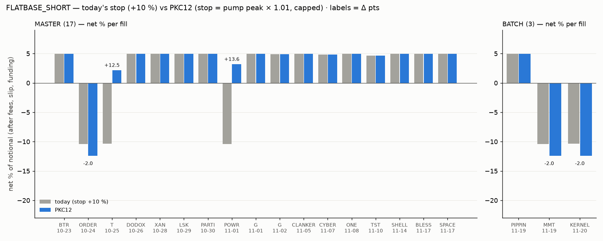

# FB_EXIT_RERUN — FLATBASE_SHORT stop: a capped "pump-peak" stop vs today's +10 % (2026-11-21)

Research only. No engine / config change, nothing committed. Pre-registration (frozen before any new cell ran):
`reports/FB_EXIT_RERUN_2026-11-21_PREREG.md`. Full generated tables (every cell, every block): `reports/FB_EXIT_RERUN_2026-11-21_tables.md`.
Scripts: `scripts/FB_EXIT_RERUN_2026-11-21_sim.py` (walks) · `scripts/FB_EXIT_RERUN_2026-11-21_eval.py` (reads + chart).
Supersedes `reports/FB_THEORY_EXIT_2026-11-21.md` (wrong 23-fill master).

## 1 · Question
The first study's best stop idea, C_PK1 (stop at the pump peak × 1.01, capped at 25 %), saved three master losers but let one batch fill lose
−25.4 %. Operator: "−25 % is not acceptable, we should have a SL." Can a peak stop with a HARD cap (12 / 15 / 20 %) beat today's +10 % stop?

## 2 · The rule, in plain words
| | Today (DL 607) | Candidate "PKC{cap}" |
|---|---|---|
| Take profit | resting maker order 5 % below entry | **unchanged** |
| Max hold | 72 h, then market close | **unchanged** |
| Stop | 10 % above entry (minus any funding we have PAID) | **the pump's highest price + 1 %, but never more than {cap} % above entry** (minus funding paid). If the pump peak is < 1 % above entry → 10 % as today |

Only the stop level moves. Because the pump peak is almost always more than 11 % above our entry (median ≈ 20 % in the backtest, 10–76 % in
the master), **PKC12 is in practice "move the stop from +10 % to +12 %"** — 16 of 17 master fills and 3 of 3 batch fills use exactly 12 %
(G 11-01 uses 11.2 %). The "peak" part only matters at caps ≥ 20 %.

## 3 · Method
- **Cohorts — exactly `reports/KEPT_LIST_FLATBASE_2026-11-21.csv`:** MASTER 17 (master pool stack_keep 28 [FB_CONFIRM + HIGHER_HIGH] → DL 577
  NEAR_BASE skips LA, BANK, NIL, SIGN, STO, PRL, KAT, EDGE = 20 → DL 601 funding > 0.005 % removes BTR 10-23 20:00, DODOX 11-13, TAC = 17);
  BATCH 3 = PIPPIN, MMT, KERNEL (PHAROS removed by DL 601). Backtest = the first study's 545 fills on today's stack (DESIGN < 2025-07 = 94,
  HOLDOUT = 451, read once).
- **Walk:** the first study's walker, imported unchanged. Real fills: 1m bars from the real fill price, taker 0.05 % in, maker 0.02 % at TP,
  taker 0.05 % + 0.25 % slip on stops / time, real funding, stop counts funding paid. Backtest: 5m, its own fee / slip, real funding.
- **Parity:** backtest REF = bt_FB `Bp_net` / `Bp_why` on **545 / 545**; C_PK1 and K_S12 / 15 / 20 reproduce the first study's cells
  1090 / 1090 each. Real REF vs booked exit kind (fills ≥ 10-28, booked under −5 / +10): **15 / 16** — the miss is **XAN 10-28**: booked a
  −10.09 stop, the 1m replay reaches the TP first (all cells give it +4.93, so it does not change any Δ, but the replayed master "today"
  is +0.88 %/fill kinder than booked on that fill).
- **Pick rule (frozen):** largest mean Δ on DESIGN among PKC12 / 15 / 20 → HOLDOUT 6 gates → MASTER decides (P(Δ > 0) ≥ 0.80, saved ≥ cut,
  min LOO Δ > 0) → BATCH shown.
- **Size:** FLATBASE `flatbase_invest_mult` 0.5 × `flatbase_lev_mult` 0.25 (= 5×) → notional ≈ equity ÷ 4 slots × 0.975 (2.5 % fee
  reserve) × 0.5 × 5 = **0.61 × equity per fill** (the same 0.61 CURRENT_STATE quotes for HT at 0.5 × 5×; batch fills' real notional $6.3–7.0k).
  "One size" below = $3,050 per fill = 0.61 × a $5,000 equity; DCR = one-size daily compound over every calendar day of the block.

## 4 · Step 1 — the pick on DESIGN (and it is already a warning)
| cell (DESIGN 94) | PKC12 | PKC15 | PKC20 | ref C_PK1 (cap 25) | ctrl K_S12 | K_S15 | K_S20 |
|---|---|---|---|---|---|---|---|
| mean Δ vs today, %/fill | **−0.41** | −0.45 | −0.43 | −0.07 | −0.21 | −0.23 | −0.23 |

**Pick = PKC12** (largest Δ within 0.05 → tighter cap). Every capped variant LOSES to today on DESIGN (P(Δ > 0) 0.06–0.17).

## 5 · Before → after tables
One size $3,050 / fill (0.61 × equity). Durations in hours from fill to exit.

**MASTER (17 real fills, 10-23 → 11-17)**
| exit | N | WR | avg net % | total $ | avg win | avg loss | worst | DCR %/day | max DD | dur avg h | dur med h | TP / STOP / TIME |
|---|---|---|---|---|---|---|---|---|---|---|---|---|
| today (+10) | 17 | 82.4 % | +2.20 | +$1,143 | +4.90 | −10.38 | −10.38 | +0.84 | −12.3 % | 3.5 | 1.9 | 14 / 3 / 0 |
| **PKC12** | 17 | 94.1 % | **+3.62** | **+$1,877** | +4.62 | −12.39 | −12.39 | **+1.41** | −7.6 % | 3.8 | 1.9 | 16 / 1 / 0 |
| PKC15 | 17 | 94.1 % | +3.44 | +$1,785 | +4.62 | −15.40 | −15.40 | +1.33 | −9.4 % | 3.8 | 1.9 | 16 / 1 / 0 |
| PKC20 (= C_PK1 here) | 17 | 100 % | +4.58 | +$2,377 | +4.58 | — | +2.14 | +1.81 | 0 | 4.0 | 2.7 | 17 / 0 / 0 |

Paired Δ PKC12: **+1.42 %/fill**, day-block 95 % CI −0.25 … +3.48, **P(Δ > 0) 0.88**, saved 2 fills **$795** vs cut 1 fill **$61**,
min leave-one-out Δ **+0.66**. After a 30–50 % in-sample haircut: ≈ +0.7 … +1.0 %/fill.

**CURRENT BATCH (3 real fills, 11-19 → 11-20; in-sample for the cap)**
| exit | N | WR | avg net % | total $ | avg win | avg loss | worst | DCR %/day | dur avg h | dur med h | TP / STOP / TIME |
|---|---|---|---|---|---|---|---|---|---|---|---|
| today (+10) | 3 | 33 % | −5.27 | −$483 | +4.93 | −10.38 | −10.38 | −3.25 | 4.3 | 5.1 | 1 / 2 / 0 |
| **PKC12** | 3 | 33 % | **−6.61** | **−$605** | +4.93 | −12.38 | −12.38 | −4.08 | 4.4 | 5.3 | 1 / 2 / 0 |
| PKC15 | 3 | 67 % | −2.82 | −$258 | +3.46 | −15.39 | −15.39 | −1.78 | 6.0 | 5.4 | 2 / 1 / 0 |
| PKC20 | 3 | 67 % | −4.50 | −$411 | +3.46 | −20.41 | −20.41 | −2.86 | 6.3 | 6.1 | 2 / 1 / 0 |
| C_PK1 (cap 25) | 3 | 67 % | −6.17 | −$564 | +3.46 | −25.42 | −25.42 | −3.97 | 6.3 | 6.2 | 2 / 1 / 0 |

Correction to the brief: the −25.4 % fill under C_PK1 is **MMT 11-19** (peak +44 % above entry; it ran through 20 % too), not KERNEL.
KERNEL went above +12 % but not +15 % and then hit the TP (+1.99 net after −1.6 % funding paid) — so caps of 15 / 20 / 25 save KERNEL, 12 does not.

**Backtest (545, 5m)**
| block | exit | N | WR | avg net % | total $ | avg loss | worst | DCR %/day | max DD | worst day | dur avg / med h | TP / STOP / TIME |
|---|---|---|---|---|---|---|---|---|---|---|---|---|
| DESIGN | today | 94 | 76.6 % | +1.35 | +$3,868 | −9.57 | −10.95 | +0.19 | −21.0 % | −12.5 % | 15.8 / 9.9 | 71 / 19 / 4 |
| DESIGN | PKC12 | 94 | 75.5 % | +0.94 | +$2,700 | −10.62 | −12.96 | +0.12 | −26.0 % | −14.9 % | 15.6 / 9.9 | 70 / 20 / 4 |
| HOLDOUT | today | 451 | 75.4 % | +1.11 | +$15,333 | −9.68 | −12.72 | +0.53 | −37.5 % | −13.1 % | 13.9 / 6.5 | 330 / 100 / 21 |
| HOLDOUT | PKC12 | 451 | 79.2 % | +1.36 | +$18,703 | −11.03 | −12.97 | +0.66 | −31.9 % | −15.4 % | 14.8 / 7.8 | 347 / 81 / 23 |
| HOLDOUT | PKC20 | 451 | 83.4 % | +1.43 | +$19,701 | −14.44 | −20.98 | +0.66 | −45.0 % | −25.2 % | 17.1 / 8.3 | 365 / 54 / 32 |
| HOLDOUT | C_PK1 | 451 | 84.5 % | +1.56 | +$21,444 | −14.94 | −26.02 | +0.72 | −50.4 % | −29.0 % | 17.8 / 8.5 | 369 / 46 / 36 |

(The "worst" trade can exceed the cap by ~1 pt: stops are market orders after a gap through the line, plus slip / fees / funding.)

**Per fill (master + batch, today vs PKC12)** — only 5 of 20 fills differ; every other fill hits the −5 % TP identically under both.
| pair | opened (UTC) | pump peak above entry | today: result · duration | PKC12: result · duration | Δ pts | cap 25 |
|---|---|---|---|---|---|---|
| ORDER (M) | 10-24 16:00 | +59 % | −10.38 STOP · 0.0 h | −12.39 STOP · 0.3 h | −2.0 | +4.00 TP |
| T (M) | 10-25 08:00 | +27 % | −10.38 STOP · 1.8 h | +2.14 TP · 3.7 h | **+12.5** | +2.14 TP |
| POWR (M) | 11-01 08:00 | +13 % | −10.38 STOP · 2.9 h | +3.17 TP · 6.8 h | **+13.6** | +3.17 TP |
| MMT (B) | 11-19 08:00 | +44 % | −10.38 STOP · 5.4 h | −12.38 STOP · 5.4 h | −2.0 | −25.42 STOP |
| KERNEL (B) | 11-20 20:00 | +37 % | −10.38 STOP · 5.1 h | −12.38 STOP · 5.3 h | −2.0 | +1.99 TP |
| 15 others (14 M + PIPPIN B) | | +10 … +76 % | TP, 0.2–15.7 h | identical | 0 | identical |

Full per-fill tables in the tables file. Chart: `reports/FB_EXIT_RERUN_2026-11-21_chart.png` (master + batch, per fill, today vs PKC12, Δ labels).

## 6 · Gates
**HOLDOUT (PKC12, read once): 5 / 6 — FAILS the CI gate.**
| gate | result |
|---|---|
| ① 95 % day-block CI of Δ > 0 | **✗** +0.24 [−0.02 … +0.53] (P 0.96) |
| ② ≥ 2 / 3 half-years > 0 | ✓ 2025-H2 +0.08 · 2026-H1 +0.33 · 2026-H2 +0.29 |
| ③ survives 0.20 % slip | ✓ +0.24 |
| ④ no pair / day ≥ 50 % of Σ Δ | ✓ 28 % / 30 % |
| ⑤ saved $ > cut $ | ✓ $8,005 vs $4,635 |
| ⑥ one-size DCR after ≥ before | ✓ +0.53 → +0.66 %/day |

PKC15 (+0.16 [−0.19 … +0.51]), PKC20 (+0.32 [−0.14 … +0.77]) and C_PK1 (+0.44 [−0.07 … +0.93]; the first study printed [+0.01, +0.86]
— borderline either way) also fail ①. The plain fixed control **K_S12 is at least as good**: HOLDOUT +0.28 [+0.00 … +0.58], DESIGN −0.21
(vs PKC12 −0.41) → **the peak element adds nothing at a 12 % cap**; the effect, if any, is "a slightly wider stop".

**MASTER (PKC12): passes** — P(Δ > 0) 0.88 ≥ 0.80 ✓ · saved $795 ≥ cut $61 ✓ · min LOO Δ +0.66 > 0 ✓.
**BATCH:** −1.34 %/fill (MMT and KERNEL both ran past +12 %: −2 pts each).

Pre-committed verdict (PREREG step 5): **MASTER passes, HOLDOUT fails → OBSERVE**, not ship. And DESIGN contradicts (−0.41).

## 7 · Size and per-stop risk (SIZE BY EDGE)
FLATBASE runs **0.61 × equity notional per fill**. Per-stop loss today ≈ 10.4 % × 0.61 = **6.3 % of equity**; at +12 % ≈ 12.4 % × 0.61 =
**7.6 % of equity** (+1.2 pts per stop; fewer stops: holdout 100 → 81).
| block | exit | WR | 95 % Wilson floor | breakeven WR | Kelly @ observed | Kelly @ floor | Kelly-floor notional ÷ equity | cost per stop (% equity) |
|---|---|---|---|---|---|---|---|---|
| MASTER 17 | today | 82.4 % | 63.1 % | 67.9 % | 45 % | **< 0** | 0 | 6.3 |
| MASTER 17 | PKC12 | 94.1 % | 77.4 % | 72.8 % | 78 % | 17 % | 1.37 | 7.6 |
| Backtest HOLDOUT 451 | today | 75.4 % | 71.9 % | 67.6 % | 24 % | 13 % | 1.37 | 5.9 avg / 7.8 worst |
| Backtest HOLDOUT 451 | PKC12 | 79.2 % | 75.8 % | 70.5 % | 29 % | 18 % | 1.65 | 6.7 avg / 7.9 worst |

Today's 0.61 is ≈ 45 % (today's stop) / 37 % (+12) of the backtest floor-Kelly notional (under ½-Kelly at the pessimistic WR) — size is not the
binding problem; the 17-fill master alone cannot justify ANY size under today's stop (floor 63 % < breakeven 68 %), only the backtest can.
**Clustering** (backtest 545, one size): max 2 FB stops in one day and in one entry window under every exit; days with ≥ 2 stops 9 → 3
(PKC12) → 2 (C_PK1); worst day −13.1 → −15.4 % (PKC12) → −29.0 % (C_PK1); max drawdown −37.5 → −37.9 % (ALL) / HOLDOUT −37.5 → −31.9 %.
Master: 3 stops under today's exit, on 3 different days (10-24, 10-25, 11-01). Two same-window FB stops at +12 ≈ −15 % of equity.

## 8 · Revert / promotion gate (pre-committed, alert-only)
**Observe line FB_STOP12_SHADOW** (if the operator wants it built): every new real FLATBASE fill walked at stop +12 % vs today's +10 %
(1m, real fill price, TP −5, 72 h, funding-paid stop) → paired Δ. Pricing: a fill that runs through +12 % costs ≈ **−2.0 pts ($61 per $3,050,
≈ 1.2 % of equity)**; a fill that turns between +10 % and +12 % and then hits the TP gains ≈ **+13 … +15 pts ($400–450)** — one save pays
≈ 7 cuts. Frozen read at ≥ 30 fills on ≥ 15 market windows: one-sided 95 % window-bootstrap P(Δ > 0) ≥ 0.95 ∧ saves × gain > cuts × cost
→ SHIP CANDIDATE (operator); otherwise keep +10.
**If the operator ships it anyway (declared override):** first 15 FLATBASE fills that touch +10 % after the deploy: Σ Δ (vs a +10 stop on the
same fill) < 0 → REVERT alert · any FLATBASE fill net worse than −13.5 % → REVIEW alert (cap breached = execution / gap issue). Frozen once decided.

## 9 · Verdict (plain English)
**Don't ship. Keep today's +10 % stop. Optionally observe "+12 %" as a shadow line.**
- The honest version of the capped idea is just "+12 % instead of +10 %" — the pump-peak part does nothing at a 12 % cap.
- On the 17 real master trades +12 % looks good (+1.4 pts per trade: saves T and POWR, costs ORDER 2 pts) — but that is two trades.
- On the 3 current-batch trades it is worse (MMT and KERNEL both went past 12 %).
- On 2.4 years of backtest it is better in the late half (+0.24) but worse in the early half (−0.41), and the late-half gain is not clear of zero.
- Wider caps (15 / 20 / 25) save more trades but make the worst loss 15–26 % and roughly double the worst day — the operator's "−25 % is not
  acceptable" rules them out, and they do not pass the backtest CI either.
- Today's +10 % stop already IS a hard stop-loss; no FLATBASE trade can lose −25 % under it.

## 10 · Caveats
- The cap grid was motivated by a BATCH fill (MMT's −25.4 % under C_PK1) → BATCH is in-sample for the cap choice.
- MASTER N = 17 (3 stops, ~15 days); one replay mismatch (XAN). Backtest = cross-check; its refutation is stated, not a veto — but here the
  pre-registered verdict is OBSERVE on the backtest CI alone, and DESIGN points the other way.
- Stop fills modelled as the line or the bar open (gap) + 0.25 % slip (real) / row slip (backtest); thin coins can slip more on a market stop.
- Batch fills' paths are complete to 11-21 18:55 UTC (all three already resolved).
