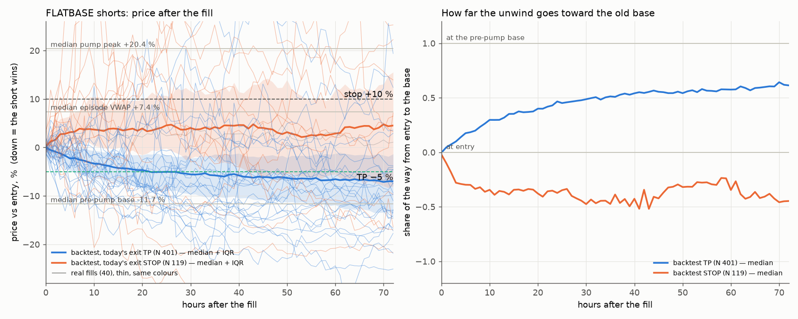

> ⚠ **Superseded by `reports/FB_EXIT_RERUN_2026-11-21.md` (wrong master cohort: this study used a 23-fill "today's filters" master; the correct kept list is `reports/KEPT_LIST_FLATBASE_2026-11-21.csv`, 17 master + 3 batch).**

# FB_THEORY_EXIT — what exit does the FLATBASE trade's own theory call for? (2026-11-21)

Research only. No engine / service / config change, nothing committed. Pre-registration (frozen before any cell ran):
`reports/FB_THEORY_EXIT_2026-11-21_PREREG.md`. Scripts: `scripts/FB_THEORY_EXIT_2026-11-21_{common,sim_bt,real,eval,chart}.py`. Data:
`reports/FB_THEORY_EXIT_2026-11-21_data/`. Full generated tables (every cell × every block, per-fill real table):
`reports/FB_THEORY_EXIT_2026-11-21_tables.md`. Chart: `reports/FB_THEORY_EXIT_2026-11-21_chart.png`.

**Short answer: keep today's FLATBASE exit (maker TP −5 % · stop +10 % counting funding paid · 72 h).** No theory-derived exit passes
the pre-committed master gates. The closest one is the same as on EXH: a stop at the pump's peak. It passes all six backtest HOLDOUT gates
(+0.44 %/fill, CI +0.01…+0.86), but it fails on the real fills: +0.08 %/fill on master with today's filters (P 0.52) and −0.97 as taken.
It also does not beat a plain fixed stop at the same distance. It roughly doubles the average loss (−10.4 → −23 % on master). It is
rejected.

## 1 · Question
The operator asked for a solid exit for every sleeve. FLATBASE exits have been searched as grids before: TP / stop / hold, trails, locks,
TP 1–10, stop 4–12 and in-trade state signs. This study starts from what the trade IS and tests only exits that theory predicts and that
nothing has tested yet.

## 2 · Theory of the trade → exit hypotheses
A coin that sat in a flat 14-day range gets pumped (Frenzy), fails (a 4-h close below the spike VWAP, then a further lower 4-h close), and
is shorted while still > 2.09 % above its pre-pump base. Nothing re-rated the coin, so price should **unwind toward the old base**.
That predicts:
1. **Target = the pump's landmarks** (pre-pump base, half-way to it, the 61.8 / 78.6 % retraces) → family **A**.
2. **Invalidation = structure** (the pump peak, the episode VWAP, the high of the breakdown 4-h candle) → family **C**, each against a
   **fixed stop at the same median distance** (family **K**, control) so that "structure" is not just "a different stop width".
3. **A stalled unwind is over** (no new low for 4–16 h after +2…4 %) → family **B**.
4. **Flat bases resolve fast** (exit at 12 / 24 / 48 h if nothing happened or under water) → family **T**.
5. **A crowded short has a funding budget** (exit after 1 % / 2 % paid) → family **F**.
Benchmark: **X_TP6** (TP −6, DL 603's best fixed TP).

**What the paths say (theory facts, `_data/facts.csv`):** in 72 h, 50 % of backtest fills (55 % real) reach the pre-pump base. 19 %
(32 % real) trade back above the pump peak. Of today's 119 backtest stop-outs, 58 later trade back to −5 % (8 of 14 real), and 58 retake
the peak (9 of 14 real). Most stopped fills do one or the other: 41 retake the peak without coming back, 41 come back without retaking
it, 17 do both, 20 neither. So a stop-out is a coin flip between "the pump resumed" and "a wick, then the thesis worked". No entry-time
landmark separates the two (section 4).

*Left: price vs entry over 72 h after the fill, backtest median + IQR split by today's outcome, with the real fills as thin lines. The
winners grind down past −5 % toward the base (median −7 % at 72 h). The stop-outs jump +3…+5 % in the first hours and then go nowhere:
the IQR band straddles both the stop and the TP. Right: share of the way from entry to the base. Winners are about 60 % of the way there
at 72 h, so a base target would be filled on only about half of them. That is why the A family loses.*

## 3 · Method (as pre-registered)
- **Backtest** = bt_FB.csv (FUNDING_STOP_2026-11-21) minus entry_rate > 0.00005 = **545 fills** on today's stack. It uses 5m paths
  and real funding with the stop counting funding paid. **Engine parity: REF = bt_FB `Bp_net` / `Bp_why` on 545 / 545 fills (100 %,
  max |gap| 0.0000).** DESIGN < 2025-07 (94) picks one cell per family. HOLDOUT ≥ 2025-07 (451) is read once.
- **Real fills** = every export (newest 18:44), FLATBASE_SHORT, CLOSED, no probes, 0 operator-closed, dedup (opened_at[:19], pair,
  direction) → **40**. Each is re-walked on 1m from the real fill price, starting the minute after the fill. Costs: taker 0.05 · maker
  0.02 · stop / rule slip 0.25. Real funding. The REF exit kind matches the booked kind on 26 / 27 fills booked under −5 / +10. The one
  miss is XAN 10-28: it was opened under the old −8 TP and booked a stop after passing −5. So the 1m replica stops nothing that live
  did not stop. Anchors were checked against live stamps: recomputed VWAP vs `entry_frenzy_vwap` within ~0.1–2 %, and the base
  distance vs the backtest's `dist_base` on the same episodes within ±0.3 %.
  **MASTER as taken** = 36 (opened < 11-17 17:00). **MASTER today's filters** = 23: drops funding > +0.005 % and fill ≤ 2.09 % above
  base (approximation: fill price ≈ confirm close, base from 1m). **BATCH** = 4 (PIPPIN, MMT, PHAROS, KERNEL).
- One size = 0.61 × equity per fill, so **$ = Δ % × $30.50 ($3,050 / fill)**. DCR-cal is computed over every calendar day.

## 4 · Results

**Today's exit (REF) per block**

| block | N | WR | avg %/fill | Σ % | $ one size | TP / STOP / TIME | DCR %/day | max DD | worst day | avg loss |
|---|---|---|---|---|---|---|---|---|---|---|
| MASTER as taken | 36 | 66.7 % | +0.04 | +1.4 | +$42 | 24 / 11 / 1 | −0.13 | −28.0 % | −19.3 % | −9.63 |
| MASTER today's filters | 23 | 73.9 % | +0.92 | +21.2 | +$645 | 17 / 6 / 0 | +0.42 | −18.5 % | −13.0 % | −10.38 |
| BATCH (≥ 11-17 17:00) | 4 | 25.0 % | −6.55 | −26.2 | −$799 | 1 / 3 / 0 | −5.33 | −15.2 % | −6.3 % | −10.37 |
| Backtest DESIGN | 94 | 76.6 % | +1.35 | +126.8 | +$3,868 | 71 / 19 / 4 | +0.19 | −21.0 % | −12.5 % | −9.57 |
| Backtest HOLDOUT | 451 | 75.4 % | +1.11 | +502.7 | +$15,333 | 330 / 100 / 21 | +0.53 | −37.5 % | −13.1 % | −9.68 |

**The five family picks (chosen on DESIGN before anything else was read). Δ = pick − today per fill, % at one size**

| family · pick | DESIGN Δ | MASTER today's (23) Δ · P(Δ>0) | MASTER as taken (36) Δ | BATCH (4) Δ | HOLDOUT (451) Δ [95 % CI] | HOLDOUT half-years | HOLDOUT @0.20 slip | verdict |
|---|---|---|---|---|---|---|---|---|
| A target · **A_R786** (TP at the 78.6 % retrace) | +0.08 | **−2.93** · 0.01 | −1.63 | −3.82 | +0.10 [−0.39, +0.55] | −0.01 / +0.51 / −0.38 | +0.10 | REJECT |
| C structure · **C_PK1** (stop at pump peak +1 %) | −0.07 | **+0.08** · 0.52 | −0.97 | +3.16 | **+0.44 [+0.01, +0.86]** | +0.12 / +0.42 / +0.83 | +0.44 | REJECT (master) |
| B stall · **B_X4_N960** (+4 %, no new low 16 h) | −0.07 | −0.09 · 0.00 | −0.06 | 0 | −0.10 [−0.18, −0.02] | −0.03 / −0.07 / −0.22 | −0.10 | REJECT |
| T time · **T_H24_UW** (out at 24 h if under water) | +0.02 | 0.00 (never fired) | −0.06 | 0 | −0.05 [−0.21, +0.11] | −0.13 / +0.02 / −0.08 | −0.05 | REJECT |
| F funding · **F_P1** (out after 1 % paid) | −0.04 | +0.32 · 0.64 (1 fill) | +0.20 | +0.89 | −0.11 [−0.25, +0.02] | +0.02 / −0.05 / −0.36 | −0.11 | REJECT |
| benchmark X_TP6 | +0.45 | −0.68 · 0.27 | −0.25 | +0.25 | +0.20 [−0.06, +0.45] | | | (DL 604 shadow) |

**Gates for the nearest pick, C_PK1** (pre-committed). Master: ① Δ ≥ 0 ✅ (+0.08) · ② saved $1,234 ≥ cut $1,175 ✅ · ③ P(Δ > 0)
≥ 0.80 ❌ (0.52) · ④ beats X_TP6 ✅ (−0.68) · ⑤ beats its distance-matched fixed stop K_MPK ❌ (+0.08 vs +0.41). It is also FRAGILE:
leave-one-out min −0.57. HOLDOUT: all six pass (CI above 0 · 3 / 3 half-years · +0.44 at 0.20 slip · top pair / day < 50 % · saved ≥
cut · DCR +0.53 → +0.72). Master fails, so the verdict is **REJECT** (master decides; the backtest is the cross-check).

**Structure vs the same width as a fixed stop (paired C − K, per fill)**

| block | C_PK0 − K_MPK (20.4 %) | C_VWAP − K_MVWAP (7.9 %) | C_CFHI − K_MCFHI (6.5 %) |
|---|---|---|---|
| MASTER today's (23) | −0.22 (P 0.18) | +0.45 (P 0.70) | +0.19 (P 0.57) |
| MASTER as taken (36) | +0.39 (P 0.83) | +0.67 (P 0.90) | −0.59 (P 0.20) |
| DESIGN (94) | +0.16 (P 0.64) | −0.85 (P 0.02) | +0.14 (P 0.62) |
| HOLDOUT (451) | +0.15 [−0.15, +0.49] | +0.11 [−0.22, +0.45] | +0.07 [−0.36, +0.49] |

Most of the peak stop's backtest gain is **width**. A plain fixed 20 % stop gets +0.36 on HOLDOUT (and +0.41 on master today's); the
peak level adds +0.15, with a CI that crosses zero. Width was already studied (DL 540, DL 603): wider stops lose on DESIGN and do not
hold up when the best 5 % is removed.

**Risk at one size (today → C_PK1):** average loss −10.4 → **−23.2 %** on master today's (HOLDOUT −9.7 → −14.9). HOLDOUT worst day
−13.1 → **−29.0 %**, max drawdown −37.5 → **−50.4 %**. As taken, the master drawdown goes −28 → −40 %. A peak stop sits about 20 % away
(capped at 25 %), so every loser costs about twice as much. MMT 11-19 would have lost −25.4 % instead of −10.4 %.

**Non-pick worth naming: C_VWAP** (stop at the episode VWAP + 0.5 %). It is the best real-fill cell: master as taken **+0.95 %/fill**
(P 0.99, CI +0.09…+2.09), today's +0.43 (P 0.73), batch +6.86 (4 fills: KERNEL, PHAROS rescued). It beats its fixed-width control on
real fills (+0.67 / +0.45). It was NOT picked because DESIGN says −0.82 (CI −1.81…−0.03). HOLDOUT says −0.07, and the backtest on
the same weeks as the master (entries ≥ 2026-10-01, 46 fills) says **−0.54**. The real fills and the replica disagree on the very same
weeks. With N = 23–36 the real-fill edge rests on a handful of rescued stops (batch in-sample, 30–50 % haircut). It is not a candidate
under the frozen rule. If the operator wants it tracked, it should be an observe line with a frozen read (≥ 30 fresh fills, window
bootstrap), not a ship.

**Other families, briefly** (every number in `_tables.md`):
- **A (landmark targets) loses on real fills in every variant** (−1.7 … −3.3 %/fill on master today's). The unwind rarely completes:
  winners sit ~60 % of the way to the base at 72 h, so far targets turn TP winners into stops (CLANKER, SHELL, PIPPIN, PARTI, BTR).
- **B (stall) and T (time) mostly cut winners early.** Every cell is ≤ 0 on HOLDOUT and on master. Flat bases do not "resolve fast":
  the winners keep grinding down for 2–3 days (chart).
- **F (funding budget)**: rarely fires because DL 607 already counts paid funding in the stop. Negative on HOLDOUT.

## 5 · What this means
The theory is right about direction: winners drift toward the old base. It is wrong about the landmarks being usable as exits. The base
is too far to reach within the hold, and VWAP / candle-high stops are too tight in the backtest. The pump-peak stop gains in the
backtest mostly through width, and it doubles the loss per stop. Today's exit, a near target (−5 %) that is reached early with a
moderate stop, remains the best balance on the real fills: master with today's filters +0.92 %/fill, 74 % WR, DCR +0.42 %/day at one
size. The current batch (−6.55 %/fill on 4 fills: 3 stops) is an entry problem in this read. Wider stops would have rescued KERNEL /
PHAROS but deepened MMT to −25 %. That trade-off is exactly what the master refuses.

## 6 · Verdict and recommended exit (plain English)
**Keep the FLATBASE exit exactly as it is today:**
- **Take profit:** a resting order 5 % below the entry price (a maker order, so no taker fee or slippage).
- **Stop:** 10 % above the entry price, where the 10 % includes any funding the short has already paid (DL 607).
- **Time limit:** close at 72 hours if neither has happened.

Why: 26 exits that follow from the trade's own logic were tested (plus 7 fixed-stop controls and the TP −6 benchmark; the PREREG header says "REF + 31", the frozen table lists 34 — a miscount, no cell added after the freeze). Targets at the old price level, stops at the pump's top / average
price / breakdown candle, "it stopped falling" exits, "it's taking too long" exits and funding-budget exits were all checked against
today's exit, on the 40 real trades and on 545 simulated ones. None beats today's exit on the real trades with enough confidence. The
one that looks good in the simulation (a stop at the pump's peak) mainly works by being a much wider stop. It would make every losing
trade cost about twice as much. On the real trades it was no better.

Still open (no change proposed): the FB_TP6_SHADOW line (DL 604) keeps running. The TP × size question stays at the batch review
(DL 603). C_VWAP can be added as an observe line only if the operator asks.

## 7 · Caveats / blind spots
- Master N is small (23 today's-filter fills, 25 windows). The day-block bootstrap on 23 fills is coarse, and the batch (4) is
  in-sample for anything that rescues its stops.
- "Today's filters" on the master is an approximation: fill price stands in for the confirm close, the base comes from 1m klines, and
  the HH / confirm entry rules were not re-applied to the S4-era fills (as-taken shown beside it).
- Backtest = 5m bars with stop-first on a shared bar. Real = 1m. Rule exits are filled at the next bar's open + slip. No depth / impact
  model. Funding is mark-scaled per settlement.
- Picks were made on DESIGN (94 fills), so the family picks are noisy. Every cell is shown on every block so a non-pick (C_VWAP) is
  visible, but it is not promotable under the frozen rule.
- Structure stops are capped at 25 %. The peak cell's risk numbers depend on that cap.
- Backtest fee convention: taker 0.045 / maker 0.018 (kept for parity). Real fills: 0.05 / 0.02.
