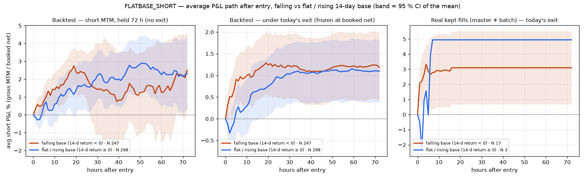

# FLATBASE_SHORT — does a DOWNTRENDING base (or a range near the 44.4 % FLAT limit) make the shorts worse or better? (2026-11-26)

**Question (operator 11-26):** SLX / LAYER / BIGTIME opened on 14-day bases that were falling ("SLX was not in flatbase, it was DOWNTREND"). The FLAT rule only tests the RANGE (max/min − 1 ≤ 0.444 over the 4,032 5m closes ending 30 min before the spike). Does the base's direction, or a range near the limit, change results?
**Verdict: NOTHING to change. No filter, no observe line.** The base direction does not separate Flatbase winners from losers on any cohort. Real fills point the opposite way to the worry: 17 of the 20 kept real fills had a falling base, and the 14 master fills among them are 14 / 14 winners at today's exit.

## 0 · Prior-study check
| Study (DL / date / exit era) | What it tested | Verdict |
|---|---|---|
| FRENZY_FLATBASE_SHORT_2026-10-22_WINLOSS (DL 348, 10-22, TP −8 / SL 15) | FLAT14 terciles (inside turnover terciles), FLAT30, RV14 (14-d realised vol), DIST90 (distance below the 90-d high), coin 1h / 4h / 24h return; looser FLAT bands 44.4–55 / 55–70 | FLAT14 not monotone (70 / 75 / 69 %); looser bands are worse → keep 0.444; DIST90 only appeared inside a 2D cell, not shipped |
| OOS_REAL_FLATBASE_2026-11-17 W/L screen + WL_DEEP_FLATBASE_2026-11-17 (today's exit X0) | flat14 median split, dist_base, off_peak, range24, emagap 5m / 1h / 4h, rsi, adx … (46 vars) | flat14: no separator (AUC 0.49, Δ −2 pp TP-first); dist_base → NEAR_BASE filter (DL 577) |
| DIST_FB_LOSERS_2026-11-20 (DL 601) + sweep_separators on real fills | entry_flatbase_flat14_pct among 7 real-stamped vars | flat14 median +1.7 pts, not a survivor; funding → DL 601 filter |
| FLATBASE_STRUCT / ENTRY_AUDIT / DEEP 11-13, ENTRY_WL_2026-11-18 | spike / confirm structure, depth, DI | nothing on the base direction |
| **NEW in this study** | **14-d base return, log-linear base slope, 7-d return, position of the base-end close in the range, % below the 14-d high** — never tested; flat14 re-read at a fixed "near the limit" cut (≥ 40 %) on today's full stack | — |
No re-open trigger was pending. The flat14 re-read is a repeat. It is shown only as the "near the limit" cut the operator asked about.

## Data and method
- **Backtest:** 545 trades from the OOS_REAL_FLATBASE rebuild on today's stack: HIGHER_HIGH, NEAR_BASE > 2.09 and FUNDING ≤ 0.005 %, with exit TP −5 maker / stop +10 / 72 h, real funding and model slippage. This is the same cohort as FB_EXIT_RERUN / FB_TP_GRID 11-21. DL 607 (funding counted inside the stop) was not re-walked.
- **Real:** the 17 master kept fills (KEPT_LIST_FLATBASE_2026-11-21 = stack_keep + the DL 601 cut; stack_pct) plus the 3 current-batch kept fills (KERNEL / MMT / PIPPIN). PHAROS is excluded because the funding filter blocks it on today's stack. Probes were excluded. No FLATBASE fill closed after 11-21.
- **Base features** come from the same 5m closes the live rule reads. The FLAT-range parity check matched exactly: 545 / 545 backtest, 20 / 20 real stamps and 3 / 3 open ledger values.
- **Cuts are frozen on DESIGN** (< 2025-07, N 94) and read on HOLDOUT (N 451) and per half-year. Granularities: sign (or a fixed a-priori cut), then median, then terciles.
- **Statistics:** window-clustered bootstrap (4-h decision windows), family-wise shuffle null over all 23 tests, Pattern-C expectancy bar, and one-size DCR (X 0.61) with max drawdown and worst day.
- **Paths:** labels come from the path (path_labels definitions, Y 9.9). Real fills use 1m bars with the entry minute skipped; the backtest uses 5m bars.

## Theory
- **Why a falling base could be BETTER for the short:** nobody is trapped above the price. The pump hits a coin with no buyers at higher levels, and a weak coin tends to resume its drift once the spike's buyers leave.
- **Why it could be WORSE:** a falling base can end in a capitulation low. The pump is then a real reversal, with shorts late into a new uptrend and stops hit.
- Both stories predict a gap between falling and flat bases. **The data show no gap.** The short works because the pump fades, whichever way the base was drifting.

## Key results (full tables below)
- **Falling base, ret14 < 0** (247 backtest): avg +1.19 vs rest +1.10. HOLDOUT +1.18 vs +1.04. The zone is worse in only 2 of 5 half-years. P(Δ < 0) 0.45, family-wise p 1.00. Real: master 14 · 100 % · +4.95. Batch 3 · −5.54 (KERNEL and MMT stops, 2 windows: noise at N 3).
- **Base slope < 0** (316): +0.90 vs +1.47 (HOLDOUT +0.79 vs +1.55, DESIGN reversed +1.45 vs +1.13). The zone is worse in 3 of 5 half-years, family-wise p 0.97. Win rate 75 % against a 68 % breakeven, and P(mean < 0) 0.01 means the zone itself is clearly profitable.
- **Near the limit, flat14 ≥ 40** (75): +0.31 vs +1.27 (HOLDOUT +0.08 · 68 % WR ≈ breakeven, DESIGN +1.05). This is not monotone: the 36.6–40 band is the best tercile (T3 > 36.6 averages +0.97 above the rest). Family-wise p 0.95. Master 9 · 100 % · +4.95. This is noise around a confound, not a cliff at the limit.
- **Nearest anything:** position in range < 0.5 is worse in 5 of 5 half-years (−0.73, P 0.90, family-wise p 0.90). Its blocked side still earns +0.70 · 74 % against a 68 % breakeven, so it fails the bar on every item.
- **Strongest test of the whole family:** ret7 > 8.5 (a rising last week) is *better*, at |t| 2.06 against a null 95th percentile of 2.97, so it is luck.
- **Pattern-C bar:** every zone fails, because the blocked side is positive (P(mean < 0) ≤ 0.45).
- **No breakeven bot:** blocking a falling base halves the one-size DCR (backtest 0.38 → 0.20 %/day; master 1.96 → 0.34). Max drawdown shrinks (−41 → −23 %), but random removal of the same number of trades shrinks it too (median −33 %). That is mostly fewer trades, and a drawdown is one path.
- **Entry × exit:** WORKED is 94 % in the falling zone vs 90 % in the rest, with the same mix of losses (mostly GAVE_BACK, then NEVER_WORKED). The chart shows falling bases move our way *faster* in the first 20 h and give some back later; the −5 TP banks it either way.
- **Base direction is common in this sleeve:** 47 % of backtest trades and 85 % of real fills had a falling base. "Flat" in this rule has always included a 14-day drift of up to about ±20 %.

## Open shorts (11-26) — zone membership only
SLX, LAYER and BIGTIME are all in the falling zone on every direction variable: ret14 < 0, slope < 0, ret7 < 0, position < 0.5, and the T3 tercile for % below the high. FLAT range: SLX 41.0 % (≥ 40, T3) · LAYER 29.3 % (T1) · BIGTIME 37.5 % (T3). On the backtest these zones have averaged about +0.8 to +1.2 % per trade. None is a loser zone.

## Caveats and blind spots
- The backtest uses 5m paths and model slippage. The DL 607 funding-in-stop is not re-walked. The 0.61 one-size ruler is the DL 601 study's.
- DESIGN has only 94 trades. Real N is 20, of which 17 are falling (no contrast), and the batch has 3. The master is all winners at today's exit, so it cannot separate anything.
- The shuffle is trade-level. Every base variable is pair-specific, not market-wide, so the window rule does not bind.
- Not tested: base volume trend, a 30 / 90-day trend (DIST90 / FLAT30 were read 10-22 under the old exit), BTC × base-direction interaction, and an intraday base shape (e.g. lower highs within the base).

---
# FLATBASE_BASE_TREND_2026-11-26 — does a DOWNTRENDING base (or a range near the 44.4 % FLAT limit) change Flatbase short results?

Research only — no bot / config change. Summaries only. Script: scripts/FLATBASE_BASE_TREND_2026-11-26.py

## Data + parity
- Backtest: 545 trades on today's stack (HIGHER_HIGH + NEAR_BASE + FUNDING_ABOVE_BASE; exit TP −5 / stop +10 / 72 h, real funding; DL 607 funding-in-stop not re-walked). Base features scored on 545 (100 %); FLAT range parity vs the rebuild: |Δ| ≤ 0.05 pts on 545 / 545 (median |Δ| 0.000).
- Real: 20 kept fills (master 17 + batch 3); parity vs the live stamp entry_flatbase_flat14_pct: |Δ| ≤ 0.05 pts on 20 / 20.
- Open: SLXUSDT, LAYERUSDT, BIGTIMEUSDT (parity vs the ledger fb_flat14_pct |Δ| max 0.000).
- DESIGN < 2025-07-01 (94) · HOLDOUT (451). Window = one 4-h decision close. One-size ruler X = 0.61 × equity per fill.

Sleeve (backtest): 545 · WR 76 % · avg +1.14 % · breakeven WR 68 %. Real: 20 · WR 90 % · avg +3.38 %.

## Feature distribution (backtest median · IQR | real median)
| var | bt_med | bt_q1 | bt_q3 | real_med | corr_ret14 |
|---|---|---|---|---|---|
| 14-d base return % | +1.98 | -8.30 | +12.28 | -8.64 | +1.00 |
| base slope %/day | -0.25 | -0.94 | +0.38 | -1.27 | +0.80 |
| 7-d return % | +4.13 | -2.56 | +11.59 | -4.72 | +0.74 |
| position in 14-d range | +0.62 | +0.34 | +0.87 | +0.43 | +0.79 |
| % below 14-d high | +7.68 | +2.61 | +14.82 | +16.46 | -0.76 |
| FLAT range % | +30.08 | +23.21 | +37.01 | +39.18 | -0.01 |

## 1 · Zone vs rest, every variable × granularity (backtest DESIGN / HOLDOUT; real = master + batch, same frozen cut)
Δ_all = zone avg − rest avg (backtest, all); P(Δ<0) = window-clustered bootstrap; p_fw = family-wise shuffle null over all 23 tests (2,000 permutations, max |t|); halves = half-years where the zone is worse / half-years with ≥ 5 per side.
| var | gran | zone | D_N | D_avg | D_rest | H_N | H_avg | H_rest | halves_zone_worse | Δ_all | P(Δ<0) | t | p_fw | real_N | real_WR | real_avg | real_rest |
|---|---|---|---|---|---|---|---|---|---|---|---|---|---|---|---|---|---|
| 14-d base return % | sign | ret14 < 0.00 | 43 | +1.21 | +1.37 | 204 | +1.18 | +1.04 | 2/5 | +0.09 | +0.45 | +0.16 | +1.00 | 17 | +88.24 | +3.10 | +4.94 |
| 14-d base return % | median | ret14 < DESIGN median 3.63 | 47 | +1.53 | +1.07 | 240 | +1.18 | +1.02 | 1/5 | +0.22 | +0.36 | +0.39 | +1.00 | 17 | +88.24 | +3.10 | +4.94 |
| 14-d base return % | T1 | ret14 ≤ -5.79 (DESIGN T1) | 32 | +0.76 | +1.58 | 135 | +0.90 | +1.19 | 4/5 | -0.38 | +0.74 | -0.63 | +1.00 | 15 | +86.67 | +2.85 | +4.95 |
| 14-d base return % | T3 | ret14 > 9.87 (DESIGN T3) | 31 | +0.67 | +1.61 | 139 | +1.50 | +0.93 | 2/5 | +0.31 | +0.29 | +0.52 | +1.00 | 1 | +100.00 | +4.94 | +3.29 |
| base slope %/day | sign | slope < 0.00 | 50 | +1.45 | +1.13 | 266 | +0.79 | +1.55 | 3/5 | -0.58 | +0.86 | -1.06 | +0.97 | 16 | +87.50 | +2.98 | +4.94 |
| base slope %/day | median | slope < DESIGN median -0.16 | 47 | +1.55 | +1.05 | 243 | +0.95 | +1.28 | 2/5 | -0.18 | +0.64 | -0.34 | +1.00 | 16 | +87.50 | +2.98 | +4.94 |
| base slope %/day | T1 | slope ≤ -0.55 (DESIGN T1) | 32 | +1.17 | +1.37 | 177 | +0.80 | +1.30 | 3/5 | -0.46 | +0.78 | -0.81 | +1.00 | 15 | +86.67 | +2.85 | +4.95 |
| base slope %/day | T3 | slope > 0.31 (DESIGN T3) | 31 | +1.58 | +1.16 | 116 | +1.75 | +0.88 | 2/5 | +0.79 | +0.09 | +1.33 | +0.90 | 3 | +100.00 | +4.94 | +3.10 |
| 7-d return % | sign | ret7 < 0.00 | 28 | +1.34 | +1.28 | 150 | +0.70 | +1.31 | 3/5 | -0.50 | +0.80 | -0.86 | +1.00 | 14 | +85.71 | +2.70 | +4.94 |
| 7-d return % | median | ret7 < DESIGN median 4.90 | 47 | +1.38 | +1.22 | 238 | +0.75 | +1.50 | 3/5 | -0.60 | +0.87 | -1.11 | +0.96 | 15 | +86.67 | +2.85 | +4.94 |
| 7-d return % | T1 | ret7 ≤ 0.46 (DESIGN T1) | 32 | +1.58 | +1.16 | 155 | +0.82 | +1.25 | 3/5 | -0.28 | +0.69 | -0.50 | +1.00 | 14 | +85.71 | +2.70 | +4.94 |
| 7-d return % | T3 | ret7 > 8.50 (DESIGN T3) | 31 | +0.88 | +1.51 | 158 | +2.08 | +0.58 | 1/5 | +1.15 | +0.02 | +2.06 | +0.38 | 5 | +100.00 | +4.94 | +2.85 |
| position in 14-d range | sign | pos < 0.50 | 36 | +0.20 | +1.98 | 183 | +0.80 | +1.31 | 5/5 | -0.73 | +0.90 | -1.31 | +0.90 | 12 | +91.67 | +3.71 | +2.87 |
| position in 14-d range | median | pos < DESIGN median 0.67 | 47 | +0.84 | +1.76 | 249 | +1.12 | +1.08 | 4/5 | -0.14 | +0.60 | -0.25 | +1.00 | 17 | +88.24 | +3.10 | +4.95 |
| position in 14-d range | T1 | pos ≤ 0.43 (DESIGN T1) | 32 | +0.18 | +1.88 | 153 | +0.73 | +1.29 | 5/5 | -0.76 | +0.91 | -1.30 | +0.91 | 9 | +88.89 | +3.31 | +3.43 |
| position in 14-d range | T3 | pos > 0.84 (DESIGN T3) | 31 | +1.11 | +1.39 | 126 | +0.85 | +1.20 | 3/5 | -0.33 | +0.70 | -0.54 | +1.00 | 2 | +100.00 | +4.95 | +3.20 |
| % below 14-d high | median | dist_hi < DESIGN median 7.80 | 47 | +1.64 | +0.96 | 228 | +1.10 | +1.11 | 2/5 | +0.11 | +0.40 | +0.21 | +1.00 | 3 | +100.00 | +4.95 | +3.10 |
| % below 14-d high | T1 | dist_hi ≤ 3.08 (DESIGN T1) | 32 | +1.49 | +1.20 | 121 | +0.84 | +1.20 | 3/5 | -0.23 | +0.65 | -0.37 | +1.00 | 2 | +100.00 | +4.95 | +3.20 |
| % below 14-d high | T3 | dist_hi > 13.61 (DESIGN T3) | 31 | +1.53 | +1.19 | 129 | +0.85 | +1.21 | 2/5 | -0.22 | +0.65 | -0.37 | +1.00 | 12 | +91.67 | +3.71 | +2.87 |
| FLAT range % | sign | flat14 < 40.00 | 76 | +1.36 | +1.05 | 394 | +1.25 | +0.08 | 2/5 | +0.96 | +0.12 | +1.14 | +0.95 | 11 | +81.82 | +2.09 | +4.95 |
| FLAT range % | median | flat14 < DESIGN median 32.74 | 46 | +1.85 | +0.77 | 287 | +0.97 | +1.34 | 2/5 | -0.13 | +0.59 | -0.22 | +1.00 | 5 | +80.00 | +1.62 | +3.96 |
| FLAT range % | T1 | flat14 ≤ 30.48 (DESIGN T1) | 32 | +1.68 | +1.10 | 252 | +0.92 | +1.34 | 3/5 | -0.28 | +0.70 | -0.52 | +1.00 | 4 | +75.00 | +0.79 | +4.02 |
| FLAT range % | T3 | flat14 > 36.61 (DESIGN T3) | 31 | +2.15 | +0.88 | 112 | +1.77 | +0.89 | 1/5 | +0.97 | +0.06 | +1.64 | +0.67 | 13 | +100.00 | +4.95 | +0.44 |

Null: 95th pct of max |t| = 2.97; best observed |t| = 2.06 (ret7 > 8.50 (DESIGN T3)).

## 2 · The operator's zones — full read vs the locked Pattern-C expectancy bar + 'no breakeven bot' (one size)
| zone | block | N | windows | WR | BE_WR | avg | rest_avg | P_mean_lt0 | ci_lo | ci_hi | top_pair_loss | top_win_loss | bar_pass |
|---|---|---|---|---|---|---|---|---|---|---|---|---|---|
| falling base: ret14 < 0 | backtest ALL | 247 | 230 | +76.92 | +67.91 | +1.19 | +1.10 | +0.00 | +0.37 | +1.97 | +5.62 | +3.85 | fail |
| falling base: ret14 < 0 | backtest DESIGN | 43 | 41 | +76.74 | +67.61 | +1.21 | +1.37 | +0.10 | -0.68 | +2.95 | +12.27 | +12.27 | fail |
| falling base: ret14 < 0 | backtest HOLDOUT | 204 | 189 | +76.96 | +67.97 | +1.18 | +1.04 | +0.01 | +0.27 | +2.04 | +5.23 | +4.64 | fail |
| falling base: ret14 < 0 | master (real) | 14 | 13 | +100.00 |  | +4.95 | +4.94 | +0.00 | +4.94 | +4.96 |  |  | — |
| falling base: ret14 < 0 | batch (real) | 3 | 3 | +33.33 |  | -5.54 |  | +0.85 | -11.69 | +4.98 | +54.14 | +54.14 | — |
| falling base: slope < 0 | backtest ALL | 316 | 295 | +75.00 | +67.91 | +0.90 | +1.47 | +0.01 | +0.20 | +1.60 | +4.00 | +2.73 | fail |
| falling base: slope < 0 | backtest DESIGN | 50 | 47 | +78.00 | +67.61 | +1.45 | +1.13 | +0.05 | -0.22 | +3.00 | +11.15 | +11.15 | fail |
| falling base: slope < 0 | backtest HOLDOUT | 266 | 248 | +74.44 | +67.97 | +0.79 | +1.55 | +0.03 | -0.04 | +1.56 | +3.55 | +3.15 | fail |
| falling base: slope < 0 | master (real) | 13 | 13 | +100.00 |  | +4.95 | +4.94 | +0.00 | +4.94 | +4.96 |  |  | — |
| falling base: slope < 0 | batch (real) | 3 | 3 | +33.33 |  | -5.54 |  | +0.85 | -11.69 | +4.98 | +54.14 | +54.14 | — |
| falling 7 d: ret7 < 0 | backtest ALL | 178 | 170 | +74.16 | +67.91 | +0.80 | +1.30 | +0.06 | -0.23 | +1.74 | +5.17 | +4.81 | fail |
| falling 7 d: ret7 < 0 | backtest DESIGN | 28 | 28 | +78.57 | +67.61 | +1.34 | +1.28 | +0.14 | -1.23 | +3.55 | +18.32 | +18.32 | fail |
| falling 7 d: ret7 < 0 | backtest HOLDOUT | 150 | 142 | +73.33 | +67.97 | +0.70 | +1.31 | +0.09 | -0.38 | +1.73 | +5.46 | +5.62 | fail |
| falling 7 d: ret7 < 0 | master (real) | 11 | 11 | +100.00 |  | +4.95 | +4.94 | +0.00 | +4.94 | +4.96 |  |  | — |
| falling 7 d: ret7 < 0 | batch (real) | 3 | 3 | +33.33 |  | -5.54 |  | +0.85 | -11.69 | +4.98 | +54.14 | +54.14 | — |
| near limit: flat14 ≥ 40 | backtest ALL | 75 | 74 | +69.33 | +67.91 | +0.31 | +1.27 | +0.35 | -1.29 | +1.86 | +5.04 | +5.04 | fail |
| near limit: flat14 ≥ 40 | backtest DESIGN | 18 | 18 | +72.22 | +67.61 | +1.05 | +1.36 | +0.24 | -1.98 | +3.99 | +24.20 | +24.20 | fail |
| near limit: flat14 ≥ 40 | backtest HOLDOUT | 57 | 56 | +68.42 | +67.97 | +0.08 | +1.25 | +0.45 | -1.82 | +1.85 | +6.32 | +6.32 | fail |
| near limit: flat14 ≥ 40 | master (real) | 9 | 9 | +100.00 |  | +4.95 | +4.94 | +0.00 | +4.94 | +4.97 |  |  | — |
| near limit: flat14 ≥ 40 | batch (real) | 0 | 0 |  |  |  | -5.54 |  |  |  |  |  | — |
| low in range: pos < 0.5 | backtest ALL | 219 | 206 | +73.97 | +67.91 | +0.70 | +1.43 | +0.06 | -0.20 | +1.57 | +5.58 | +3.82 | fail |
| low in range: pos < 0.5 | backtest DESIGN | 36 | 34 | +72.22 | +67.61 | +0.20 | +1.98 | +0.42 | -2.10 | +2.24 | +11.04 | +11.04 | fail |
| low in range: pos < 0.5 | backtest HOLDOUT | 183 | 172 | +74.32 | +67.97 | +0.80 | +1.31 | +0.05 | -0.17 | +1.70 | +4.65 | +4.71 | fail |
| low in range: pos < 0.5 | master (real) | 10 | 10 | +100.00 |  | +4.95 | +4.94 | +0.00 | +4.94 | +4.97 |  |  | — |
| low in range: pos < 0.5 | batch (real) | 2 | 2 | +50.00 |  | -2.46 | -11.69 | +0.76 | -9.90 | +4.98 | +100.00 | +100.00 | — |

Block the zone → one-size DCR %/day · max drawdown % · worst day % (before → after):
| zone | block | DCR_before | DCR_block | maxDD_before | maxDD_block | worst_day_before | worst_day_block |
|---|---|---|---|---|---|---|---|
| falling base: ret14 < 0 | backtest ALL | +0.38 | +0.20 | -40.96 | -23.43 | -16.00 | -16.00 |
| falling base: ret14 < 0 | backtest DESIGN | +0.18 | +0.10 | -21.99 | -14.08 | -12.44 | -13.06 |
| falling base: ret14 < 0 | backtest HOLDOUT | +0.53 | +0.27 | -40.96 | -23.43 | -16.00 | -16.00 |
| falling base: ret14 < 0 | master (real) | +1.96 | +0.34 | +0.00 | +0.00 | +0.00 | +0.00 |
| falling base: ret14 < 0 | batch (real) | -3.42 | +0.00 | -7.13 | +0.00 | -7.13 | +0.00 |
| falling base: slope < 0 | backtest ALL | +0.38 | +0.21 | -40.96 | -24.99 | -16.00 | -16.00 |
| falling base: slope < 0 | backtest DESIGN | +0.18 | +0.07 | -21.99 | -14.69 | -12.44 | -12.44 |
| falling base: slope < 0 | backtest HOLDOUT | +0.53 | +0.32 | -40.96 | -24.99 | -16.00 | -16.00 |
| falling base: slope < 0 | master (real) | +1.96 | +0.46 | +0.00 | +0.00 | +0.00 | +0.00 |
| falling base: slope < 0 | batch (real) | -3.42 | +0.00 | -7.13 | +0.00 | -7.13 | +0.00 |
| falling 7 d: ret7 < 0 | backtest ALL | +0.38 | +0.30 | -40.96 | -32.18 | -16.00 | -16.00 |
| falling 7 d: ret7 < 0 | backtest DESIGN | +0.18 | +0.12 | -21.99 | -17.17 | -12.44 | -13.06 |
| falling 7 d: ret7 < 0 | backtest HOLDOUT | +0.53 | +0.42 | -40.96 | -32.18 | -16.00 | -16.00 |
| falling 7 d: ret7 < 0 | master (real) | +1.96 | +0.69 | +0.00 | +0.00 | +0.00 | +0.00 |
| falling 7 d: ret7 < 0 | batch (real) | -3.42 | +0.00 | -7.13 | +0.00 | -7.13 | +0.00 |
| near limit: flat14 ≥ 40 | backtest ALL | +0.38 | +0.37 | -40.96 | -43.98 | -16.00 | -16.00 |
| near limit: flat14 ≥ 40 | backtest DESIGN | +0.18 | +0.15 | -21.99 | -21.73 | -12.44 | -12.44 |
| near limit: flat14 ≥ 40 | backtest HOLDOUT | +0.53 | +0.53 | -40.96 | -43.98 | -16.00 | -16.00 |
| near limit: flat14 ≥ 40 | master (real) | +1.96 | +0.92 | +0.00 | +0.00 | +0.00 | +0.00 |
| near limit: flat14 ≥ 40 | batch (real) | -3.42 | -3.42 | -7.13 | -7.13 | -7.13 | -7.13 |
| low in range: pos < 0.5 | backtest ALL | +0.38 | +0.29 | -40.96 | -22.96 | -16.00 | -16.00 |
| low in range: pos < 0.5 | backtest DESIGN | +0.18 | +0.18 | -21.99 | -13.64 | -12.44 | -12.44 |
| low in range: pos < 0.5 | backtest HOLDOUT | +0.53 | +0.38 | -40.96 | -22.96 | -16.00 | -16.00 |
| low in range: pos < 0.5 | master (real) | +1.96 | +0.80 | +0.00 | +0.00 | +0.00 | +0.00 |
| low in range: pos < 0.5 | batch (real) | -3.42 | -2.44 | -7.13 | -7.13 | -7.13 | -7.13 |

Real fills, block ret14 < 0 — leave-one-out of the Δ (SUMMED % pts over the blocked fills; the excluded fill's number is its contribution to Δ): Δ -52.67 % pts · without the biggest (TST 11-10 -5.01, 10% of Δ): -47.66 % pts

## 3 · Entry × exit — path labels per zone (count · Σ net %)
| zone | block | side | N | WORKED_pct | reach_med | CAPTURED | LEFT_ON_TABLE | NEVER_WORKED | STOPPED_RECOVERED | GAVE_BACK | DRIFT_LOSS |
|---|---|---|---|---|---|---|---|---|---|---|---|
| falling base: ret14 < 0 | backtest | zone | 247 | +94.33 | +6.63 | 173 · +819 | 17 · +42 | 12 · -124 | 1 · -11 | 43 · -423 | 1 · -10 |
| falling base: ret14 < 0 | backtest | rest | 298 | +89.93 | +6.84 | 201 · +969 | 22 · +86 | 21 · -217 | 2 · -23 | 50 · -472 | 2 · -16 |
| falling base: ret14 < 0 | real | zone | 17 | +88.24 | +8.23 | 14 · +69 | 1 · +5 |  | 1 · -12 | 1 · -10 |  |
| falling base: ret14 < 0 | real | rest | 3 | +100.00 | +5.44 | 3 · +15 |  |  |  |  |  |
| falling base: slope < 0 | backtest | zone | 316 | +92.72 | +6.44 | 213 · +1012 | 24 · +71 | 17 · -176 | 2 · -21 | 59 · -594 | 1 · -10 |
| falling base: slope < 0 | backtest | rest | 229 | +90.83 | +7.14 | 161 · +776 | 15 · +58 | 16 · -166 | 1 · -13 | 34 · -302 | 2 · -16 |
| falling base: slope < 0 | real | zone | 16 | +87.50 | +7.75 | 13 · +64 | 1 · +5 |  | 1 · -12 | 1 · -10 |  |
| falling base: slope < 0 | real | rest | 4 | +100.00 | +8.16 | 4 · +20 |  |  |  |  |  |
| near limit: flat14 ≥ 40 | backtest | zone | 75 | +89.33 | +6.30 | 51 · +244 | 1 · +2 | 7 · -72 | 1 · -11 | 15 · -139 |  |
| near limit: flat14 ≥ 40 | backtest | rest | 470 | +92.34 | +6.83 | 323 · +1544 | 38 · +127 | 26 · -270 | 2 · -23 | 78 · -756 | 3 · -26 |
| near limit: flat14 ≥ 40 | real | zone | 9 | +100.00 | +10.44 | 9 · +45 |  |  |  |  |  |
| near limit: flat14 ≥ 40 | real | rest | 11 | +81.82 | +6.09 | 8 · +40 | 1 · +5 |  | 1 · -12 | 1 · -10 |  |

## 4 · Open shorts (11-26) — zone membership only (no P&L)
| pair | 14-d base return % | base slope %/day | 7-d return % | position in 14-d range | % below 14-d high | FLAT range % |
|---|---|---|---|---|---|---|
| SLX | T1 · < sign cut | T1 · < sign cut | T1 · < sign cut | T1 · < sign cut | T3 | T3 |
| LAYER | T1 · < sign cut | T1 · < sign cut | T1 · < sign cut | T1 · < sign cut | T3 | T1 · < sign cut |
| BIGTIME | T1 · < sign cut | T1 · < sign cut | T1 · < sign cut | T1 · < sign cut | T3 | T3 · < sign cut |
(T1 / T2 / T3 = the DESIGN terciles; cut values in table 1.)
