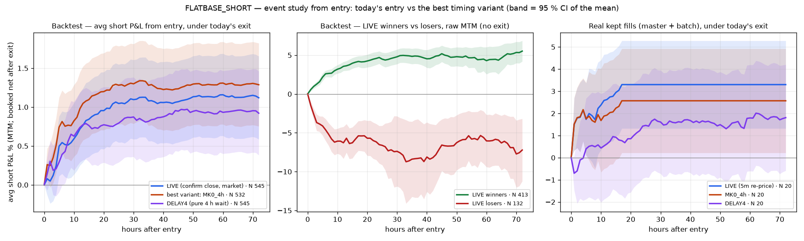

# FLATBASE_SHORT — is today's entry timing right, or can one later / better-priced entry shorten the trade and keep it in profit longer? (2026-11-26)

**Question (operator 11-26):** "Is the entry timing we are having correct? Or might we adjust the entry timing with one variable, reduce the average duration of the trade, and be more time on the positive P&L side?"
**Verdict: KEEP today's entry (market short at the FB_CONFIRM 4-h close). No observe line.** All 10 pre-registered variants lose on the master. 9 of 10 also lose on the backtest. The one that does not lose there (MK0_4h, a resting limit at the confirm close) is an execution change, not a timing change. Its backtest gain is the modelled entry slippage, which real fills do not pay. It fails the luck test (studentized max-t null p 0.23 — review re-check; the script's max-mean null gave 0.71).

## 0 · Prior-study check
| Study (DL / date) | What it tested | Verdict |
|---|---|---|
| DL 417 (10-30) FB_CONFIRM watch | Operator asked the same question then ("entering later would be better?"). Tested waits of 1–24 h from the S4 **signal**, selling 1–7 % higher, "against then 1 h close back below", and the next 4-h close below the signal | That last rule became FB_CONFIRM (DL 428, shipped). Waits were noise and selling higher was worse |
| DL 474 (11-05) fb_combo luck test | The same 13 alternatives from S4, priced on master | Sell 1–7 % higher −1.89 … −0.55 per trade. Waits are noise |
| FLATBASE_EARLY_ENTRY_2026-11-12 | 10 **earlier** rules (S4, H1_4, H1C_2/4, RED5, OFF10C, ROLL4(C), PEAK4(C)) | All worse than LIVE; best H1C_2 Δ −0.43 per episode |
| FLATBASE_S4_VS_CONFIRM_NB_2026-11-19 | Enter at the signal vs wait for the confirm, on today's filters | Keep confirm (+0.86 vs +0.29) |
| DL 429 (11-02) BANK tracker + FLATBASE_SPEED_1113_rows (study_flatbase_depth_filter_1113: M1 / SK1) | A **deeper** confirm, ≥ 1 % below S4 | Observe-only (BANK M1 shadow, DL 539) |
| DL 540 HIGHER_HIGH · 577 NEAR_BASE · 601 FUNDING_ABOVE_BASE · 607 funding-counted stop | Entry filters and the stop | Shipped; the cohort here already carries them |
| **NEW here** | Entries **after** today's confirm, anchored on the confirm close (not S4): resting bounce limits at the confirm close + k × 1h ATR, a spike-VWAP retest, a further 1h or 4h close below the confirm close or below the confirm candle's low, and a pure 4 h delay. Plus a description of today's entry (hold, time in profit, adverse move first) | — |

## Method (pre-registered: reports/FLATBASE_ENTRY_TIMING_PREREG_2026-11-26.md, frozen before any result)
- **Cohort is fixed; only the entry moves.** Backtest = 545 trades on today's stack: HIGHER_HIGH, NEAR_BASE and FUNDING. This is the same cohort as FLATBASE_BASE_TREND_2026-11-26. Re-pricing LIVE here reproduces the rebuild exactly: exit reason on 545 / 545, avg +1.134 vs +1.138.
- **Real = 20 fills:** the 17 master kept fills (KEPT_LIST_FLATBASE_2026-11-21) plus 3 in the batch (KERNEL / MMT / PIPPIN).
  - 10 master fills were entered at S4 before DL 428. The master books them at the confirm entry, so their T0 = the rebuilt confirm close.
  - The confirm-entered fills keep their real fill price as LIVE.
  - The 5m re-price matches the booked result: avg +3.30 vs +3.38, same sign on 20 / 20.
- **Exit:** today's −5 TP (maker) / +10 stop (taker, slip ≥ 0.10) / 72 h, walked from each variant's own fill.
- **Costs:** real funding, plus maker for limit entries and taker + slip for market entries. A limit needs a 0.05 % trade-through to fill, and its fill bar can stop but not take profit. A variant that never fills or never triggers is counted as no trade (0).
- **Statistics:** one-size DCR (X 0.61, every calendar day), day-block bootstrap, a pick-the-best null over all 10 variants (same sign flips for all), half-years, DESIGN / HOLDOUT, leave-one-out and per-pair concentration.

## 1 · Is today's entry early? (descriptive)
- **Backtest LIVE:** 545 · 76 % · +1.13. Hold: mean 14.2 h, median 7.2 h (median time to TP 6.4 h). In profit on 57 % of held 5m closes (winners 68 %, losers 24 %).
- **The first ±1 % touch is a coin flip:** 52 % against us, 45 % with us. But the median trade is in profit at the first 5m close. It reaches +1 % in our favour in a median 20 min, after a median 1.1 % adverse move. TP winners' adverse move before TP: median 2.6 %, p75 5.1 %.
- **Master:** 17 · 100 % · +4.79. Hold mean 6.0 h, median 3.2 h. 64 % of the time in profit; 47 % went against us first, with a median 1.05 % adverse move before +1 %.
- **Losers are the ones that go against first:** 67 % of backtest losers vs 47 % of winners. Their median adverse move before +1 % is 1.75 vs 1.02.
- **Reading:** the entry is not systematically early. The typical drawdown is about 1 % of noise around a move that starts at once. Waiting for a better price mostly skips the trades that fall straight away, which are the best ones.

## 2 · Variants (full tables below)
| variant | backtest N (lost) | bt avg | bt Δ/episode [95 % CI] | bt hold h | bt % time + | bt DCR (LIVE 0.38) | master N (lost) | master avg | master Δ/ep | master DCR (LIVE 1.75) |
|---|---|---|---|---|---|---|---|---|---|---|
| LIVE | 545 (0) | +1.13 | — | 14.2 | 57 % | 0.38 | 17 (0) | +4.79 | — | 1.75 |
| MK0_4h limit @ confirm | 532 (13) | +1.30 | +0.14 [−0.01, +0.31] | 13.5 | 59 % | 0.43 | 17 (0) | +3.93 | −0.86 | 1.42 |
| ATR05_12h | 348 (197) | +1.16 | −0.39 [−0.88, +0.11] | 10.8 | 64 % | 0.25 | 11 (6) | +3.40 | −2.59 | 0.79 |
| ATR1_12h | 232 (313) | +1.45 | −0.52 [−1.09, +0.05] | 8.4 | 66 % | 0.21 | 4 (13) | +0.80 | −4.60 | 0.06 |
| ATR2_12h | 99 (446) | +0.37 | −1.07 [−1.66, −0.47] | 3.6 | 58 % | 0.02 | 1 (16) | +4.01 | −4.56 | 0.09 |
| ATR1_24h | 275 (270) | +1.07 | −0.59 [−1.19, −0.00] | 8.8 | 64 % | 0.18 | 5 (12) | +1.63 | −4.31 | 0.16 |
| VWAP_24h | 213 (332) | +0.65 | −0.88 [−1.47, −0.27] | 8.0 | 61 % | 0.07 | 3 (14) | −0.59 | −4.90 | −0.05 |
| C1H | 509 (36) | +0.73 | −0.45 [−0.93, +0.02] | 17.3 | 54 % | 0.21 | 17 (0) | +1.14 | −3.65 | 0.38 |
| C4H | 482 (63) | +0.59 | −0.61 [−1.21, −0.02] | 18.6 | 55 % | 0.15 | 17 (0) | +1.25 | −3.55 | 0.43 |
| LOW1H | 454 (91) | +0.50 | −0.72 [−1.29, −0.14] | 19.2 | 54 % | 0.11 | 14 (3) | +2.55 | −2.69 | 0.74 |
| DELAY4 | 545 (0) | +0.93 | −0.21 [−0.80, +0.37] | 16.5 | 58 % | 0.30 | 17 (0) | +3.04 | −1.75 | 1.11 |

- **Bounce limits (ATR / VWAP) do what the operator hoped on the trades they fill,** then lose overall. They shorten the hold (8–11 h vs 14 h), raise time in profit (64–66 %) and earn +1.9 to +7.2 more on the kept trades. But they never fill on 36–82 % of episodes, and those episodes earned LIVE +2.9 to +4.4 each (the immediate drops). Net per episode is −0.4 to −1.1 (backtest) and −2.6 to −4.9 (master); DCR falls in both.
- **Waiting for a further close** (C1H / C4H / LOW1H) is worse on every metric: lower WR, a longer hold (17–19 h), less time in profit, and DCR roughly halved.
- **DELAY4** (a pure 4 h wait) costs −0.21 per trade on the backtest and −1.75 on the master, with a longer hold.
- **Turnover does not rescue any variant.** Flatbase has on average 0.37 open positions in the backtest (0.15 master), so the book slots do not bind for this sleeve. The slot-hours a shorter hold frees have no waiting Flatbase signal to use them. The higher Σ per position-day of the limit variants (up to 4.1 vs 1.9) comes from fewer trades, not more money: every one has lower one-size DCR.
- **MK0_4h**, the only backtest-positive variant (6 / 6 half-years), is a **cost artefact.** Its gain on kept trades (+0.26) ≈ the rebuild's modelled entry slip (mean 0.26 %) + taker − maker (0.03). Real confirm-entered fills sold at a median 0.00 % from the confirm close (range −0.32 … +0.60), so live has no such slip to save. On the master it is −0.86 per episode: one fill, CLANKER, turns from TP into a stop because the limit sits below the real fill (leave-one-out without it +0.43). Its 2.4 % no-fill episodes were the immediate +4.8 % winners. Luck test: best of 10 — studentized max-t null p 0.23 (review re-check, MK0_4h t 1.68 vs null 95th 2.36); the script's max-mean null (dominated by the high-variance bounce variants) gave p 0.71 (backtest), 0.73 (HOLDOUT). Fails either way.
- **Batch (3 fills, KERNEL / MMT stops):** several variants turn one stop into a TP (+3 to +7 per episode). N 3 in 2 windows is noise. It is also the "refit around the trades that broke it" trap (CLAUDE.md live lesson), and the master and backtest both reject the same variants.

## 3 · Caveats
- The backtest's 5m paths are coarse: a same-bar TP and stop counts as a stop, and limit fills use a high touch with a 0.05 % trade-through (no queue model). DL 607 (funding counted in the stop) is not re-walked; it applies to all variants alike. Real-fill funding is real on 14 / 20 and 0 on the rest (all variants alike).
- Master N 17 (all winners at today's exit) can only show what a variant loses, not what it saves. The backtest is the only place with losers (132).
- The ATR parity vs the rebuild's atr_1h is exact. VWAP = the live s4_scan convention, frozen at the confirm close (not updated while the limit rests).

## 4 · Blind spots
- **Not tested:**
  - a limit placed at the confirm close but repriced each hour (a trailing or "chasing" limit);
  - entry splitting (half at the confirm, half on a bounce);
  - order-book-based timing (Route B data covers only about 3 weeks of Flatbase fills);
  - 1m-resolution re-walks of the backtest;
  - a variant × BTC-regime interaction.
- Joint entry × exit: every variant was judged under today's exit only. A bounce entry with a closer TP is a two-variable change, outside this one-variable ask.

---
# FLATBASE_ENTRY_TIMING_2026-11-26 — Flatbase entry timing: is the confirm-close entry right, or can one later / better-priced entry do better?

Research only — no bot / config change. Summaries only. Pre-registration: reports/FLATBASE_ENTRY_TIMING_PREREG_2026-11-26.md · script: scripts/FLATBASE_ENTRY_TIMING_2026-11-26.py

## Data + parity
- Backtest: 545 episodes (today's stack). LIVE re-priced here vs the rebuild's X0: exit reason agrees on 100.0 %; avg net +1.134 vs X0 +1.138 (difference = the 0.10 % stop-slip floor + funding window); entry-price |Δ| max 0.0000 %.
- ATR1h parity vs the rebuild's atr_1h: median |Δ| 0.000 pts on 545 (200 h warm-up vs full history).
- Real: 20 kept fills (master 17 · batch 3). LIVE-sim on 5m vs booked: avg +3.30 vs +3.38; same sign on 20 / 20. Funding for real fills: real (14 / 20 covered). 10 master fills were entered at S4 before the FB_CONFIRM ship (DL 428): the master books them at the confirm entry (FLATBASE_CONFIRM_CF, DL 527), so their LIVE here = a market short at the rebuilt confirm close (0.10 % slip); the confirm-entered fills keep their REAL fill price as LIVE.
- DESIGN < 2025-07-01 (94) · HOLDOUT (451). One size X = 0.61 × equity. Costs: taker 0.045 % (+ row entry slip) for market entries, maker 0.018 % (no slip) for limits; TP maker; stop taker + max(slip, 0.10 %).

## 1 · Today's entry, described (LIVE)
| block | N | WR | avg | hold_avg_h | hold_med_h | TP_med_h | TP_share | pct_time_pos | MAE_TP_med | MAE_TP_p75 | against_first | fav_first | h_to_fav1_med | mae_pre_fav1_med | h_first_pos_med |
|---|---|---|---|---|---|---|---|---|---|---|---|---|---|---|---|
| backtest ALL | 545 | +75.78 | +1.13 | +14.20 | +7.17 | +6.38 | +73.76 | +57.46 | +2.64 | +5.06 | +51.74 | +44.95 | +0.33 | +1.09 | +0.08 |
| backtest DESIGN | 94 | +76.60 | +1.30 | +15.82 | +9.88 | +9.17 | +75.53 | +57.65 | +2.04 | +5.01 | +47.87 | +51.06 | +0.50 | +0.98 | +0.08 |
| backtest HOLDOUT | 451 | +75.61 | +1.10 | +13.86 | +6.42 | +5.67 | +73.39 | +57.42 | +2.69 | +5.06 | +52.55 | +43.68 | +0.33 | +1.13 | +0.08 |
| master (5m re-price) | 17 | +100.00 | +4.79 | +6.01 | +3.17 | +3.17 | +100.00 | +63.99 | +4.97 | +5.82 | +47.06 | +41.18 | +0.08 | +1.05 | +0.00 |
| batch (5m re-price) | 3 | +33.33 | -5.16 | +4.39 | +5.17 | +2.58 | +33.33 | +40.85 | +1.09 | +1.09 | +66.67 | +33.33 | +0.42 | +1.03 | +0.00 |
against_first / fav_first = % of trades whose first ±1 % touch went against / with us; h_to_fav1 = hours to the first +1 % in our favour; mae_pre_fav1 = the worst adverse move before that; h_first_pos = hours to the first 5m close in profit; pct_time_pos = % of the held 5m closes with gross MTM > 0.

| block | side | N | hold_med_h | pct_time_pos | against_first | h_to_fav1_med | mae_pre_fav1_med | mae_med |
|---|---|---|---|---|---|---|---|---|
| backtest | winners | 413 | +7.00 | +68.01 | +46.97 | +0.33 | +1.02 | +2.75 |
| backtest | losers | 132 | +7.17 | +24.44 | +66.67 | +0.54 | +1.75 | +10.67 |
| real | winners | 18 | +2.88 | +65.27 | +50.00 | +0.08 | +1.04 | +3.97 |
| real | losers | 2 | +5.29 | +17.73 | +50.00 | +3.38 | +6.79 | +11.63 |

## 2 · Variants vs LIVE (frozen grid, one size, every calendar day)
lost = episodes with no fill / no trigger (contribute 0); d_ep = paired Δ net per EPISODE vs LIVE (lost = −LIVE net) with day-block 95 % CI; d_kept = Δ on the episodes the variant still trades; lost_live_avg = what LIVE earned on the lost ones; per_pos_day = Σ net % per position-day (slot-bound turnover); conc = average open Flatbase positions.

### backtest ALL
| variant | rule | N | lost | WR | avg | sum | hold_h | wait_h | pct_time_pos | per_pos_day | conc | DCR | maxDD | worst_day | d_ep | d_lo | d_hi | d_kept | lost_live_avg |
|---|---|---|---|---|---|---|---|---|---|---|---|---|---|---|---|---|---|---|---|
| LIVE | market at the confirm close (today) | 545 | 0 | +75.78 | +1.13 | +617.88 | +14.20 | +0.00 | +57.46 | +1.92 | +0.37 | +0.38 | -41.36 | -13.86 | +0.00 | +0.00 | +0.00 | +0.00 |  |
| MK0_4h | limit at the confirm close, 4 h | 532 | 13 | +76.50 | +1.30 | +692.18 | +13.46 | +0.09 | +58.90 | +2.32 | +0.34 | +0.43 | -42.14 | -13.83 | +0.14 | -0.01 | +0.31 | +0.26 | +4.83 |
| ATR05_12h | limit +0.5×ATR1h, 12 h | 348 | 197 | +75.57 | +1.16 | +403.96 | +10.75 | +2.70 | +63.76 | +2.59 | +0.18 | +0.25 | -29.07 | -13.31 | -0.39 | -0.88 | +0.11 | +1.88 | +4.40 |
| ATR1_12h | limit +1×ATR1h, 12 h | 232 | 313 | +77.16 | +1.45 | +335.41 | +8.41 | +4.02 | +66.00 | +4.13 | +0.09 | +0.21 | -30.63 | -13.20 | -0.52 | -1.09 | +0.05 | +3.92 | +3.81 |
| ATR2_12h | limit +2×ATR1h, 12 h | 99 | 446 | +70.71 | +0.37 | +36.96 | +3.57 | +5.44 | +58.34 | +2.51 | +0.02 | +0.02 | -38.19 | -12.92 | -1.07 | -1.66 | -0.47 | +7.21 | +2.90 |
| ATR1_24h | limit +1×ATR1h, 24 h | 275 | 270 | +74.91 | +1.07 | +294.60 | +8.75 | +6.03 | +64.07 | +2.94 | +0.11 | +0.18 | -30.63 | -13.20 | -0.59 | -1.19 | -0.00 | +2.94 | +4.19 |
| VWAP_24h | limit at the spike VWAP, 24 h | 213 | 332 | +72.77 | +0.65 | +138.75 | +7.99 | +6.32 | +60.58 | +1.96 | +0.08 | +0.07 | -37.58 | -12.92 | -0.88 | -1.47 | -0.27 | +3.10 | +3.43 |
| C1H | 1st 1h close < confirm close (24 h) | 509 | 36 | +72.69 | +0.73 | +373.53 | +17.34 | +2.75 | +53.76 | +1.02 | +0.42 | +0.21 | -50.05 | -13.23 | -0.45 | -0.93 | +0.02 | -1.18 | -9.87 |
| C4H | next 4h close < confirm close (24 h) | 482 | 63 | +70.95 | +0.59 | +285.40 | +18.60 | +6.37 | +54.52 | +0.76 | +0.43 | +0.15 | -46.51 | -15.92 | -0.61 | -1.21 | -0.02 | -1.68 | -7.57 |
| LOW1H | 1st 1h close < confirm-candle low (24 h) | 454 | 91 | +70.70 | +0.50 | +224.91 | +19.20 | +5.07 | +53.66 | +0.62 | +0.41 | +0.11 | -44.57 | -18.93 | -0.72 | -1.29 | -0.14 | -2.18 | -6.57 |
| DELAY4 | market 4 h after the confirm | 545 | 0 | +73.39 | +0.93 | +505.94 | +16.54 | +4.00 | +57.59 | +1.35 | +0.43 | +0.30 | -37.91 | -15.96 | -0.21 | -0.80 | +0.37 | -0.21 |  |

### backtest DESIGN
| variant | rule | N | lost | WR | avg | sum | hold_h | wait_h | pct_time_pos | per_pos_day | conc | DCR | maxDD | worst_day | d_ep | d_lo | d_hi | d_kept | lost_live_avg |
|---|---|---|---|---|---|---|---|---|---|---|---|---|---|---|---|---|---|---|---|
| LIVE | market at the confirm close (today) | 94 | 0 | +76.60 | +1.30 | +121.82 | +15.82 | +0.00 | +57.65 | +1.97 | +0.17 | +0.18 | -21.99 | -13.07 | +0.00 | +0.00 | +0.00 | +0.00 |  |
| MK0_4h | limit at the confirm close, 4 h | 92 | 2 | +77.17 | +1.47 | +135.17 | +15.46 | +0.17 | +59.49 | +2.28 | +0.16 | +0.20 | -22.02 | -13.04 | +0.14 | -0.15 | +0.56 | +0.24 | +4.57 |
| ATR05_12h | limit +0.5×ATR1h, 12 h | 63 | 31 | +73.02 | +0.78 | +49.29 | +14.98 | +2.89 | +64.77 | +1.25 | +0.11 | +0.07 | -21.24 | -7.27 | -0.77 | -1.66 | +0.22 | +1.23 | +4.83 |
| ATR1_12h | limit +1×ATR1h, 12 h | 42 | 52 | +71.43 | +0.77 | +32.48 | +15.40 | +4.74 | +68.40 | +1.21 | +0.07 | +0.04 | -18.22 | -7.27 | -0.95 | -2.23 | +0.44 | +2.84 | +4.02 |
| ATR2_12h | limit +2×ATR1h, 12 h | 12 | 82 | +75.00 | +1.09 | +13.05 | +6.16 | +5.26 | +55.36 | +4.24 | +0.01 | +0.02 | -9.78 | -6.63 | -1.16 | -2.56 | +0.32 | +7.99 | +2.50 |
| ATR1_24h | limit +1×ATR1h, 24 h | 50 | 44 | +72.00 | +0.78 | +38.87 | +15.78 | +6.74 | +63.40 | +1.18 | +0.09 | +0.05 | -17.81 | -7.27 | -0.88 | -2.23 | +0.55 | +1.84 | +3.97 |
| VWAP_24h | limit at the spike VWAP, 24 h | 41 | 53 | +73.17 | +0.81 | +33.01 | +15.33 | +6.39 | +62.60 | +1.26 | +0.07 | +0.04 | -15.08 | -7.27 | -0.94 | -2.24 | +0.46 | +2.37 | +3.51 |
| C1H | 1st 1h close < confirm close (24 h) | 85 | 9 | +74.12 | +1.12 | +95.18 | +18.43 | +2.62 | +54.52 | +1.46 | +0.17 | +0.14 | -29.10 | -7.16 | -0.28 | -1.23 | +0.54 | -1.43 | -10.57 |
| C4H | next 4h close < confirm close (24 h) | 79 | 15 | +70.89 | +0.73 | +57.92 | +19.96 | +6.43 | +55.25 | +0.88 | +0.18 | +0.08 | -29.35 | -9.10 | -0.68 | -2.02 | +0.54 | -2.27 | -7.70 |
| LOW1H | 1st 1h close < confirm-candle low (24 h) | 76 | 18 | +73.68 | +1.15 | +87.05 | +21.50 | +4.57 | +55.92 | +1.28 | +0.18 | +0.12 | -24.44 | -12.60 | -0.37 | -1.58 | +0.80 | -2.22 | -7.45 |
| DELAY4 | market 4 h after the confirm | 94 | 0 | +74.47 | +1.04 | +97.87 | +19.11 | +4.00 | +58.07 | +1.31 | +0.20 | +0.14 | -24.61 | -9.10 | -0.25 | -1.46 | +0.91 | -0.25 |  |

### backtest HOLDOUT
| variant | rule | N | lost | WR | avg | sum | hold_h | wait_h | pct_time_pos | per_pos_day | conc | DCR | maxDD | worst_day | d_ep | d_lo | d_hi | d_kept | lost_live_avg |
|---|---|---|---|---|---|---|---|---|---|---|---|---|---|---|---|---|---|---|---|
| LIVE | market at the confirm close (today) | 451 | 0 | +75.61 | +1.10 | +496.06 | +13.86 | +0.00 | +57.42 | +1.90 | +0.52 | +0.52 | -41.36 | -13.86 | +0.00 | +0.00 | +0.00 | +0.00 |  |
| MK0_4h | limit at the confirm close, 4 h | 440 | 11 | +76.36 | +1.27 | +557.02 | +13.04 | +0.07 | +58.78 | +2.33 | +0.47 | +0.60 | -42.14 | -13.83 | +0.14 | -0.03 | +0.32 | +0.26 | +4.87 |
| ATR05_12h | limit +0.5×ATR1h, 12 h | 285 | 166 | +76.14 | +1.24 | +354.67 | +9.82 | +2.66 | +63.54 | +3.04 | +0.23 | +0.38 | -29.07 | -13.31 | -0.31 | -0.88 | +0.23 | +2.02 | +4.32 |
| ATR1_12h | limit +1×ATR1h, 12 h | 190 | 261 | +78.42 | +1.59 | +302.94 | +6.86 | +3.86 | +65.47 | +5.58 | +0.11 | +0.33 | -30.63 | -13.20 | -0.43 | -1.05 | +0.21 | +4.16 | +3.77 |
| ATR2_12h | limit +2×ATR1h, 12 h | 87 | 364 | +70.11 | +0.27 | +23.91 | +3.22 | +5.47 | +58.75 | +2.05 | +0.02 | +0.01 | -38.19 | -12.92 | -1.05 | -1.70 | -0.38 | +7.11 | +3.00 |
| ATR1_24h | limit +1×ATR1h, 24 h | 225 | 226 | +75.56 | +1.14 | +255.73 | +7.19 | +5.87 | +64.22 | +3.79 | +0.13 | +0.27 | -30.63 | -13.20 | -0.53 | -1.19 | +0.13 | +3.18 | +4.23 |
| VWAP_24h | limit at the spike VWAP, 24 h | 172 | 279 | +72.67 | +0.61 | +105.74 | +6.24 | +6.30 | +60.10 | +2.36 | +0.09 | +0.09 | -37.58 | -12.92 | -0.87 | -1.57 | -0.19 | +3.27 | +3.41 |
| C1H | 1st 1h close < confirm close (24 h) | 424 | 27 | +72.41 | +0.66 | +278.35 | +17.12 | +2.78 | +53.61 | +0.92 | +0.60 | +0.26 | -50.05 | -13.23 | -0.48 | -1.04 | +0.05 | -1.13 | -9.64 |
| C4H | next 4h close < confirm close (24 h) | 403 | 48 | +70.97 | +0.56 | +227.49 | +18.33 | +6.35 | +54.38 | +0.74 | +0.61 | +0.21 | -44.52 | -15.92 | -0.60 | -1.28 | +0.08 | -1.56 | -7.53 |
| LOW1H | 1st 1h close < confirm-candle low (24 h) | 378 | 73 | +70.11 | +0.36 | +137.85 | +18.74 | +5.17 | +53.21 | +0.47 | +0.58 | +0.10 | -44.57 | -18.93 | -0.79 | -1.44 | -0.15 | -2.17 | -6.35 |
| DELAY4 | market 4 h after the confirm | 451 | 0 | +73.17 | +0.90 | +408.07 | +16.00 | +4.00 | +57.49 | +1.36 | +0.60 | +0.41 | -37.91 | -15.96 | -0.20 | -0.85 | +0.46 | -0.20 |  |

### master
| variant | rule | N | lost | WR | avg | sum | hold_h | wait_h | pct_time_pos | per_pos_day | conc | DCR | maxDD | worst_day | d_ep | d_lo | d_hi | d_kept | lost_live_avg |
|---|---|---|---|---|---|---|---|---|---|---|---|---|---|---|---|---|---|---|---|
| LIVE | market at the confirm close (today) | 17 | 0 | +100.00 | +4.79 | +81.46 | +6.01 | +0.00 | +63.99 | +19.12 | +0.15 | +1.75 | +0.00 | +0.00 | +0.00 | +0.00 | +0.00 | +0.00 |  |
| MK0_4h | limit at the confirm close, 4 h | 17 | 0 | +94.12 | +3.93 | +66.78 | +6.13 | +0.04 | +65.29 | +15.37 | +0.16 | +1.42 | -6.20 | -6.20 | -0.86 | -3.00 | +0.03 | -0.86 |  |
| ATR05_12h | limit +0.5×ATR1h, 12 h | 11 | 6 | +90.91 | +3.40 | +37.36 | +2.95 | +3.78 | +82.97 | +27.63 | +0.05 | +0.79 | -6.79 | -6.79 | -2.59 | -4.30 | -0.87 | -1.32 | +4.94 |
| ATR1_12h | limit +1×ATR1h, 12 h | 4 | 13 | +75.00 | +0.80 | +3.19 | +4.15 | +6.56 | +56.73 | +4.62 | +0.02 | +0.06 | -7.14 | -7.14 | -4.60 | -6.38 | -3.07 | -4.14 | +4.75 |
| ATR2_12h | limit +2×ATR1h, 12 h | 1 | 16 | +100.00 | +4.01 | +4.01 | +0.79 | +11.29 | +80.00 | +121.45 | +0.00 | +0.09 | +0.00 | +0.00 | -4.56 | -4.92 | -4.10 | -0.93 | +4.78 |
| ATR1_24h | limit +1×ATR1h, 24 h | 5 | 12 | +80.00 | +1.63 | +8.16 | +3.34 | +9.91 | +55.38 | +11.72 | +0.02 | +0.16 | -7.14 | -7.14 | -4.31 | -6.18 | -2.77 | -3.31 | +4.73 |
| VWAP_24h | limit at the spike VWAP, 24 h | 3 | 14 | +66.67 | -0.59 | -1.77 | +4.68 | +11.01 | +49.17 | -3.03 | +0.02 | -0.05 | -7.14 | -7.14 | -4.90 | -6.58 | -3.54 | -5.53 | +4.76 |
| C1H | 1st 1h close < confirm close (24 h) | 17 | 0 | +76.47 | +1.14 | +19.39 | +7.54 | +1.65 | +53.83 | +3.63 | +0.19 | +0.38 | -6.22 | -6.22 | -3.65 | -6.49 | -1.02 | -3.65 |  |
| C4H | next 4h close < confirm close (24 h) | 17 | 0 | +76.47 | +1.25 | +21.19 | +22.65 | +6.12 | +49.49 | +1.32 | +0.57 | +0.43 | -7.23 | -6.29 | -3.55 | -6.00 | -1.20 | -3.55 |  |
| LOW1H | 1st 1h close < confirm-candle low (24 h) | 14 | 3 | +85.71 | +2.55 | +35.70 | +15.00 | +3.93 | +57.52 | +4.08 | +0.31 | +0.74 | -6.22 | -6.22 | -2.69 | -5.39 | -0.36 | -2.21 | +4.94 |
| DELAY4 | market 4 h after the confirm | 17 | 0 | +88.24 | +3.04 | +51.63 | +19.33 | +4.00 | +57.57 | +3.77 | +0.49 | +1.11 | -5.24 | -3.36 | -1.75 | -3.61 | -0.17 | -1.75 |  |

### batch
| variant | rule | N | lost | WR | avg | sum | hold_h | wait_h | pct_time_pos | per_pos_day | conc | DCR | maxDD | worst_day | d_ep | d_lo | d_hi | d_kept | lost_live_avg |
|---|---|---|---|---|---|---|---|---|---|---|---|---|---|---|---|---|---|---|---|
| LIVE | market at the confirm close (today) | 3 | 0 | +33.33 | -5.16 | -15.47 | +4.39 | +0.00 | +40.85 | -28.20 | +0.14 | -2.39 | -6.22 | -6.22 | +0.00 | +0.00 | +0.00 | +0.00 |  |
| MK0_4h | limit at the confirm close, 4 h | 3 | 0 | +33.33 | -5.13 | -15.39 | +4.35 | +0.04 | +40.80 | -28.32 | +0.14 | -2.38 | -6.21 | -6.21 | +0.03 | +0.03 | +0.03 | +0.03 |  |
| ATR05_12h | limit +0.5×ATR1h, 12 h | 3 | 0 | +66.67 | -0.08 | -0.25 | +3.10 | +3.85 | +49.41 | -0.64 | +0.10 | -0.06 | +0.00 | -3.18 | +5.07 | +0.03 | +15.17 | +5.07 |  |
| ATR1_12h | limit +1×ATR1h, 12 h | 2 | 1 | +50.00 | -2.61 | -5.21 | +1.42 | +3.92 | +54.55 | -44.15 | +0.03 | -0.85 | +0.00 | -6.21 | +3.42 | -2.46 | +15.17 | +7.60 | +4.94 |
| ATR2_12h | limit +2×ATR1h, 12 h | 1 | 2 | +100.00 | +4.96 | +4.96 | +0.96 | +6.12 | +100.00 | +124.34 | +0.01 | +0.75 | +0.00 | +0.00 | +6.81 | +5.12 | +10.20 | +15.17 | -2.63 |
| ATR1_24h | limit +1×ATR1h, 24 h | 3 | 0 | +66.67 | -0.08 | -0.25 | +1.57 | +9.38 | +53.75 | -1.26 | +0.05 | -0.11 | +0.00 | -6.21 | +5.07 | +0.03 | +15.17 | +5.07 |  |
| VWAP_24h | limit at the spike VWAP, 24 h | 2 | 1 | +50.00 | -2.61 | -5.21 | +0.54 | +11.17 | +54.55 | -115.48 | +0.01 | -0.80 | +0.00 | -3.18 | +3.42 | +0.03 | +10.20 | +0.03 | -10.20 |
| C1H | 1st 1h close < confirm close (24 h) | 3 | 0 | +66.67 | -0.11 | -0.33 | +2.67 | +3.33 | +64.04 | -0.99 | +0.08 | -0.07 | +0.00 | -3.21 | +5.05 | -0.00 | +15.14 | +5.05 |  |
| C4H | next 4h close < confirm close (24 h) | 2 | 1 | +50.00 | -2.63 | -5.27 | +12.88 | +6.00 | +26.86 | -4.91 | +0.27 | -0.86 | +0.00 | -6.22 | +3.40 | -2.47 | +15.14 | -0.00 | -10.20 |
| LOW1H | 1st 1h close < confirm-candle low (24 h) | 2 | 1 | +50.00 | -2.63 | -5.27 | +12.92 | +5.50 | +26.63 | -4.89 | +0.27 | -0.86 | +0.00 | -6.22 | +3.40 | -2.47 | +15.14 | -0.00 | -10.20 |
| DELAY4 | market 4 h after the confirm | 3 | 0 | +33.33 | -5.16 | -15.47 | +2.81 | +4.00 | +21.73 | -44.12 | +0.09 | -2.55 | +0.00 | -12.45 | -0.00 | -7.57 | +15.14 | -0.00 |  |

### master + batch
| variant | rule | N | lost | WR | avg | sum | hold_h | wait_h | pct_time_pos | per_pos_day | conc | DCR | maxDD | worst_day | d_ep | d_lo | d_hi | d_kept | lost_live_avg |
|---|---|---|---|---|---|---|---|---|---|---|---|---|---|---|---|---|---|---|---|
| LIVE | market at the confirm close (today) | 20 | 0 | +90.00 | +3.30 | +65.99 | +5.77 | +0.00 | +60.52 | +13.72 | +0.16 | +1.30 | -9.24 | -6.22 | +0.00 | +0.00 | +0.00 | +0.00 |  |
| MK0_4h | limit at the confirm close, 4 h | 20 | 0 | +85.00 | +2.57 | +51.39 | +5.87 | +0.04 | +61.62 | +10.51 | +0.16 | +1.00 | -9.19 | -6.21 | -0.73 | -2.50 | +0.03 | -0.73 |  |
| ATR05_12h | limit +0.5×ATR1h, 12 h | 14 | 6 | +85.71 | +2.65 | +37.12 | +2.98 | +3.79 | +75.78 | +21.34 | +0.06 | +0.73 | -6.79 | -6.79 | -1.44 | -3.55 | +1.22 | +0.05 | +4.94 |
| ATR1_12h | limit +1×ATR1h, 12 h | 6 | 14 | +66.67 | -0.34 | -2.02 | +3.24 | +5.68 | +56.00 | -2.50 | +0.03 | -0.06 | -7.55 | -7.14 | -3.40 | -5.62 | -0.65 | -0.23 | +4.76 |
| ATR2_12h | limit +2×ATR1h, 12 h | 2 | 18 | +100.00 | +4.49 | +8.97 | +0.88 | +8.71 | +90.00 | +123.03 | +0.00 | +0.18 | +0.00 | +0.00 | -2.85 | -4.72 | -0.45 | +7.12 | +3.96 |
| ATR1_24h | limit +1×ATR1h, 24 h | 8 | 12 | +75.00 | +0.99 | +7.91 | +2.68 | +9.71 | +54.77 | +8.86 | +0.03 | +0.14 | -7.14 | -7.14 | -2.90 | -5.24 | -0.20 | -0.16 | +4.73 |
| VWAP_24h | limit at the spike VWAP, 24 h | 5 | 15 | +60.00 | -1.40 | -6.98 | +3.02 | +11.07 | +51.32 | -11.08 | +0.02 | -0.16 | -7.37 | -7.14 | -3.65 | -5.72 | -1.46 | -3.31 | +3.76 |
| C1H | 1st 1h close < confirm close (24 h) | 20 | 0 | +75.00 | +0.95 | +19.07 | +6.81 | +1.90 | +55.36 | +3.36 | +0.19 | +0.35 | -6.22 | -6.22 | -2.35 | -5.37 | +0.73 | -2.35 |  |
| C4H | next 4h close < confirm close (24 h) | 19 | 1 | +73.68 | +0.84 | +15.92 | +21.62 | +6.11 | +47.11 | +0.93 | +0.57 | +0.28 | -7.23 | -6.29 | -2.50 | -5.03 | +0.52 | -3.17 | -10.20 |
| LOW1H | 1st 1h close < confirm-candle low (24 h) | 16 | 4 | +81.25 | +1.90 | +30.44 | +14.74 | +4.12 | +53.66 | +3.10 | +0.33 | +0.57 | -9.41 | -6.22 | -1.78 | -4.57 | +1.05 | -1.93 | +1.15 |
| DELAY4 | market 4 h after the confirm | 20 | 0 | +80.00 | +1.81 | +36.16 | +16.85 | +4.00 | +52.19 | +2.57 | +0.47 | +0.68 | -12.45 | -12.45 | -1.49 | -3.81 | +1.27 | -1.49 |  |

## 3 · Consistency: paired Δ per episode by half-year (backtest) + the pick-the-best null
| half | N | LIVE_avg | MK0_4h | ATR05_12h | ATR1_12h | ATR2_12h | ATR1_24h | VWAP_24h | C1H | C4H | LOW1H | DELAY4 |
|---|---|---|---|---|---|---|---|---|---|---|---|---|
| 24-H1 | 2 | +2.57 | +1.20 | +2.44 | -0.09 | -2.57 | +2.43 | +1.86 | +2.42 | +2.41 | -7.85 | +2.41 |
| 24-H2 | 36 | +0.93 | +0.02 | -1.45 | -0.98 | -0.40 | -0.84 | -0.91 | +0.71 | -0.20 | +0.22 | +0.11 |
| 25-H1 | 56 | +1.49 | +0.19 | -0.45 | -0.96 | -1.60 | -1.03 | -1.06 | -1.02 | -1.10 | -0.48 | -0.58 |
| 25-H2 | 136 | +0.45 | +0.12 | +0.27 | +0.39 | +0.04 | +0.14 | -0.18 | -0.28 | +0.20 | -0.12 | +0.41 |
| 26-H1 | 188 | +0.64 | +0.17 | -0.20 | +0.01 | -0.83 | -0.01 | -0.30 | -0.25 | -0.03 | -0.29 | +0.30 |
| 26-H2 | 127 | +2.47 | +0.10 | -1.11 | -1.96 | -2.54 | -2.02 | -2.45 | -1.05 | -2.29 | -2.27 | -1.58 |
half-years with Δ > 0: MK0_4h 6/6 · ATR05_12h 2/6 · ATR1_12h 2/6 · ATR2_12h 1/6 · ATR1_24h 2/6 · VWAP_24h 1/6 · C1H 2/6 · C4H 2/6 · LOW1H 1/6 · DELAY4 4/6

Pick-the-best null (10 variants, day-block sign flips, same flips for all variants): backtest ALL best = MK0_4h Δ +0.136/episode · p 0.708 (null 95th pct +0.672) · HOLDOUT best = MK0_4h Δ +0.135 · p 0.733 · master best = MK0_4h Δ -0.863 · p 0.964.

## 4 · Master (real kept fills): leave-one-out + per-pair concentration of each variant's Δ
| variant | d_sum | loo | top_pair | top_pair_share |
|---|---|---|---|---|
| MK0_4h | -14.68 | Δ -14.68 pts · without the biggest (CLANKER 11-05 -15.11, 103% of Δ): +0.43 pts ⚠ one fill carries ≥ 50 % of the result | CLANKER | +97.22 |
| ATR05_12h | -44.09 | Δ -44.09 pts · without the biggest (LSK 10-29 -16.07, 36% of Δ): -28.02 pts | LSK | +34.18 |
| ATR1_12h | -78.26 | Δ -78.26 pts · without the biggest (LSK 10-29 -16.64, 21% of Δ): -61.62 pts | LSK | +21.22 |
| ATR2_12h | -77.45 | Δ -77.45 pts · without the biggest (PARTI 10-30 -4.94, 6% of Δ): -72.51 pts | G | +12.43 |
| ATR1_24h | -73.30 | Δ -73.30 pts · without the biggest (LSK 10-29 -16.64, 23% of Δ): -56.66 pts | LSK | +22.64 |
| VWAP_24h | -83.23 | Δ -83.23 pts · without the biggest (LSK 10-29 -16.64, 20% of Δ): -66.59 pts | LSK | +19.97 |
| C1H | -62.06 | Δ -62.06 pts · without the biggest (PARTI 10-30 -15.15, 24% of Δ): -46.92 pts | PARTI | +24.39 |
| C4H | -60.27 | Δ -60.27 pts · without the biggest (LSK 10-29 -15.38, 26% of Δ): -44.88 pts | LSK | +24.50 |
| LOW1H | -45.76 | Δ -45.76 pts · without the biggest (ORDER 10-24 -15.14, 33% of Δ): -30.61 pts | ORDER | +31.88 |
| DELAY4 | -29.83 | Δ -29.83 pts · without the biggest (LSK 10-29 -15.38, 52% of Δ): -14.45 pts ⚠ one fill carries ≥ 50 % of the result | LSK | +47.44 |

Backtest per-pair concentration of the Δ:
| variant | d_sum | pairs | top_loss_pair | top_loss_share | top_gain_pair | top_gain |
|---|---|---|---|---|---|---|
| MK0_4h | +74.30 | 284 | 1000LUNC | +8.01 | CTSI | +15.64 |
| ATR05_12h | -213.92 | 284 | ALICE | +3.21 | ALPINE | +30.34 |
| ATR1_12h | -282.47 | 284 | SOLV | +1.77 | MEME | +33.44 |
| ATR2_12h | -580.92 | 284 | DRIFT | +1.75 | 1000SATS | +40.81 |
| ATR1_24h | -323.28 | 284 | TST | +2.57 | MEME | +33.44 |
| VWAP_24h | -479.12 | 284 | ALICE | +2.54 | ENJ | +32.02 |
| C1H | -244.35 | 284 | BROCCOLI714 | +4.12 | 1000SATS | +25.61 |
| C4H | -332.48 | 284 | LUMIA | +3.10 | NOM | +30.49 |
| LOW1H | -392.97 | 284 | LUMIA | +2.93 | 1000SATS | +35.81 |
| DELAY4 | -111.94 | 284 | IO | +3.61 | HYPER | +31.62 |

## 5 · Frozen decision rule
| variant | master_d | bt_d | bt_lo | holdout_d | halves | DCR_bt | DCR_master | verdict |
|---|---|---|---|---|---|---|---|---|
| MK0_4h | -0.86 | +0.14 | -0.01 | +0.14 | 6/6 | +0.38→+0.43 | +1.75→+1.42 | keep today |
| ATR05_12h | -2.59 | -0.39 | -0.88 | -0.31 | 2/6 | +0.38→+0.25 | +1.75→+0.79 | keep today |
| ATR1_12h | -4.60 | -0.52 | -1.09 | -0.43 | 2/6 | +0.38→+0.21 | +1.75→+0.06 | keep today |
| ATR2_12h | -4.56 | -1.07 | -1.66 | -1.05 | 1/6 | +0.38→+0.02 | +1.75→+0.09 | keep today |
| ATR1_24h | -4.31 | -0.59 | -1.19 | -0.53 | 2/6 | +0.38→+0.18 | +1.75→+0.16 | keep today |
| VWAP_24h | -4.90 | -0.88 | -1.47 | -0.87 | 1/6 | +0.38→+0.07 | +1.75→-0.05 | keep today |
| C1H | -3.65 | -0.45 | -0.93 | -0.48 | 2/6 | +0.38→+0.21 | +1.75→+0.38 | keep today |
| C4H | -3.55 | -0.61 | -1.21 | -0.60 | 2/6 | +0.38→+0.15 | +1.75→+0.43 | keep today |
| LOW1H | -2.69 | -0.72 | -1.29 | -0.79 | 1/6 | +0.38→+0.11 | +1.75→+0.74 | keep today |
| DELAY4 | -1.75 | -0.21 | -0.80 | -0.20 | 4/6 | +0.38→+0.30 | +1.75→+1.11 | keep today |
