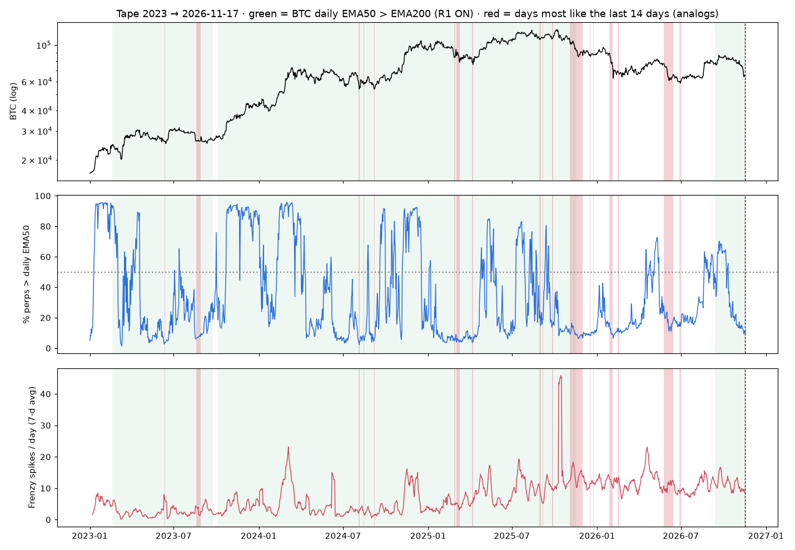
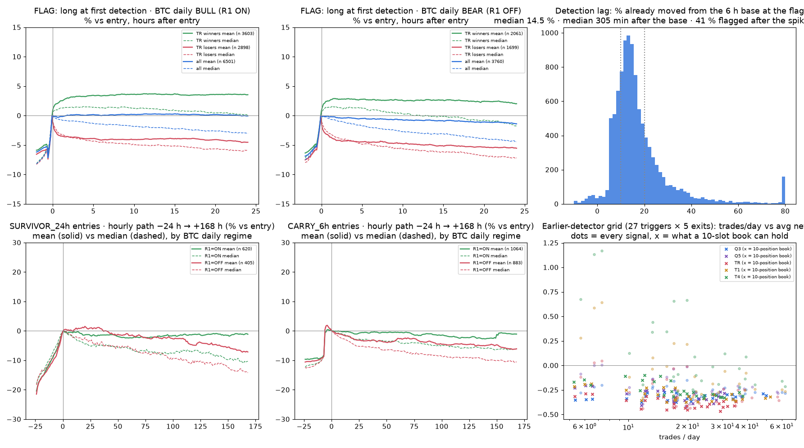

# FRENZY LONG SEARCH — auditing our own "no long edge" verdict (2026-11-19)

**Pre-registered:** `FRENZY_LONG_SEARCH_2026-11-19_PREREG.md` (main families: see the timing disclosure in the PREREG — frozen around the build, results possibly seen; addendum A "buy at
first detection" and addendum B "earlier detector" frozen before their own results — each says what had already been read).
Research only. No bot code, config, tests or CLAUDE files changed (report-only commit). WILLY_HT is studied by another agent and is not
re-tested here.

## The question
The operator: *"Market is bullish and more coins are in frenzy, yet you keep saying you find no LONG opportunity. I'm 100 % sure there
is something."* Plus three follow-ups during the study: buy **at first detection** instead of waiting for a dip; test **earlier detectors**
(the flag fires late); and rank candidates by **daily compound return at many trades a day**, not by %/trade.

## Plain answer
1. **The tape is not bullish right now.** Over the 14 days to 11-17 BTC fell 16 % (≈ 77.4k → 64.9k; 63.0k on 11-18). Only **10–13 %** of
   USDT perps sit above their daily EMA50, near the lowest readings since 2023. The median alt is −6.8 % over 7 days. The BTC daily
   EMA50 is still above the EMA200, but the gap shrank from +5.7 to +0.5 in three weeks. Frenzy spikes run at 8–10 a day: above the
   2023–24 rate (3–5), below October's 12–13. "More coins in frenzy" is true against 2023–24. "Bullish" is not true of the market;
   it is true of a handful of single coins.
2. **There IS money in Frenzy pumps on the long side, but it sits BEFORE our flag.** Entering at the 6-hour base, which you can only
   know in hindsight, earns **+8.8 %/trade gross** with a 3 % trailing stop. Entering at the flag earns −0.26 % gross. The flag fires after
   a median **+14.5 %** move. Only 23 % of episodes are flagged with less than 10 % done, and those lose too (−0.51 %/trade net).
3. **Detecting earlier does not reach that money.** A 27-trigger grid of earlier detectors (5 / 15 / 30 min × 2 / 3 / 5 % × 5 / 10 / 20×
   volume), on all coins including delisted ones from 2022-11 to 2026-11:
   - When the coin does go on to Frenzy, the earlier detector fires a median of only **5–10 minutes** before today's flag, at the same price.
   - **75–95 %** of its signals never become a Frenzy at all.
   - About 39 % never make +3 % before falling −5 %.
   - **0 of 135 cells** are positive with a realistic 10-position book. Family-wise p = 0.085: no cell beats random timing on the
     same coins.
4. **Frequency only comes at the cost of the edge.** Every family that trades 5–60 times a day loses money per trade with a realistic
   book. The few that look positive with no position limit are paid by about 84 market-wide **burst hours** (≥ 10 coins popping in the
   same hour, mostly crash rebounds: 2025-10-10, 2024-08-05, 2025-02-03, …). Without the top 10 days the best one is −0.06 %/trade. That
   is the CRASH_DIP event trade already on the observe list, not a daily long.
5. **The new horizons (hold 1–7 days, collect funding) are a lottery, not an edge.** The pre-registered families: SURVIVOR (coins
   still holding their pump 24–72 h later) and CARRY (deeply negative funding, so the long is paid). 8 primary cells:
   - none has a day-clustered CI above 0;
   - family-wise p = 0.41;
   - every one has a negative median and is negative with the best 5 % of trades removed.

   CARRY really does collect 2.8–3.9 % in funding over 72 h. The price falls by more. Most entries DO go up first (87–94 % make +1 %, median reach +7 … +16 %), then give it back, and fixed +5 / +10 % targets do not fix that (exploratory).
6. **Regime does not rescue any family, and it often points the wrong way.**
   - Every family was split by BTC daily trend, BTC prior-day sign, alt breadth, Frenzy count and "days like now", counted in window units.
   - High breadth is **worse** for every family.
   - The 120 days that most resemble the current tape are **worse** for every family (e.g. CARRY_24 −2.26 vs +0.51 on other days).
   - This repeats REGIME_LONGS (11-18): a BTC-led or broad-market rally does not lift Frenzy longs.
7. **Real fills (master) are positive, but they cover one window.**
   - 115 kept Frenzy long fills, Oct 3 → Nov 17, average **+1.07 %/fill** on today's stack. As traded, all 282 fills average −0.35 %.
   - All 37 fill days sit in one regime cell (R1 ON, high Frenzy count), so the master cannot tell regimes apart.
   - It is fading with the tape: +0.91 / +1.00 / +1.86 / +1.20 / +1.63 in weeks 41–45, then **+0.21 in week 46 and −0.29 in week 47**,
     as BTC's 7-day return went to −8 % and then −13 %.
   - The kept filters were fitted on these same fills (OOS_REAL_LITE).
8. **One post-hoc lead survives most checks: SLOW_RIDE.** Buy a shortlisted Frenzy coin 24 h after its spike, rest a +20 % maker TP, no
   stop, hold up to 7 days, at most 10 open.
   - Result: +1.48 %/trade, CI [+0.60, +2.19], 7 of 8 half-years positive, +0.85 at 0.50 % slip, best-5 %-out +0.37.
   - But it is **flat in DESIGN** (+0.34 %/trade, one-size DCR ≈ 0.02 %/day) and **negative on the days that look like now** (−0.94).
   - It is 1.7 trades a day with a −24 to −28 % drawdown at 5 % notional.
   - It was picked after reading 72 cells.

   **OBSERVE only.** It is the opposite of the "many trades a day" ask.
9. **Verdict: no long sleeve to build.**
   - The operator's instinct is right about **where** the money is: in the first leg of the pump, before anyone can confirm it.
   - Our detector cannot be there. A faster detector at a realistic latency cannot either: when it fires early it is mostly wrong, and
     when it is right it is only minutes ahead.
   - What remains:
     - an event trade (crash-day burst / CRASH_DIP, already observed);
     - a slow, fat-tailed, low-frequency ride (SLOW_RIDE, new observe line).

## 1. Inventory — what was already tested, and the gaps
| idea | where | result |
|---|---|---|
| FRENZY_LONG on today's rules, 2024-06 → 2026-11 | VERIFY_FRENZY_LONG 11-17 | −0.15 %/trade; frozen filter only positive in-sample; 2024-H2 −0.79 |
| FRENZY_LONG regime switches (139 + 125 rules, 1D/2D) | FRENZY_LONG_REGIME 11-17 | 0 pass; family-wise p 0.88; risk-on sign wrong |
| LITE / LITE_RETRY / WILLY rebuilds + OOS | VERIFY_* / OOS_REAL_LITE 11-17 | ≈ 0 or negative; only 2026-H2 positive; master good from in-sample filters |
| Every trigger, every 5m bar 0–24 h, 73 features, 1D/2D/3D, walk-forward model, 27 exits | UNIFIED_LONG 11-18 | no ≥ 5/day long; raw −0.09 % gross; model top decile below costs |
| 58 single exits incl. trails, VWAP / spike-low invalidation, BE locks | LONG_LEADS_DEEP LL3 11-18 | all lose; "−4 % first" is an entry problem |
| 8 regime calendars × 5 triggers, window-block null | REGIME_LONGS 11-18 | none; bull regimes often worse |
| 336 TA cells (14 indicators × TF × exits) | FRENZY_TA_CATALOG 11-17 | 0 pass; longs lose before costs |
| pre-spike model, first 30 min, flat base | FRENZY_EARLY_DETECTION 11-17 | 60/60 + 30/30 negative; 85–91 % of starts fizzle |
| 1 h / 4 h BREV signature (+ buyers ≥ 1.1) | BREV_SIGNATURE 11-18 | observe-only; fails family-wise; BREV itself not caught |
| breakout stops / confirm-then-ride | FRENZY_HUNT_FOLLOWUP 11-17 | 0 / 120; +4 % → +8 % is a coin flip |
| second push / dip after push | FRENZY_SECOND_PUSH 10-02 | all negative |
| high-ATR longs L1–L4 | HIGH_ATR 11-18 | none; only BTC-falling VWAP snapback (observe) |
| spot-led long mirror | SPOT_SHARE_DEEP 11-17 | longs lose in holdouts |
| crowded-short filter on triggers | UNIFIED / LONG_LEADS LL2 | relative help, still ≤ 0 |
| crash-day dip long (CRASH_DIP) | UNIFIED / LONG_LEADS / REGIME_LONGS | event trade, observe |
| runaway / lift-off / volume-leads | OVERNIGHT 10-01 (memory) | 0 / 128; only pass lived in the first 60 s |
| entry latency 0–30 s; seconds-delay | FRENZY_ENTRY_LATENCY 10-07, SECONDS_DELAY 10-08 | flat 1–13 s; speed not worth building |
| hot-state scalp | HOT_SCALP 10-01 | no-edge rate |
| **GAPS (this study)** | | **holding horizon > 24 h (to 7 d) with no TP cap · late survivors 24–72 h after the spike · funding carry for longs · first-detection long split by how early the flag fired, with a hindsight bound · earlier-detector grid with a random-timing null · current-tape analogs · ranking by daily compound at a realistic book** |
| still untestable | — | order-book depth history · Alpha / social / listing announcements · sub-minute cascade entries (no tick history; the local 1m cache is outcome-selected, see §5) |

## 2. Theory (written before the data) and what came out
| theory | expected | found |
|---|---|---|
| (a) fresh breakout, volume expanding, OI rising | + early | The money is there, but before the flag (hindsight bound +8.8 %). At detection it is spent. |
| (b) second leg after a shallow base above VWAP (SURVIVOR) | + | 24 h −0.96, 48 h +0.65, 72 h −1.90 (72 h stop −20). Negative medians, no consistency. |
| (c) squeeze fuel / funding carry (CARRY) | + over 72 h | Funding received 2.8–3.9 % per trade. Price loses more. 6 h +0.88, 24 h −0.01, 48 h +0.15. All CIs include 0. |
| (d) spot-led / buyers / top traders adding / OI up (MIRROR composite on the UNIFIED rows) | + | DESIGN −0.31 %/trade at TP3/SL4/4h (6,820 rows), B −0.06, H24 0.00. The mirror of the short's edge does not exist for longs. |
| (e) breadth / BTC daily bull / many frenzies = risk-on | + | **Inverted or flat.** High breadth worse for every family. Current-tape analogs worse. |

## 3. Method
- **Universe:** 10,261 validated-walk Frenzy episodes (643 pairs, 2023-01 → 2026-11-17, delisted coins included, real-time shortlist
  gate). Earlier-detector and FAST5 families: every 5m bar of 661–672 local pairs, 2022-11 → 2026-11.
- **Fills:** next 5m open (= signal close + ~8 s) + 0.10 % slip (stress 0.20 / 0.50). Taker 0.05 % in and out. Maker 0.02 % on TPs that
  trade 1 tick through. Gap-aware stops. Real funding at every settlement: the long pays positive, receives negative; hourly coins
  included; missing months are charged 0.05 % / 8 h. One position per pair per cell.
- **Book:** every candidate is also read with a K = 10 position book (first come), the shared-book reality.
- **Blocks:** DESIGN 2025-01 → 2026-06 · HOLD-A 2023–24 · HOLD-B 2026-07 → 11.
- **Nulls:**
  - main families: condition permuted within month (200 draws);
  - earlier detector: random-timing on the same pair-month (200 draws, all 135 cells).
- **Regimes:** lag-safe prior-day values at sign granularity (R1 BTC 1d EMA50 > 200 · R6 BTC prior day > 0 · R5 > 50 % of perps above
  daily EMA50 · RF Frenzy 7-d count ≥ median · analog). Counted in days and R1 windows.
- **DCR:** one size (0.18 × equity notional unless stated), every calendar day, P&L on the exit day.

## 4. Current tape and its analogs (`_tape.png`, `_analogs.csv`)
| 14-day mean to 2026-11-17 | now | 2023–26 mean (sd) |
|---|---|---|
| BTC daily EMA50/200 gap % | +3.0 (now +0.5) | +6.1 (11.6) |
| BTC 14-d return % | −16.2 | +1.9 (9.4) |
| % perps above daily EMA50 | 12.8 | 34.5 (26.6) |
| Frenzy spikes / day | 9.4 | 7.1 (4.8) |
| median alt 7-d return % | −5.8 | −1.5 (5.6) |

The nearest analog windows (10 % nearest days, 32 windows):

| window | days |
|---|---|
| 2026-05-25 → 06-15 | 22 |
| 2025-11-03 → 12-01 | 29 |
| 2026-01-27 → 02-04 | 9 |
| 2025-02-26 → 03-10 | — |
| 2025-04-06 → 08 | — |

These are corrective / capitulation phases inside the 2025–26 cycle, not alt seasons. On analog days every long family is worse than
on other days:

| family | analog days | other days |
|---|---|---|
| CARRY_6 | −0.31 | +1.14 |
| CARRY_24 | −2.26 | +0.51 |
| SURVIVOR_48 | −1.27 | +0.85 |
| FLAG TR | −0.60 | −0.51 |
| SLOW_RIDE | −0.94 | +1.75 |

11-19 snapshot (fapi 24 h tickers, 270 perps ≥ $5 M): median alt +1.2 %, 66 % up: a bounce day. BTC 63.9k.

## 5. Buying AT FIRST DETECTION (addendum A) and earlier detectors (addendum B)
**Detection lag** (10,261 episodes):
- Price had moved **+14.5 %** from the 6 h base at the median flag (p10 +7 %, p90 +31.5 %). Only 22.6 % are under 10 %.
- 41 % are flagged after the spike bar, because the shortlist gate comes later.
- The "minutes since the base" read is crude (the 6 h window saturates; median 305 min). The % moved is the reliable number.

**Long at the flag** (net %/trade, one position per pair; 7.2 trades/day):

| group | Q3 | Q5 | TR (primary) | T1 | T4 | H72 |
|---|---|---|---|---|---|---|
| all | −0.39 | −0.41 | **−0.53** [−0.62, −0.43] | −0.43 | −0.30 | +0.54 (median −4.4, best-5 %-out −4.25) |
| moved < 10 % | −0.41 | −0.37 | −0.51 | −0.35 | −0.21 | +0.27 |
| moved 10–20 % | −0.37 | −0.41 | −0.44 | −0.59 | −0.43 | −0.22 |
| moved > 20 % | −0.42 | −0.43 | −0.70 | −0.19 | −0.14 | +1.35 |
| flagged at the spike close | −0.38 | −0.37 | −0.49 | −0.48 | −0.10 | +1.23 |

- TR is 0 of 8 half-years positive. Every regime side of TR is negative (R1 ON −0.49 / OFF −0.58, breadth high −0.67 / low −0.45,
  Frenzy-count high −0.62 / low −0.24).
- The theory "edge in the early-caught" fails: < 10 % is no better than 10–20 %.

**Hindsight bound** (gross, the same exits entered at the base bar): Q3 +2.72 · Q5 +4.80 · TR **+8.83**, against −0.18 / −0.21 / −0.26 at
the flag. That is the whole size of the "LONG opportunity" the operator sees on the chart. It exists only before confirmation.

**FAST 1m detector (2026, local 1m cache): INVALID.**
- The cache coverage is outcome-selected. 5m events with full 1m coverage average +4.98 % (72 h), against −3.91 % for those without.
  So its +8.8 %/trade at 72 h is an artefact.
- Re-run on 5m over the full universe (FAST5): quick exits ≈ 0 to −0.1. Time holds are positive only unbooked and are burst-dependent.

**Earlier-detector grid (27 triggers × 5 exits, 5m, 2022-11 → 2026-11).**
- Signals per day by window: 18 (W5), 26 (W15), 28 (W30).
- 14.5 % of signals become a Frenzy within 2 h. For those, the median lead is 5–10 min, at the same price as the flag entry.
- False-positive rate (never +3 % before −5 %): 37–41 %.
- A random bar on the same coins and months earns −0.33 to −0.61 %/trade; the triggers beat random by ~0.2–0.4 but stay below costs.
- **0 of 135 cells are positive with a 10-slot book** (best −0.10). 22 cells are positive unbooked, mostly T1 / T4 time-holds (a few Q5 / TR cells too).

The best unbooked cell is W5_R3_V5 T4 (19.8 trades/day, +0.66, CI [+0.10, +1.40], HOLD-A +0.83, DESIGN +0.71, HOLD-B +0.07, 7/9
half-years):
- its best-5 %-out is −1.20 and its 10-slot book reads −0.16;
- by burst size it is −0.04 (single-coin hours, N 8,395), −0.25 (2–3 coins), −0.39 (4–9), and **+5.42 for ≥ 10 coins in the same hour
  (84 hours)**;
- the top 10 days carry 109 % of the net, and without them it is −0.06.

That is a crash-rebound event, i.e. CRASH_DIP. Family-wise random-timing null: observed max t 1.23 vs null p95 1.45, **p 0.085**.

## 6. New horizons: SURVIVOR / CARRY (pre-registered primary cells, all blocks)
| cell (primary exit) | N | trades/day | WR | avg | median | day CI | @0.20 | best-5 %-out | Kelly floor | DESIGN / HOLD-A / HOLD-B | halves + | funding paid |
|---|---|---|---|---|---|---|---|---|---|---|---|---|
| SURVIVOR_24h (72 h, SL 20) | 1,025 | 0.73 | 32.8 | −0.96 | −9.6 | [−2.76, +1.03] | −1.15 | −5.92 | −0.08 | −1.29 / −0.76 / −0.20 | 3/8 | −1.08 |
| SURVIVOR_48h | 855 | 0.61 | 36.4 | +0.65 | −5.9 | [−1.16, +2.54] | +0.45 | −4.27 | −0.02 | −0.27 / +0.11 / +5.04 | 3/8 | −0.62 |
| SURVIVOR_72h | 824 | 0.58 | 35.3 | −1.90 | −6.8 | [−3.47, −0.34] | −2.09 | −5.45 | −0.16 | −3.79 / −0.43 / +0.52 | 2/8 | −0.44 |
| CARRY_6h (72 h, no stop) | 1,947 | 1.38 | 38.1 | +0.88 | −3.8 | [−0.79, +2.75] | +0.69 | −3.83 | −0.00 | +0.74 / +0.42 / +2.15 | 5/8 | −2.82 |
| CARRY_24h | 1,597 | 1.13 | 37.3 | −0.01 | −3.5 | [−1.50, +1.65] | −0.21 | −4.32 | −0.05 | −0.56 / −0.64 / +2.78 | 3/8 | −2.59 |
| CARRY_48h | 818 | 0.58 | 40.0 | +0.15 | −3.2 | [−1.58, +1.86] | −0.04 | −3.84 | −0.05 | −0.23 / +2.49 / −0.31 | 4/8 | −3.09 |
| SURV_CARRY_24h | 299 | 0.22 | 35.5 | +1.39 | −10.4 | [−2.20, +5.36] | +1.20 | −4.56 | −0.03 | +1.84 / −0.67 / +1.91 | 4/8 | −3.90 |
| SURV_CARRY_48h | 153 | 0.11 | 32.0 | +0.23 | −6.4 | [−3.82, +5.63] | +0.04 | −5.61 | −0.08 | +1.36 / −2.10 / −1.76 | 4/8 | −3.80 |

Family-wise: observed max DESIGN t 0.73 vs null p95 1.34, **p 0.41** (re-run with the extra exits: p 0.40).

**Entry × exit, from the path** (`_primary_trades.csv.gz`, labels):
- **The entries do work at first.** 87–94 % of primary trades reach +1 % before their stop. The median REACH before the stop is
  +7 to +8 % for CARRY and +14 to +16 % for SURVIVOR.
- **The larger realised loss side is the exit (give-back):**

  | label | SURVIVOR | CARRY |
  |---|---|---|
  | GAVE_BACK (reached ≥ +5 %, ended at a loss) | 38–44 % | 25–30 % |
  | DRIFT_LOSS | 15–18 % | 21–26 % |
  | NEVER_WORKED | 6 % | 9–11 % |
  | CAPTURED | 13–24 % | 13–24 % |
  | LEFT_ON_TABLE | 14–23 % | 14–23 % |
  | STOPPED_RECOVERED | ≤ 4 % | ≤ 4 % |

- **Joint check, exploratory, post-hoc:** after this read, TP +5 % and +10 % were added to the grid (`_cells.csv`; the primaries are
  unchanged, and the re-run family-wise p = 0.40). Smaller targets do NOT rescue the families:
  - no checkpoint × TP5 / TP10 cell has a day-CI lower bound above 0;
  - the best are BASE_24 168 h TP10 (+0.32, CI [−0.17, +0.88]) and CARRY_48 168 h TP10 (+0.78, CI [−0.30, +1.81], best-5 %-out −0.07);
  - SURV_CARRY TP10 looks good in DESIGN / HOLD-A (+1.4 … +2.7) and is −2.3 … −4.6 in HOLD-B.
- So the give-back is not an exit-shaped problem a fixed target solves. The trades that reach +5–10 % and then fail are paid for by
  the ones that do not reach it.
- The 3-hour trail, the break-even lock and the structure exits on the same kind of entries already lost (LONG_LEADS_DEEP LL3).

## 7. Regime (window units)
- R1 has only 3 windows on each side in 2023–26, so no R1 result can count as more than 3 observations.
- R5 / RF / R6 have 4–6 windows per side.
- Sign reads on the primary cells (`_regime.csv`):
  - **High breadth (R5) is the worse side in 8 / 8 cells** (e.g. CARRY_6 −1.21 vs +1.30; SURVIVOR_24 −2.41 vs −0.24).
  - R1 ON is better for CARRY_6 (+1.49 vs +0.16, 3 windows each) but worse for SURVIVOR_48 (−0.85 vs +3.34) and SLOW_RIDE (+1.02 vs +2.59).
  - No family flips from losing to winning on any side consistently across half-years.
- **Does any Frenzy-long family flip to winning in bull + high-breadth windows? No.** It is the reverse: those windows are the worst.

## 8. Master check (real fills; `_master.csv`, `_master_weeks.csv`)
| sleeve | fills | kept (today's stack) | kept avg % | kept days | as-traded avg % |
|---|---|---|---|---|---|
| FRENZY_LONG | 53 | 26 | +0.31 | 17 | −1.25 |
| FRENZY_LITE | 75 | 37 | +1.12 | 23 | +0.26 |
| FRENZY_LITE_RETRY | 46 | 20 | +1.65 | 11 | +0.02 |
| FRENZY_WIDE | 14 | 0 | — | 0 | −0.93 |
| FRENZY_WILLY (not HT) | 86 | 24 | +1.33 | 17 | −0.57 |
| SURGE_LONG | 8 | 8 | +1.02 | 7 | +1.02 |
| **all** | 282 | 115 | **+1.07** | 37 | −0.35 |

- All kept fills are in R1 ON with a high Frenzy count, so this is one regime window.
- BTC prior-day sign does not separate them: +1.14 vs +0.97.
- Weekly kept avg: W41 +0.91 · W42 +1.00 · W43 +1.86 · W44 +1.20 · W45 +1.63 · **W46 +0.21 · W47 −0.29**. Breadth went 50 → 11 % and BTC
  7-day from −2 % to −13 %.
- Overlap with this study's families: none. No live sleeve holds 1–7 days or enters at the checkpoints. The flag entry is closest to
  FRENZY_LONG / SURGE; its backtest (−0.53 at TR) disagrees with the small positive master on 26 fills, and VERIFY_FRENZY_LONG already
  reconciled that gap to in-sample filters and one window.

## 9. Ranking by daily compound (operator: many trades/day; `_rank.csv`)
Realistic 10-position book. DCR is %/day at 0.18 notional, over every calendar day of the span.

| candidate | trades/day (signals) | K10 trades/day | K10 avg % | K10 DESIGN / A / B | K10 Kelly floor | K10 DCR @0.18 (max DD) |
|---|---|---|---|---|---|---|
| SLOW_RIDE = BASE_24h · 168 h · TP20 · no stop (post-hoc) | 5.6 | 1.7 | **+1.48** | +0.34 / +1.96 / +3.76 | +0.045 | +0.33 (−72 %) |
| BASE_24h · 72 h no stop (post-hoc) | 5.5 | 2.6 | +0.83 | +0.72 / +0.49 / +2.48 | +0.014 | +0.15 (−95 %) |
| CARRY_48h · 24 h · SL 10 (post-hoc) | 0.7 | 0.7 | +1.02 | +0.77 / +0.83 / +2.07 | +0.026 | +0.09 (−33 %) |
| FAST5 D5 · T4 (5m, ≥ 5 % bar) | 5.5 | 4.9 | −0.02 | −0.12 / −0.48 / +1.17 | −0.040 | −0.25 (−99.7 %) |
| earlier-detector best (W5_R3_V20 TR / T4) | 13–20 | 12 | −0.10 … −0.16 | all ≤ 0 | < 0 | < 0 |
| FLAG at first detection · TR | 7.2 | 7.0 | −0.53 | −0.57 / −0.50 / −0.44 | −0.21 | −0.70 (−100 %) |
| CARRY_6h primary | 1.4 | 1.2 | +0.62 | +0.19 / +0.44 / +2.65 | −0.013 | −0.04 (−93 %) |

- Every family at ≥ 5 trades a day is ≤ 0 per trade once the book is realistic.
- The only positive DCRs come at 0.7–2.6 trades/day with drawdowns of −33 to −95 % at 0.18 notional.

**SLOW_RIDE in detail** (10-slot book, `_slowride.csv`, `_slowride_trades.csv.gz`):
- N 2,372 (all fills; the DCR table in `_slowride.csv` stops at 11-12: N 2,363 · +1.41) · 559 coins · WR 51 % vs 46 % breakeven · median +0.53 · day CI [+0.60, +2.19] · t 3.7.
- LOPO min +1.41 · LOMO min +1.21 · top day 3.4 % · top pair 4.9 %.
- Slippage: +1.32 at 0.20 %, +0.85 at 0.50 %.
- Half-years: +1.45 / +1.74 / +1.64 / +2.87 / **−0.66** / +1.15 / +0.41 / +3.75.
- Exit mix: 37 % hit +20 %; the rest time out at day 7 averaging −9.4 % (worst 5 % ≤ −31 %); funding received +0.41.
- One-size DCR at 5 % notional (before = no long sleeve, 0 %/day → after):

  | block | DCR | max DD |
  |---|---|---|
  | ALL | +0.11 %/day | −28 % |
  | HOLD-A | +0.14 | −28 % |
  | **DESIGN** | **+0.02** | −24 % |
  | HOLD-B | +0.34 | −9 % |

- After the 30–50 % haircut: ≈ +0.7–1.0 %/trade, ≈ +0.05 %/day at 5 % notional.
- **Fails:** DESIGN (pre-registered item 1); no family-wise null for a post-hoc pick (item 2); one negative half-year in DESIGN; Kelly
  floor barely > 0; negative on current-tape analog days (−0.94, 240 trades) and in high breadth (+0.82 vs +1.75).
- Capacity: thin coins 24 h after the spike, held passively. The book depth cannot be rebuilt historically; the 0.50 % slip read is
  the proxy.

## 10. Event study

- **Top row:** long at first detection, TR winners vs losers, by BTC daily regime. The +5–7 % run happens in the bars before entry. After
  entry the mean of all trades is flat (bull) or drifts down (bear), and the median falls to −3 … −4.5 % by 24 h. The detection-lag
  histogram is centred at +14.5 %.
- **Bottom row:** SURVIVOR_24h / CARRY_6h hourly paths −24 h → +168 h. Medians fall 6–14 % over the week in both regimes. Last panel:
  the earlier-detector frontier. Unbooked dots reach +1 % only at 6–20 trades/day; every 10-slot-book cross sits at −0.1 … −0.45.

## 11. Meaning
- Pumps mean-revert after they become visible. That is why EXHAUSTION / DISTRIBUTION / FLATBASE shorts work.
- The long side's money is the first leg, before visibility (hindsight +8.8 %/trade).
- No detector at a realistic latency separates a starting Frenzy from the 75–95 % of look-alike pops that fizzle. When it is right, it
  is right only 5–10 minutes before our flag.
- "Which pumps don't mean-revert" has two answers in this data:
  1. those bought during market-wide capitulation bursts (CRASH_DIP, an event trade);
  2. a fat right tail that a 7-day no-stop ride captures on average but not reliably (SLOW_RIDE).
- Neither is a high-frequency daily long. The current tape is a BTC drawdown with record-low breadth. Its historical analogs are the
  worst days for every long family tested.

## 12. Verdict
- **No BUILD. No live size.**
- **OBSERVE (new, frozen now):** `SLOW_RIDE` = shortlisted Frenzy coin, entry at the first 5m open ≥ 24 h after the spike close (24 h vol
  ≥ $20 M), long, resting maker TP +20 %, no stop, time exit 168 h, at most 10 open, one per pair.
  - Paper / scout only.
  - Read at ≥ 60 forward fills over ≥ 8 distinct weeks. Keep only if avg net > 0 with ≥ 5 / 8 weeks > 0 at real fills.
  - Revert if avg ≤ 0 at 40 fills.
- **Refuted / retired:**
  - SURVIVOR, CARRY, SURV_CARRY (all horizons);
  - FLAG long at first detection (every split);
  - the 27-trigger earlier-detector grid;
  - the MIRROR composite;
  - the 1m FAST read (data-selection artefact).
- **Unchanged:** CRASH_DIP (event observe line) remains the only long with a mechanism; the burst-hour finding is the same trade.
- **What would change this:** sub-minute (tick / websocket) detection of the first leg, with a measured false-positive rate. The
  hindsight bound says the prize is large, and every 1–5-minute detector here is too late or too noisy. That needs tick history we do
  not have locally; a forward websocket capture is the only route.

## Files
- **Report and pre-registration:**
  - `reports/FRENZY_LONG_SEARCH_2026-11-19.md` (this file)
  - `_PREREG.md`
- **Results:**
  - `_cells.csv`, `_regime.csv`, `_primary_trades.csv.gz`
  - `_flag_cells.csv`, `_flag_regime.csv`, `_flag_lag.csv`
  - `_fast_cells.csv` (invalid, kept for audit)
  - `_early_cells.csv`, `_early_regime.csv`
  - `_mirror.csv`, `_master.csv`, `_master_weeks.csv`
  - `_rank.csv`, `_slowride.csv`, `_slowride_trades.csv.gz`
  - `_analogs.csv`
  - `_tape.png`, `_event.png`
- **Data:** `reports/FRENZY_LONG_SEARCH_data/`.
- **Scripts:** all in `scripts/`:
  - `frenzy_long_search_build.py`, `_tape.py`, `_eval.py`
  - `_flag.py`, `_flag_eval.py`, `_fast.py`, `_fast5.py`
  - `_early.py`, `_early_eval.py`
  - `_mirror_master.py`, `_rank.py`, `_slowride.py`, `_charts.py`

## Assumptions and blind spots
- **Universe:** local 5m caches, delisted included, but 97.5 % of FAST5 / early-grid rows are on coins that had a Frenzy at some point.
  That membership is outcome-related for non-Frenzy pops; it biases those long reads up, and they still lose.
- **Fills and exits:**
  - exits on 5m bars; same-bar stop + TP counts as a stop;
  - the TR trail uses the prior bars' high;
  - entry at the next 5m open stands in for the 8 s live latency (the latency study shows the price is flat over 1–13 s).
- **Book:** depth, other sleeves' slots and restarts are not rebuilt.
- **Earlier-detector null:** draws random bars from the same pair-month (≤ 300 per pair-month), not from the same hour.
- **SLOW_RIDE:** chosen after reading the 72 BASE cells and the 10-slot-book effect. It is post-hoc in full.
- **Regime:** R1 has only 3 windows per side in 2023–26.
