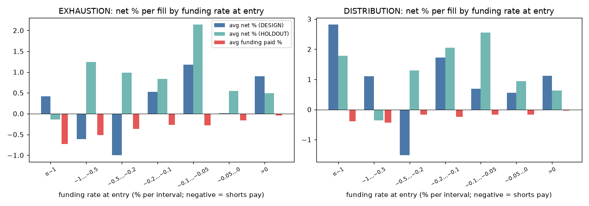

# FUNDING_RULE: should EXHAUSTION / DISTRIBUTION shorts skip or half-size when funding is deeply negative? (2026-11-19)

**Verdict: NO rule. 0 of 20 rules pass; every SKIP / HALF rule loses on HOLDOUT except the ≤ −1.0 pair, which is negative on DESIGN (a sign flip). Keep entries as they are.**

## Question
ZKC (EXH, 11-19) paid $195 funding, 31 % of its gross, at −0.78 %/h. Shorts pay when funding is negative. Does avoiding or shrinking those entries pay?

## Correction first
The backtests already charged **real funding** at every settlement (hourly where Binance switched the coin): EXH −0.20 % per fill on average, DIST −0.09 %. The 11-19 claim "the studies didn't include funding" was wrong. Funding at entry was also already tested as a W/L variable in ENTRY_WL (T3) and DIST_WL (P8): no effect.

## Method (pre-registered: FUNDING_RULE_2026-11-19_PREREG.md)
- EXH 3,368 kept fills (EXH_EXIT2 1m REF net, today's exit). DIST 1,534 fills kept by RSI1h ≥ 74.07 (DIST_EXIT REF_B net, Exit B). Both net of fees, slippage, real funding.
- Variable: last settled funding rate at entry. 10 rules per sleeve: SKIP or HALF size at rate ≤ −0.05 / −0.10 / −0.20 / −0.50 / −1.00 %.
- DESIGN 2023-07 → 2025-06 · HOLDOUT 2025-07 → 2026-11 read once · day-block bootstrap · family-wise shuffled null · expectancy filter bar.
- Script: `scripts/funding_rule_study.py` (tables + chart). Joins: EXH 3,368 → 3,368; DIST 1,535 → 1,534 (one LTCUSDT 2024-11-14 fill has no Exit-B row). Breakeven WR and the blocked-cohort checks use all periods (not fixed by the pre-reg); nothing comes near passing either way.

## Results

## EXHAUSTION
- Fills 3368 (DESIGN 1349 · HOLDOUT 2019); rate coverage 97%; avg net +0.68 %; WR 42%; breakeven WR 37%; funding paid avg -0.20 % / fill (net already includes it).

### Funding paid by entry rate (descriptive)

| rate at entry (%/interval) | N | WR | avg net % | avg funding % | funding as % of gross on winners | days |
|---|---|---|---|---|---|---|
| (-99.0, -1.0] | 213 | 42% | +0.07 | -0.72 | 11 % | 160 |
| (-1.0, -0.5] | 240 | 45% | +0.94 | -0.52 | 6 % | 171 |
| (-0.5, -0.2] | 326 | 42% | +0.45 | -0.37 | 7 % | 234 |
| (-0.2, -0.1] | 218 | 43% | +0.76 | -0.27 | 5 % | 165 |
| (-0.1, -0.05] | 197 | 50% | +1.82 | -0.28 | 4 % | 151 |
| (-0.05, 0.0] | 569 | 40% | +0.39 | -0.17 | 3 % | 362 |
| (0.0, 99.0] | 1506 | 41% | +0.72 | -0.04 | 1 % | 635 |

### Rules (Δ = change in summed net % at one size vs today)

| rule | DESIGN Δ (95 % CI) | blocked N · WR · avg · days | HOLDOUT Δ | blocked N · WR · avg | top pair share of loss | null 95th | pass |
|---|---|---|---|---|---|---|---|
| SKIP rate ≤ -0.05 | -26.8 (-253.3 … +190.0) | 325 · 38% · +0.08 · 186d | -883.6 | 869 · 46% · +1.02 · 341d | 2 % | 75.3 | ✗ |
| SKIP rate ≤ -0.1 | +50.8 (-153.6 … +251.5) | 259 · 37% · -0.20 · 160d | -602.5 | 738 · 45% · +0.82 · 315d | 2 % | 75.3 | ✗ |
| SKIP rate ≤ -0.2 | +79.1 (-103.8 … +248.9) | 205 · 36% · -0.39 · 132d | -465.6 | 574 · 45% · +0.81 · 279d | 3 % | 75.3 | ✗ |
| SKIP rate ≤ -0.5 | -8.8 (-135.2 … +106.6) | 117 · 39% · +0.07 · 80d | -230.6 | 336 · 45% · +0.69 · 198d | 4 % | 75.3 | ✗ |
| SKIP rate ≤ -1.0 | -32.7 (-130.4 … +51.9) | 78 · 42% · +0.42 · 58d | +18.3 | 135 · 41% · -0.14 · 102d | 3 % | 75.3 | ✗ |
| HALF rate ≤ -0.05 | -13.4 (-124.9 … +88.8) | 325 · 38% · +0.08 · 186d | -441.8 | 869 · 46% · +1.02 · 341d | 2 % | 75.3 | ✗ |
| HALF rate ≤ -0.1 | +25.4 (-82.5 … +118.6) | 259 · 37% · -0.20 · 160d | -301.2 | 738 · 45% · +0.82 · 315d | 2 % | 75.3 | ✗ |
| HALF rate ≤ -0.2 | +39.5 (-58.1 … +121.6) | 205 · 36% · -0.39 · 132d | -232.8 | 574 · 45% · +0.81 · 279d | 3 % | 75.3 | ✗ |
| HALF rate ≤ -0.5 | -4.4 (-62.3 … +56.9) | 117 · 39% · +0.07 · 80d | -115.3 | 336 · 45% · +0.69 · 198d | 4 % | 75.3 | ✗ |
| HALF rate ≤ -1.0 | -16.3 (-64.0 … +27.4) | 78 · 42% · +0.42 · 58d | +9.1 | 135 · 41% · -0.14 · 102d | 3 % | 75.3 | ✗ |

## DISTRIBUTION
- Fills 1534 (DESIGN 553 · HOLDOUT 981); rate coverage 100%; avg net +0.92 %; WR 42%; breakeven WR 36%; funding paid avg -0.09 % / fill (net already includes it).

### Funding paid by entry rate (descriptive)

| rate at entry (%/interval) | N | WR | avg net % | avg funding % | funding as % of gross on winners | days |
|---|---|---|---|---|---|---|
| (-99.0, -1.0] | 33 | 52% | +2.10 | -0.40 | 5 % | 31 |
| (-1.0, -0.5] | 29 | 38% | +0.09 | -0.43 | 6 % | 27 |
| (-0.5, -0.2] | 64 | 42% | +0.98 | -0.17 | 3 % | 53 |
| (-0.2, -0.1] | 51 | 51% | +2.02 | -0.25 | 4 % | 45 |
| (-0.1, -0.05] | 43 | 51% | +1.95 | -0.16 | 3 % | 39 |
| (-0.05, 0.0] | 208 | 41% | +0.84 | -0.17 | 3 % | 175 |
| (0.0, 99.0] | 1106 | 42% | +0.83 | -0.04 | 1 % | 585 |

### Rules (Δ = change in summed net % at one size vs today)

| rule | DESIGN Δ (95 % CI) | blocked N · WR · avg · days | HOLDOUT Δ | blocked N · WR · avg | top pair share of loss | null 95th | pass |
|---|---|---|---|---|---|---|---|
| SKIP rate ≤ -0.05 | -47.6 (-129.5 … +26.8) | 46 · 46% · +1.04 · 36d | -273.9 | 174 · 47% · +1.57 · 132d | 3 % | 34.0 | ✗ |
| SKIP rate ≤ -0.1 | -37.9 (-109.0 … +28.2) | 32 · 47% · +1.19 · 26d | -199.7 | 145 · 46% · +1.38 · 113d | 3 % | 34.0 | ✗ |
| SKIP rate ≤ -0.2 | -27.6 (-96.3 … +34.8) | 26 · 46% · +1.06 · 22d | -107.2 | 100 · 43% · +1.07 · 84d | 4 % | 34.0 | ✗ |
| SKIP rate ≤ -0.5 | -38.2 (-100.7 … +18.0) | 19 · 53% · +2.01 · 16d | -33.7 | 43 · 42% · +0.78 · 40d | 6 % | 34.0 | ✗ |
| SKIP rate ≤ -1.0 | -28.2 (-87.1 … +16.3) | 10 · 60% · +2.82 · 9d | -41.0 | 23 · 48% · +1.78 · 22d | 12 % | 34.0 | ✗ |
| HALF rate ≤ -0.05 | -23.8 (-66.1 … +13.7) | 46 · 46% · +1.04 · 36d | -136.9 | 174 · 47% · +1.57 · 132d | 3 % | 34.0 | ✗ |
| HALF rate ≤ -0.1 | -19.0 (-56.2 … +14.4) | 32 · 47% · +1.19 · 26d | -99.9 | 145 · 46% · +1.38 · 113d | 3 % | 34.0 | ✗ |
| HALF rate ≤ -0.2 | -13.8 (-49.8 … +16.4) | 26 · 46% · +1.06 · 22d | -53.6 | 100 · 43% · +1.07 · 84d | 4 % | 34.0 | ✗ |
| HALF rate ≤ -0.5 | -19.1 (-49.9 … +9.1) | 19 · 53% · +2.01 · 16d | -16.9 | 43 · 42% · +0.78 · 40d | 6 % | 34.0 | ✗ |
| HALF rate ≤ -1.0 | -14.1 (-42.4 … +8.1) | 10 · 60% · +2.82 · 9d | -20.5 | 23 · 48% · +1.78 · 22d | 12 % | 34.0 | ✗ |

## What it means
- **Deep negative funding is a real cost but not a losing cohort.** At ≤ −1 %, EXH fills pay 0.72 % funding on average (about 11 % of the winners' gross; caveat: EXH funding comes from the baseline 5m exit while net is the 1m exit-study net, so the share is approximate), and their net drops to about +0.07 %. But the HOLDOUT rules still lose money: these squeezed coins are also where the biggest drops happen. The funding is the price of the trade, not a sign it is bad.
- **No monotonic pattern.** On EXH the −0.1 … −0.05 bucket is the best and ≤ −1 the worst; on DIST the ≤ −1 bucket is the best and −1 … −0.5 the worst. Opposite ends across the two sleeves = noise around a positive mean, not a funding effect.
- **The only DESIGN win does not survive.** EXH SKIP ≤ −0.2 is +79 on DESIGN, just above the shuffled null (75), but its 95 % CI includes 0 (−104 … +249) and it loses −466 on HOLDOUT. The ≤ −1.0 pair (SKIP / HALF) is the only HOLDOUT positive (+18 / +9) and it is negative on DESIGN: a sign flip, not a rule.
- HALF is exactly half of SKIP by construction, so the 20 rules are really 5 thresholds × 2 sizes.
- **Live example:** ZKC (11-19 paper export, not in the backtest) paid $195 funding at −0.78 %/h and still booked +6.83 % net.

## Blind spot (stated in the pre-reg)
A funding-conditional hold cap (close before the next hourly settlement when the rate is deep) needs 1m paths with settlement times. Not tested. The exit studies' time exits (T 4 / 8 / 16 h) all lost, and EXH winners take a median of several hours to reach the take profit, so a hold cap is unlikely to help.

## Watch line (no gate, descriptive)
At each batch review: funding paid per EXH / DIST fill and its share of gross. Flag if the live average is far above the backtest (−0.20 % EXH / −0.09 % DIST).
