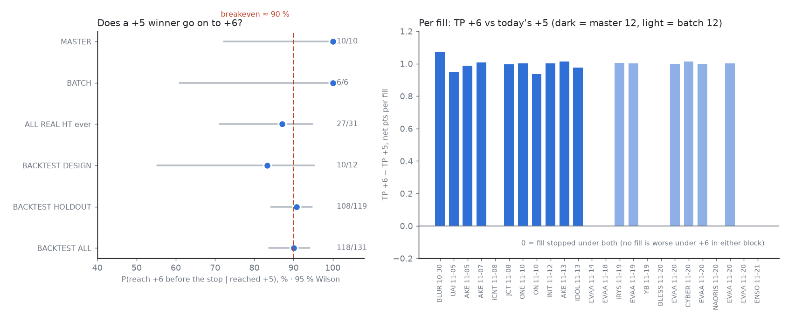

# HT_EXIT_RERUN 2026-11-21 — FRENZY_WILLY_HT: TP +6 instead of +5? (correct today's-filter cohorts)

Research only. No engine, config or test change, nothing committed. Replaces the cohort used in `HT_THEORY_EXIT_2026-11-21.md`
(that report's "today's filters" master applied the dip ≥ 1.4 only and missed WILLY_HT_FAILED_SPIKE).
Script `scripts/HT_EXIT_RERUN_2026-11-21.py` (imports, never edits, the HT_THEORY_EXIT sim / eval). Outputs
`reports/HT_EXIT_RERUN_2026-11-21_{grid.pkl, cond.csv, summary.csv, delta.csv, cells.csv, perfill.csv, tables.md, chart.png}`.

## Question
The operator leans to TP +6 instead of today's +5 for HT. Does it pay? And did DL 587 have a reason against +6?

## 1 · DL 587 check — nothing in it argues against +6
- DL 587 says: *"Nothing here passes a locked gate: the HT TP +5 is an operator pick between the shipped +2 (DL 537) and the study's +6."*
  The evidence it cites (HT_TP6_WL_2026-11-18: real HT fills 73 % reach +6) points **towards** +6, not away.
- The "study's +6" was the **frame the operator asked about** in HT_TP6_WL (TP +6 / SL −4), not a pick that study made. HT_TP6_WL's own
  verdict was on filters (none) and said "the TP6/SL4 exit itself is −0.24/trade on the full rebuild vs +3.42 on master — that gap is the
  decision to resolve". It never compared +5 vs +6.
- The only TP number in DL 587 used *against* something is the 90-min cap ("29 % reach +6 within 90 min vs 36 % within 24 h") — that
  argued for the 24 h hold, not for +5.
- STOP_WIDTH_KEPT_2026-11-14 (14 kept HT fills, old exit with the spike-high target): **+6/−4 beat +5/−4 by +2.0 pts** (−3.7 vs −5.7 vs
  the +8 cap); its verdict was "keep the +8 cap". DL 537 (TP +2) and DL 546/548 (stop lines) priced other exits and were retired by DL 587.
- **Plain finding: +5 was a judgement call, not a tested choice. Nothing on record argues against +6.**

## 2 · Method
- **Cohorts (exactly the kept list `reports/KEPT_LIST_WILLY_HT_2026-11-21.csv`)**: MASTER 12 and CURRENT BATCH 12 (dip ≥ 1.4 AND
  vs-VWAP > 0). Also "ALL REAL HT ever" (62 fills, any filter) and the backtest `HT_WILLY_2026-11-20_cohort_HT.csv` (300 fills) split
  DESIGN < 2025-07-01 ≤ HOLDOUT (as pre-registered) and by half-year.
- **FAILED_SPIKE on the backtest:** already applied. The cohort's source rows (`BASELINE_TRADES_WILLY_HT_2026-11-18.csv`) carry the
  engine's `vs_vwap` stamp; all 300 rows have vs_vwap > 0 (min +0.002), so no rebuild was needed.
- **Exit engine:** the study's own `run_ht` (resting maker TP ≥ 1 tick through · stop −4 net, taker + 0.10 % slip, stop first inside a
  bar · 24 h time exit · real funding). New TP grid 4.5 / 5 / 5.5 / 6 / 7 / 8, also at 0.20 % slip. **Parity: the re-walk equals
  sim.pkl's REF, TP6 and TP4.5 to 0.000 on every fill.** 0 Binance weight (all 1m bars from the existing caches).
- **Key statistic:** P(reach +6 before the stop | reached +5 before the stop). Each extra hit gains ≈ +1.0 pt; each miss turns a +5
  into ≈ −4.0 → costs **8.96 pts** (mean of every real + backtest miss). **Breakeven P = 8.96 / (1.0 + 8.96) ≈ 90 %.**
- Size: one size $3,050 per fill; DCR = one-size daily compound at 0.61 × equity per fill over every calendar day of the block.

## 3 · The key math — P(+6 | +5)

| Block | reached +5 | went on to +6 | P | 95 % Wilson | vs breakeven 90 % |
|---|---|---|---|---|---|
| MASTER (12, today's filters) | 10 | 10 | 100 % | 72–100 % | above, can't exclude 90 % |
| BATCH (12, today's filters) | 6 | 6 | 100 % | 61–100 % | above, can't exclude 90 % |
| Kept real, both (24) | 16 | 16 | 100 % | 81–100 % | above, can't exclude 90 % |
| ALL REAL HT ever (62, any filter) | 31 | 27 | 87 % | 71–95 % | below |
| — of which blocked by today's filters (38) | 15 | 11 | 73 % | | all 4 misses are FAILED_SPIKE-blocked fills (LA 10-24, ARK 10-25, ICNT 11-08 16:15, INIT 11-11) |
| BACKTEST DESIGN (33) | 12 | 10 | 83 % | 55–95 % | below |
| BACKTEST HOLDOUT (267) | 119 | 108 | 91 % | 84–95 % | at |
| BACKTEST ALL (300) | 131 | 118 | 90 % | 84–94 % | exactly at |
| BT by half: 25-H1 · 25-H2 · 26-H1 · 26-H2 | 12 · 36 · 24 · 59 | 10 · 34 · 23 · 51 | 83 · 94 · 96 · 86 % | | 2 of 4 halves above |
| Kept real + backtest pooled | 147 | 134 | 91.2 % | | +0.12 pts per +5-reaching fill (≈ +0.06 per fill) |

Descriptive grid, P(reach +X | reached +5) — breakeven in brackets: **+5.5** master 10/10 · batch 6/6 · real-all 31/31 · backtest 94 %
(95 %) · **+6** above · **+7** master 70 % · batch 83 % · backtest 78 % (82 %) · **+8** master 50 % · batch 83 % · backtest 70 % (75 %).
**+7 and +8 are below breakeven everywhere except the 6-fill batch → no.**

Reading: on the fills today's filters keep, no +5 winner has ever failed to reach +6 (16 of 16). On the backtest (already FAILED_SPIKE
filtered) the hit rate sits **exactly at** breakeven. The real misses all came from fills today's filters now block (Fisher one-sided
p ≈ 0.04 for 0/16 vs 4/15) — plausible (a burst trading below its VWAP has weaker follow-through) but the backtest, which also has the
filter, does not reproduce a 100 % rate.

## 4 · Before → after (TP +5 today → TP +6), one size $3,050

| Block | Exit | N | WR | avg net % | total $ | avg win | avg loss | worst | DCR %/day | dur avg | dur median | TP / STOP / TIME |
|---|---|---|---|---|---|---|---|---|---|---|---|---|
| **MASTER** | TP +5 (today) | 12 | 83 % | +3.63 | +$1,328 | +5.18 | −4.10 | −4.10 | 1.63 | 15.8 min | 10.9 min | 10 / 2 / 0 |
| | **TP +6** | 12 | 83 % | **+4.46** | **+$1,632** | +6.17 | −4.10 | −4.10 | **1.99** | 21.3 min | 14.8 min | 10 / 2 / 0 |
| **BATCH** | TP +5 (today) | 12 | 50 % | +0.45 | +$164 | +5.00 | −4.11 | −4.13 | 0.71 | 67.8 min | 30.8 min | 6 / 6 / 0 |
| | **TP +6** | 12 | 50 % | **+0.95** | **+$348** | +6.01 | −4.11 | −4.13 | **1.57** | 71.4 min | 41.3 min | 6 / 6 / 0 |
| BT DESIGN | TP +5 | 33 | 36 % | −0.71 | −$718 | +5.00 | −3.98 | −4.17 | −0.11 | 2.2 h | 1.4 h | 12 / 21 / 0 |
| | TP +6 | 33 | 30 % | −0.91 | −$918 | +6.00 | −3.92 | −4.17 | −0.15 | 2.4 h | 1.4 h | 10 / 23 / 0 |
| BT HOLDOUT | TP +5 | 267 | 45 % | −0.02 | −$133 | +5.04 | −4.08 | −4.26 | −0.03 | 58 min | 19 min | 119 / 148 / 0 |
| | TP +6 | 267 | 40 % | +0.02 | +$140 | +6.06 | −4.08 | −4.26 | −0.02 | 67 min | 24 min | 108 / 159 / 0 |

Per half-year (backtest, TP +5 → +6 avg / DCR): 25-H1 −0.71 → −0.91 · 25-H2 +0.73 → +0.96 · 26-H1 −1.25 → −1.07 · 26-H2 +0.35 → +0.18
(DCR −0.11 → −0.15 · +0.15 → +0.19 · −0.35 → −0.30 · +0.15 → +0.05).

Duration: TP +6 holds a winner about **+5 min longer on master** (avg 16 → 21 min), **+4 min on the batch** (68 → 71 min avg, median
31 → 41 min). Losers are unchanged (they stop before +5 either way).

### Gate set — Δ = TP +6 − TP +5 per fill (net pts)

| Block | Δ avg | Δ $ | better / worse | day-block P(Δ>0) | 95 % CI | slip 0.20 Δ | LOO fill (min) | LOO pair (min) | top pair share |
|---|---|---|---|---|---|---|---|---|---|
| MASTER | **+0.83** | +$303 | 10 / 0 | 1.00 | [+0.61, +1.00] | +0.83 | +0.81 | +0.77 | AKE 30 % |
| BATCH | +0.50 | +$184 | 6 / 0 | 0.94 | [0.00, +0.60] | +0.50 | +0.46 | +0.34 | EVAA 67 % ⚠ |
| ALL REAL ever | −0.14 | −$255 | 27 / 4 | 0.35 | [−0.81, +0.38] | −0.14 | −0.16 | −0.23 | EVAA 15 % |
| BT DESIGN | −0.20 | −$199 | 10 / 2 | 0.34 | [−1.06, +0.39] | −0.20 | −0.24 | −0.28 | GOAT 20 % |
| BT HOLDOUT | +0.03 | +$273 | 108 / 11 | 0.63 | [−0.21, +0.26] | +0.03 | +0.03 | +0.02 | 5 % |
| BT halves | −0.20 · +0.23 · +0.18 · −0.17 | | | 0.34 · 0.86 · 0.90 · 0.22 | | | | | |

Master's bootstrap P = 1.00 is mechanical: with 0 misses every Δ is ≥ 0. It shows the sign on these fills, not that P(+6|+5) > 90 %.
Master + batch are in-sample for the operator's lean (seen before the ask) → haircut 30–50 %: master +0.83 → ≈ +0.4–0.6 per fill.

Per fill (today's result / TP +6, minutes to exit):

| Block | Pair | Opened (UTC) | TP +5 | min | TP +6 | min | reach before stop |
|---|---|---|---|---|---|---|---|
| M | BLUR | 10-30 18:55 | +6.46 TP | 72 | +7.53 TP | 72 | +7.35 % |
| M | UAI | 11-05 02:55 | +5.09 TP | 2 | +6.03 TP | 2 | +24.8 % |
| M | AKE | 11-05 18:55 | +5.04 TP | 18 | +6.03 TP | 18 | +6.48 % |
| M | AKE | 11-07 01:55 | +5.01 TP | 13 | +6.02 TP | 52 | +11.0 % |
| M | ICNT | 11-08 07:55 | −4.10 STOP | 7 | −4.10 STOP | 7 | −0.05 % |
| M | JCT | 11-08 17:50 | +5.00 TP | 7 | +6.00 TP | 8 | +77.3 % |
| M | ONE | 11-10 07:45 | +5.05 TP | 20 | +6.06 TP | 21 | +31.4 % |
| M | ON | 11-10 15:55 | +5.07 TP | 16 | +6.00 TP | 36 | +7.20 % |
| M | INIT | 11-12 09:00 | +5.00 TP | 6 | +6.00 TP | 7 | +7.00 % |
| M | AKE | 11-13 07:15 | +5.00 TP | 2 | +6.01 TP | 3 | +6.82 % |
| M | IDOL | 11-13 16:30 | +5.04 TP | 9 | +6.01 TP | 12 | +15.0 % |
| M | EVAA | 11-14 15:05 | −4.10 STOP | 19 | −4.10 STOP | 19 | +4.94 % |
| B | EVAA | 11-18 12:30 | −4.10 STOP | 31 | −4.10 STOP | 31 | +3.08 % |
| B | IRYS | 11-19 01:05 | +5.04 TP | 12 | +6.05 TP | 14 | +22.5 % |
| B | EVAA | 11-19 13:00 | +5.00 TP | 23 | +6.00 TP | 27 | +36.4 % |
| B | YB | 11-19 15:25 | −4.10 STOP | 3 | −4.10 STOP | 3 | −1.71 % |
| B | BLESS | 11-20 07:10 | −4.10 STOP | 15 | −4.10 STOP | 15 | +4.12 % |
| B | EVAA | 11-20 07:50 | +4.97 TP | 79 | +5.97 TP | 91 | +22.9 % |
| B | CYBER | 11-20 08:30 | +5.01 TP | 12 | +6.02 TP | 15 | +7.04 % |
| B | EVAA | 11-20 10:25 | +5.00 TP | 31 | +6.00 TP | 52 | +14.9 % |
| B | NAORIS | 11-20 10:35 | −4.11 STOP | 111 | −4.11 STOP | 111 | +2.81 % |
| B | EVAA | 11-20 12:55 | +5.00 TP | 168 | +6.00 TP | 169 | +9.96 % |
| B | EVAA | 11-20 23:20 | −4.13 STOP | 279 | −4.13 STOP | 279 | +3.95 % |
| B | ENSO | 11-21 02:30 | −4.10 STOP | 52 | −4.10 STOP | 52 | +5.04 % (gross; +5 net needs ≈ +5.07) |

Several winners have little room above +6: AKE 11-05 (+6.48), AKE 11-13 (+6.82), INIT (+7.00), CYBER (+7.04). The thin margin is
why +7 / +8 fail (they lose AKE ×2, INIT, ON, CYBER).

## 5 · Other leading cells on the correct cohorts (vs today's exit; PREREG master rule: Δ ≥ 0 · saved ≥ cut · P ≥ 0.80 · Δ > best fixed TP, which is now TP +6 at +0.83)

| Cell | MASTER Δ · P · saved/cut $ | BATCH Δ · P | BT DESIGN Δ · P | BT HOLDOUT Δ [CI] · P | Read |
|---|---|---|---|---|---|
| C_BASE (stop under pre-spike base) | **+1.52 · 0.91 · $556 / $0** (2 fired) | **−1.45 · 0.00** (CI −5.1 … −0.4) | +0.52 · 0.73 | +0.24 [−0.40, +0.93] · 0.77 | PREREG candidate on master, contradicted by the batch |
| A_H0 (TP at spike high) | −1.03 · 0.11 · $265 / $641 | +1.61 · 1.00 | +0.45 · 0.75 | −0.11 [−0.47, +0.24] · 0.28 | fails master → no |
| A_Hp05 (TP 0.5 % above H) | −0.50 · 0.25 · $293 / $476 | +2.01 · 1.00 | +0.35 · 0.72 | −0.13 [−0.47, +0.18] · 0.21 | fails master → no |
| TP +4.5 | +0.30 · 0.66 · $262 / $154 | +0.47 · 0.69 | +0.34 · 0.87 | −0.03 [−0.18, +0.14] · 0.34 | one fill each block (EVAA 4.94 / ENSO 5.04) = 100 % of the gain → no |
| TP +6 (fixed comparator) | +0.83 · 1.00 · $303 / $0 | +0.50 · 0.94 | −0.20 · 0.34 | +0.03 [−0.21, +0.26] · 0.63 | see above |

**C_BASE in plain words:** on master it rescues the two −4 stops (ICNT, EVAA 11-14 both recover to +5). On the batch it lets 5 of 6
stops run deeper (YB −10.2, ENSO −10.2, BLESS −9.8, NAORIS −8.6, EVAA 11-18 −8.2) and saves 1. Live-stopped cohort, two-sided: master
2 saved / 0 deeper · batch 1 saved / 5 deeper. Avg loss −9.4 % (vs −4.1 %): one stop costs ≈ 2.3 × today's per-stop risk. Exactly the
"wider stop" pattern the stop-width rule warns about → **observe only, never ship** on 2 master fires.
A_H0 / A_Hp05 win on the batch but lose on master and on HOLDOUT → no (master decides).

## 6 · Revert gate for TP +6 (pre-committed, alert-only — gates never switch anything)
- **Cohort:** HT fills (today's filters) opened ≥ the TP +6 deploy + 10 min that **reach +5 net before the −4 stop** (the resting +5
  maker would have filled = the high trades ≥ 1 tick through the +5 net price), open-time order. Both legs are priced on every such
  fill's own 1m path (symmetric information).
- **Δ per fill** = TP6 result − 5.0 (TP6 hit ≈ +1.0; a miss = the realised stop/time result − 5 ≈ −9).
- **Decision, once:** at the **first 10** such fills, **Σ Δ < 0 → REVERT alert** (frenzy_willy_ht_tp_pct back to 5.0, operator applies).
  Σ Δ < 0 happens as soon as **2 misses** occur (2 × −9 is more than 10 hits can repay), so the alert can fire early, at the 2nd miss.
  Else KEEP.
- **Priced** (gain +1.0, miss −8.96, 200k draws): P(revert) when the true hit rate is 80 % → 62 % · 85 % → 46 % · **90 % (breakeven)
  → 26 %** · 95 % → 9 % · 100 % → 0 %. It catches a clearly-worse rate about half the time and rarely trips on a good one; it cannot
  separate 90 % from 95 % — nothing at N = 10 can. Expected time: ~10 fills reaching +5 ≈ 1–2 weeks at the batch's rate (6 in 4 days).
- Scout note (DL 406): any HT watch line that prices "today's exit" goes ⚠ STALE at the switch and must be re-based to TP +6 the same day.

## 7 · Verdict

**Plain English for the operator:** switching HT from TP +5 to TP +6 is a small, reasonable bet, not a proven improvement.
- On every trade today's filters keep (24 real trades), **every trade that reached +5 also reached +6** before the stop — 16 of 16.
  So on master you'd have made **+0.83 % more per trade** (+$1,328 → +$1,632; %/day 1.63 → 1.99) and on this batch +0.50 more
  (+$164 → +$348; %/day 0.71 → 1.57). No trade was worse. Winners take ~5 minutes longer.
- **But** +6 only pays if about **9 in 10** of the +5 winners keep going to +6, because one that turns around and hits the stop costs
  about 9 times what a successful one gains. The 2-year backtest (300 trades, same filters) says **90 %** — exactly the break-even point.
  So over the long run the backtest expects ≈ zero difference; the real trades say it helps. 16 trades cannot tell "100 %" from "90 %".
- **+7 and +8: no.** Too many winners (AKE ×2, INIT, CYBER, ON) only went +6.5 … +7.2 before turning; below break-even everywhere.
- **Nothing in DL 587 argues against +6** — +5 was your pick between +2 and the +6 the study looked at.

**As a quant:** it is an operator-declared override (N = 16 reach-+5 fills, below the locked gates; the backtest neutral, not
contradicting: HOLDOUT Δ +0.03 [−0.21, +0.26]). The downside is bounded and symmetric with the upside (pooled real + backtest
P ≈ 91 % → ≈ +0.06 per fill expected; master's +0.83 is the optimistic end). Costs are identical (maker TP either way, same stop),
risk per stop unchanged, exposure +5 min per winner. **I would accept it — ship TP +6 as a declared override with the revert gate
above** — and I would not call it an edge. If you prefer to wait, the same gate can run as an OBSERVE line on +5 (price TP6 on every
reach-+5 fill) and switch at 10 fills with Σ Δ > 0; that costs ≈ +0.5–0.8 per winner meanwhile if the real-fill rate holds.
**Exact rule:** `frenzy_willy_ht_tp_pct` 5.0 → **6.0** (resting maker, flat, net). Stop −4, 24 h, no late TP, no high target —
unchanged. Do NOT ship C_BASE / A_H0 / A_Hp05 / TP 4.5 / +7 / +8. C_BASE = observe only (batch contradicts, stop ≈ 2.3 × wider).

## Caveats
- N: 16 reach-+5 fills on the kept real cohorts; Wilson lows 72 % / 61 % — below breakeven. Master and batch were seen before the ask
  (in-sample) → haircut. Batch Δ is 67 % EVAA (one coin, 5 fills, 3 days).
- Batch EVAA 11-18 was booked +2.00 under the old +2 exit; here re-priced on today's exit (stopped). ENSO 11-21 reached +5.04 % gross
  (+5 net needs ≈ +5.07) — a near-miss for both exits.
- Backtest ≠ live (as-was recall W 66 % / L 62 %); its P(+6|+5) of 90 % is the long-run anchor but the live trade set differs.
- Paper costs: 0.10 % stop slip (0.20 % stress shown: same Δ). Live adds nothing different between +5 and +6 (both maker TPs).
- The FAILED_SPIKE "all misses were blocked fills" link is 4 fills (p ≈ 0.04) and not reproduced by the backtest → do not lean on it.
