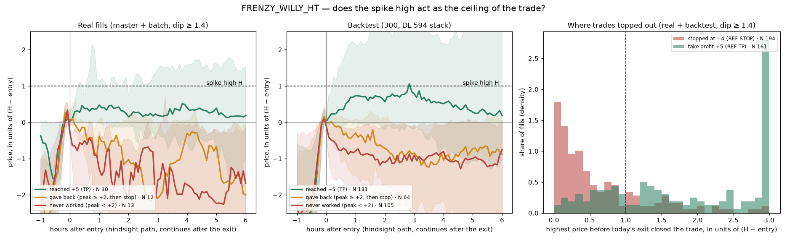

⚠ Superseded by HT_EXIT_RERUN_2026-11-21.md (wrong master cohort: FAILED_SPIKE missing)

# HT_THEORY_EXIT 2026-11-21 — what exit does the HT trade's own logic call for? (FRENZY_WILLY_HT, plus plain FRENZY_WILLY)

Research only. No engine, config or test change, nothing committed. The design was frozen before any cell was simulated, in
`HT_THEORY_EXIT_2026-11-21_PREREG.md`. Scripts: `scripts/HT_THEORY_EXIT_2026-11-21_{cohort,sim,eval,chart}.py`. Every cell × cohort row
is in `HT_THEORY_EXIT_2026-11-21_cells.csv` and the auto tables are in `HT_THEORY_EXIT_2026-11-21_tables.md`.

## Answer in plain English

**HT: keep today's exit (take profit +5 %, stop −4 %, 24 h).** I tested 23 exits that follow from the trade's logic, plus 7 fixed
take-profit levels. None beats today's exit on the real master fills. That includes taking profit at the spike high, a stop under the dip
low or the VWAP, a "stalled" exit, a break-even lock after touching the high, and selling half at the high.

The recent losers (ENSO, BLESS, EVAA, NAORIS, KAVA) are real, and on this batch a take profit at the spike high would have rescued them.
But they are **not typical**:
- On the master fills and on the 300-trade backtest, most stopped trades never got close to the spike high. The median stopped trade got
  only 22–35 % of the way there, and only about 1 in 4 ever touched it.
- The trades that hit +5 % usually went straight *through* the spike high.
- So taking profit at the high would cut the winners more than it saves the losers. On master that costs −0.42 %/trade.

**Plain WILLY: one formal candidate, too weak to ship.** The candidate splits the position. Half keeps today's target (just under the
spike high). The other half aims 1 % *above* the spike high. On the 23 kept master fills it passes the pre-committed test on the letter:
+0.12 %/trade, P 0.88. It fails on the 2026 backtest (−0.03), is small after the in-sample haircut, and needs new code for a split
position. My recommendation is to keep V2b and register it as an observe line only if you want it watched.

---

## 1 · Question and theory

HT buys the first red 5m bar of a live Frenzy burst once price is ≥ 1.4 % under the spike high H (DL 594). The bet is that the burst is a
pause and price goes back to H or beyond. The prereg derives four exit predictions from that:
1. **H is the natural target.** A take profit at or near H should turn the "peaked +2.5…+5, then −4" trades into wins.
2. **The thesis dies under the dip low or under the episode VWAP.** A stop placed there should beat a flat −4.
3. **Continuation is fast or not at all.** "No new high for N minutes after +X %" should be a good time to sell.
4. **After H is touched, the breakout is a free option.** A break-even lock after the touch, or banking half at H, should keep the
   upside and remove the double-top losses.

Funding is reported but not tested as a rule. Longs on these coins mostly *receive* funding: −0.03 %/trade net on the real fills.

**What the price paths say (chart below).** Prediction 1 assumes H acts as a ceiling. The data says it mostly does not:

| | stopped at −4 (REF) | took +5 (REF) |
|---|---|---|
| real fills, dip ≥ 1.4 | 25 fills · **24 % ever touched H** · median peak 0.22 of the way to H | 30 · 63 % touched H · median peak 1.42 × the distance to H |
| backtest (300) | 169 · **21 % touched H** · median 0.35 | 131 · 73 % · median 1.81 |

Most losers die well before H; that is the entry side, already shown by STATE_EXIT and HT_WILLY 11-20. Winners usually run *through* H.
The batch is different: 5 of its 7 stops touched H and a 6th came within ~0.3 % of it. A TP at H is therefore a rule that fits this batch.

*Left and middle: the median price path after entry, in units of the distance to the spike high (0 = entry, 1 = H), by today's outcome.
The band is the interquartile range. Right: the highest price each trade reached before today's exit closed it, in the same units (the
last bin holds everything ≥ 3). The stopped trades (red) pile up far below 1.*

## 2 · Method

- **Real fills:** every archived export up to `scalpars_orders_paper_2026-11-21_18-44-02.csv`, CLOSED, no probes, operator-closed
  removed, dedup (opened_at[:19], pair, direction) with the newest export winning.
  - HT: 62 fills. MASTER (< 11-17 17:00) has 49 as taken; **43 pass today's filters (dip ≥ 1.4)**. BATCH has 13.
  - WILLY: 85 master fills; 23 are kept by today's stack (`MASTER_POOL_stacked` stack_keep).
  - Every fill is re-priced under each exit from its real fill price.
- **Backtest:** `HT_WILLY_2026-11-20_cohort_HT.csv`, 300 fills, DESIGN < 2025-07 (33) and HOLDOUT (267). WILLY has 545 (92 / 453).
- **Engine:** 1m bars, stop checked first within a bar, maker TP must trade 1 tick through.
  - Costs: entry taker 0.05, maker TP 0.02, stop / time / rule exits taker 0.05 + 0.10 slip, real funding.
  - Stress: 0.20 slip.
- **Parity (gate ≥ 99 %):** all pass.

| check | N | same exit kind |
|---|---|---|
| HT real fills booked under +5 / −4 | 12 | **12 / 12** (paper-mode median gap 0.05 %) |
| HT backtest vs ref_kind | 300 | **300 / 300** |
| WILLY backtest vs ref_kind | 545 | **545 / 545** |
| WILLY real, V2b era (info) | 49 | 47 / 49 |

- **Reproduces the earlier read:** HT master on today's filters under today's exit = 43 · 55.8 % · **+1.03 %/trade**. The brief had +1.02.
- **Decision rule (pre-committed), on MASTER · today's filters.** A cell must pass all four:
  1. Δ ≥ 0.
  2. Saved $ ≥ cut $.
  3. Day-block bootstrap P(Δ > 0) ≥ 0.80.
  4. Δ > the best fixed-TP alternative.

  The other blocks are caveats.
- **Money:** $ is at one size, $3,050 per fill. DCR is one-size, 0.61 × equity per fill, compounded over every calendar day.

## 3 · HT results

**Reference (today's exit):**

| cohort | N | WR % | avg % | $ | DCR %/day | avg loss | worst day $ |
|---|---|---|---|---|---|---|---|
| MASTER · today's filters | 43 | 55.8 | +1.03 | +1,354 | +1.13 | −4.10 | −125 |
| MASTER · as taken | 49 | 51.0 | +0.59 | +885 | +0.69 | −4.10 | −193 |
| BATCH | 13 | 46.2 | +0.10 | +40 | +0.09 | −4.10 | −125 |
| backtest DESIGN | 33 | 36.4 | −0.71 | −718 | −0.11 | −3.98 | −127 |
| backtest HOLDOUT | 267 | 44.6 | −0.02 | −133 | −0.03 | −4.08 | −376 |

**Every cell. Δ is %/trade vs today. The first five columns are master · today's filters (the decider).**

| cell | fired | Δ | P(Δ>0) | saved $ / cut $ | DCR b→a | M as taken Δ | BATCH Δ | DESIGN Δ (P) | HOLDOUT Δ (P) |
|---|---|---|---|---|---|---|---|---|---|
| A_H0 TP at H | 26 | −0.42 | 0.14 | 1,286 / 1,841 | 1.13→0.64 | −0.24 | **+1.89** | +0.45 (0.75) | −0.11 (0.28) |
| A_Hm05 TP at H × 0.995 | 27 | −0.48 | 0.12 | 1,419 / 2,054 | →0.58 | | | | |
| A_Hp05 TP at H × 1.005 | 25 | −0.59 | 0.09 | 1,092 / 1,862 | →0.43 | | | | |
| A_H75 TP at ¾ of the way to H | 28 | −0.47 | 0.14 | 1,517 / 2,132 | →0.60 | | | | |
| N_H0 nearer of H and +5 | 16 | −0.52 | 0.04 | 343 / 1,030 | →0.55 | −0.33 | +1.42 | +0.72 (0.90) | −0.10 (0.24) |
| N_Hm05 | 17 | −0.56 | 0.04 | 508 / 1,244 | →0.52 | | | | |
| B_X2_N30 stall | 4 | −0.21 | 0.13 | 132 / 404 | →0.89 | | | | |
| B_X2_N60 | 3 | −0.10 | 0.27 | 132 / 258 | →1.02 | | | | |
| B_X2_N120 | 1 | +0.10 | 0.63 | 136 / 0 | →1.25 | +0.09 | −0.37 | −0.05 (0.34) | +0.03 (0.68) |
| B_X3_N30 / N60 / N120 | 2 / 1 / 0 | −0.13 / −0.04 / 0 | — | | | | | | |
| C_DIPLOW stop under the dip low (1.5–8 %) | 27 | −0.52 | 0.08 | 1,146 / 1,827 | →0.54 | −0.37 | +0.61 | **+1.07 (0.99)** | **+0.23 (0.85)** |
| C_VWAP5 5m close < VWAP | 31 | −0.66 | 0.04 | 1,398 / 2,259 | →0.39 | −0.31 | +0.39 | +0.67 (0.88) | −0.22 (0.14) |
| C_BASE stop under the pre-spike base | 20 | **+0.29** | **0.72** | 1,484 / 1,108 | →1.44 | +0.70 (0.89) | **−1.48** | +0.52 (0.73) | +0.24 (0.77) |
| control S3 fixed −3 | 22 | −0.16 | 0.32 | 580 / 786 | →0.94 | | | | |
| control S5 fixed −5 | 19 | +0.03 | 0.51 | 554 / 517 | →1.14 | +0.34 | −0.53 | −0.61 (0.00) | −0.25 (0.01) |
| control S6 fixed −6 | 19 | −0.10 | 0.37 | 833 / 962 | →0.99 | | | | |
| D_HLOCK0 break-even after an H touch | 4 | −0.07 | 0.29 | 253 / 347 | →1.06 | 0.00 | +0.83 | +0.39 (0.79) | −0.15 (0.14) |
| D_HLOCK1 lock +1 after an H touch | 7 | −0.28 | 0.11 | 312 / 679 | →0.83 | | | | |
| E_H0_5 half at H, half at +5 | 26 | −0.21 | 0.14 | 643 / 920 | →0.89 | −0.12 | +0.94 | +0.22 (0.75) | −0.05 (0.28) |
| E_Hm05_5 | 27 | −0.24 | 0.12 | 709 / 1,027 | →0.86 | | | | |
| E_H0_LOCK half at H, half BE-locked | 26 | −0.25 | 0.12 | 770 / 1,094 | →0.85 | | | | |
| **fixed TP 4.5 (best fixed)** | 25 | −0.08 | 0.27 | 262 / 367 | →1.05 | −0.08 | +0.43 | +0.34 | −0.03 |
| fixed TP 2 / 2.5 / 3 / 3.5 / 4 / 6 | | −0.86 / −0.82 / −0.95 / −0.67 / −0.37 / −0.36 | ≤ 0.19 | | | | | | |

**Verdict per family (pre-committed rule): 0 candidates.**
- **Target at H (A, N, E): rejected.** Every version loses on master (−0.21 … −0.59, P ≤ 0.14) and on the 2026 HOLDOUT (−0.05 … −0.11).
  - Its only support is this batch (+1.89 on 13 fills). That is in-sample: the batch is what motivated the idea. After the 30–50 %
    haircut it is +0.9 … +1.3, on 13 fills over 4 days.
  - Mechanism: in master the TP at H sits at a median +4.6 %, almost the same as +5. In the batch it sits at only +2.0 %. Recent
    entries have had a nearer H.
  - A rule such as "nearer-of only when H is close" would be fitted to this batch. Per the "never refit around the trades that broke it"
    rule, it was not tested. It can only be a pre-registered observe line, judged on future fills.
- **Structure stops (C): rejected.**
  - The dip-low stop is a tight ~1.5 % stop on most fills (median distance 1.5–2.2 %). It wins in the backtest (DESIGN +1.07, HOLDOUT
    +0.23) but loses on master (−0.52, P 0.08). Master decides, so no.
  - The VWAP stop loses on master and on HOLDOUT.
  - The base stop is the closest to passing (+0.29, P 0.72 < 0.80; as taken +0.70, P 0.89; HOLDOUT +0.24, P 0.77). Its risk is worse:
    average loss −5.7 % vs −4.1 %, worst master day −$284 vs −$125, and **−1.48 on this batch** (EVAA, KAVA, BLESS, NAORIS and ENSO would
    have lost −6 to −10 % instead of −4).
  - It fails the pre-committed P bar, so it is not a candidate. It is mostly a "wider stop": the S5 / S6 controls are also roughly flat on
    master, and S5 is −0.25 (P 0.01) on HOLDOUT. That matches HT_WILLY 11-20 ("wider stops lose").
- **Stall exits (B): rejected.** They almost never fire. Trades that reach +2 / +3 tend to finish quickly, and the best cell fired once
  on master.
- **H-touch locks (D): rejected.** It fires on only 4 master fills (−0.07) and is −0.15 on HOLDOUT.
- **Best fixed TP:** TP 4.5 is −0.08 on master. Today's +5 stays the best fixed level, as found before.

## 4 · Plain FRENZY_WILLY (second section; V2b exit)

Structure stops, BE locks, trails and time grace were tested on V2b on 11-18 (WILLY_EXIT_V2) and are not repeated here. The stall
overlay never fired on master: WILLY trades end within 90 min, usually at the target. Ten of the 23 kept fills predate the stamped spike
high, so every H-based cell equals REF on them.

| cell | M today's filters: N · Δ · P · saved / cut $ · DCR b→a | M as taken (85): Δ (P) | DESIGN (92): Δ (P) | HOLDOUT (453): Δ (P) |
|---|---|---|---|---|
| REF (V2b) | 23 · 91.3 % · +1.12 · DCR +0.40 | −0.37 avg | −0.08 avg | −0.08 avg |
| **WE_HALF**: ½ V2b + ½ target at H × 1.01 | 10 fired · **+0.12** · **0.88** · 165 / 82 · 0.40 → 0.44 | +0.04 (0.88) | +0.11 (0.98) | **−0.03 (0.30)**, CI −0.12 … +0.07 |
| WA_Hp05: target at H × 1.005 | 9 · +0.05 · 0.66 · 200 / 164 | +0.03 (0.71) | +0.12 (0.89) | −0.10 (0.09) |
| WA_H0: target at H | 6 · −0.08 · 0.38 | −0.02 | +0.08 | −0.05 |
| WB stall (4 cells) | 0 fired | | | |
| best fixed TP (2) | −0.06 · 0.45 | +0.03 | −0.12 | +0.02 |

**WE_HALF: formal candidate on the letter, recommendation = do NOT ship.**
- **For:** it meets the four master conditions.
  - +0.12 %/trade, P 0.88, saved $165 > cut $82, beats the best fixed TP (−0.06).
  - Slip 0.20 still gives +0.12. Top pair is 20 % of the gain (ONE), top day 17 %. Leave-one-pair-out is +0.08.
- **Against:**
  - The sample is tiny: 10 changed fills, about $83 of net gain on master.
  - 30 rules were tested. Some cell reaching P ≥ 0.80 is what chance alone would give.
  - The 2026 HOLDOUT (453 trades) is −0.03.
  - After the in-sample haircut it is about +0.06 … +0.08 %/trade.
  - It needs new engine code (a split position with two resting TPs).
  - Plain WILLY has 0 fills since it was turned back on (DL 595).
- **If the operator wants it watched:** an OBSERVE line "WILLY_HALF_H101". Each closed plain-WILLY fill is priced both ways from its own
  1m path. Decided once at 20 fills: keep observing if Σ Δ ≤ 0, else bring it back with its HOLDOUT caveat.

## 5 · Caveats

- Master HT fills ran older exits (V2b, +2 era). They are re-priced here, so their "today's exit" result is a replay, not a booking. The
  booked +5 era (12 fills) matched 12 / 12.
- The backtest HT cohort has only 33 DESIGN fills.
- The bootstrap resamples entry days. Master spans ≈ 19 trading days, so the P values are coarse.
- Batch numbers are in-sample: they are why the study was asked for. Apply a 30–50 % haircut to any batch-derived gain.

## 6 · Recommended exit, per sleeve

| sleeve | exit | why |
|---|---|---|
| **FRENZY_WILLY_HT** | **Unchanged: TP +5 % net (resting maker) · stop −4 % · 24 h** | No theory-derived exit beats it on master (0 / 23 pass; best fixed TP 4.5 is −0.08). The spike high is not a ceiling for most trades; the recent double tops are a batch pattern. The losses are on the entry side. |
| **FRENZY_WILLY** | **Unchanged: V2b** (target ≈ spike high − 1 %, stop −4, late TP +0.25 from 30 min, 90 min) | The one formal candidate (half aimed 1 % above the high) is small, in-sample-weak and flat on the 2026 backtest. Observe only, if wanted. |
