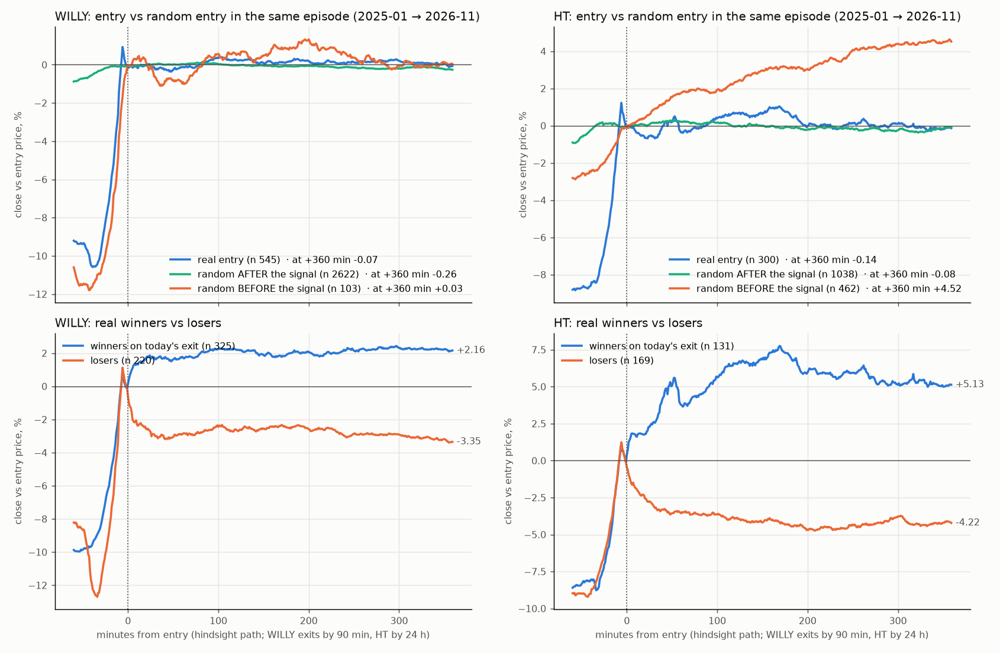

# HT and WILLY: is it the exit or the entry? (2026-11-20)

**Research only, BACKTEST plus real fills.** No engine, config or test change. WILLY and HT stay ON in paper. Each sleeve is its own row and is never pooled with the other.

- Pre-registered in `HT_WILLY_2026-11-20_PREREG.md`, written before any result.
- The timing-rule ADDENDUM was frozen before any HOLDOUT read of a rule.
- Split: DESIGN = 2025, HOLDOUT = 2026-01 →, read once. This is the sleeve's own split, because its signals start in 2025-01; the 2023-07 split cannot be used.
- One size: X = 0.61, so $6,100 per fill on $10k. DCR-cal uses `one_size.dcr` over every calendar day of the block.
- Probes are excluded everywhere. **HT has no master evidence:** all 15 kept HT master rows are probes. HT's real evidence is the 9 current-batch fills taken under today's exit.

## Verdict

| sleeve | exit (Part 1) | entry vs random (Part 2) | timing rules | verdict |
|---|---|---|---|---|
| **FRENZY_WILLY_HT** | **KEEP TP 5 / SL 4 / 24 h.** 0 of 40 cells is positive on both DESIGN and HOLDOUT. The DESIGN pick T8_S3_H12 scores +0.31 on DESIGN (t 0.84 vs null 2.70) and **−0.37 on HOLDOUT**. Wider stops lose (S5 −0.41 / −0.22; S6 −0.36 / −0.19). The old +2 exit scores −0.13 / −0.03. | **NO DIFFERENCE** on the clean control (draws after the signal): d +0.09 [−0.53, +0.72], HOLDOUT −0.24 [−0.99, +0.54]. Yesterday's "random beats real" was a look-ahead artefact (§5). | R1 / R2 / R3 all **FAIL**: DESIGN Δ ≤ 0 for all three, and HOLDOUT t 0.23 / 0.83 / −0.19 vs a null of 2.13. | **NO CHANGE.** Nothing qualifies as an observe line. |
| **FRENZY_WILLY** | Not studied this round (V2b stays). The decomposition says ENTRY first. | **NO DIFFERENCE** over the full span: d +0.21 [−0.20, +0.61]. HOLDOUT shows real > random, +0.59 [+0.09, +1.17]. 3 of 4 half-years are positive. The master shows real > random, +1.30 [+0.19, +2.33] on 24 fills, but the DL 527 filters were fitted on those fills. | None registered. The map had no robust bucket where random wins. | **NO CHANGE.** The entry is at least as good as a random post-signal minute, and better in 2026. |

---

## 1. Theory first (mechanism)

**What WILLY and HT do:**
- A Frenzy coin spikes. The bot waits for the **first red 5m bar** after the spike (entry A) and buys it.
- WILLY then targets a quick bounce: +1.25, or the spike-high target, within 90 min.
- HT is the turnover-refused twin. Since DL 587 it targets +5 within 24 h, with a −4 stop. Since DL 594 it needs a dip of ≥ 1.4 % below the spike high H.

**What the bet assumes:**
- The first red bar after a squeeze is a pause inside a trend that is still alive, not the top.
- For HT, the price has to travel +5 from the red bar. From a shallow dip (1.4–4 % below H) that means a **new high above H**, which is a breakout. From a deeper dip it means a **re-test of H**.

**How it can fail:**
- **The red bar can be the turn.** Pumps mean-revert (reports from 10-01 and 11-18). Then the bot is buying the first lower high, and the trade can only lose.
- **The entry can carry no timing information.** Then any minute after the spike is as good as the red bar. The test for that is a random entry inside the same episode, after the signal.
- **The exit can give back.** If the coin reaches +1…+4 and then rolls over, a fixed +5 TP leaves it all on the table. The test for that is the exit grid plus the GAVE_BACK share.

## 2. Data and parity

**Cohorts.**
- HT: 417 baseline rows → dip ≥ 1.4 → **300**. Keeping one trade per coin per holding period under the 24 h exit changes nothing (300). That is 300 episodes, 220 days and 139 pairs.
- WILLY: **545** fills (one per episode), 355 days.
- Sensitivity: HT without the dip filter, 416 fills.

**REF on today's exit** (`_ref.csv`):

| sleeve | block | N | WR | avg % | $ (one size) | DCR %/day |
|---|---|---|---|---|---|---|
| HT | DESIGN 2025 | 101 | 47.5 | +0.256 | +$1,579 | +0.035 |
| HT | HOLDOUT 2026 | 199 | 41.7 | −0.270 | −$3,282 | −0.125 |
| HT | half-years 25-H1 / 25-H2 / 26-H1 / 26-H2 | 33 / 68 / 77 / 122 | | −0.71 / +0.73 / −1.25 / +0.35 | | |
| HT, no dip filter | ALL | 416 | 40.9 | −0.346 | −$8,790 | −0.160 |
| WILLY | DESIGN | 267 | 54.3 | −0.483 | −$7,868 | −0.253 |
| WILLY | HOLDOUT | 278 | 64.7 | +0.302 | +$5,117 | +0.126 |

The dip filter (DL 594) lifts HT from −0.35 to −0.09 over the full span. Both numbers are backtest.

**Replica parity.**
- **HT, current batch:** 9 of 9 post-587 fills give the same exit kind, and the exit minute agrees within 1 minute.
  - Nets agree to within 0.04, except stop slippage: BLESS was booked −4.90 against a replica −4.10, and YB / KAVA filled better than −4.10.
  - EVAA 11-18 opened before the DL 587 exit. It was booked at +2 under the old exit and is excluded.
- **WILLY master:** the replica gives the same kind as the master's V2b re-price (`stack_pct`) on 23 of 24 fills. PIEVERSE was closed externally at −2.31; the replica stops it at −4.10.
- **Baseline re-sim:** identical to FAST_TP_2026-11-20 (max |Δ| 0.000).

## 3. Path decomposition (today's exit; X = +1 %, Y = 4 %; $ at one size)

| sleeve | CAPTURED | LEFT_ON_TABLE | GAVE_BACK | NEVER_WORKED | STOPPED_RECOVERED | larger loss side |
|---|---|---|---|---|---|---|
| HT (300) | 73 · +$22.5k | 58 · +$17.8k | **101 · −$25.0k** | 36 · −$9.0k | 32 · −$8.0k | **EXIT first** (gave back −$25.0k vs entry −$17.0k) |
| WILLY (545) | 85 · +$17.9k | 240 · +$23.2k | 99 · −$13.9k | **80 · −$19.7k** | **41 · −$10.2k** | **ENTRY first** (−$30.0k vs −$13.9k) |

Reading:
- 232 of the 300 HT fills **worked** (+1 % before −4). Their median reach is +4.0, and then many of them roll back.
- So HT's leak is the exit side, which is why Part 1 runs first.
- WILLY's leak is the entry side.

## 4. Part 1: HT exit grid (T × S × H + OLD2; paired on the 300 fills)

**Grid summary.**
- No cell is positive on both DESIGN and HOLDOUT (`_grid.csv`, all 41 cells).
- Family null: the 95th percentile of the max t over 40 cells, from DESIGN-day sign flips, is **2.70**.
- **DESIGN pick: T8_S3_H12.**
  - DESIGN: Δ +0.314 [−0.43, +1.01], t 0.84.
  - **HOLDOUT: Δ −0.365 [−0.96, +0.21].**
  - Half-years: +0.13 / +0.40 / +0.40 / **−0.85**.
  - Leave-one-pair-out minimum: −0.19.
  - **It fails every core gate.**

**Before → after (backtest; Δ CI from the day-block bootstrap).**

| cell | block | N | WR | avg % | Δ [CI] | $ | DCR | changed (saved-side / cut-side) |
|---|---|---|---|---|---|---|---|---|
| T8_S3_H12 (pick) | DESIGN | 101 | 47.5 → 33.7 | +0.256 → +0.570 | +0.31 [−0.45, +1.00] | +1,579 → +3,512 | +0.035 → +0.091 | 101 (53 / 48) |
| T8_S3_H12 (pick) | HOLDOUT | 199 | 41.7 → 22.1 | −0.270 → −0.636 | **−0.37** [−0.96, +0.21] | −3,282 → −7,718 | −0.125 → −0.264 | 199 (116 / 83) |
| OLD2 (old +2 exit) | DESIGN | 101 | 47.5 → 67.3 | +0.256 → +0.132 | −0.13 [−0.79, +0.61] | +1,579 → +812 | +0.035 → +0.019 | 73 (25 / 48) |
| OLD2 (old +2 exit) | HOLDOUT | 199 | 41.7 → 61.8 | −0.270 → −0.305 | −0.03 [−0.49, +0.41] | −3,282 → −3,700 | −0.125 → −0.129 | 128 (45 / 83) |
| T4_S4_H24 | DESIGN | 101 | 47.5 → 55.4 | +0.256 → +0.424 | +0.17 [−0.27, +0.65] | +1,579 → +2,611 | +0.035 → +0.071 | 56 (8 / 48) |
| T4_S4_H24 | HOLDOUT | 199 | 41.7 → 46.2 | −0.270 → −0.321 | −0.05 [−0.29, +0.24] | −3,282 → −3,898 | | 92 (9 / 83) |
| T6_S4_H24 | DESIGN | 101 | 47.5 → 43.6 | +0.256 → +0.348 | +0.09 | +1,579 → +2,141 | | 48 (0 / 48) |
| T6_S4_H24 | HOLDOUT | 199 | 41.7 → 37.2 | −0.270 → −0.304 | −0.03 | −3,282 → −3,696 | | 83 (0 / 83) |
| T5_S4_H12 | DESIGN | 101 | 47.5 → 47.5 | +0.256 → +0.280 | +0.02 | | | 1 |
| T5_S4_H12 | HOLDOUT | 199 | 41.7 → 41.2 | −0.270 → −0.287 | −0.02 | | | 2 |
| T5_S6_H24 | DESIGN | 101 | 47.5 → 53.5 | +0.256 → −0.105 | −0.36 [−0.84, +0.19] | +1,579 → −646 | | 53 (53 / 0) |
| T5_S6_H24 | HOLDOUT | 199 | 41.7 → 50.8 | −0.270 → −0.460 | −0.19 | −3,282 → −5,584 | | 116 (116 / 0) |

**Live-stopped rule (stop-only cells).**
- The wider-stop cells change 0 fills that REF did not stop. This was asserted.
- **S6 (HOLDOUT):** of 116 REF stops, 18 are saved (+155.8 pts) and 98 go deeper (−193.5 pts).
- **S5 (HOLDOUT):** 7 saved (+63.8), 109 deeper (−108.4). On DESIGN, Δ −0.41 with the CI below 0.
- **S3:** saves 1 pt on each REF stop, but adds 83 new stops (−156 pts in HOLDOUT).
- **So −4 stays.** This agrees with STOP_WIDTH_KEPT 11-14. The DL 546 HT wider-stop watch keeps running unchanged.

**Sensitivity: each cell de-overlapped under its own exit.** Same ranking. T8_S3_H12 is the DESIGN best at +0.50 and HOLDOUT −0.64 (`_grid_owndeov.csv`).

**Real fills: current batch HT (9 post-587 fills, 2 days; DCR over 11-19 → 11-20). Anecdotal.**

| cell | WR | avg % | $ | DCR | changed (better / worse) |
|---|---|---|---|---|---|
| T8_S3_H12 (pick) | 56 → 33 | +0.96 → +0.09 | +$529 → +$49 | +2.63 → +0.08 | 9 (6 / 3) (1 still open, marked) |
| OLD2 | 56 → 89 | +0.96 → +1.62 | +529 → +888 | +2.63 → +4.44 | 8 (4 / 4) |
| T6_S4_H24 | 56 → 56 | +0.96 → +1.52 | +529 → +835 | +2.63 → +4.16 | 5 (5 / 0) |
| T4_S4_H24 | 56 → 67 | +0.96 → +1.31 | +529 → +719 | | 6 (1 / 5) |
| T5_S6_H24 | 56 → 56 | +0.96 → +0.08 | +529 → +42 | | 4 (0 / 4) |

- The real fills contradict the pick (−$480).
- OLD2 and T6 look better on these 9 fills (EVAA / IRYS ran far). But both lose on DESIGN or HOLDOUT, so this is noise at N = 9.
- **Master HT: none, because every master HT row is a probe.**
- **WILLY exit: not in scope.** There is no candidate, so the master per-batch blocks for an exit candidate are n/a.

## 5. Part 2: real entry vs random entry in the same episode

**Setup.**
- Each fill gets K = 50 random minutes in the same coin, run on the same exit (same H and runner ATR), with 0.10 slip and the same funding.
- The pre-registered controls were C_LOC (±30 min), C_EP ([spike, max(spike + 6 h, entry + 1 h))), C_EPD (C_EP plus dip ≥ 1.4 vs H) and C_OLD12 (yesterday's ±12 h).

**Three biases in the random controls, found here.**

1. **Pre-spike draws (yesterday's ±12 h control).**
   - Random minutes placed *before* the spike in a coin we already know spiked ride the pump. They average WILLY +0.44 and **HT +1.94**.
   - Post-spike draws average −0.22 and +0.10.
   - This is the whole of yesterday's +0.20 / +0.58 "random beats real".
2. **Pre-signal draws (C_LOC −30…−1 and the early part of C_EP).**
   - WILLY and HT buy the **first red bar** after the spike. So every minute between the spike close and the real entry is, in hindsight, inside a green (rising) stretch.
   - Draws there average WILLY +0.86 / +1.44 and HT +0.25 / +1.16 (C_LOC / C_EP).
   - That makes "real − random" −0.9 to −1.5 by construction. The chart (orange line) shows it.
3. **C_EPD used the fill's H.** H is the highest high up to the *real* red bar, so a random minute placed before H's bar "knows" price will later trade at H.
   - Those draws average **HT +1.91** and **WILLY +2.44**, against −0.05 / −0.29 for draws after H's bar.
   - The registered C_EPD result (HT d −1.02 [−1.53, −0.50], "random beats real") is this artefact.
   - With the dip measured against the high known at the time, it becomes **−0.35 [−0.92, +0.20]**, which is no difference (`_epd_check.csv`).

**Clean control: draws AFTER the real signal only** (same draw sets; `_random_post.csv`). This was not in the pre-registration, but it only removes bias.

| set | sleeve | control | N fills | real avg | random avg | d = real − random [95 % day-block CI] | DESIGN d | HOLDOUT d | half-years |
|---|---|---|---|---|---|---|---|---|---|
| backtest | HT | C_EP_POST | 255 | +0.04 | −0.06 | **+0.09 [−0.53, +0.72]** | +0.78 | −0.24 [−0.99, +0.54] | +0.27 / +1.02 / −1.12 / +0.33 |
| backtest | HT | C_LOC_POST (+1…+30 min) | 300 | −0.09 | −0.10 | **+0.01 [−0.41, +0.42]** | +0.19 | −0.09 | +0.67 / −0.04 / −0.99 / +0.49 |
| backtest | HT (no dip filter) | C_EP_POST | 371 | −0.29 | −0.20 | −0.09 [−0.61, +0.43] | +0.49 | −0.38 | |
| backtest | WILLY | C_EP_POST | 544 | −0.08 | −0.28 | **+0.21 [−0.20, +0.61]** | −0.20 | **+0.59 [+0.09, +1.17]** | +0.22 / −0.42 / +0.15 / +1.17 |
| backtest | WILLY | C_LOC_POST | 545 | −0.08 | −0.23 | +0.15 [−0.27, +0.53] | −0.21 | +0.48 [+0.07, +0.95] | +0.28 / −0.46 / +0.14 / +0.94 |
| master B19–B27 | WILLY | C_EP_POST | 24 (17 days) | +1.19 | −0.11 | **+1.30 [+0.19, +2.33]** | | | in-sample filters (DL 527) |
| current batch | HT | C_LOC_POST | 9 (2 days) | +0.96 | −0.60 | +1.57 [+0.07, +2.77] | | | anecdotal |
| current batch | HT | C_EP_POST | 8 | +0.46 | +0.09 | +0.37 [−0.09, +0.83] | | | |

For completeness, the registered controls as run (biased; `_random.csv`):

| sleeve | control | d (full span) [CI] |
|---|---|---|
| WILLY | C_LOC | −0.23 [−0.59, +0.13] |
| WILLY | C_EP | +0.14 [−0.23, +0.54] |
| HT | C_LOC | −0.19 [−0.54, +0.17] |
| HT | C_EP | −0.32 [−0.90, +0.25] |
| HT | C_EPD | −1.02 (artefact, see bias 3) |
| HT | C_OLD12 | −0.86 |

**Reading.**
- **HT:** the red-bar entry shows **no detectable timing edge** (CI ±0.6 %/fill — low power: a post-signal draw shares most of the real trade's path). A random minute after it, on the same exit, does the same (+0.09 ± 0.6; 255 of 300 fills — the 45 with < 3 post-signal draws are dropped). Together with GAVE_BACK being the biggest loss group, this says HT's result is the exit's luck on a post-spike coin, not entry skill.
- **WILLY:** the entry is at least as good as random and better in 2026: HOLDOUT +0.59 with CI > 0, 3 of 4 half-years positive, master +1.30. It does not meet "REAL BEATS RANDOM" over the full span (CI low −0.20, and DESIGN −0.20). WILLY's losses are entry-side (NEVER_WORKED), but random minutes are worse still (−0.28 avg).

## 6. Timing map and the three rules (HT)

**The map** (`_timing_map_DESIGN.csv`) was built on DESIGN C_EP draws. Those draws carry biases 2 and 3 above, so it is EXPLORATORY and partly contaminated.
- Read at the time: random entries 1.4–4 % below H averaged −1.38, while those 4–15 % below H averaged +0.48 / +0.90.
- That suggested a retest-of-H mechanism. **With the known-at-the-time high, the effect almost vanishes:** 1.4–4 % +0.03, 4–8 % +0.14, 8–15 % +0.29, and near-high < 1.4 % +0.58.

**Rules** (frozen before HOLDOUT; Δ per signal, a skipped signal = 0; `_rules.csv`):

| rule | taken / 300 | DESIGN Δ [CI] | HOLDOUT Δ [CI] | HOLDOUT t vs null 95th 2.13 | halves Δ > 0 | current batch (9): Δ / $ | verdict |
|---|---|---|---|---|---|---|---|
| HT_R1 DELAY_DIP4 (enter at the first close ≤ H × 0.96 within 6 h) | 269 | **−0.82 [−1.54, −0.07]** | +0.06 [−0.40, +0.52] | 0.23 | 1/4 | −1.70 / +$529 → −$401 | **FAIL** |
| HT_R2 FILTER_DIP4 (take only if dip ≥ 4) | 122 | −0.08 [−0.76, +0.61] | +0.20 [−0.27, +0.65] | 0.83 | 2/4 | +0.15 / +$529 → +$610 (2 fills) | **FAIL** |
| HT_R3 DELAY_DIP8 | 218 | −0.07 [−1.12, +0.98] | −0.07 [−0.77, +0.62] | −0.19 | 2/4 | −0.21 / +$529 → +$416 | **FAIL** |

Rule DCR before → after:
- R1: DESIGN +0.035 → −0.117; HOLDOUT −0.125 → −0.100.
- R2: DESIGN +0.035 → +0.029; HOLDOUT −0.125 → −0.036.
- R3: DESIGN +0.035 → +0.026; HOLDOUT −0.125 → −0.144.

**WILLY:** no rule was registered. No random bucket beat the real fills robustly, and the real-fill "since spike" pattern runs opposite to the random map, which points to a confound.

## 7. Part 3: joint check (entry × exit)

**R2 under the pick exit (T8_S3_H12).**
- HOLDOUT +0.50 [+0.05, +0.94], but DESIGN −0.22.
- The pick exit itself fails.
- The pick re-read on R2's entries flips sign across blocks: DESIGN +0.17, HOLDOUT −0.07.
- **Sign flip → no ship.**

**R1 and R3 under the pick:** DESIGN −1.10 and −0.14. No read is positive on both blocks.

**Combined:** no exit × entry combination passes. The luck test counts 41 exit cells × 3 rules, so it would be harder still.

## 8. Event-study chart

**Top row: real entries (blue) against random minutes after the signal (green) and before the signal (orange).**
- The blue and green lines are nearly the same after minute 0, for both sleeves. That is what "no detectable timing edge" looks like.
- The orange line climbs to about +4.5 on HT. That climb is the hindsight-green stretch (bias 2), and it explains "random beats real".
- The real entries come after a run of about +9 % in 60 min. The last minute before the fill is a red-bar dip.

**Bottom row: real winners vs real losers on today's exit.**
- Both groups have the same pre-entry path and the same first minute.
- They separate only after about 5–10 minutes. Nothing at the entry separates them.
- For HT, the losers fall straight to about −4 within an hour.
- The winners reach about +7.5 by 170 min, which is the HT +5 TP region. The paths are hindsight and continue past each trade's exit.

## 9. Meaning

1. **The "random beats real" headline is refuted.** It came from look-ahead in the random control. Yesterday's ±12 h control included pre-spike minutes. The pre-registered C_LOC / C_EP / C_EPD each had a smaller version: pre-signal green stretches and an H taken from the future. The clean comparison, random minutes after the signal, shows HT ≈ random and WILLY ≥ random.
2. **HT has no entry-timing edge, and fixed levels cannot repair its exit.**
   - The money leaks through GAVE_BACK (101 fills, −$25k).
   - No TP / SL / hold combination is positive on both DESIGN and HOLDOUT.
   - The backtest says HT is about break-even at best (−0.09 over the full span, −0.27 in 2026).
   - The current-batch +0.96 on 9 fills over 2 days is consistent with luck.
   - Per the operator constraint, HT stays ON in paper. The DL 546 wider-stop watch and the DL 594 near-high revert gate keep counting.
3. **One flag for the DL 594 near-high filter (exploratory, not a recommendation):** on the clean known-high dip, random HT draws within 1.4 % of the high did *better* (+0.58 DESIGN) than deeper ones. This does not support "near-high is bad". The filter's own frozen revert gate (priced blocked trades) is the right judge; no change is suggested.
4. **WILLY's entry is the better of the two** and has positive 2026 evidence against random. Its losses are entry-side, but a different minute does not fix them. Any WILLY work belongs on WHICH episodes to take (setup selection), not WHEN inside the episode.

## 10. Blind spots

- **HT's real evidence is 9 fills on 2 days.** There is no master HT; every master row is a probe.
- **WILLY master (24) carries in-sample filters** (DL 527 was fitted on those fills).
- **The baseline entries were built under HT's OLD +2 exit.** Keeping one trade per coin per holding period removed 0 under 24 h, but signals the old run never produced (slots, re-arming) are not added. The HT max-slots cap (10) under 24 h holds is not modelled.
- **The clean post-signal control was added after the pre-registration** (a design flaw was found). It only removes bias, and both versions are shown. The timing rules were chosen on a partly contaminated DESIGN map. They failed anyway.
- **1m bars:** entry-minute order. Backtest entries are at the bar open; the real fills include the entry minute in the replica.
- **Stop slippage:** the replica uses −4.10. Live BLESS was −4.90. Thin-coin stops would make every HT cell slightly worse.
- **Funding** uses the engine's sources and proxy. Queue position of the resting maker TP is not modelled.
- **Runner flag:** pre-11-13 master WILLY fills lack the runner stamp, so no runner is applied (V2b's runner may matter on a few).
- **The current-batch draws past "now" are marked at the last close:** 1 fill in the T8 cell, plus some random draws.
- **WILLY exit:** not re-studied here (out of scope; FAST_TP and earlier studies cover it).

## Files

**Pre-registration:**
- `reports/HT_WILLY_2026-11-20_PREREG.md` (with ADDENDUM)

**Scripts** (all in `scripts/`):
- `ht_willy_sim.py`
- `ht_willy_real.py`
- `ht_willy_eval.py`
- `ht_willy_rules.py`
- `ht_willy_epd_check.py`
- `ht_willy_postsignal.py`
- `ht_willy_chart.py`

**Outputs** (each `reports/HT_WILLY_2026-11-20_*`):
- `_ref.csv`
- `_decomp.csv`
- `_grid.csv`
- `_grid_owndeov.csv`
- `_stopsplit.csv`
- `_ba_backtest.csv`
- `_ba_real.csv`
- `_real_parity.csv`
- `_random.csv`
- `_random_post.csv`
- `_epd_check.csv`
- `_timing_map_DESIGN.csv`
- `_rules.csv`
- `_rules_rows.csv`
- `_cohort_HT.csv` / `_cohort_WILLY.csv`
- `_chart.png`
- `_data/` (sims, real.pkl, fapi 1m)

**Data access:** data.binance.vision zips (300 pair-days, 0 weight). fapi: 10 calls, last used weight 50.
