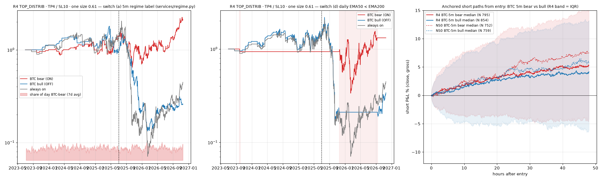

# A no-spot short sleeve that is ON only when BTC is bearish? (2026-11-18)

**Pre-registered:** `NOSPOT_BTCBEAR_2026-11-18_PREREG.md` (frozen 23:05 UTC, before any new result) + **Addendum E** (operator: the exit
family and W/L for the bear-ON cohort, frozen at the same time, before any result). HOLDOUT read once per cell.
**Everything below is BACKTEST.** Research only. Nothing in the bot changed. No engine / config change (research only; working data in the *_data folders stays local).

## Question (operator)
NOSPOT_EXIT found that R4 TOP_DISTRIB shorts on Frenzy coins with no spot market did better when BTC's 5m regime was bearish. Is there a
real, tradable sleeve "short no-spot Frenzy coins, ON only when BTC is bearish"? You want more trades per day. It must ADD to the
combined short book (EXHAUSTION + Flatbase + L4 + DISTRIBUTION), not only be positive alone.

## Plain answer
1. **No. Verdict: NOTHING.** No cell passes the pre-registered bar. 154 cells (7 BTC-bear definitions × 11 no-spot entries × 2 exits):
   16 are positive on HOLDOUT, **0 have a window-level 95 % CI above zero, 0 have a positive Kelly at the WR floor**, best family-wise
   null p = 0.79.
2. **The mechanical picks failed hard.** Addendum E picked (by DESIGN window t, frozen) R10 OI_FROM_MAX under "BTC 1h below EMA20 and EMA50"
   and under "breadth < 50 %". Best DESIGN exit TP 5 / SL 10: DESIGN +0.31 → **HOLDOUT −0.35 %/trade** (CI −0.63 … −0.03). The other pick
   had no surviving exit.
3. **The original watch fact holds its sign but is not strong.** R4 · BTC 5m bear · TP 4 / SL 10: DESIGN +0.40 (190 trades, 117 windows),
   HOLDOUT **+0.21** (636 trades, 284 windows), window CI **−0.24 … +0.64**, rotation null per-cell p 0.08, family-wise 0.90, Kelly at the
   floor −0.05. And it is in-sample by construction (it is the cell that produced the idea).
4. **It is not a market effect.** BTC-bear does NOT make random no-spot shorts better (random bars: −0.32 ON vs −0.39 OFF on HOLDOUT), and
   it does NOT make spot-coin EXHAUSTION better (+0.59 ON vs +0.86 OFF). If the R4 split is real, it is specific to R4 × wide-stop TP exit.
   But the BTC-bear definitions disagree with each other on R4 (bear better under 4 of 7, bull better under 3 of 7). That is the pattern of noise.
5. **Joint book: adds nothing you can rely on.** R4 · 5m-bear · TP4/SL10 adds +0.64 trades/day and moves HOLDOUT DCR 2.836 → 2.843 %/day
   in-sample, **2.787 after a 30 % haircut** (below the book), and raises the book's max drawdown 65 % → 77 %.
6. **Your coins this week:** both PHAROS R4 signals (11-18 15:45, 16:30) fired in a BTC 5m BEAR regime and both stopped at −10.3 %.

## What was already seen (honest list)
- NOSPOT_EXIT `_regime.csv`, full span: **R4 · TP4/SL10: 5m-bear +0.37 (693) / chop +0.05 / bull −0.24 (700)**; daily-bear +0.16 / bull −0.01.
  R4 · REF: −0.03 / −0.26. R4 · time 4 h: +0.25 / −0.38. R1 · TP4/SL12: −0.26 / +0.10 (opposite). NS0 · REF: −0.04 / −0.26.
- NOSPOT_SLEEVE: NS0 · XA by BTC daily (−0.13 bear / −0.38 bull) and 5m (−0.10 / −0.25 / −0.39). DESIGN is 100 % daily-bull.
- So cells (a) 5m and (d) daily × R4 / NS0 / R1 × REF / TP4SL10 are **contaminated**: their HOLDOUT is not fresh. The pre-registered rule
  caps them at OBSERVE. Fresh evidence = other definitions, other cohorts, window statistics, the rotation null, LOWO, the controls.
- (The +0.37 was on trades one-positioned without the switch. Here the switch gates entries first, then one position per pair: 826 trades
  full span instead of 693, +0.25 instead of +0.37.)

## Method
- **Trades:** the NOSPOT_EXIT 1m simulation (every eligible bar of the 2,081 episodes where NS0 / R1 / R4 fire × 46 exits + REF). Rule rows
  outside those episodes dropped (R3 92 %, R5 93 %, R6 94 %, R7 93 %, R9 92 %, others ≥ 97 % covered). Same costs: taker 0.05, maker 0.02,
  slip max(0.10 %, model) per taker leg, real funding; stress flat 0.20 %. One position per pair, applied AFTER the switch.
- **Switch definitions** (all at entry, closed bars only, sign granularity, nothing tuned). ON = bearish.

| id | ON (bearish) | duty DESIGN / HOLDOUT | contiguous ON episodes D / H | days mostly ON D / H |
|---|---|---|---|---|
| a | `classify_btc_regime` on BTC 5m ∈ {HEALTHY_BEAR, STRONG_BEAR, BEAR_EXHAUSTED} | 26 % / 26 % | 6,123 / 4,143 | 23 / 12 |
| b | BTC 1 h EMA20 falling (vs 3 bars ago) | 46 % / 51 % | 706 / 451 | 301 / 248 |
| c | BTC 4 h return < 0 | 48 % / 50 % | 7,738 / 5,399 | 334 / 239 |
| d | BTC daily EMA50 < EMA200 | **1 % / 59 %** | **1 / 1** | 9 / 299 |
| e | BTC 1 h close < EMA20 and < EMA50 | 38 % / 43 % | 912 / 680 | 257 / 214 |
| f | BTC 24 h return < 0 | 47 % / 50 % | 3,135 / 1,979 | 328 / 247 |
| g | breadth: < 50 % of USDT perps above daily EMA50 | 68 % / 82 % | 27 / 16 | 497 / 416 |

  (a) reproduces the earlier R4 label series on 99.93 % of hours; (d) matches the earlier daily R1 on 100 %. BTC 5m after 2026-11-16 16:00
  fetched from the fapi (2 calls, 10 weight).
- **Window = UTC day of entry** with ≥ 1 ON trade. Bootstrap = resample ON-days (2,000). LOWO = drop each of the 10 best days.
- **Null:** rotate the BTC regime timeline against the trades (offset 14 d … span − 14 d, wrapped inside HOLDOUT, 1,000 draws). This keeps
  each regime's autocorrelation and duty cycle. Statistic = ON avg − cohort avg. Family max over every cell.
- **Splits:** DESIGN 2023-07 → 2025-06, HOLDOUT 2025-07 → 2026-11-18.

## Window counts
- Short-flip definitions (a, b, c, e, f) have plenty of bear windows in BOTH splits: R4 · TP4/SL10 has 109–149 DESIGN windows and 283–365
  HOLDOUT windows; NS0 72–132 / 296–398.
- **(d) daily EMA50 < EMA200 has 0 DESIGN windows for R4 and NS0 and exactly ONE contiguous bear episode in HOLDOUT (≈ 2025-10 → 2026-09,
  299 days).** In episode units that is one observation. It cannot be judged; it can only be described.
- (g) breadth is ON 68–82 % of the time. It is not much of a switch.

## Main table — HOLDOUT avg %/trade ON (bear) / OFF (bull), DESIGN ON in brackets

### Exit TP 4 / SL 10 / 24 h

| cohort | (a) | (b) | (c) | (d) | (e) | (f) | (g) |
|---|---|---|---|---|---|---|---|
| NS0 | −0.21 / −0.00 (+0.76) | −0.00 / −0.02 (−0.32) | −0.12 / +0.03 (+0.07) | +0.19 / −0.36 (–) | −0.02 / −0.03 (−0.09) | +0.05 / −0.10 (−0.17) | −0.03 / +0.03 (−0.85) |
| R1 | −0.36 / −0.15 (+0.18) | −0.32 / −0.01 (+0.20) | −0.25 / −0.08 (+0.36) | −0.16 / −0.22 (−3.23) | −0.41 / +0.01 (+0.18) | −0.34 / −0.05 (+0.11) | −0.25 / +0.12 (−0.07) |
| R2 | −0.80 / −0.32 (+0.14) | −0.16 / −0.77 (−0.16) | −0.45 / −0.57 (+0.05) | −0.42 / −0.60 (−0.87) | −0.22 / −0.72 (+0.71) | −0.48 / −0.43 (+0.12) | −0.43 / −0.78 (−0.10) |
| R3 | −0.26 / −0.46 (−0.21) | −0.45 / −0.30 (−0.55) | −0.47 / −0.42 (−0.42) | −0.36 / −0.36 (–) | −0.35 / −0.37 (−0.17) | −0.49 / −0.31 (−0.41) | −0.42 / −0.12 (−0.96) |
| **R4** | **+0.21 / −0.19 (+0.40)** | −0.04 / +0.08 (+0.70) | +0.09 / −0.20 (+0.40) | +0.17 / −0.14 (–) | +0.07 / −0.00 (+0.80) | −0.07 / +0.15 (+0.60) | −0.01 / +0.18 (+0.30) |
| R5 | −0.17 / +0.20 (+0.27) | −0.17 / −0.02 (+0.21) | −0.04 / −0.11 (+0.12) | −0.17 / −0.02 (+0.30) | −0.20 / −0.05 (+0.06) | −0.20 / +0.12 (−0.04) | −0.16 / +0.11 (−0.33) |
| R6 | −0.46 / −0.51 (−0.68) | −0.43 / −0.49 (−0.92) | −0.48 / −0.52 (−0.95) | −0.60 / −0.27 (–) | −0.44 / −0.49 (−0.61) | −0.50 / −0.43 (−0.58) | −0.58 / +0.12 (−1.29) |
| R7 | −0.26 / −0.32 (−0.21) | −0.18 / −0.42 (+0.01) | −0.30 / −0.27 (−0.11) | −0.28 / −0.35 (+1.01) | −0.19 / −0.36 (+0.21) | −0.25 / −0.23 (−0.12) | −0.34 / −0.16 (−0.24) |
| R8 | +0.06 / +0.83 (−0.86) | +0.12 / +0.17 (−0.15) | −0.04 / +0.38 (−0.48) | +0.21 / +0.14 (–) | −0.22 / +0.43 (−0.24) | −0.09 / +0.34 (−0.15) | +0.10 / +0.58 (+0.03) |
| R9 | −0.17 / −0.09 (−0.28) | −0.16 / −0.23 (−0.25) | −0.21 / −0.16 (−0.44) | −0.31 / −0.16 (–) | −0.18 / −0.20 (−0.13) | −0.17 / −0.27 (−0.42) | −0.34 / +0.20 (−0.49) |
| R10 | −0.27 / −0.22 (−0.07) | −0.24 / −0.20 (+0.11) | −0.36 / −0.19 (−0.01) | −0.20 / −0.42 (+1.79) | −0.29 / −0.24 (+0.29) | −0.35 / −0.13 (+0.10) | −0.33 / −0.02 (−0.01) |

### Exit REF (shipped EXHAUSTION exit)

| cohort | (a) | (b) | (c) | (d) | (e) | (f) | (g) |
|---|---|---|---|---|---|---|---|
| NS0 | +0.10 / −0.26 (−1.05) | −0.02 / +0.09 (−0.61) | −0.02 / +0.06 (−0.32) | −0.02 / +0.12 (–) | −0.06 / +0.09 (−0.18) | +0.10 / −0.01 (−0.41) | −0.10 / +0.76 (−0.84) |
| R1 | −0.54 / −0.22 (−0.19) | −0.46 / −0.19 (−0.31) | −0.43 / −0.21 (−0.25) | −0.35 / −0.30 (−0.06) | −0.62 / −0.13 (−0.12) | −0.49 / −0.16 (−0.12) | −0.35 / −0.27 (−0.41) |
| R4 | −0.01 / −0.26 (−0.27) | +0.02 / −0.09 (+0.17) | −0.12 / −0.18 (+0.12) | +0.08 / −0.21 (–) | +0.04 / −0.18 (−0.05) | +0.01 / −0.13 (+0.07) | −0.04 / −0.14 (−0.16) |
| R10 | −0.49 / −0.40 (−0.30) | −0.44 / −0.37 (−0.04) | −0.47 / −0.40 (−0.16) | −0.32 / −0.67 (+4.03) | −0.50 / −0.35 (+0.13) | −0.41 / −0.28 (−0.14) | −0.49 / −0.32 (−0.11) |
| R2 / R3 / R5–R9 | all negative ON in HOLDOUT under every definition (−0.14 to −1.02) | | | | | | |

(Full table with N, windows, trades/day, WR, CI, concentration, halves: `_main.csv`.)

- **"BTC bear helps every no-spot short" is false.** ON beats OFF in about half the cells and loses in the other half. R1 and R5 are
  WORSE when BTC is bearish under every definition. R8 is better when BTC is bullish.
- **R4 is the only cohort where bear-ON is positive under several definitions** (a, c, d, e at TP4/SL10). But under (b), (f), (g) R4 does
  better when BTC is BULLISH. A real "bear helps R4" mechanism should not flip sign between 1 h EMA slope and 4 h return.

### Every HOLDOUT-positive ON cell against the bar (16 of 154)

| def · cohort · exit | contam. | N | windows | /ON-day | WR | avg | window CI 95 % | top day % | top pair % | LOWO min | @0.20 | Kelly floor | halves + | p cell | p_fw |
|---|---|---|---|---|---|---|---|---|---|---|---|---|---|---|---|
| d · R8 · TP4/SL10 | no | 826 | 231 | 2.76 | 73.2 | +0.21 | −0.17 … +0.58 | 22 | 21 | +0.17 | +0.08 | −0.036 | 0.67 | 0.43 | 1.00 |
| **a · R4 · TP4/SL10** | **yes** | 636 | 284 | 4.76 | 73.4 | **+0.21** | **−0.24 … +0.64** | 23 | 25 | +0.16 | +0.08 | **−0.049** | 0.67 | 0.08 | 0.90 |
| d · NS0 · TP4/SL10 | yes | 1,310 | 285 | 4.38 | 74.4 | +0.19 | −0.10 … +0.51 | 16 | 30 | +0.17 | +0.07 | −0.024 | 0.33 | 0.12 | 1.00 |
| d · R4 · TP4/SL10 | yes | 978 | 253 | 3.27 | 73.4 | +0.17 | −0.18 … +0.54 | 19 | 33 | +0.14 | +0.04 | −0.039 | 0.67 | 0.33 | 1.00 |
| b · R8 · TP4/SL10 | no | 735 | 249 | 2.88 | 72.9 | +0.12 | −0.37 … +0.62 | 36 | 37 | +0.08 | −0.01 | −0.069 | 0.67 | 0.48 | 1.00 |
| a · NS0 · REF | yes | 627 | 304 | 4.69 | 37.2 | +0.10 | −0.48 … +0.71 | 58 | 58 | +0.04 | −0.06 | −0.038 | 0.67 | 0.31 | 1.00 |
| g · R8 · TP4/SL10 | no | 1,255 | 323 | 3.02 | 72.7 | +0.10 | −0.22 … +0.42 | 30 | 29 | +0.07 | −0.03 | −0.049 | 0.67 | 0.89 | 1.00 |
| f · NS0 · REF | no | 1,074 | 319 | 4.28 | 37.4 | +0.10 | −0.36 … +0.56 | 55 | 52 | +0.04 | −0.07 | −0.028 | 0.67 | 0.32 | 1.00 |
| c · R4 · TP4/SL10 | no | 1,040 | 365 | 4.14 | 72.2 | +0.09 | −0.26 … +0.44 | 25 | 57 | +0.07 | −0.04 | −0.058 | 0.67 | 0.28 | 1.00 |
| d · R4 · REF | yes | 942 | 253 | 3.15 | 37.0 | +0.08 | −0.38 … +0.53 | 57 | 82 | +0.03 | −0.09 | −0.031 | 0.67 | 0.31 | 1.00 |
| e · R4 · TP4/SL10 | no | 868 | 283 | 3.96 | 72.4 | +0.07 | −0.31 … +0.46 | 47 | 92 | +0.04 | −0.06 | −0.073 | 0.67 | 0.47 | 1.00 |
| a · R8 · TP4/SL10 | no | 496 | 253 | 3.71 | 72.4 | +0.06 | −0.46 … +0.60 | 91 | 92 | +0.01 | −0.07 | −0.106 | 0.33 | 0.65 | 1.00 |
| f · NS0 · TP4/SL10 | no | 1,017 | 319 | 4.05 | 73.2 | +0.05 | −0.33 … +0.47 | 69 | 56 | +0.02 | −0.07 | −0.072 | 0.67 | 0.29 | 1.00 |
| e · R4 · REF | no | 839 | 281 | 3.83 | 36.0 | +0.04 | −0.42 … +0.51 | 108 | 105 | −0.00 | −0.13 | −0.037 | 0.67 | 0.30 | 1.00 |
| b · R4 · REF | no | 1,003 | 328 | 3.93 | 35.8 | +0.02 | −0.42 … +0.45 | 138 | 197 | −0.01 | −0.14 | −0.035 | 0.67 | 0.38 | 1.00 |
| f · R4 · REF | no | 972 | 307 | 3.87 | 36.1 | +0.01 | −0.45 … +0.45 | 509 | 653 | −0.03 | −0.16 | −0.038 | 0.67 | 0.29 | 1.00 |

"/ON-day" = trades per full day of ON time. "halves +" = share of full-span half-years (≥ 5 ON trades) positive.
- **Bar items failed by every cell: #2 (window CI > 0), #6 (Kelly at the floor > 0) and #7 (family-wise null).** Most also fail #5 (0.20 slip).
- R8 · (d) looks fine on avg, but R8 is just as good when BTC is BULL (+0.14). The switch adds nothing there.

## Addendum E — the exit family on the bear-ON cohort

**E1 (frozen rule: highest DESIGN window t under REF, ≥ 10 DESIGN windows, one per definition):**

| rank | def · cohort | DESIGN N | windows | avg | window t |
|---|---|---|---|---|---|
| 1 | **e · R10** | 704 | 230 | +0.13 | 2.33 |
| 2 | **g · R10** | 1,028 | 217 | −0.11 | 1.83 |
| 3 | g · R2 | 241 | 130 | −0.04 | 1.50 |
| 4 | c · R2 | 208 | 147 | +0.11 | 1.44 |
| … | a · R4 (the source) | 181 | 120 | −0.27 | −0.96 |

(The window t averages per-day means, so it can be positive while the trade avg is negative; that is the frozen rule.)

**E3 (46 exits, DESIGN ON only) and HOLDOUT once:**

| pair | DESIGN survivors | pick | DESIGN avg | HOLDOUT avg (N) | HOLDOUT CI | HOLDOUT REF |
|---|---|---|---|---|---|---|
| e · R10 | 8 (TP 3–5 × SL 6–12, BE 4) | **TP 5 / SL 10** | +0.31 (550) | **−0.35** (2,598) | −0.63 … −0.03 | −0.50 |
| g · R10 | 0 | — | (best −0.01) | every exit −0.20 to −0.87 | | −0.49 |
| a · R4 (source, contaminated, descriptive) | 13 (TP 3–5 × SL 6–12, lock 5→3, trail 4/1.5, time 4 h, time 48 h) | time 48 h (SL 10) | +0.95 (160) | +0.24 (518) | −1.11 … +1.63 | −0.01 |

- **On e · R10 every one of the 46 exits is negative on HOLDOUT (−0.20 to −0.67).** It is the NOSPOT_EXIT picture again: DESIGN plateau of
  fixed TP + wide stop, gone on HOLDOUT.
- On the R4 source, the HOLDOUT is positive for most fixed-TP / time exits (+0.06 to +0.48), REF is −0.01. Under the rotation null the
  R4 × 5m-bear lift has per-cell p 0.01–0.05 for 12 exits (TP 2–3 / SL 10–12, small TP with SL 4–6, trails 2–3/1.5) — **but family-wise 0.88–1.00**
  over the 289 cells of the full family, and the cell is in-sample. This is the most interesting thing in the study, and it is not enough.
- **Saved / deeper (R4 · 5m-bear, TP4/SL10 vs REF, HOLDOUT):** of 390 REF stops, 236 are saved (+1,962 % summed), 154 stop deeper (−772);
  of 186 REF take-profits, 185 are capped at 4 % (−1,089). Net +0.22/trade vs REF — the same "wider stop, smaller TP" exit effect as before.
- **Δ = 0 on never-armed fills:** not applicable — no break-even / lock / trail exit was picked.
- **Random-entry control under the same switch and exit (HOLDOUT):** TP4/SL10 random bars −0.32 ON / −0.39 OFF; REF −0.51 / −0.52;
  TP5/SL10 under (e) −0.43 / −0.34. The switch does nothing for random entries.

## The control and the spot comparison

| HOLDOUT avg %/trade | (a) ON / OFF | (b) | (c) | (d) | (e) | (f) | (g) |
|---|---|---|---|---|---|---|---|
| random no-spot bars · TP4/SL10 | −0.32 / −0.39 | −0.38 / −0.31 | −0.35 / −0.34 | −0.30 / −0.40 | −0.39 / −0.31 | −0.40 / −0.29 | −0.41 / −0.03 |
| random no-spot bars · REF | −0.51 / −0.52 | −0.54 / −0.50 | −0.55 / −0.49 | −0.47 / −0.59 | −0.57 / −0.48 | −0.57 / −0.47 | −0.57 / −0.26 |
| **spot-coin EXHAUSTION** · REF (N ≈ 500–1,500 per side) | +0.59 / +0.86 | +0.69 / +0.79 | +0.80 / +0.69 | +0.74 / +0.74 | +0.56 / +0.87 | +0.69 / +0.79 | +0.67 / +0.96 |
| spot-coin EXHAUSTION · TP4/SL10 | +0.64 / +0.49 | +0.54 / +0.54 | +0.51 / +0.56 | +0.48 / +0.62 | +0.45 / +0.60 | +0.64 / +0.44 | +0.50 / +0.66 |

- **No market effect.** BTC-bear does not lift random no-spot shorts (gaps ≤ 0.12, sign mixed; under breadth (g) random shorts are much WORSE when breadth is bearish) and does not lift the spot-coin EXHAUSTION
  sleeve (on REF it is better when BTC is BULL under 5 of 7 definitions).
- So "BTC bear" is not a general short tailwind in these coins. Any R4 split is an interaction with that one entry, and it is not stable
  across definitions.

## Path decomposition — do bearish-BTC shorts squeeze less?

Squeeze share = NEVER_WORKED + STOPPED_RECOVERED (share of trades). WORKED = +1 % before the stop distance.

| cohort · exit | (a) squeeze ON / OFF | (a) worked ON / OFF | (d) squeeze ON / OFF | (c) squeeze ON / OFF |
|---|---|---|---|---|
| R4 · TP4/SL10 | 6.2 / 8.0 % | 93.0 / 90.8 % | 8.1 / 7.5 % | 6.8 / 9.0 % |
| R4 · REF | 16.9 / 17.8 % | 83.1 / 82.2 % | 16.6 / 17.9 % | 17.5 / 18.8 % |
| NS0 · REF | 15.7 / 17.1 % | 84.3 / 82.9 % | 15.7 / 17.6 % | 16.6 / 16.8 % |
| R1 · REF | 19.8 / 18.4 % | 80.2 / 81.6 % | 18.0 / 19.5 % | 19.0 / 18.6 % |
| R10 · REF | 23.2 / 22.4 % | 76.8 / 77.6 % | 19.0 / 23.0 % | 21.7 / 22.1 % |

- Bear-BTC shorts squeeze **1–2 points less** at most, and not for R1 / R10. GAVE_BACK (moved our way, then squeezed through the stop)
  stays ~48 % of REF trades and ~70–85 % of the loss in both states. The loss engine does not change with BTC.
- Anchored paths (chart, right): median R4 short path at 48 h ≈ +5.3 % when BTC-5m bear vs +4.1 % bull; NS0 +7.5 vs +5.9. The 25–75 % band
  is −5 % … +13 % in both. The difference is small next to the spread.

## Winners vs losers inside the bear-ON cohort (Addendum E5)
- **Coverage:** 55 entry-time variables, all ≥ 95 % scored except mcap / turnover (44 % — coins with no market-cap record). Blind spots as
  in NOSPOT_SLEEVE: historical mcap, order-book depth, liquidations, Alpha listing history.
- **Screen:** 3 granularities (median, terciles, quintiles), ≈ 165 tests per (cohort, exit), family-wise label-shuffle null (300), DESIGN.

| bear-ON cohort · exit | tests | p_fw < 0.05 | best (DESIGN) | p_fw |
|---|---|---|---|---|
| e · R10 · REF | 165 | 0 | hour (quint) | 0.27 |
| e · R10 · TP5/SL10 | 165 | 0 | dd_hi (quint) | 0.93 |
| g · R10 · REF | 165 | 1 | f_prev (terc, middle, 26 trades) | 0.033 |
| g · R10 · TP4/SL10 | 165 | 0 | oi_vs_max (quint) | 0.18 |
| a · R4 · REF | 163 | 0 | hour (quint) | 0.56 |
| a · R4 · time 48 h | 163 | 0 | f_last (quint) | 0.45 |

- **Joint check:** the only hit (g · R10 · REF, f_prev middle tercile) has p_fw 0.997 under TP4/SL10 and a HOLDOUT lift of +0.04. It flips
  between exits → **no filter** (pre-registered rule).
- Nothing inside the bear-ON cohort separates winners from losers.

## Concentration and leave-one-window-out (R4 · 5m-bear · TP4/SL10, HOLDOUT)
- Top day 23 % of profit, top pair 25 % (RAYSOL): both under the 25 % / 50 % bar. Drop the 10 best days one at a time: worst +0.16.
  Drop the top pair: +0.16.
- **By half-year (full span, ON):** 24-H1 +0.51 · 24-H2 −0.11 · 25-H1 +0.54 · 25-H2 −0.23 · 26-H1 +0.30 · 26-H2 **+1.45**. Most of the
  HOLDOUT profit is 2026-H2 (96 trades, +1.45). Without it the HOLDOUT ON avg is −0.01 (25-H2 −0.23 on 317 trades, 26-H1 +0.30 on 223).
- The one-size equity of the ON sleeve (chart, left) halves during 2025-H2 before recovering. Bear-only did not avoid that drawdown.

## The null
- Rotation null over the main family (154 cells): the family-wise 95 % point of "ON lift" is +0.83 %/trade. The best observed lifts are
  +0.38 (e · R2 · TP4/SL10, p_fw 0.79) and +0.34 (a · R4 · TP4/SL10, p_fw 0.90).
- Full family incl. the 3 exit studies (289 cells): minimum p_fw 0.88. 16 cells have per-cell p < 0.05 — about what 289 tests give by luck
  (14 expected), and 12 of them are R4 × 5m-bear exits that share the same trades (one effect counted 12 times).

## Joint book (`joint_short_sim.py`, all four + candidate, one book, 0.61 × equity, uncapped)

| book | trades/day | full DCR %/day | HOLDOUT DCR | worst day | max DD |
|---|---|---|---|---|---|
| **all four (EXH + FB + L4 + DIST)** | 4.99 | **1.662** | **2.836** | −42.1 % | 64.6 % |
| + R4 · 5m-bear · TP4/SL10 (in-sample) | 5.62 (+0.64) | 1.683 | 2.843 | −40.6 % | 76.8 % |
| … haircut 30 % / 50 % | | 1.654 / 1.635 | **2.787 / 2.750** | −40.6 % | 77.1 / 77.4 % |
| + R4 · 5m-bear · time 48 h | 5.44 | 1.465 | 2.339 | −46.4 % | 83.1 % |
| + R4 · 5m-bear · REF | 5.60 | 1.557 | 2.688 | −42.1 % | 77.8 % |
| + R4 · daily-bear · TP4/SL10 | 5.73 | 1.629 | 2.767 | −44.0 % | 86.5 % |
| + R4 · 4h-bear · TP4/SL10 | 5.98 | 1.607 | 2.647 | −44.0 % | 80.2 % |
| + R10 · (e) · TP5/SL10 (Addendum E pick) | 7.37 | 1.080 | 1.354 | −64.2 % | 99.0 % |

- **Only the in-sample source cell nudges the book up (+0.007 %/day HOLDOUT); any haircut turns it negative.** Every add raises max drawdown.
- **Alone at 0.61:** R4 · 5m-bear · TP4/SL10 compounds +0.06 %/day full span (+0.08 HOLDOUT), worst day −15.6 %.
- **Clustering:** daily P&L correlation with EXHAUSTION −0.01 (no extra clustering); at most 3 candidate stops on one day; on the book's
  worst days it added between −6.4 % and +1.9 % (`_worstdays.csv`).

## The final combined candidate (Addendum E6)
Switch BTC 5m regime bear (a) + R4 TOP_DISTRIB entry + no W/L filter (none survived) + fixed maker TP 4 % / market SL 10 % / 24 h.
(The E3 pick for this pair, time 48 h, is worse in the book; TP4/SL10 is shown because it is the best candidate, not because it was selected.)

| item | value |
|---|---|
| trades/day while ON (per full ON day) | 4.76 HOLDOUT · 1.00 DESIGN |
| trades/day averaged (duty 26 %) | 1.26 HOLDOUT · 0.67 full span · **0.64 taken in the joint book** |
| avg %/trade DESIGN / HOLDOUT | +0.40 (190) / **+0.21** (636) — HOLDOUT not fresh |
| window CI (HOLDOUT, 284 windows) | **−0.24 … +0.64** |
| @0.20 % slip | +0.08 |
| Kelly | WR 73.4 %, floor 70.5 % vs breakeven 71.8 % → **−0.049** (size 0) |
| DCR at 0.61 alone | +0.06 %/day full · +0.08 HOLDOUT · worst day −15.6 % |
| joint add (HOLDOUT DCR) | 2.836 → 2.843 in-sample · 2.787 (−0.05) at 30 % haircut · max DD 65 → 77 % |
| null | per-cell p 0.08, family-wise 0.90 |
| bar items | windows ✓ · CI ✗ · concentration ✓ · halves ✓ (4/6) · 0.20 slip ✓ · Kelly ✗ · null ✗ · joint add ✗ after haircut · DESIGN ✓ · vs random ✓ (+0.53) |

## Replays this week (live 1m, BTC regime at each signal; net %)

| coin · cohort · entry (UTC) | BTC 5m label | (a) | (b) | (c) | (d) | (e) | (f) | REF | TP4/SL10 | TP5/SL10 | time 48 h |
|---|---|---|---|---|---|---|---|---|---|---|---|
| PIPPIN · NS0 · 11-18 19:00 | HEALTHY_BULL | bull | BEAR | BEAR | bull | BEAR | BEAR | TP +9.83 | TP +3.83 | TP +4.83 | open +13.2 |
| BLESS · NS0 · 11-16 09:45 | STRONG_BEAR | BEAR | BEAR | BEAR | bull | BEAR | BEAR | SL −5.83 | SL −10.30 | SL −10.30 | SL −10.30 |
| BLESS · NS0 · 11-16 17:45 | HEALTHY_BULL | bull | bull | bull | bull | bull | bull | SL −6.30 | SL −10.30 | SL −10.30 | SL −10.30 |
| BLESS · NS0 · 11-18 04:45 | CHOPPY_WEAK | chop | BEAR | BEAR | bull | BEAR | BEAR | SL −4.81 | TP +3.83 | TP +4.83 | SL −10.30 |
| BLESS · NS0 · 11-18 07:45 | CHOPPY_WEAK | chop | bull | bull | bull | bull | BEAR | TP +9.84 | TP +3.83 | TP +4.83 | open −2.33 |
| BLESS · R1 · 11-15 10:15 | STRONG_BULL | bull | BEAR | bull | bull | bull | BEAR | SL −4.20 | SL −10.27 | SL −10.27 | SL −10.27 |
| BLESS · R1 · 11-18 05:15 | CHOPPY_WEAK | chop | BEAR | BEAR | bull | BEAR | BEAR | SL −5.42 | SL −10.30 | SL −10.30 | SL −10.30 |
| **PHAROS · R4 · 11-18 15:45** | STRONG_BEAR | **BEAR** | BEAR | BEAR | bull | BEAR | BEAR | SL −5.64 | **SL −10.27** | SL −10.27 | SL −10.27 |
| **PHAROS · R4 · 11-18 16:30** | BEAR_EXHAUSTED | **BEAR** | BEAR | BEAR | bull | BEAR | BEAR | SL −5.72 | **SL −10.30** | SL −10.30 | SL −10.30 |

- JELLYJELLY: no NS0 / R1 / R4 / R10 signal. BTC daily (d) is BULL all week (no daily switch would have been ON).
- **The candidate's only two live-week fills (PHAROS R4, 5m-bear) both lost −10.3 %.** Two fills are anecdote, but they are exactly
  the trades the switch was meant to keep.

## Chart
`NOSPOT_BTCBEAR_2026-11-18_chart.png`

- **Left:** R4 · TP4/SL10 one-size equity, ON when BTC 5m bear (red) vs OFF (blue) vs always (grey). Red strip = share of each day BTC-5m
  bear (7-day avg): it never stays on or off for long. The red curve halves in 2025-H2, then rises mostly in 2026-H2.
- **Middle:** the same with the daily switch (d); shaded = BTC daily bear. One bear episode in the whole span.
- **Right:** anchored short paths from entry (48 h), R4 and NS0, BTC-5m bear vs bull. Small gap, huge overlap.

## What it means
- BTC's direction does not make these coins easier to short. Random shorts, the spot-coin sleeve, and 10 of 11 no-spot entries show no
  consistent bear benefit; R1 and R5 get worse.
- The R4 × "BTC 5m bear" split is real in sign on both halves of the data (+0.40 DESIGN, +0.21 HOLDOUT) and survives leave-one-day-out.
  But it is weak (CI includes 0), it changes sign under other bear definitions, it lives mostly in one half-year, it is in-sample, and its
  Kelly is negative because the 10 % stop costs 2.5 × the 4 % TP. "Stronger on 2 of 7 definitions" is what noise looks like over 154 cells.
- The operator's goal (more trades/day) is real: this would add ~0.6 trades/day. But the book does not grow with it after a haircut, and the
  drawdown grows.

## Verdict
**NOTHING** (by the pre-registered rule). No SHIP-candidate, no OBSERVE.
- No cell passes items 2 (window CI) and 7 (null) together; the OBSERVE rule requires both.
- Best cell: **R4 TOP_DISTRIB · BTC 5m bear · TP 4 / SL 10 / 24 h** — DESIGN +0.40 / HOLDOUT +0.21 (contaminated), CI −0.24 … +0.64, p_fw 0.90,
  Kelly −0.05, joint add +0.007 %/day in-sample / −0.05 after a 30 % haircut.
- Addendum E picks (R10 under 1h-below-EMAs / breadth): HOLDOUT −0.35 and no survivor. W/L: no separator survives the joint check.
- Keep `EXH_NO_SPOT` blocking. Nothing to build.
- **Watch fact only (no build, no gate, no sleeve):** the R4 × BTC-5m-bear split. It can be re-read for free at the next NOSPOT refresh with
  the frozen rule above (switch (a), R4 primary mask, TP4/SL10, one position after the switch): it would need ≥ 30 NEW ON windows after
  2026-11-18 with a window-CI lower bound > 0. Do not refit the definition or the exit to rescue it (the PHAROS fills are the first two).

## Assumptions and caveats
1. All numbers are BACKTEST. The thin-coin slip model is calibrated, not observed on these coins; stops are market orders.
2. 1m bars cannot order moves inside a minute (stop first). 0.3 % of trades use the 5m fallback (the last days).
3. Episodes are the all-spike list, not the live engine flag. No-spot = no spot zip that month; 1000-prefix pairs excluded.
4. Rule rows outside the 2,081 simulated episodes are dropped (6–8 % for R3 / R5 / R6 / R7 / R9).
5. The rotation null wraps HOLDOUT end to start; regimes with very long blocks (d, g) have few distinct rotations — their p is coarse.
6. The joint book is the uncapped one-book model of `joint_short_sim.py` (flat 0.10 slip for the four sleeves, model slip for the candidate).

## Files
- **Report:** `reports/NOSPOT_BTCBEAR_2026-11-18.md`, `_PREREG.md` (+ Addendum E), `_chart.png`.
- **Tables:** `_main.csv` (every def × cohort × exit × ON / OFF / ALL × block), `_control.csv`, `_null.csv`, `_null_full.csv`, `_e1.csv`,
  `_e3_select.csv`, `_e3_grid.csv`, `_bar.csv`, `_control_cand.csv`, `_saved.csv`, `_paths.csv`, `_squeeze.csv`, `_wl.csv`, `_coverage.csv`,
  `_spot.csv`, `_joint.csv`, `_worstdays.csv`, `_cluster.csv`, `_replays.csv`.
- **Trades:** `_trades.csv.gz` (the 6 joint-book candidates, ON-gated, with every regime label and path group).
- **Scripts:** `scripts/nospot_btcbear_lib.py`, `scripts/nospot_btcbear_eval.py` (stage 1), `scripts/nospot_btcbear_stage2.py` (Addendum E,
  control, null, W/L, paths), `scripts/nospot_btcbear_stage3.py` (spot, joint, clustering, replays, chart).
  **Data:** `reports/NOSPOT_BTCBEAR_data/` (BTC 5m incl. the 11-16 → 11-18 tail, regime series, row cache, EXH 1m).
