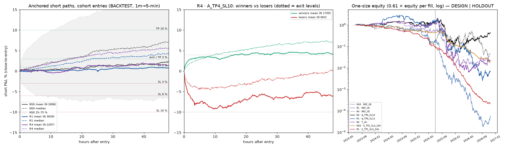

# Can a better EXIT make the no-spot Frenzy short pay? (2026-11-18)

**Pre-registered:** `NOSPOT_EXIT_2026-11-18_PREREG.md` (frozen 22:12 UTC, before any simulation) + **Addendum S** (small-TP cells,
operator request, frozen 22:24 UTC, before any simulation had run). HOLDOUT was read once, after the mechanical DESIGN selection.
**Everything below is BACKTEST.** Research only. Nothing in the bot changed. No commit.

## Question (operator)
On perp-only Frenzy coins, about 80 % of shorts go +1 % our way first, and most of the loss is GAVE_BACK (up a few %, then squeezed
back through the stop). Can locking in profit (fixed TP, break-even, profit lock, trailing stop, time exit, or a small 1–1.5 % TP) turn
these entries into a positive sleeve?

## Plain answer
1. **No. Nothing ships, nothing to observe.** 46 exits × 3 entries = 138 cells. 13 survived DESIGN. The top 3 went to HOLDOUT. All 3 fail
   the bar: the best (R4 TOP_DISTRIB · TP 4 % / SL 10 %) makes **+0.02 %/trade** on HOLDOUT and passes 3 of 9 items.
2. **Every exit improvement is an EXIT effect, not an entry edge.** The same exit lifts **random entries** in the same episodes by the
   same amount or more (TP 4 / SL 10 vs REF: +0.32 DESIGN / +0.18 HOLDOUT on random bars, vs +0.12 to +0.31 on R1, −0.05 / +0.07 on R4).
   Random entries stay negative under every exit (best −0.01 DESIGN, −0.29 HOLDOUT).
3. **Break-even, profit lock and trailing stops all LOSE vs no lock.** The lock fires 600–1,300 times per cohort. The fills it saves
   and the fills it cuts short cancel out, and each lock exit pays taker fee + thin-coin slip. Net vs the same exit without the lock: −0.09 to −0.29 %/trade for BE / lock
   (one exception, R4 lock +5 → +3: +0.03); trails help only NS0 vs a plain 24 h hold (which is itself deeply negative).
4. **Small TP (1 % / 1.5 %) does not work.** The +1 % hit rate is real (74–77 % before a −3 % stop, ~80 % before −4 %), but the
   breakeven WR is **~80 % at TP 1 / SL 3** because a win nets only +0.83 % and a loss costs −3.3 to −3.6 %. Every S cell loses
   −0.10 to −0.36 %/trade, on every cohort, both blocks. The random-entry control has the **same** +1 % hit rate (74.8 %): it is not an
   entry property.
5. **Every add LOWERS EXH + DIST.** HOLDOUT one-size DCR: EXH + DIST +1.74 %/day → +1.46 with the best pick, +0.67 / +0.95 with the
   other two.
6. **Your coins (11-10 → 11-18):** BLESS / PHAROS entries were squeezed straight through every stop (−10 to −12 % with the wide-stop
   exits vs −5 to −6 % on REF). PIPPIN 11-18 19:00 NS0 won under every exit.

## Method
- **Entries (frozen, from NOSPOT_SLEEVE):** NS0 (EXH trigger on no-spot rows), R1 OI_UNWIND, R4 TOP_DISTRIB (primary masks, unchanged).
  RND = every eligible 15m-close bar in the 2,081 episodes where any of them fires (440,122 bars, the random-entry control).
  One position per pair, re-applied per (cohort, exit) with that exit's own exit time.
- **Path:** 1m futures klines from data.binance.vision daily zips (9,846 pair-days, 0 API weight). **99.7 % of trades on 1m**; the rest
  (last days of the data, not yet zipped) fall back to 5m, flagged. 48 h path.
- **Fills:** the stop as it stood at the bar OPEN is checked first on the HIGH; then the maker TP on the LOW, ≥ 1 tick through; both in one
  bar → stop. Stops fill at max(stop, bar open) (gap-aware). BE / lock / trail levels update after the bar's checks and apply from the
  next bar. All stops, locks, trails and time exits are MARKET orders.
- **Costs:** taker 0.05 % per taker leg; maker 0.02 % on a TP; slip per taker leg = max(0.10 %, −0.042 + 0.276 · √(6,100 ÷ Q5)); real
  funding incl. hourly; a missing pair-month −0.05 %/8 h. Stresses: flat 0.20 % per taker leg; 2 × slip on dynamic exits.
- **Exit family (46 selectable + reference):**
  - REF = the shipped EXHAUSTION exit XE: TP min(20 × ATR15, 10 %) / SL min(1.5 × ATR15, 6 %) / 24 h.
  - A: TP 2 / 3 / 4 / 5 % × SL 6 / 10 / 12 %, 24 h (12).
  - B: break-even after +2 / 3 / 4 % (stop to entry − costs), SL 10, TP 10 (3).
  - C: profit lock +3 → +1, +4 → +2, +5 → +3, SL 10, TP 10 (3).
  - D: trail, arm 2 / 3 / 4 % × giveback 1.5 / 3 %, plus arm 3 × 1 / 2 × ATR15, SL 10, no TP (8).
  - T: time exit 4 / 12 / 24 / 48 h, SL 10 (4).
  - S (addendum): TP 1 / 1.5 % × SL 2 / 3 / 4 / 6 % × hold 4 / 24 h (16).
  - Partial TP excluded (operator).
- **Selection (DESIGN 2023-07 → 2025-06):** N ≥ 30 · avg > 0 · avg > REF · ≥ 2/3 DESIGN halves positive · ≥ 2/3 grid neighbours positive.
  Top 3 by DESIGN avg (one per cohort × family) → HOLDOUT (2025-07 → 2026-11-18), read once.
- **Null:** each trade's entry → a uniform random eligible bar of the same episode (same exit), 500 draws; statistic = avg − null mean;
  family-wise max over 138 cells.
- **Parity:** REF on 1m reproduces the 5m study: NS0 −0.05 %/trade (5m: −0.07), same N (2,696). On EXHAUSTION trades the 1m REF gross
  equals the baseline CSV exactly (+1.137 %).

## The reference (REF = shipped EXHAUSTION exit, 1m)

| cohort | block | N | /day | WR | BE WR | avg | avg win / loss | @0.20 | best-5 %-out | Kelly (floor) | DCR %/day |
|---|---|---|---|---|---|---|---|---|---|---|---|
| NS0 | DESIGN | 406 | 0.56 | 31.8 | 36.1 | −0.54 | +7.94 / −4.49 | −0.72 | −1.11 | −0.125 | −0.24 |
| NS0 | HOLDOUT | 2,290 | 4.54 | 37.2 | 37.0 | +0.04 | +9.54 / −5.59 | −0.13 | −0.49 | −0.022 | −0.41 |
| R1 | DESIGN | 919 | 1.26 | 31.9 | 33.7 | −0.21 | +7.72 / −3.93 | −0.39 | −0.75 | −0.065 | −0.24 |
| R1 | HOLDOUT | 2,720 | 5.39 | 34.7 | 37.1 | −0.33 | +8.81 / −5.19 | −0.50 | −0.86 | −0.060 | −1.56 |
| R4 | DESIGN | 485 | 0.66 | 32.6 | 33.7 | −0.13 | +7.77 / −3.94 | −0.30 | −0.67 | −0.068 | −0.09 |
| R4 | HOLDOUT | 1,812 | 3.59 | 36.0 | 36.5 | −0.06 | +8.77 / −5.04 | −0.23 | −0.59 | −0.036 | −0.48 |
| RND | DESIGN / HOLDOUT | 86,924 / 353,198 | | | | −0.34 / −0.52 | | | | | |

## DESIGN grid (avg net %/trade; HOLDOUT shown only as descriptive after the decision)

| exit | NS0 D | R1 D | R4 D | RND D | NS0 H | R1 H | R4 H | RND H | survivor |
|---|---|---|---|---|---|---|---|---|---|
| REF_XE | −0.54 | −0.21 | −0.13 | −0.33 | +0.04 | −0.32 | −0.06 | −0.52 | ref |
| A TP2 SL6 | −0.02 | −0.12 | −0.15 | −0.09 | −0.19 | −0.12 | −0.11 | −0.31 | |
| A TP3 SL6 | −0.08 | −0.05 | −0.08 | −0.05 | −0.11 | −0.12 | −0.06 | −0.34 | |
| A TP4 SL6 | −0.19 | −0.03 | −0.01 | −0.04 | −0.06 | −0.16 | −0.07 | −0.37 | |
| A TP5 SL6 | −0.32 | −0.17 | −0.01 | −0.04 | −0.10 | −0.17 | −0.04 | −0.40 | |
| A TP2 SL10 | −0.13 | +0.06 | +0.06 | −0.06 | −0.11 | −0.06 | +0.02 | −0.29 | R1 |
| A TP3 SL10 | −0.10 | +0.12 | +0.19 | −0.02 | −0.03 | −0.11 | +0.05 | −0.31 | R1, R4 |
| **A TP4 SL10** | −0.14 | +0.17 | **+0.19** | −0.01 | −0.02 | −0.18 | **+0.02** | −0.34 | **R4 (pick 1)** |
| A TP5 SL10 | −0.36 | −0.00 | +0.18 | −0.01 | −0.07 | −0.19 | +0.09 | −0.38 | R4 |
| A TP2 SL12 | −0.02 | +0.08 | −0.07 | −0.06 | −0.13 | −0.07 | +0.06 | −0.29 | R1 |
| A TP3 SL12 | −0.09 | +0.14 | +0.06 | −0.02 | −0.11 | −0.09 | +0.09 | −0.32 | R1, R4 |
| **A TP4 SL12** | −0.14 | **+0.19** | +0.14 | −0.01 | −0.10 | **−0.13** | +0.11 | −0.36 | **R1 (pick 2)**, R4 |
| A TP5 SL12 | −0.26 | −0.00 | +0.09 | −0.01 | −0.12 | −0.13 | +0.17 | −0.40 | R4 |
| B BE2 / BE3 / BE4 | −0.45 / −0.30 / −0.45 | −0.18 / −0.15 / −0.14 | −0.33 / −0.11 / −0.07 | −0.15 / −0.08 / −0.10 | −0.07 / +0.05 / −0.07 | −0.24 / −0.29 / −0.31 | −0.11 / −0.03 / +0.02 | −0.45 / −0.48 / −0.50 | |
| C L31 / L42 / L53 | −0.07 / −0.48 / −0.64 | −0.19 / −0.09 / −0.15 | −0.06 / −0.11 / +0.08 | −0.09 / −0.12 / −0.11 | +0.02 / −0.05 / −0.06 | −0.20 / −0.21 / −0.29 | −0.07 / −0.02 / +0.11 | −0.47 / −0.49 / −0.51 | |
| D trail a2 g1.5 / g3 | −0.28 / −0.47 | −0.12 / −0.18 | −0.10 / −0.21 | −0.21 / −0.16 | −0.10 / −0.12 | −0.21 / −0.25 | −0.12 / −0.12 | −0.43 / −0.47 | |
| D trail a3 g1.5 / g3 | −0.30 / −0.34 | −0.04 / −0.09 | −0.00 / −0.14 | −0.17 / −0.13 | −0.02 / −0.03 | −0.26 / −0.28 | −0.03 / −0.08 | −0.45 / −0.49 | |
| D trail a4 g1.5 / g3 | −0.44 / −0.42 | −0.06 / −0.13 | +0.04 / −0.06 | −0.15 / −0.14 | −0.08 / −0.12 | −0.33 / −0.32 | −0.06 / −0.10 | −0.47 / −0.51 | |
| D trail a3 1 / 2 × ATR | −0.33 / −0.23 | −0.09 / −0.21 | −0.09 / +0.25 | −0.18 / −0.19 | +0.12 / +0.11 | −0.30 / −0.21 | −0.10 / −0.01 | −0.51 / −0.59 | (R4 2×ATR: plateau 0/3) |
| T 4 h | −0.21 | −0.24 | **+0.15** | −0.39 | −0.20 | −0.33 | **−0.10** | −0.59 | **R4 (pick 3)** |
| T 12 h | −0.04 | −0.37 | +0.03 | −0.48 | −0.45 | −0.32 | −0.09 | −0.73 | R4 |
| T 24 h | +0.47 | +0.08 | +0.08 | −0.51 | −0.67 | −0.35 | +0.17 | −0.82 | (NS0: plateau 0/2) |
| T 48 h | −0.63 | −0.55 | +0.21 | −0.43 | −0.59 | −0.40 | −0.06 | −0.99 | |
| S TP1 SL2 / 3 / 4 / 6 (24 h) | −0.36 / −0.30 / −0.24 / −0.18 | −0.19 / −0.16 / −0.17 / −0.13 | −0.19 / −0.15 / −0.18 / −0.20 | −0.19 / −0.18 / −0.16 / −0.13 | −0.26 / −0.21 / −0.20 / −0.16 | −0.21 / −0.16 / −0.15 / −0.14 | −0.20 / −0.16 / −0.10 / −0.14 | −0.32 / −0.31 / −0.30 / −0.29 | |
| S TP1.5 SL2 / 3 / 4 / 6 (24 h) | −0.30 / −0.22 / −0.17 / −0.06 | −0.22 / −0.18 / −0.17 / −0.10 | −0.17 / −0.15 / −0.20 / −0.17 | −0.20 / −0.18 / −0.16 / −0.11 | −0.24 / −0.19 / −0.22 / −0.21 | −0.23 / −0.17 / −0.14 / −0.14 | −0.21 / −0.16 / −0.11 / −0.13 | −0.34 / −0.32 / −0.31 / −0.29 | |

(4 h holds of the S cells are within ±0.02 of the 24 h ones; full grid in `_grid.csv`, selection in `_select.csv`.)

- **No NS0 cell survives.** NS0's only positive DESIGN cell (T 24 h, +0.47) has both neighbours negative and is −0.67 on HOLDOUT.
- **No B / C / D / S cell survives on any cohort.**

## The plateau
- The only plateau is **fixed TP 2–5 % with a WIDE stop (10–12 %)** on R1 and R4 (13 survivors, all A-family or R4 time exits).
  The same zone is positive on R4 HOLDOUT (+0.02 to +0.17), negative on R1 HOLDOUT (−0.06 to −0.19).
- A 6 % stop is negative everywhere. This is the NOSPOT_SLEEVE finding again: the squeezes need a wide stop, and the wide stop costs
  −10 to −12 % when it is hit.

## HOLDOUT for the 3 survivors (read once) and the ship bar

| item | R4 · TP 4 / SL 10 | R1 · TP 4 / SL 12 | R4 · time 4 h (SL 10) |
|---|---|---|---|
| DESIGN avg (N) | +0.19 (488) | +0.19 (913) | +0.15 (481) |
| HOLDOUT avg (N, /day) | **+0.02** (1,884, 3.7) | **−0.13** (3,015, 6.0) | **−0.10** (1,637, 3.2) |
| HOLDOUT REF avg | −0.06 | −0.33 | −0.06 |
| 1. HOLDOUT > 0 and > REF | ✓ | ✗ | ✗ |
| 2. ≥ 2/3 half-years positive | ✓ 5/7 | ✗ 3/7 | ✗ 4/7 |
| 3. > 0 at 0.20 % slip | ✗ −0.10 | ✗ −0.25 | ✗ −0.30 |
| 4. best-5 %-out > 0 | ✗ −0.18 | ✗ −0.34 | ✗ −1.37 |
| 5. Kelly at WR floor > 0 (trade / day) | ✗ −0.055 / −0.080 | ✗ −0.086 / −0.139 | ✗ −0.055 / −0.112 |
| 6. family-wise null p < 0.05 | ✗ 0.48 | ✗ 0.96 | ✓ 0.016 |
| 7. no pair / day ≥ 50 % of profit | ✗ 146 % / 85 % | ✗ (no profit) | ✗ (no profit) |
| 8. ≥ 8 windows | ✓ 443 days | ✓ 479 | ✓ 432 |
| 9. DCR > 0 and adds to EXH + DIST | ✗ −0.21; 1.74 → 1.46 | ✗ −1.05; 1.74 → 0.67 | ✗ −0.78; 1.74 → 0.95 |
| **items passed** | **3 / 9** | **1 / 9** | **2 / 9** |
| day-block 95 % CI of HOLDOUT avg | −0.25 … +0.30 | −0.36 … +0.10 | −0.53 … +0.34 |

- After the 30–50 % in-sample haircut, pick 1's DESIGN +0.19 becomes +0.10 to +0.13; HOLDOUT delivered +0.02.
- **Fragility:** pick 1's DESIGN +0.19 depends on which re-entries one-position allows. On REF's own entry set the same exit makes
  −0.18 on DESIGN (Δ −0.05 vs REF). The edge is not in the exit.
- **Robustness (descriptive):** pick 1 with SL 6 → −0.02 HOLDOUT, SL 12 → +0.05, 48 h → +0.04. Pick 2 with SL 6 → −0.18.

## The null
- Every cohort beats random timing in its own episodes, by a lot for long holds (T 24 h / 48 h: +0.9 to +1.4 %/trade vs random, p_fw ≈
  0). That is because random entries are terrible with long holds (random T 24 h: −1.1 to −1.4 %/trade): the coins keep pumping.
- Beating a deeply negative null is not an edge. The 3 picks: p_fw 0.48 / 0.96 / 0.016. Only the 4 h time exit beats it, and it loses
  on HOLDOUT. Table: `_null.csv`.

## The random-entry control (entry × exit joint check)
Δ = exit − REF on the SAME entries (REF's one-position set), avg %/trade.

| exit | NS0 D / H | R1 D / H | R4 D / H | **RND D / H** |
|---|---|---|---|---|
| A TP4 SL10 | +0.43 / −0.06 | +0.31 / +0.12 | −0.05 / +0.07 | **+0.32 / +0.18** |
| A TP4 SL12 | +0.49 / −0.13 | +0.27 / +0.08 | −0.15 / +0.03 | **+0.32 / +0.16** |
| A TP3 SL10 | +0.45 / −0.06 | +0.35 / +0.19 | −0.04 / +0.05 | **+0.32 / +0.21** |
| B BE3 | +0.30 / −0.03 | +0.31 / +0.06 | −0.24 / +0.04 | +0.25 / +0.03 |
| C L31 | +0.48 / −0.04 | +0.23 / +0.05 | −0.22 / −0.02 | +0.24 / +0.05 |
| D trail a3 g1.5 | +0.26 / −0.06 | +0.13 / +0.01 | −0.20 / −0.03 | +0.17 / +0.07 |
| T 4 h | +0.32 / −0.25 | −0.10 / −0.02 | +0.06 / −0.11 | −0.06 / −0.07 |
| S TP1 SL3 24 h | +0.25 / −0.26 | +0.07 / +0.14 | −0.01 / −0.07 | +0.16 / +0.21 |

- **The exit gains are as large on random bars as on the chosen entries.** A fixed TP 3–4 % with a wide stop beats the shipped exit on
  ANY entry in these episodes (+0.2 to +0.3). That is a pure exit effect; it is not specific to NS0 / R1 / R4.
- And it is not enough: random entries under that exit still lose (−0.01 DESIGN, −0.34 HOLDOUT).

## Saved / deeper (EXIT/STOP counterfactual rule)
**① Mechanism vs its own base** (BE / lock vs TP 10 / SL 10; trail vs SL 10 / 24 h), REF's entry set. **Fills where the lock never fired:
Δ = 0 exactly on every unfired fill, all 14 mechanism cells × 4 cohorts (0 non-zero).**

| cohort | exit | fired | saved: N · Σ % | cost: N · Σ % | net Δ %/trade |
|---|---|---|---|---|---|
| NS0 | B BE3 | 1,462 | 676 · +6,375 | 786 · −6,758 | −0.14 |
| NS0 | C L31 | 1,570 | 695 · +6,825 | 875 · −7,155 | −0.12 |
| NS0 | D trail a3 g1.5 | 2,101 | 1,169 · +13,026 | 932 · −11,954 | +0.40 (vs a −0.5 base) |
| R1 | B BE3 | 1,921 | 847 · +7,172 | 1,074 · −7,864 | −0.19 |
| R1 | D trail a3 g1.5 | 2,745 | 1,340 · +12,564 | 1,405 · −12,909 | −0.09 |
| R4 | B BE3 | 1,195 | 537 · +4,713 | 658 · −4,924 | −0.09 |
| R4 | C L31 | 1,316 | 563 · +5,085 | 753 · −5,390 | −0.13 |
| R4 | D trail a3 g1.5 | 1,751 | 893 · +8,800 | 858 · −9,218 | −0.18 |

- The lock saves real squeezes, but cuts as many runners short. On R1 / R4 every BE / lock / trail is net negative (all cells in
  `_saved.csv`).

**② Best pick vs REF, split by REF's outcome** (R4 · TP 4 / SL 10):

| REF outcome | N | saved (pick better): N · Σ % | deeper / cost: N · Σ % | avg Δ |
|---|---|---|---|---|
| REF stopped (−min(1.5 ATR, 6 %)) | 1,469 | 863 · +7,019 | 606 · −3,055 (wider stop hit) | +2.70 |
| REF TP (≤ 10 %) | 650 | 1 · +3 | 649 · −3,827 (TP 4 caps the winner) | −5.88 |
| REF time | 178 | 68 · +153 | 110 · −184 | −0.17 |

- The wider stop saves 863 REF stops, 606 of them then stop deeper (−10 %). The 4 % TP gives back −5.9 per REF winner. Net ≈ 0. The same
  split on random bars is +2.14 / −5.97 / 0.00 — identical shape.

## Path decomposition, before (REF) → after (1m; share of trades / share of the loss)

| cohort · exit | CAPTURED | LEFT_ON_TABLE | GAVE_BACK | NEVER_WORKED | STOP_RECOV | loss: GAVE_BACK / NEVER / STOP_REC | GAVE_BACK median reach |
|---|---|---|---|---|---|---|---|
| NS0 · REF | 29 % | 7 % | 47 % | 9 % | 8 % | 75 / 13 / 12 % | +3.6 % |
| NS0 · TP4 SL10 | 39 % | 33 % | 19 % | 6 % | 3 % | 69 / 21 / 10 % | +2.4 % |
| R1 · REF | 28 % | 6 % | 47 % | 14 % | 5 % | 74 / 18 / 8 % | +3.3 % |
| R1 · TP4 SL12 | 52 % | 21 % | 20 % | 5 % | 1 % | 72 / 23 / 4 % | +2.4 % |
| R4 · REF | 29 % | 6 % | 47 % | 10 % | 7 % | 75 / 14 / 11 % | +3.3 % |
| R4 · TP4 SL10 | 46 % | 26 % | 20 % | 5 % | 2 % | 68 / 21 / 9 % | +2.4 % |
| R4 · trail a3 g1.5 | 31 % | 46 % | 15 % | 5 % | 2 % | 61 / 26 / 12 % | +2.1 % |
| RND · TP4 SL10 | 52 % | 17 % | 22 % | 7 % | 1 % | 66 / 26 / 5 % | +2.4 % |

- The exit does what it should: GAVE_BACK falls from 47 % of trades to ~20 %. But the GAVE_BACK that remains is the worst kind: up only
  +2.4 % (never reached the 4 % TP), then squeezed −10 to −12 %. It still carries ~70 % of the loss. Those trades decide the sleeve, and
  no lock below +2.4 % pays (BE2 / trail arm 2 are the worst cells).

## Per period (avg %/trade, N in `_grid.csv`)

| cohort · exit | 23-H2 | 24-H1 | 24-H2 | 25-H1 | 25-H2 | 26-H1 | 26-H2 |
|---|---|---|---|---|---|---|---|
| NS0 · REF | −2.23 | +0.75 | −0.44 | −0.64 | +0.23 | +0.20 | −0.43 |
| R1 · REF | −0.12 | −0.05 | −0.14 | −0.31 | −0.45 | −0.37 | +0.01 |
| R4 · REF | +2.46 | +0.61 | −1.13 | −0.02 | −0.41 | +0.14 | +0.83 |
| R4 · TP4 SL10 | +1.65 (13) | +1.04 | −0.63 | +0.27 | −0.22 | +0.22 | +0.52 |
| R1 · TP4 SL12 | +0.04 | +1.36 | −0.38 | +0.16 | −0.26 | −0.03 | −0.01 |
| R4 · T 4 h | +1.49 (13) | +1.04 | −0.78 | +0.28 | −0.27 | −0.21 | +0.73 |

**BTC regime (sign granularity, full span, avg (N)):**

| cohort · exit | BTC daily bear (R1 −1) | BTC daily bull (+1) | 5m bear (R4 −1) | 5m chop (0) | 5m bull (+1) |
|---|---|---|---|---|---|
| R4 · REF | +0.07 (944) | −0.18 (1,353) | −0.03 (644) | +0.02 (966) | −0.26 (687) |
| R4 · TP4 SL10 | +0.16 (979) | −0.01 (1,393) | **+0.37** (693) | +0.05 (979) | **−0.24** (700) |
| R1 · TP4 SL12 | −0.12 (1,825) | +0.00 (2,103) | −0.26 (1,352) | +0.02 (1,582) | +0.10 (994) |
| R4 · T 4 h | −0.06 (847) | −0.03 (1,271) | +0.25 (600) | −0.01 (898) | −0.38 (620) |

- R4 shorts work better when BTC 5m is bearish and worse when bullish (sign holds in 5 of 7 halves for TP4 SL10). It is a market-wide
  variable → a sleeve on/off idea in window units, not a finding. Watch fact only. Half-year detail: `_regime.csv`.

## Concentration (R4 · TP 4 / SL 10, HOLDOUT)
- Net profit +45 % summed over 1,884 trades; the top pair alone makes 146 % of it, the top day 85 %. Leave-the-top-pair-out avg −0.01.
- The HOLDOUT "profit" is a few pairs on a few days; the bar item fails clearly.

## Slip stress

| cell (HOLDOUT) | modelled slip | flat 0.20 % per taker leg | 2 × slip on dynamic exits |
|---|---|---|---|
| R4 · TP4 SL10 | +0.02 | −0.10 | +0.02 (no dynamic exits) |
| R1 · TP4 SL12 | −0.13 | −0.25 | −0.13 |
| R4 · T 4 h | −0.10 | −0.30 | −0.10 |
| NS0 · trail a3 g1.5 (HOLDOUT) | −0.02 | −0.22 | −0.10 |
| R4 · trail a3 g1.5 (HOLDOUT) | −0.03 | −0.23 | −0.10 |

## Kelly (size by edge)

| cell (HOLDOUT) | WR | WR floor (95 %) | breakeven WR | avg win / loss | Kelly obs. → at floor (trade) | at floor (day) | per stop at 0.61 |
|---|---|---|---|---|---|---|---|
| R4 · TP4 SL10 | 72.2 | 70.5 | 72.1 | +3.73 / −9.62 | +0.007 → −0.055 | −0.080 | 6.2 % of equity |
| R1 · TP4 SL12 | 73.5 | 72.2 | 74.4 | +3.74 / −10.86 | −0.034 → −0.086 | −0.139 | 7.4 % |
| R4 · T 4 h | 48.3 | 46.2 | 49.0 | +6.77 / −6.51 | −0.015 → −0.055 | −0.112 | – |

**Kelly at the WR floor is negative for every pick: size 0.**

## Small-TP addendum (operator's +1 % hypothesis) — dedicated SL 3 % rows

| cohort · cell | block | N | /day | WR | **BE WR** | +1 % before −3 % | avg | @0.20 | DCR %/day at 0.61 | worst day | stops/day p99 · max | same-hour stops max |
|---|---|---|---|---|---|---|---|---|---|---|---|---|
| NS0 · TP 1 / SL 3 (24 h) | DESIGN | 414 | 0.57 | 72.5 | 79.9 | 72.7 % | −0.30 | −0.43 | −0.11 | −7.6 % | 4 · 5 | 2 |
| NS0 · TP 1 / SL 3 (24 h) | HOLDOUT | 2,356 | 4.67 | 74.7 | 79.9 | 74.8 % | −0.21 | −0.34 | −0.64 | −11.1 % | 5 · 7 | 2 |
| NS0 · TP 1.5 / SL 3 (24 h) | HOLDOUT | 2,353 | 4.66 | 67.1 | 71.2 | – | −0.19 | −0.33 | −0.59 | −14.8 % | 6 · 9 | 2 |
| R1 · TP 1 / SL 3 (24 h) | DESIGN | 2,190 | 3.00 | 75.9 | 79.9 | 76.1 % | −0.16 | −0.28 | −0.31 | −16.2 % | 10 · 11 | 4 |
| R1 · TP 1 / SL 3 (24 h) | HOLDOUT | 5,837 | 11.6 | 75.9 | 79.8 | 76.1 % | −0.16 | −0.29 | −1.21 | −15.6 % | 9 · 21 | 6 |
| R1 · TP 1.5 / SL 3 (24 h) | HOLDOUT | 5,279 | 10.5 | 67.7 | 71.3 | – | −0.17 | −0.30 | −1.17 | −16.9 % | 12 · 24 | 7 |
| R4 · TP 1 / SL 3 (24 h) | DESIGN | 803 | 1.10 | 76.1 | 79.8 | 76.5 % | −0.15 | −0.27 | −0.11 | −9.0 % | 5 · 6 | 2 |
| R4 · TP 1 / SL 3 (24 h) | HOLDOUT | 2,917 | 5.78 | 76.1 | 79.9 | 76.3 % | −0.16 | −0.28 | −0.59 | −12.5 % | 9 · 16 | 4 |
| R4 · TP 1.5 / SL 3 (24 h) | HOLDOUT | 2,737 | 5.42 | 67.8 | 71.3 | – | −0.16 | −0.29 | −0.58 | −18.9 % | 11 · 16 | 4 |
| **RND (control)** · TP 1 / SL 3 (24 h) | DESIGN / HOLDOUT | | | 75.4 / 74.7 | 79.8 / 81.5 | 75.5 / 74.8 % | −0.18 / −0.30 | | | | | |
| **RND** · TP 1.5 / SL 3 (24 h) | DESIGN / HOLDOUT | | | 67.2 / 66.4 | 71.1 / 72.9 | – | −0.18 / −0.32 | | | | | |

**+1 % hit rate before the stop (REF entries, full span):**

| stop | NS0 | R1 | R4 | RND (control) |
|---|---|---|---|---|
| −2 % | 64.5 % | 67.2 % | 68.1 % | 66.3 % |
| −3 % | 74.3 % | 75.8 % | 76.8 % | 74.8 % |
| −4 % | 79.7 % | 80.7 % | 81.8 % | 79.8 % |
| −6 % | 86.2 % | 86.0 % | 86.2 % | 85.5 % |

- **The operator's 80 % is right, but only against a −4 % stop.** Against −3 % it is 74–77 %.
- **The breakeven WR is higher than the hit rate in every cell.** At TP 1 / SL 3: a win nets +0.83 % (1 % − 0.07 % fees − entry slip),
  a loss −3.3 to −3.6 % (stop + slip + gaps + fees). Breakeven = 80 %; observed 75–76 %. A 4–5-point WR gap × 4 % = −0.16 to −0.30 %/trade.
- **The entries add nothing to the hit rate:** random bars in the same episodes hit +1 % just as often (74.8 % vs 74.3–76.8 %).
- **Volume makes it worse, not better:** R1 · TP 1 / SL 3 fires 11.6 times a day on HOLDOUT and compounds to −1.2 %/day at 0.61.
- **Loser clustering:** stops come in bursts — up to 21–24 stops on one day for R1, up to 6–7 stops in the SAME UTC hour across pairs;
  worst day at 0.61 = −11 to −19 % of equity.
- All 16 S cells are negative on DESIGN for every cohort; none was a survivor (`_smalltp.csv`, `_hit1.csv`).

## One-size DCR and the joint add (0.61 × equity per fill, P&L on the exit day, every calendar day)

| book | full span DCR · max DD · worst day | HOLDOUT DCR · max DD · worst day |
|---|---|---|
| **EXH + DIST (today)** | **+1.13** · 81 % · −48 % | **+1.74** · 81 % · −38 % |
| + R4 · TP4 SL10 (pick 1) | +1.02 · 96 % · −59 % | +1.46 · 96 % · −59 % |
| + R1 · TP4 SL12 (pick 2) | +0.69 · 96 % · −62 % | +0.67 · 96 % · −62 % |
| + R4 · T 4 h (pick 3) | +0.80 · 99 % · −72 % | +0.95 · 99 % · −72 % |
| + R4 · TP3 SL10 | +1.09 · 95 % · −59 % | +1.60 · 95 % · −54 % |
| + NS0 · REF | +0.78 · 90 % | +1.27 · 90 % |
| + NS0 · BE3 / L31 / trail a3 g1.5 | +0.89 / +0.92 / +0.87 | +1.38 / +1.34 / +1.29 |
| pick 1 alone | −0.07 · 96.5 % · −48 % | −0.21 · 96.5 % · −48 % |

- **Every add lowers the book and raises its drawdown.** (One-size model, no slot cap: DD numbers are for comparison only.)

## EXHAUSTION spot-coin cross-check (reported, not decided on)
3,368 EXHAUSTION trades (dl582 kept), 1m, same costs:

| exit | avg net %/trade | WR | 25-H1 | 26-H1 |
|---|---|---|---|---|
| REF (shipped) | **+0.68** | 41.8 | +0.35 | +0.55 |
| TP4 SL10 (no-spot pick 1) | +0.48 | 76.4 | −0.26 | −0.01 |
| TP4 SL12 (pick 2) | +0.53 | 79.1 | −0.20 | −0.16 |
| time 4 h, SL 10 | +0.39 | 56.9 | −0.02 | +0.23 |
| time 24 h, SL 10 | +0.85 | 54.2 | −0.55 | +1.08 |

- The best no-spot exit would **hurt** EXHAUSTION (−0.20 %/trade). The spot-coin entries have an edge that a big TP lets run.
- Time 24 h / SL 10 shows +0.85 vs +0.68 on EXH (negative in 25-H1). Not part of this study's family for EXH; no conclusion drawn.

## Replays 2026-11-10 → 11-18 (live 1m, entries from the NOSPOT_SLEEVE live rows; net %)

| coin | cohort · entry (UTC) | REF | TP4 SL10 | TP4 SL12 | time 4 h | time 24 h | trail 3 / 2 × ATR |
|---|---|---|---|---|---|---|---|
| PIPPIN | NS0 · 11-18 19:00 | TP +9.83 | TP +3.83 | TP +3.83 | open +13.2 | open +13.2 | open +13.2 |
| BLESS | NS0 · 11-16 09:45 | SL −5.83 | SL −10.30 | SL −12.30 | SL −10.30 | SL −10.30 | SL −10.30 |
| BLESS | NS0 · 11-16 17:45 | SL −6.30 | SL −10.30 | SL −12.30 | SL −10.30 | SL −10.30 | SL −10.30 |
| BLESS | NS0 · 11-18 04:45 | SL −4.81 | TP +3.83 | TP +3.83 | SL −10.30 | SL −10.30 | trail +2.53 |
| BLESS | NS0 · 11-18 07:45 | TP +9.84 | TP +3.83 | TP +3.83 | time +6.58 | open −2.33 | trail +1.62 |
| BLESS | R1 · 11-15 10:15 | SL −4.20 | SL −10.27 | SL −12.27 | time −3.65 | SL −10.27 | SL −10.27 |
| BLESS | R1 · 11-18 05:15 | SL −5.42 | SL −10.30 | SL −12.30 | SL −10.30 | SL −10.30 | SL −10.30 |
| PHAROS | NS0 + R4 · 11-18 15:45 | SL −5.64 | SL −10.27 | SL −12.27 | SL −10.27 | SL −10.27 | SL −10.27 |
| PHAROS | R4 · 11-18 16:30 | SL −5.72 | SL −10.30 | SL −12.21 | SL −10.30 | SL −10.30 | SL −10.30 |

- JELLYJELLY: no NS0 / R1 / R4 signal in the window. PHAROS 20:30 / 21:15 (the blocked EXH signals): no rule fires (as before).
- On your coins the wide stops lose more than REF: BLESS and PHAROS squeezed straight through −10 to −12 %. "open" = still inside the
  hold at the data end (marked to the last 1m close).

## Chart
`NOSPOT_EXIT_2026-11-18_chart.png`

- **Left:** anchored short paths from entry (48 h), with the exit levels. Median paths rise to +4 to +7 % by 48 h; means stay at +1 to +2 %.
  The 25–75 % band (NS0) is very wide: half the trades sit between about −6 % and beyond +15 % after a day.
- **Middle:** pick 1 winners vs losers. Losers move against us from the first minutes and sit near −8 % for hours: the squeeze is fast.
- **Right:** one-size equity curves (log). Everything that looked flat or positive on DESIGN breaks after 2025-07 (dashed line).

## What it means
- **The median-vs-mean gap is not an exit problem.** Taking +1 to +4 % early raises the WR to 72–80 %, but the breakeven WR rises with it,
  because the losers (squeezes) are 2.5–10 × the size of the capped winners. The fat squeeze tail moves with the stop: a tight stop
  catches the normal noise, a wide stop catches fewer but bigger squeezes.
- **Locks and trails do not separate the two.** A squeeze and a normal bounce look the same for the first +2–3 %. The lock cuts runners
  as often as it saves squeezes, and pays taker + slip each time.
- **The exit gains we did find (TP 3–4 % with a 10–12 % stop beats the shipped exit by +0.2–0.3) are pure exit effects**: they appear
  just as strongly on random entries, and random entries are still negative. There is no entry here for an exit to amplify.
- Consistent with NOSPOT_SLEEVE: the no-spot short has timing (better than random) but no edge after costs.

## Verdict
**NOTHING.** No SHIP-candidate, no OBSERVE.
- Best candidate: **R4 TOP_DISTRIB entry · fixed maker TP 4 % / market SL 10 % / 24 h**: DESIGN +0.19 (haircut +0.10–0.13), HOLDOUT
  **+0.02** (CI −0.25 … +0.30), 3 / 9 bar items; negative at 0.20 % slip, best-5 %-out < 0, Kelly at the floor < 0, null p 0.48, one pair
  = 146 % of the profit, lowers EXH + DIST (1.74 → 1.46 %/day). Its DESIGN edge disappears on REF's own entry set.
- R1 · TP 4 / SL 12 and R4 · 4 h time exit lose on HOLDOUT.
- Small TP (1 / 1.5 %): refuted on every cohort and on random entries; breakeven WR ≈ 80 % vs observed 75–76 % at SL 3.
- BE / profit lock / trailing: worse than no lock on R1 / R4; no survivor.
- Keep `EXH_NO_SPOT` blocking. Do not change the EXHAUSTION exit from this study.

**Watch facts (no build, no gate):**
1. On no-spot Frenzy coins, a fixed TP 3–4 % with a 10–12 % stop beats the EXHAUSTION exit by +0.2–0.3 %/trade on ANY entry, random
   included (exit effect, still negative overall).
2. R4 TOP_DISTRIB shorts do better when BTC 5m is bearish (+0.37 vs −0.24 bull, pick 1): a market-wide switch idea, window units.
3. On EXHAUSTION's own trades, a 24 h time exit with a 10 % stop showed +0.85 vs +0.68 (one half negative) — outside this study's scope.

## Assumptions and caveats
1. All numbers are BACKTEST. The thin-coin slip model is calibrated, not observed on these coins; stops are market orders and can slip
   more than modelled during a squeeze (the 0.20 % stress already turns every pick negative).
2. 1m bars cannot order moves inside a minute: a stop and a TP in the same minute count as the stop (pessimistic).
3. Episodes are the all-spike list, not the live engine flag. No-spot = no spot zip that month; 1000-prefix pairs excluded.
4. One-size DCR has no slot cap and sizes every fill at 0.61 × equity; drawdowns are for comparison only.
5. 0.3 % of trades (the last days, before the daily zips exist) used the 5m path.

## Files
- **Report:** `reports/NOSPOT_EXIT_2026-11-18.md`, `_PREREG.md` (+ Addendum S), `_chart.png`.
- **Tables:** `_grid.csv` (every cohort × cell × block, all stats), `_select.csv`, `_null.csv`, `_control.csv`, `_saved.csv`, `_paths.csv`,
  `_regime.csv`, `_joint.csv`, `_smalltp.csv`, `_hit1.csv`, `_robust.csv`, `_exh_crosscheck.csv`, `_replays.csv`.
- **Trades:** `_trades.csv.gz` (REF, the picks, the best cell per cohort and the SL 3 small-TP cells; net, net@0.20, kind, path group).
- **Scripts:** `scripts/nospot_exit_{fetch,sim,eval,extra,live1m}.py`. **Data:** `reports/NOSPOT_EXIT_data/` (k1m, sim, path, live1m).
