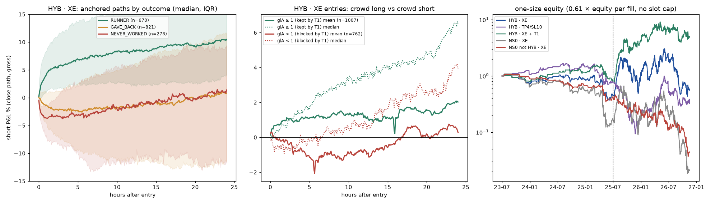

# A HYBRID short for no-spot FRENZY coins: EXHAUSTION's trigger + "top traders cutting longs" (2026-11-18)

**Pre-registered:** `NOSPOT_HYBRID_2026-11-18_PREREG.md` (frozen 2026-11-19 00:27 UTC, before any hybrid number was computed).
**Everything below is BACKTEST.** Research only. Nothing in the bot changed (research only; working data stays local).

## Plain answer
1. **The hybrid does not ship.** HOLDOUT is positive (+0.22 %/trade, 1,523 trades) but the 95 % CI crosses zero (−0.21 … +0.64),
   only 3 of 7 half-years are positive, best-5 %-out is −0.30, Kelly at the WR floor is < 0, and it does **not** beat the
   shuffled-positions null (p_fw 0.24). It misses 6 of the 9 ship-bar items.
2. **The good part of it is DISTRIBUTION's.** 15 % of hybrid trades are trades DIST already takes (same coin, same hour). Those
   make **+1.12 %/trade**. The other 85 % make **−0.05 %/trade** (HOLDOUT +0.05). Added to the joint book (EXH + FB + L4 + DIST) the
   hybrid **lowers** the daily compound return: 1.66 → 1.48 %/day, max drawdown −65 % → −77 %.
3. **The top-trader cut barely filters.** 66 % of all NS0 signals already have the top-trader position ratio falling by ≥ 0.011 over
   4 h. After a FRENZY spike the big accounts are almost always cutting. So the hybrid is "NS0 minus a third", not a new signal.
4. **Winners vs losers: no variable survives the DESIGN screen** (166 1D tests, best p_fw 0.70; 1,426 2D pairs, one 18-trade cell
   that reverses on HOLDOUT). Of the six theory candidates, one holds direction in both periods and both exits:
   **T1 "crowd still long" (global account L/S ≥ 1)**. Hybrid + T1 makes +0.53 %/trade on HOLDOUT (CI +0.03 … +1.02) under XE and
   +0.40 under TP 4 / SL 10 (6 of 7 halves positive). But it does **not** beat its own family null (p_fw 0.34 / 0.15), its DESIGN
   is ≈ 0 under XE (−0.08), and the joint book gains little (+0.02 %/day) for a deeper drawdown (−74 %). The same glA effect also
   works on NS0 without the top-trader leg in HOLDOUT, so T1 is mostly a crowd effect, not a hybrid effect.
5. **One secondary variant is interesting:** the **1 h** position change (V1) beats the null clearly (p_fw 0.003) and is +0.49 on
   HOLDOUT (CI +0.02 … +0.96). But DESIGN is −0.61, only 3 of 7 halves are positive and best-5 %-out is −0.01. It was a
   secondary; it cannot be promoted from this study.
6. **PHAROS 11-18:** 20:30 → the top-trader leg FAILS (top traders were ADDING, +0.031): no hybrid trade. 21:15 → the leg passes
   (−0.071); with the live engine's vol_decay (which passed) the hybrid **would have shorted at 21:15**; it is −2.5 % (open).
   The 15:45 hybrid signal was stopped (−5.6 %).
7. **Verdict: OBSERVE by the pre-registered wording (HOLDOUT avg > 0), nothing to build.** Two frozen observe lines (below).

## Question (operator)
Short FRENZY coins that have no Binance spot market with EXHAUSTION's trigger, but read "top traders cutting longs" from futures
positioning in place of "spot buyers leaving". Then a deep winners-vs-losers study on the hybrid's trades.

## What was already known (stated in the PREREG)
- **NS0** (EXHAUSTION's trigger on no-spot coins, no spot leg) loses: −0.09 %/trade (NOSPOT), −0.07 to −0.25 with the 0.10 % slip floor.
- **R4 TOP_DISTRIB** (top-trader cut without the RSI / vol_decay trigger) ≈ 0 on HOLDOUT, swings ±2 % by half-year.
- **NOSPOT_EXIT:** best fixed exit TP 4 / SL 10, still no ship.
- **DISTRIBUTION** (red ≥ 5× volume candle + top-trader 4 h cut + RSI1h ≥ 74.07) is positive on no-spot coins too (+0.88 %/trade on
  its 444 no-spot trades here). The hybrid had to ADD to it.

## Theory (written before data)
- On a spot coin, EXHAUSTION's spot-share fall means the real buyers have left; what is left is futures leverage with no new demand.
- A perp-only coin has no spot buyers. Its fuel is leveraged longs. The nearest proxy for "informed money leaving" is Binance's top
  traders' net position. If their long/short ratio falls while the RSI rolls over and volume decays, they sell into the crowd.
- Ways it could fail (also stated): the ratio moves for hedging reasons; perp-only coins squeeze hard; R4 said the positioning signal
  alone is ≈ 0.

## Method
- **Rule (frozen):** on the NOSPOT_SLEEVE universe (476 k closed 15m bars, 215 no-spot pairs, FRENZY window, vol24 ≥ $20M), short at
  the next 5m open after a closed 15m bar with RSI(14) crossing > 70 → ≤ 70, vol_decay ≥ 0.6366, and the top-trader **position** L/S
  4 h change ≤ −0.01097 (`services/distribution.py pos_chg_4h`: latest metrics row ≤ T − 5 min and ≤ 30 min old, the 4 h-earlier row
  within 15 min, ABSOLUTE difference). Recomputed from the raw metrics files (`scripts/nospot_hybrid_build.py`); it matches the stored %
  change to 4e-7 on every row. Scored on 99.96 % of NS0 signals.
- **Variants (secondary, ≤ 4):** V1 = 1 h change · V2 = top-trader ACCOUNT ratio · V3 cut −0.005 · V4 cut −0.02 (plateau only).
- **Exits:** XE = EXHAUSTION live (TP min(20 × ATR, 10 %) maker / SL min(1.5 × ATR, 6 %) / 24 h) primary; TP 4 / SL 10 secondary.
  1m paths (99.8 % of trades; 5m fallback flagged). Taker 0.05 % + slip max(0.10 %, size model) per taker leg, maker TP only when traded
  through by 1 tick, stop checked first, gap-aware, real funding. One position per pair.
- **Splits:** DESIGN 2023-07 → 2025-06 (100 % BTC-daily-bull) · HOLDOUT 2025-07 → 2026-11-18, read once. Top-trader data is blank
  for most of 2022; the universe starts 2023-07, so it does not matter here.
- **Controls:** random entry in the same episode (500 draws). Family-wise null: position-change values shuffled across NS0 signals
  within each month, 1,000 shuffles, family = 5 rules × 2 exits.
- **Joint:** `scripts/joint_short_sim.py` machinery (one account, 0.609 × equity, coin lock, book 10, margin; flat 0.10 % slip there),
  the hybrid at the lowest priority (DIST wins a shared coin). The joint report's no-depth-cap headline is compared; with the depth cap
  the compounding $10k path skips nearly everything for every config (not informative).
- Scripts: `scripts/nospot_hybrid_build.py`, `_eval.py`, `_joint.py`, `_wl.py`, `_extra.py`. Data: `reports/NOSPOT_HYBRID_2026-11-18_data/`.

## Primary result

| cell | block | N | /day | WR | avg % | 95 % CI | @0.20 | best-5 %-out | Kelly (WR floor) | DCR %/day @0.61 | max DD | worst day |
|---|---|---|---|---|---|---|---|---|---|---|---|---|
| **HYB · XE** | DESIGN | 246 | 0.34 | 33.7 | −0.38 | −1.31 … +0.53 | −0.56 | −0.95 | −0.123 | −0.10 | 65 % | −16.4 % |
| **HYB · XE** | **HOLDOUT** | **1,523** | **3.02** | 38.5 | **+0.22** | **−0.21 … +0.64** | +0.05 | −0.30 | −0.010 | +0.04 | 86 % | −27.8 % |
| HYB · TP4/SL10 | DESIGN | 224 | 0.31 | 71.9 | −0.03 | −0.99 … +0.88 | −0.16 | −0.25 | −0.192 | −0.04 | 58 % | −22.8 % |
| HYB · TP4/SL10 | HOLDOUT | 1,440 | 2.85 | 73.1 | +0.03 | −0.31 … +0.37 | −0.10 | −0.18 | −0.066 | −0.17 | 88 % | −26.7 % |
| V1 1 h · XE | DESIGN | 215 | 0.29 | 32.6 | −0.61 | −1.62 … +0.51 | −0.79 | −1.18 | −0.162 | −0.13 | 72 % | −22.8 % |
| V1 1 h · XE | HOLDOUT | 1,180 | 2.34 | 40.3 | +0.49 | +0.02 … +0.92 | +0.33 | −0.01 | +0.014 | +0.42 | 81 % | −27.9 % |
| V2 account · XE | HOLDOUT | 1,644 | 3.26 | 35.8 | −0.17 | −0.47 … +0.20 | −0.33 | −0.70 | −0.048 | −0.68 | 98 % | −32.4 % |
| V3 cut −0.005 · XE | HOLDOUT | 1,580 | 3.13 | 38.4 | +0.20 | −0.20 … +0.64 | +0.04 | −0.31 | −0.010 | +0.02 | 89 % | −31.6 % |
| V4 cut −0.02 · XE | HOLDOUT | 1,417 | 2.81 | 38.7 | +0.23 | −0.20 … +0.64 | +0.06 | −0.28 | −0.010 | +0.08 | 81 % | −27.8 % |
| NS0 · XE (ref) | HOLDOUT | 2,290 | 4.54 | 37.2 | +0.04 | −0.28 … +0.38 | −0.13 | −0.49 | −0.022 | −0.41 | 97 % | −34.7 % |
| NS0 not HYB · XE | HOLDOUT | 770 | 1.53 | 34.5 | −0.32 | −0.79 … +0.16 | −0.49 | −0.87 | −0.078 | −0.45 | 92 % | −22.0 % |

Full span HYB · XE: 1,769 trades, 1.43/day, +0.13 %/trade. Signals: 1,830 of 2,788 NS0 signals (66 %) pass the top-trader cut.

- Plateau (V3 / V4): smooth, same sign as the primary in both blocks (negative on DESIGN, ≈ +0.2 on HOLDOUT). The cut value is not
  the problem; the signal is weak.
- The hybrid vs the NS0 signals it rejects (HOLDOUT): +0.22 vs −0.32. So the cut does sort trades, but the shuffled null says a
  random two-thirds of NS0 signals does about as well often enough (below).
- V2 (top-trader ACCOUNT ratio) is worse than NS0. Accounts cutting is not the same as positions cutting.

### The ship bar (HOLDOUT unless stated)

| bar item | HYB · XE | HYB · TP4/SL10 | V1 1 h · XE (secondary) | HYB · XE + T1 (W/L lead) |
|---|---|---|---|---|
| ① avg > 0 and CI low > 0 | +0.22, low −0.20 ✗ | +0.03, low −0.27 ✗ | +0.49, low +0.02 ✓ | +0.53, low +0.06 ✓ |
| ② ≥ 2/3 halves positive (full span) | 3/7 ✗ | 4/7 ✗ | 3/7 ✗ | 4/7 ✗ |
| ③ positive at 0.20 slip | +0.05 ✓ | −0.10 ✗ | +0.33 ✓ | +0.37 ✓ |
| ④ best-5 %-out > 0 | −0.30 ✗ | −0.18 ✗ | −0.01 ✗ | +0.03 ✓ |
| ⑤ Kelly at the WR floor > 0 | −0.010 ✗ | −0.066 ✗ | +0.014 ✓ | +0.012 ✓ |
| ⑥ beats the family-wise null | p 0.24 ✗ | p 0.82 ✗ | p 0.003 ✓ | p 0.34 ✗ (filter-family null) |
| ⑦ no pair / day ≥ 50 % | 26 % / 14 % ✓ | 144 % / 79 % ✗ | 11 % / 7 % ✓ | 11 % / 10 % ✓ |
| ⑧ ≥ 8 windows | 439 ✓ | 434 ✓ | 420 ✓ | 361 ✓ |
| ⑨ adds to the joint book (no-DIST part > 0) | 1.66 → 1.48 %/day ✗ (no-DIST part +0.05) | 1.66 → 1.44 ✗ | 1.66 → 1.66, HOLDOUT 2.84 → 3.06, DD −65 → −76 % (≈) | 1.66 → 1.69, HOLDOUT 2.84 → 2.96, DD −65 → −74 % (small ✓) |
| DESIGN avg (context) | −0.38 | −0.03 | −0.61 | −0.08 |
| **items passed** | **3 / 9** | **1 / 9** | **6 / 9** | **7 / 9** |

(pair 144 % with TP4: the cell's total is near zero, so one pair's sum exceeds it; it means "no robust total", not concentration.)

## Overlap with DISTRIBUTION

| | ALL | DESIGN | HOLDOUT |
|---|---|---|---|
| HYB · XE trades | 1,769 | 246 | 1,523 |
| shared with a DIST trade (same coin, DIST open or entry ± 60 min) | 269 (15 %) | 27 (11 %) | 242 (16 %) |
| avg of the shared trades | **+1.12** | +1.38 | +1.09 |
| avg of the NOT shared trades (the hybrid's real add) | **−0.05** (1,500) | −0.60 (219) | **+0.05** (1,281) |
| TP4/SL10: shared / not shared | +0.73 / −0.12 | +1.54 / −0.23 | +0.64 / −0.10 |
| DIST no-spot trades (RSI1h ≥ 74.07), for scale | 444 at +0.88 | | |

- **What the hybrid adds beyond DIST is ≈ 0 %/trade.** The part that works is the part DIST already trades.

## Per period (full span, avg %/trade, N in brackets)

| cell | 23-H2 | 24-H1 | 24-H2 | 25-H1 | 25-H2 | 26-H1 | 26-H2 |
|---|---|---|---|---|---|---|---|
| HYB · XE | −2.52 (19) | +1.62 (31) | −0.26 (64) | −0.60 (132) | +0.47 (586) | +0.37 (537) | −0.36 (400) |
| HYB · TP4/SL10 | +0.65 (15) | +1.87 (30) | +0.12 (59) | −0.66 (120) | −0.28 (564) | +0.53 (490) | −0.17 (386) |
| V1 · XE | −2.28 (16) | +2.09 (27) | −0.67 (63) | −1.00 (109) | +0.68 (475) | +0.79 (401) | −0.22 (304) |
| NS0 · XE | −2.23 (28) | +0.75 (45) | −0.44 (115) | −0.64 (218) | +0.23 (843) | +0.20 (822) | −0.43 (625) |
| NS0 not HYB · XE | −1.64 (9) | −1.18 (14) | −0.48 (52) | −0.72 (87) | −0.31 (257) | −0.15 (288) | −0.56 (225) |
| HYB · XE + T1 | −2.75 | +2.26 | +0.24 | −0.58 | +1.04 | +0.43 | −0.03 |
| HYB · TP4 + T1 (own one-position set) | +2.07 (11) | +2.10 (26) | +0.77 (40) | −0.95 (72) | +0.14 (310) | +0.85 (261) | +0.23 (232) |

- The current half (26-H2, Jul → Nov) is negative for the hybrid under both exits.

### BTC daily regime (R1 = EMA50 vs EMA200, sign; HOLDOUT; window = UTC day)

| cell | BTC bear: N · windows · avg · windows positive | BTC bull: N · windows · avg · windows positive |
|---|---|---|
| HYB · XE | 963 · 263 · +0.07 · 48 % | 560 · 178 · +0.47 · 56 % |
| HYB · TP4/SL10 | 896 · 263 · +0.28 · 62 % | 544 · 178 · −0.40 · 53 % |
| NS0 · XE | 1,409 · 285 · −0.02 · 52 % | 881 · 191 · +0.12 · 52 % |

- The regime sign FLIPS with the exit (XE does better in bull, TP4 in bear). DESIGN is 100 % bull and there XE is −0.38. No stable
  regime story; regime is not a usable switch here.

### Random-entry control (same episode, same exit, 500 draws)

| cell | actual | random entry | p |
|---|---|---|---|
| HYB · XE | +0.13 | −0.72 | 0.000 |
| HYB · TP4/SL10 | +0.02 | −0.66 | 0.000 |
| NS0 · XE | −0.05 | −0.69 | 0.000 |
| NS0 not HYB · XE | −0.39 | −0.61 | 0.12 |

- Same as every no-spot study: the trigger picks much better moments than random (random loses −0.7 %), but "better than random"
  only lifts it to about zero.

## The null (shuffle the position change across NS0 signals within each month, 1,000 shuffles)

| cell | actual avg (full) | null mean | null 95th pct | p (cell) | p (family-wise) | HOLDOUT: actual · null · p_fw |
|---|---|---|---|---|---|---|
| **HYB · XE** | +0.13 | −0.02 | +0.13 | 0.051 | **0.24** | +0.22 · +0.05 · 0.23 |
| HYB · TP4/SL10 | +0.02 | −0.03 | +0.11 | 0.26 | 0.82 | +0.03 · −0.02 · 0.96 |
| **V1 1 h · XE** | +0.32 | −0.06 | +0.16 | 0.003 | **0.003** | +0.49 · +0.04 · 0.002 |
| V1 1 h · TP4/SL10 | +0.09 | −0.05 | +0.14 | 0.10 | 0.44 | +0.11 · −0.04 · 0.72 |
| V2 account · XE | −0.25 | −0.07 | +0.07 | 0.99 | 1.00 | |
| V3 cut −0.005 · XE | +0.10 | −0.02 | +0.13 | 0.09 | 0.37 | |
| V4 cut −0.02 · XE | +0.16 | −0.02 | +0.15 | 0.04 | 0.14 | |

- The primary's top-trader leg is **not** distinguishable from a random within-month selection of the same size (p_fw 0.24).
- The **1 h** change is (p_fw 0.003, same on HOLDOUT). That is real timing information. But it only shows on HOLDOUT (DESIGN −0.61)
  and only under XE, so it is an observe line, not a ship.

## Path decomposition (RUNNER = net > 0 · GAVE_BACK = reached +1 % before the stop distance, then lost · NEVER_WORKED)

| cell | block | RUNNER | GAVE_BACK | NEVER_WORKED | loss share GAVE_BACK / NEVER | median reach: RUNNER / GAVE_BACK / NEVER |
|---|---|---|---|---|---|---|
| HYB · XE | ALL | 37.9 % (avg +9.40) | 46.4 % (−5.62) | 15.7 % (−5.20) | 76 % / 24 % | +10.6 / +3.4 / +0.5 % |
| HYB · XE | HOLDOUT | 38.5 % | 46.4 % | 15.0 % | 77 % / 23 % | +10.7 / +3.6 / +0.5 % |
| HYB · TP4/SL10 | ALL | 72.9 % (+3.79) | 19.2 % (−10.10) | 7.9 % (−10.18) | 71 % / 29 % | +4.7 / +2.3 / +0.5 % |
| NS0 · XE | ALL | 36.4 % | 47.0 % | 16.6 % | 75 % / 25 % | +10.6 / +3.6 / +0.5 % |
| NS0 not HYB · XE | ALL | 33.6 % | 48.2 % | 18.2 % | 73 % / 27 % | +10.6 / +3.8 / +0.5 % |

- **The loss is EXIT-side**, as in every no-spot study: three quarters of it is GAVE_BACK. The coin dips +3.4 % our way, then squeezes
  back through the 1.5 × ATR stop. The hybrid's cut moves RUNNER from 34 % (rejected NS0) to 38 %; it does not change the shape.
- Chart left panel: RUNNER paths keep going (+10 % at 24 h); GAVE_BACK and NEVER_WORKED median paths sit at −2 to −3 % for 12 h.

Left: HYB · XE anchored close paths by outcome (median, IQR). Middle: entries with the crowd long (glA ≥ 1) vs crowd short (glA < 1).
Right: one-size equity (0.61 × equity per fill, no slot cap); dashed line = HOLDOUT start.

## Winners vs losers (on the 1,769 HYB · XE trades)

### Coverage and blind spots
- 58 entry-time variables. All ≥ 99.4 % scored, except **mcap / turnover: 44 % on DESIGN, 73 % full** (coins without a market-cap
  record today, mostly delisted). Full table: `_data/wl_coverage.csv`.
- Variables: OI (level $, 15m / 1 h / 4 h change, OI / 24 h volume, OI vs episode max) · funding (last, previous, 8 h-equivalent,
  sign, hourly) · top-trader position and account (level, 1 h / 4 h % change, the new absolute 4 h / 1 h changes) · global account
  L/S (level, 1 h / 4 h) · taker buy/sell (last hour, hour before) · premium (1 h, episode peak) · RSI15, RSI1h, DI15, **ADX15, ADX1h**
  (computed from klines for this study) · distance from the high, lower high, VWAP gap, peak age, hours since the spike · vol_decay,
  volume multiple, ATR %, 24 h volume, Q5 · mcap, turnover · returns 15m / 1 h / 4 h / 24 h, biggest 1 h pump in 24 h, rise from the
  flag · hour · BTC 1 h / 4 h / 24 h, BTC daily regime R1, BTC 5m regime R4.
- **Blind spots:** historical market cap (today's supply × past price; delisted coins unscored) · order-book depth (no history) ·
  liquidations (OI drop is the proxy) · the live engine's own episode start (vol_decay differs — see PHAROS) · Binance Alpha listing
  timing · individual top-trader accounts (Binance gives one aggregate ratio). DESIGN is 100 % BTC-bull, so R1 cannot separate on DESIGN.

### The screen (decision = DESIGN, 246 trades; full span shown as DESCRIPTIVE only)
- **1D, 166 tests (58 variables × sign / terciles / quintiles), family-wise label-shuffle null, 500:**

| screen | label | best variable (gran) | spread %/trade | p_fw |
|---|---|---|---|---|
| DESIGN | booked net XE | rise_on_to_hi (quint) | 3.94 | 0.70 |
| DESIGN | booked net TP4 (same entries) | ret1h (quint) | 4.14 | 0.44 |
| DESIGN | RUNNER vs GAVE_BACK | peak_age_h (quint) | 38.5 pts | 0.19 |
| FULL (descriptive) | booked net XE | pos1 = 1 h top-trader change (quint) | 2.23 | 0.11 |
| FULL (descriptive) | RUNNER vs GAVE_BACK | pos1 (quint) | 18.3 pts | **0.010** |
| FULL (descriptive) | booked net TP4 | ret24h (sign) | 2.02 | 0.08 |

- **2D, every pair at terciles (1,426 pairs on DESIGN, 1,431 full), null 200:** one DESIGN cell passes (Q5 middle tercile × rise from the
  flag top tercile, 18 trades, −5.69 %). It reverses on HOLDOUT (blocked side +0.51 %, 259 trades). Refuted. Full span: no cell passes.
- **No entry-time variable separates winners from losers on DESIGN.** The only full-span signal is the 1 h top-trader change, i.e. V1.

### Selected 1D buckets (DESIGN · full span, avg %/trade under XE / TP4 on the same entries)

| variable (gran) | bucket | DESIGN N · XE · TP4 | FULL N · XE · TP4 | RUNNER rate (full) |
|---|---|---|---|---|
| global account L/S (sign at 1) | < 1 (crowd short) | 85 · −0.95 · −0.85 | 762 · −0.27 · −0.53 | 42 % |
| | ≥ 1 (crowd long) | 161 · −0.08 · +0.43 | 1,007 · +0.43 · +0.45 | 47 % |
| top-trader 4 h change (terc) | deepest (≤ −0.17 / −0.15) | 82 · +0.11 · +0.03 | 590 · +0.48 · −0.09 | 48 % |
| | middle | 82 · +0.08 · +0.80 | 589 · −0.03 · −0.03 | 43 % |
| | shallowest (−0.06 … −0.01) | 82 · −1.34 · −0.87 | 590 · −0.05 · +0.20 | 43 % |
| top-trader 1 h change (quint, full cuts) | ≤ −0.09 | | 354 · +0.64 · −0.02 | 48 % |
| | −0.09 … −0.04 | | 354 · +1.00 · +0.55 | 53 % |
| | −0.04 … −0.02 | | 353 · −0.30 · −0.29 | 42 % |
| | −0.02 … +0.01 | | 354 · −1.23 · −0.74 | 35 % |
| | > +0.01 | | 354 · +0.55 · +0.64 | 46 % |
| funding (sign) | < 0 | 65 · +1.21 · +1.05 | 337 · +1.23 · +0.17 | 54 % |
| | ≥ 0 | 181 · −0.95 · −0.39 | 1,432 · −0.13 · −0.01 | 43 % |
| OI 1 h (sign) | falling | 65 · −1.32 · −0.75 | 548 · +0.52 · −0.02 | 48 % |
| | rising | 181 · −0.04 · +0.25 | 1,221 · −0.04 · +0.05 | 44 % |
| distance from high (terc) | near (≤ 4.5 / 5.6 %) | 82 · −0.60 · −0.10 | 590 · −0.10 · −0.23 | 42 % |
| | far (≥ 7.7 / 10.3 %) | 82 · +0.09 · +0.29 | 590 · +0.72 · +0.43 | 49 % |
| BTC 24 h (sign; windows) | down | 101 (78 d) · −0.37 · −0.36 | 815 (364 d) · +0.14 · +0.05 | 45 % |
| | up | 145 (101 d) · −0.39 · +0.23 | 954 (401 d) · +0.12 · +0.00 | 45 % |
| BTC daily R1 (windows) | bear | – | 963 (263 d) · +0.07 · +0.29 | 44 % |
| | bull | 246 (160 d) · −0.38 · −0.01 | 806 (338 d) · +0.21 · −0.29 | 46 % |
| ATR % (terc) | high (≥ 3.4 / 5.0) | 82 · −0.93 · −0.26 | 590 · +0.37 · +0.13 | 47 % |
| ADX15 (terc) | high (≥ 48.8 / 50.4) | 82 · −0.57 · +0.53 | 590 · +0.31 · −0.03 | 46 % |
| mcap (terc; 44 % / 73 % scored) | small (< $66 M / $31 M) | 36 · −2.69 · −0.87 | 430 · −0.25 · −0.20 | 42 % |
| | large (> $0.7 B / $114 M) | 36 · +0.85 · +0.89 | 430 · +0.49 · −0.03 | 47 % |

- The 1 h top-trader change is **not monotonic** (the −0.02 … +0.01 bucket is the hole, both sides win). By the house rule a
  mid-range hole with winning flanks is a confound flag, not a filter. V1's cut (≤ −0.011) sits at the edge of that hole.
- Negative funding wins under XE in both blocks but not under TP4 on HOLDOUT (and it was the OPPOSITE of the theory, T2).
- Every bucket table, both screens: `_data/wl_1d_buckets.csv`, `_wl_1d_spread.csv`, `_wl_2d.csv`.

### Theory candidates (frozen in the PREREG), kept vs blocked, XE and TP4 on the same entries

| candidate | DESIGN kept / blocked XE | DESIGN kept / blocked TP4 | HOLDOUT kept / blocked XE | HOLDOUT kept / blocked TP4 | HOLDOUT N kept / blocked | same sign both blocks + both exits? | filter-family p_fw (HOLDOUT, XE / TP4) |
|---|---|---|---|---|---|---|---|
| **T1 block glA < 1 (shorts crowded)** | −0.08 / −0.95 | +0.43 / −0.85 | **+0.53 / −0.18** | **+0.45 / −0.49** | 846 / 677 | **yes** | 0.34 / 0.15 |
| T2 block funding < 0 | −0.95 / **+1.21** | −0.39 / +1.05 | −0.01 / +1.24 | +0.05 / −0.05 | 1,251 / 272 | no (opposite of the theory) | 1.00 / 0.96 |
| T3 block OI 1 h rising | −1.33 / −0.04 | −0.75 / +0.25 | +0.77 / −0.05 | +0.07 / +0.02 | 483 / 1,040 | no (flips DESIGN → HOLDOUT) | 0.05 / 0.99 |
| T4 keep deep cut (pos4 ≤ −0.106) | +0.32 / −1.08 | +0.50 / −0.52 | +0.46 / −0.02 | −0.05 / +0.11 | 730 / 793 | no (flips under TP4 on HOLDOUT) | 0.52 / 1.00 |
| T5 block BTC 24 h up | −0.37 / −0.39 | −0.37 / +0.23 | +0.22 / +0.21 | +0.11 / −0.04 | 714 / 809 | no effect | 0.98 / 0.88 |
| T6 keep near high (dd ≤ 5.5 %) | −0.60 / −0.16 | −0.05 / +0.02 | −0.14 / +0.36 | −0.38 / +0.20 | 442 / 1,081 | no (opposite) | 1.00 / 1.00 |
| S2 (screen survivor) block Q5 mid × rise top | +0.04 / −5.69 (18) | +0.09 / −1.33 | +0.16 / +0.51 | −0.10 / +0.68 | 1,264 / 259 | no (reverses) | – |

**T1 in detail** (the only candidate that passes the entry × exit check):
- Kept side, HOLDOUT, XE: +0.53, CI +0.03 … +1.02, @0.20 +0.37, best-5 %-out +0.03, Kelly +0.012, top pair 11 %, top day 10 %,
  4 of 7 halves positive (−2.75 · +2.26 · +0.24 · −0.58 · +1.04 · +0.43 · −0.03). BTC bear +0.21, bull +0.64 (kept side).
- Under TP4 (own one-position set): +0.40, CI +0.03 … +0.80, 6 of 7 halves, best-5 %-out +0.21, Kelly +0.010, max DD 64 %.
- **Blocked side vs the expectancy bar (filter use):** HOLDOUT XE blocked WR 35.9 % vs breakeven ≈ 37 %, avg −0.18, window-clustered
  95 % upper bound **+0.33** (not confidently < 0) ✗ · 313 windows ✓ · top pair 3 % of the loss ✓ · N 677 ✓. Under TP4 the blocked
  side is −0.44 with an upper bound +0.001 (just misses). So as a FILTER it fails confidence on both exits.
- **It is not a hybrid effect.** Same split on NS0 (no top-trader leg), HOLDOUT XE: kept +0.30 / blocked −0.32. On DESIGN NS0 it is
  flat (−0.49 / −0.62). And it was already seen in NOSPOT_SLEEVE (Q1 "shorts crowded", right sign, failed DESIGN). So this is a
  re-read of a known idea on a new subset, not new evidence. Disclosed.
- Does it add beyond DIST? 188 of the 1,007 kept trades are DIST-shared (+0.98); the other 819 make +0.31 (HOLDOUT 681 at +0.43).

### The three ways to act, priced (HOLDOUT, DCR at one size 0.61, every calendar day)

| candidate | before | filter (block) | size tilt (1.5× kept / 0.5× blocked) | conditional exit (blocked side → TP4) |
|---|---|---|---|---|
| T1 crowd short | +0.04 %/day | **+0.36** | +0.28 | −0.19 |
| T3 OI 1 h rising (failed DESIGN) | +0.04 | +0.35 | +0.36 | +0.18 |
| T4 deep cut (fails exit check) | +0.04 | +0.24 | +0.18 | +0.21 |
| T2 / T5 / T6 / S2 | +0.04 | −0.28 / +0.02 / −0.16 / −0.06 | −0.46 / −0.04 / −0.14 / −0.26 | −0.34 / −0.15 / −0.07 / +0.12 |

Joint book (EXH + FB + L4 + DIST + the cell; no depth cap; full span / HOLDOUT days / max DD):

| config | joint DCR %/day | HOLDOUT DCR | max DD | hybrid trades taken |
|---|---|---|---|---|
| **all four (before)** | **1.662** | **2.836** | **−64.6 %** | – |
| + HYB · XE | 1.481 | 2.579 | −77.1 % | 1,552 (−0.07 at flat 0.10 slip) |
| + HYB · XE, non-DIST-shared only | 1.506 | 2.636 | −77.1 % | 1,493 |
| + HYB · TP4/SL10 | 1.439 | 2.393 | −88.8 % | 1,450 |
| + V1 1 h · XE | 1.655 | 3.056 | −76.4 % | 1,228 (+0.16) |
| + HYB · XE + T1 filter | **1.686** | **2.964** | −73.7 % | 851 (+0.23) |
| + HYB · XE + T1 tilt | 1.564 | 2.759 | −79.0 % | 1,552 |
| + HYB · TP4 + T1 filter | 1.647 | 2.837 | −78.9 % | 796 |
| + HYB · TP4 + T1, non-DIST-shared | 1.701 | 2.981 | −77.1 % | 762 |
| + HYB · XE + T3 filter (failed DESIGN) | 1.705 | 3.063 | −69.1 % | 501 |
| + NS0 · XE (reference) | 1.210 | 2.125 | −86.0 % | 2,467 |

- The plain hybrid makes the joint book worse. With T1 it adds a little (+0.02 %/day full, +0.13 HOLDOUT) but deepens the drawdown
  by 9 points. That is the wrong trade for a book that already sits at −65 % max DD.
- In-sample haircut (30–50 %) on any T1 number: the T1 split is read on the same HOLDOUT that defines it as "the survivor".

## Replays (what the hybrid does on your coins)

| coin | history (HYB · XE, all time) | recent signals (11-01 → 11-18) | T1 (crowd long?) |
|---|---|---|---|
| **PHAROS** | none before 11-18 (no NS0 signal Sep–Oct) | **15:45** HYB fires (top traders −0.267) → SL −5.6 % (TP4: SL −10.3 %). 17:00: leg passes (−0.308) but vol_decay 0.50 in the replay rows → no trade (would be SL −6.1 %). **20:30**: top traders **+0.031** (adding) → **no trade**, even with the live engine's vol_decay; now −0.5 % (open). **21:15**: leg passes (−0.071); vol_decay 0.37 on the replay rows, but the live engine passed it → **the hybrid would have shorted 21:15**; now −2.5 % (open, marked 22:17 UTC). | 15:45 glA 1.37 kept · 21:15 glA 1.49 kept |
| **PIEVERSE** | 7 trades, +3.32 %/trade, WR 57 % (TP4: +1.81) | 11-09 13:15 SL −3.9 · 11-09 20:00 TP +9.9 · 11-15 09:30 TP +9.9 | glA 0.97 / 0.57 / 0.77 → T1 would have blocked all three (1 loser, 2 winners) |
| **PIPPIN** | 37 trades, −2.27 %/trade (sum −84 %) | 11-18 19:00 HYB TP +9.8 (TP4 +3.8) | glA 1.45 kept |
| **BLESS** | 23 trades, −1.98 %/trade (sum −45 %) | 11-16 09:45 SL −5.8 (DIST-shared) · 11-16 17:45 SL −6.3 · 11-18 07:45 TP +9.8 (live rows) | 1.67 kept (loser) · 0.79 blocked (loser) · 2.03 kept (winner) |
| **JELLYJELLY** | 33 trades, −1.32 %/trade (sum −43 %) | no RSI-cross signal 11-14 → 11-18 | – |

- On your three named perp-only coins (PIPPIN, BLESS, JELLYJELLY) the hybrid's history is clearly negative (−1.3 to −2.3 %/trade).
- PHAROS 20:30 is exactly what the top-trader leg is for: the big accounts were adding, and the leg says no. The 21:15 signal it
  would take is under water for now. Rows: `NOSPOT_HYBRID_2026-11-18_replays.csv`.

## Verdict

**OBSERVE (by the PREREG wording: HOLDOUT avg > 0). Nothing to build.** The primary misses bar items ① (CI low −0.21), ② (3/7 halves),
④ (best-5 %-out −0.30), ⑤ (Kelly −0.010), ⑥ (null p_fw 0.24) and ⑨ (joint 1.66 → 1.48 %/day; the non-DIST part is ≈ 0). The
profitable slice is the 15 % that DISTRIBUTION already trades.

Frozen rule tested: short a no-spot FRENZY coin at the next 5m open after a closed 15m bar with RSI14 crossing 70 → ≤ 70, vol_decay
≥ 0.6366, 24 h volume ≥ $20M and the top-trader position L/S 4 h absolute change ≤ −0.01097; exit TP min(20 × ATR, 10 %) maker /
SL min(1.5 × ATR, 6 %) / 24 h.

Two observe lines, frozen now (read on fresh data only, never re-fit):
1. **HYB + T1** = the rule above AND global account L/S ≥ 1 at entry; exit XE (and TP4 / SL10 read beside it). Promotion only if fresh
   fills (after 2026-11-19) beat the family null and the blocked side is confidently negative. Known weakness: the same split works on
   NS0 without the top-trader leg, so if it promotes, the simpler "NS0 + crowd long" must be tested first.
2. **V1** = the rule above with the 1 h position change ≤ −0.01097 instead of 4 h; exit XE. Strong null (p 0.003) but DESIGN −0.61
   and a non-monotonic 1 h change profile.

Neither is a recommendation to switch anything on. DISTRIBUTION already covers the no-spot shorts that work.

## Files
- `reports/NOSPOT_HYBRID_2026-11-18_PREREG.md` · this report · `_chart.png` · `_replays.csv` · `_trades.csv.gz` (HYB and V1, both
  exits, every trade with its entry features and the DIST-shared flag).
- `reports/NOSPOT_HYBRID_2026-11-18_data/`: grid · null · random_control · paths · regime · overlap · joint · shipbar · wl_* ·
  filter_null (csv); feat / Y / W / core (pkl, gitignored); logs.
- Scripts: `scripts/nospot_hybrid_build.py` · `_eval.py` · `_joint.py` · `_wl.py` · `_extra.py`.

## Reproducibility notes (added at commit, from the pre-commit review)
- Both this report and the PREREG were last touched at commit time to reword "No commit" → "no engine / config change". That edit is the only change after the 00:27 UTC freeze; it is why the file times read 00:40.
- The T1 / TP4 numbers (the TP4 filter-family p values, the "HYB · TP4 + T1" half-year row, T1 under TP4 +0.40 / CI +0.03 … +0.80, its blocked-side bound, and the joint rows 1.647 / 1.701) came from an unsaved scratch check. They are NOT reproducible from the committed scripts. Treat them as descriptive; the verdict does not depend on them.
- Some confidence intervals appear twice with small differences (e.g. −0.21 vs −0.20) because they are separate bootstrap draws.
- The `*.log` and `*.pkl` files in the `_data/` folder stay local (gitignored).
