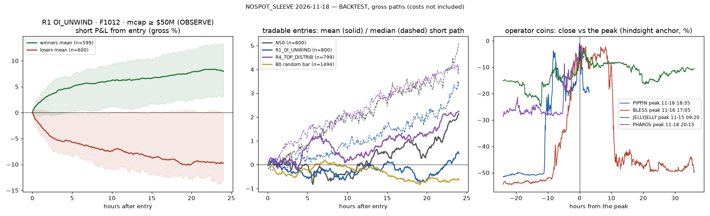

# A SHORT sleeve for FRENZY coins with NO Binance spot market? (2026-11-18)

**Pre-registered:** `NOSPOT_SLEEVE_2026-11-18_PREREG.md` (frozen 21:40 UTC, before any result) + **Addendum A** (frozen 21:45 UTC, after the
row build, before any cohort result: the operator's deep-dive W/L and theory filters).
**Everything below is BACKTEST.** Research only. Nothing in the bot changed. No commit.

## Question (operator)
Can we short perp-only Frenzy coins (PIPPIN, BLESS, JELLYJELLY, PHAROS …)? They often dump hard after the Frenzy peak. EXHAUSTION_SHORT
cannot trade them: its edge needs the spot share of volume to fall, and these coins have no spot.

## Plain answer
1. **No. Nothing ships.** 10 theory rules × 6 exits = 60 cells. One cell survived DESIGN (R5 TAKER_FADE, TP 5 / SL 5). It lost on
   HOLDOUT (**−0.26 %/trade**, 3,033 trades).
2. **The timing is real, the profit is not.** Every rule beats a random entry in the same episode (random = **−0.4 to −0.6 %/trade**;
   several rules p_fw < 0.05). But beating "random" only lifts the trade to about zero. Same story as SECOND_PEAK.
3. **The losses are mostly EXIT, not squeeze-at-entry.** About 80 % of trades go +1 % our way before the stop. 60–85 % of the loss is
   GAVE_BACK: the coin dips (median +2.6 to +3.8 % for us), then squeezes back through the stop. Pure "squeezed from the first minute"
   (NEVER_WORKED + STOPPED_RECOVERED) is ~20 % of trades and 15–40 % of the loss.
4. **No entry-time variable predicts the squeeze.** Squeezed losers vs winners: best AUC 0.43 / 0.57 over 50 variables. "Shorts crowded"
   (L/S < 1) is the only theory signal with the expected sign, and it fails on DESIGN.
5. **The closest thing** (R1 OI_UNWIND · TP 10 / SL 12 · skip coins < $50 M mcap) passes 6 of 9 bar items on HOLDOUT (+0.22 %/trade). But
   its profit comes from coins with **no market cap today** (delisted later, +0.40). That is look-ahead that cannot be replayed live. The
   scored ≥ $50 M part makes only +0.05 %/trade. Kelly at the WR floor < 0, compound return < 0, max DD 96 %. **Downgraded to NOTHING.**
6. **Your coins:** PIPPIN, BLESS and JELLYJELLY are among the worst no-spot names for every rule (e.g. NS0 sums −62 %, −56 %, −74 % over
   their history). PHAROS 11-18 20:30 / 21:15: no rule fires (OI and top traders did not unwind yet).

## Theory (written before data, see PREREG)
- On a perp-only coin the pump is futures leverage. The dump should come when leverage **unwinds**: OI falls, the premium collapses,
  aggressive buyers fade, top traders cut while the crowd stays long.
- Squeeze risk is the mirror: crowded shorts (L/S < 1), negative funding (a short pays it), OI still rising.
- Each idea became one rule (R1–R10) with frozen parameters and a stated plateau grid.

| rule | idea | primary condition (at entry T) |
|---|---|---|
| R1 OI_UNWIND | longs leave near the high | OI 1 h ≤ −3 % ∧ ≤ 15 % below the episode high ∧ price 1 h ≤ 0 |
| R2 OI_TRAP | late longs trapped in a stall | OI 1 h ≥ +5 % ∧ abs(price 1 h) ≤ 1.5 % ∧ ≤ 10 % below the high |
| R3 FUND_TURN | extreme + funding turns down | previous funding (8 h-eq.) ≥ +0.05 % ∧ last < previous ∧ ≤ 20 % below the high |
| R4 TOP_DISTRIB | top traders cut, crowd stays long | top-trader POSITION ratio 1 h ≤ −5 % ∧ global account ratio 1 h ≥ 0 ∧ ≤ 20 % below |
| R5 TAKER_FADE | aggressive buyers fade | taker buy/sell last 1 h ≤ 0.90 ∧ hour before ≥ 1.0 ∧ ≤ 15 % below |
| R6 PREM_COLLAPSE | perp premium gone | episode peak premium ≥ 0.25 % ∧ premium now ≤ ¼ of it ∧ ≤ 20 % below |
| R7 LH_VWAP | lower high + VWAP lost | peak ≥ 2 h old ∧ 2 h high ≤ 95 % of the peak ∧ close < episode VWAP ∧ 8–30 % below |
| R8 CASCADE | liquidation cascade continues | OI 1 h ≤ −8 % ∧ price 1 h ≤ −5 % |
| R9 CROWD_LONG | squeeze guard after the peak | ≥ 8 % below ∧ peak ≥ 1 h old ∧ global L/S ≥ 1.5 ∧ funding ≥ 0 ∧ OI 1 h ≤ 0 |
| R10 OI_FROM_MAX | OI unwound, price has not | OI ≤ 85 % of its episode max ∧ ≤ 20 % below the high |

## Method
- **Universe:** the all-spike Frenzy episodes NOSPOT_MCAP used (`EXHAUSTION_EXPAND_data/allspk_meta.csv`), window = flag on → spike + 72 h.
  No-spot = `spot_status(pair, month) = 0` (no spot zip that month). Every closed 15m bar with vol24 ≥ $20 M; entry = next 5m open.
  - **476,231 bars, 215 pairs, 2,347 episodes.** DESIGN (2023-07 → 2025-06) 89,535 bars; HOLDOUT (2025-07 → 2026-11-18) 386,696.
  - Most no-spot Frenzy coins are recent: DESIGN has 413 episodes, HOLDOUT ~1,900.
  - **No-spot definition vs the engine:** the engine checks the exact symbol in spot exchangeInfo, so it calls 1000PEPE etc. "no spot".
    Those coins have a spot market (PEPE). They are excluded here. A builder would need a base-asset check.
- **Data:** 5m klines (EXHAUSTION / LEADS caches), Binance `metrics` (OI, top-trader position / account, global account, taker ratio;
  9,996 cached + 788 fetched from data.binance.vision, 18 missing), 5m premium index (1,510 cached + 44 fetched), real funding.
  Lags: metrics rows with create_time (period START) ≤ T − 5 min, ≤ 30 min old; premium bars closed ≤ T; funding settled ≤ T.
- **Fills:** taker 0.05 % per taker leg, maker 0.02 % on TP; slippage per taker leg = max(0.10 %, NOSPOT slip model at $6.1 k); stress 0.20 %.
  TP fills only when traded through by 1 tick. Gap-aware stops. Stop first if both in one 5m bar. Real funding incl. hourly; a missing
  month is charged 0.05 %/8 h. One position per pair per cell.
- **Exits (frozen):** XE = EXHAUSTION shipped (TP min(20×ATR15, 10 %) / SL min(1.5×ATR15, 6 %) / 24 h) · XA = old EA (3×ATR ≤ 5 / 1.5×ATR ≤ 5) ·
  F55 · F106 · F1012 (wide stop) · F1510 (48 h).
- **Parity:** my NS0 (the EXH trigger on these rows, XA exit) = −0.25 %/trade vs NOSPOT's −0.09. The gap is the 0.10 % slip floor per leg
  (NOSPOT's model gave ≈ 0 slip). Same sign, same story.
- **Null:** each trade's entry moved to a uniform random bar of the SAME episode (same exit), 500 draws; family-wise max over the 60 cells.
- **DCR:** one size = 0.61 × equity per fill, no slot cap, every calendar day (descriptive; it overstates what a shared book can hold).

## Base result (all 2023-07 → 2026-11; BACKTEST)

| cohort | exit | N | /day | WR | avg | @0.20 | best-5 %-out | Kelly (floor) | DESIGN avg (N) | HOLDOUT avg (N) |
|---|---|---|---|---|---|---|---|---|---|---|
| B0 random bar | XE | 38,711 | 31.3 | 32.5 | −0.42 | −0.59 | −0.96 | −0.083 | −0.39 (4,632) | −0.42 (34,079) |
| B0 random bar | XA | 71,056 | 57.5 | 45.1 | −0.36 | −0.51 | −0.63 | −0.127 | −0.32 (8,599) | −0.36 (62,457) |
| B0 random bar | F1012 | 20,414 | 16.5 | 53.3 | −0.51 | −0.67 | −1.07 | −0.118 | −0.50 (2,101) | −0.51 (18,313) |
| **NS0** (EXH trigger) | XE | 2,696 | 2.18 | 36.3 | −0.07 | −0.24 | −0.60 | −0.054 | −0.54 (406) | +0.01 (2,290) |
| **NS0** | XA | 2,714 | 2.20 | 48.0 | −0.25 | −0.40 | −0.52 | −0.115 | −0.56 (406) | −0.19 (2,308) |
| NS0 | F55 | 2,683 | 2.17 | 50.4 | −0.22 | −0.37 | −0.49 | −0.112 | −0.48 (391) | −0.18 (2,292) |
| NS0 | F106 | 2,633 | 2.13 | 40.3 | −0.04 | −0.20 | −0.56 | −0.055 | −0.38 (385) | +0.02 (2,248) |
| NS0 | F1012 | 2,378 | 1.92 | 57.0 | +0.18 | +0.03 | −0.33 | −0.050 | +0.04 (342) | +0.21 (2,036) |
| NS0 | F1510 | 2,429 | 1.97 | 44.2 | −0.02 | −0.18 | −0.81 | −0.056 | −0.06 (346) | −0.01 (2,083) |

- Shorting a no-spot Frenzy coin at a random moment loses ≈ 0.4 %/trade under any exit. These coins keep pumping often enough.
- NS0 with the wide 12 % stop is the best base (+0.18). It still fails: 3 of 7 halves negative, best-5 %-out −0.33, Kelly < 0.

## Each pre-registered rule on DESIGN (2023-07 → 2025-06)

"vs B0" = rule avg − random-bar avg (same exit). "halves +" = share of DESIGN half-years (N ≥ 10) positive. "plateau +" = share of the
rule's stated grid cells positive. p_fw = family-wise timing null (full span).

| rule | exit | N | /day | WR | avg | vs B0 | @0.20 | best-5 % out | Kelly | halves + | plateau + | random-bar mean | p_fw | survivor |
|---|---|---|---|---|---|---|---|---|---|---|---|---|---|---|
| R1 OI_UNWIND | XE | 919 | 1.26 | 31.9 | −0.21 | +0.18 | −0.39 | −0.75 | −0.089 | 0.00 | 0.07 | −0.61 | 0.75 | |
| R1 OI_UNWIND | F1012 | 646 | 0.88 | 55.0 | +0.06 | +0.56 | −0.11 | −0.48 | −0.095 | 0.75 | 0.60 | −0.75 | 0.034 | no (plateau) |
| R2 OI_TRAP | XE | 366 | 0.50 | 34.7 | +0.16 | +0.55 | −0.02 | −0.38 | −0.058 | 0.75 | 0.58 | −0.63 | 0.17 | no (plateau) |
| R2 OI_TRAP | F1510 | 269 | 0.37 | 53.2 | +0.70 | +1.31 | +0.53 | −0.08 | −0.046 | 0.50 | 1.00 | −0.89 | 0.006 | no (halves) |
| R3 FUND_TURN | F55 | 858 | 1.17 | 47.3 | −0.49 | −0.14 | −0.65 | −0.78 | −0.239 | 0.00 | 0.00 | −0.77 | 0.67 | |
| R4 TOP_DISTRIB | F55 | 525 | 0.72 | 53.1 | +0.09 | +0.44 | −0.06 | −0.17 | −0.098 | 0.75 | 0.33 | −0.37 | 0.81 | no (plateau) |
| R4 TOP_DISTRIB | F1510 | 357 | 0.49 | 49.9 | +0.40 | +1.00 | +0.22 | −0.37 | −0.070 | 0.50 | 0.44 | −0.83 | 0.000 | no (halves, plateau) |
| **R5 TAKER_FADE** | **F55** | 1,126 | 1.54 | 53.1 | **+0.08** | +0.44 | −0.07 | −0.18 | −0.071 | 0.75 | 0.67 | −0.36 | 0.99 | **YES** |
| R6 PREM_COLLAPSE | F106 | 371 | 0.51 | 37.7 | −0.51 | −0.10 | −0.69 | −1.09 | −0.188 | 0.00 | 0.00 | −1.44 | 0.022 | |
| R7 LH_VWAP | F1510 | 659 | 0.90 | 49.3 | −0.05 | +0.55 | −0.23 | −0.85 | −0.098 | 0.25 | 0.00 | +0.03 | 1.00 | |
| R8 CASCADE | F1510 | 129 | 0.18 | 45.7 | −0.67 | −0.06 | −0.84 | −1.56 | −0.224 | 0.25 | 0.44 | −0.78 | 0.038 | |
| R9 CROWD_LONG | F1012 | 584 | 0.80 | 53.6 | −0.15 | +0.35 | −0.32 | −0.70 | −0.132 | 0.25 | 0.00 | +0.04 | 1.00 | |
| R10 OI_FROM_MAX | F1012 | 738 | 1.01 | 57.0 | +0.09 | +0.59 | −0.08 | −0.43 | −0.092 | 0.50 | 0.33 | −1.53 | 0.000 | no (halves, plateau) |

Each rule's best DESIGN exit and XE where informative; all 60 cells are in `_cells.csv`. **Only R5 × F55 survived.**

## HOLDOUT (read once) — each rule at its best DESIGN exit, plus half-years (full span)

| rule | exit | HOLDOUT N | HOLDOUT avg | full avg | full @0.20 | full best-5 % out | full Kelly | 23-H2 | 24-H1 | 24-H2 | 25-H1 | 25-H2 | 26-H1 | 26-H2 |
|---|---|---|---|---|---|---|---|---|---|---|---|---|---|---|
| NS0 (ref) | XA | 2,308 | −0.19 | −0.25 | −0.40 | −0.52 | −0.115 | −1.48 | +0.68 | −0.23 | −0.87 | −0.32 | +0.03 | −0.31 |
| R1 OI_UNWIND | F1012 | 2,148 | −0.14 | −0.10 | −0.26 | −0.63 | −0.078 | +0.14 | +0.62 | −0.55 | +0.20 | −0.51 | −0.11 | +0.51 |
| R2 OI_TRAP | F1510 | 681 | −0.33 | −0.04 | −0.21 | −0.84 | −0.069 | −1.09 | +0.81 | −0.18 | +1.52 | −0.33 | +0.04 | −1.02 |
| R3 FUND_TURN | F55 | 7,524 | −0.44 | −0.44 | −0.60 | −0.73 | −0.161 | −0.75 | −0.29 | −0.12 | −0.79 | −0.54 | −0.37 | −0.46 |
| R4 TOP_DISTRIB | F1510 | 1,425 | +0.15 | +0.20 | +0.03 | −0.59 | −0.043 | −1.19 | +1.83 | −2.04 | +1.03 | −0.48 | +0.31 | +2.05 |
| **R5 TAKER_FADE** (survivor) | F55 | 3,033 | **−0.26** | −0.17 | −0.32 | −0.43 | −0.095 | +0.11 | +0.30 | −0.11 | +0.11 | −0.08 | −0.34 | −0.39 |
| R6 PREM_COLLAPSE | F106 | 4,381 | −0.75 | −0.73 | −0.90 | −1.29 | −0.135 | −0.78 | −0.29 | −0.57 | −0.54 | −0.57 | −0.86 | −0.77 |
| R7 LH_VWAP | F1510 | 3,776 | −0.30 | −0.26 | −0.43 | −1.07 | −0.075 | −0.02 | −0.41 | −2.01 | +0.82 | −0.07 | −0.37 | −0.47 |
| R8 CASCADE | F1510 | 1,120 | −0.09 | −0.15 | −0.31 | −0.95 | −0.077 | −3.05 | −2.86 | −2.94 | +0.40 | −0.63 | +0.08 | +1.13 |
| R9 CROWD_LONG | F1012 | 3,384 | −0.20 | −0.19 | −0.35 | −0.73 | −0.091 | −0.28 | −0.09 | −1.61 | +0.62 | −0.49 | −0.35 | +0.30 |
| R10 OI_FROM_MAX | F1012 | 3,178 | −0.54 | −0.42 | −0.58 | −0.97 | −0.119 | −1.50 | +0.68 | −0.67 | +0.53 | −0.82 | −0.52 | +0.03 |

- The survivor R5 fails HOLDOUT (−0.26). **No pre-registered rule passes.**
- R4 TOP_DISTRIB (the DISTRIBUTION idea on no-spot coins) is the only positive HOLDOUT (+0.15), but it swings ±2 % between halves
  (3 of 7 negative), best-5 %-out −0.59, Kelly < 0. It was not a DESIGN survivor.
- First signal per episode only (robustness): R4 +0.43 (1,161), R10 +0.09, R9 +0.01, all others ≤ 0. Same picture.

## The null (timing)
- Random entries in the same episodes lose a lot (−0.4 to −2.5 %/trade depending on rule and exit). Most rules beat that: R1 / R2 / R4 /
  R10 with wide exits at p_fw ≤ 0.03.
- So the rules **do pick better moments than random**. They just do not pick profitable ones. Beating a strongly negative null is not an edge.

## Exit comparison (full-span avg %/trade)

| cohort | XE | XA | F55 | F106 | F1012 | F1510 |
|---|---|---|---|---|---|---|
| B0 random | −0.42 | −0.36 | −0.37 | −0.44 | −0.51 | −0.58 |
| NS0 | −0.07 | −0.25 | −0.22 | −0.04 | **+0.18** | −0.02 |
| R1 OI_UNWIND | −0.30 | −0.25 | −0.20 | −0.15 | −0.10 | −0.21 |
| R2 OI_TRAP | −0.14 | −0.27 | −0.26 | −0.12 | −0.17 | −0.04 |
| R3 FUND_TURN | −0.56 | −0.45 | −0.44 | −0.56 | −0.64 | −0.62 |
| R4 TOP_DISTRIB | −0.09 | −0.13 | −0.08 | −0.03 | +0.11 | **+0.20** |
| R5 TAKER_FADE | −0.25 | −0.28 | −0.17 | −0.19 | −0.21 | −0.19 |
| R6 PREM_COLLAPSE | −0.70 | −0.53 | −0.53 | −0.73 | −1.01 | −1.15 |
| R7 LH_VWAP | −0.31 | −0.26 | −0.24 | −0.28 | −0.23 | −0.26 |
| R8 CASCADE | −0.16 | −0.26 | −0.25 | −0.14 | +0.14 | −0.15 |
| R9 CROWD_LONG | −0.31 | −0.27 | −0.24 | −0.26 | −0.19 | −0.29 |
| R10 OI_FROM_MAX | −0.38 | −0.32 | −0.31 | −0.41 | −0.42 | −0.40 |

- **Wider stops help on the better entries** (NS0, R1, R4, R8: F1012 / F1510 best). That fits the squeeze story: a 5–6 % stop sits inside
  the normal squeeze range. But even with a 12 % stop no entry is reliably positive.
- R3 (funding) and R6 (premium) get WORSE with wider stops: those entries are early, and the coin keeps rising.

## Path decomposition (where the loss comes from)

Share of trades, and share of the total LOSS, per group (5m path; WORKED = +1 % our way before the stop distance).

| cell | CAPTURED | LEFT_ON_TABLE | GAVE_BACK | NEVER_WORKED | STOPPED_RECOVERED | loss: GAVE_BACK / NEVER / STOP_REC |
|---|---|---|---|---|---|---|
| B0 random · XE | 26 % | 6 % | 46 % | 10 % | 11 % | 70 / 14 / 17 % |
| NS0 · XA | 29 % | 19 % | 31 % | 10 % | 11 % | 60 / 19 / 21 % |
| NS0 · XE | 29 % | 7 % | 45 % | 10 % | 10 % | 71 / 14 / 15 % |
| R1 · F1012 | 44 % | 12 % | 37 % | 6 % | 1 % | 81 / 15 / 3 % |
| R1 · XE | 28 % | 6 % | 47 % | 14 % | 5 % | 73 / 19 / 8 % |
| R4 · F1510 | 38 % | 9 % | 44 % | 6 % | 3 % | 82 / 12 / 6 % |
| R5 · F55 | 42 % | 9 % | 33 % | 12 % | 4 % | 66 / 26 / 8 % |
| R6 · F106 | 29 % | 7 % | 48 % | 8 % | 8 % | 74 / 13 / 13 % |
| R7 · F1510 | 36 % | 8 % | 47 % | 7 % | 1 % | 83 / 14 / 2 % |
| R9 · F1012 | 44 % | 11 % | 38 % | 5 % | 1 % | 82 / 14 / 3 % |

(all cells in `_paths.csv`)

- **Losses are mainly EXIT-side (GAVE_BACK).** The coin first moves our way (NS0 XA GAVE_BACK reach: median +2.6 %, IQR 1.7–3.8 %), then
  squeezes back through the stop. On NS0 XE the median reach of a GAVE_BACK trade is +3.7 %.
- **Squeezed from the start** (NEVER_WORKED + STOPPED_RECOVERED) is ~20 % of NS0 trades and 30–40 % of its loss. A wide stop removes most
  STOPPED_RECOVERED losses (21 % → 3 %) but the stop then costs 12 %.
- So the operator's picture "the squeeze hits the stop" is right, but usually AFTER a small dip, not at entry. A trailing / break-even
  exit was not pre-registered here (it would also pay market-close slippage on these thin coins). It is the open question (see Next step).

## Winners vs losers and filters (Addendum A, operator deep dive)

### Coverage and blind spots
- 50 entry-time variables, all ≥ 99 % scored on every cohort, except **mcap / turnover: 72 % (DESIGN 46 %)**. Unscored = coins with no
  market-cap record today (mostly delisted). Coverage table: `_coverage.csv`.
- **Blind spots:** historical market cap (today's supply × past price; delisted coins unscored), order-book depth (no history), liquidation
  data (OI drop used as a proxy), Binance Alpha listing history, the live engine's own episode flag (the all-spike list starts some episodes
  earlier). BTC daily regime: **DESIGN is 100 % BTC-bull (R1 = +1)**; R1 = −1 exists only from 2025-H2. A regime split cannot be tested on
  DESIGN.

### 1D screen (3 granularities, booked net, WORKED and REACH; family-wise label-shuffle null, 500)
Smallest family-wise p per cohort (all in `_wl1d.csv`):

| cohort | best var (gran) | spread %/trade | p_fw | best var on WORKED | p_fw (WORKED) |
|---|---|---|---|---|---|
| NS0 · XA | glA 1 h change (quint) | 1.35 | 0.38 | ATR % (quint) | 0.31 |
| NS0 · XE | mcap (quint) | 2.67 | 0.074 | ATR % (quint) | 0.12 |
| R1 · F1012 | hour (quint) | 2.04 | 0.58 | 24 h return (quint) | 0.50 |
| R2 · F1510 | funding 8 h-eq. (quint) | 5.64 | 0.17 | VWAP gap | 0.26 |
| R3 · F55 | **funding sign** | 1.05 | **0.012** | funding sign | **0.000** |
| R4 · F1510 | mcap (quint) | 3.40 | 0.25 | mcap | **0.030** |
| R5 · F55 | turnover (quint) | 0.83 | 0.62 | Q5 | 0.56 |
| R6 · F106 | top-trader account L/S (quint) | 1.68 | **0.042** | RSI15 / +DI−DI | **0.006** |
| R7 · F1510 | mcap | 1.77 | 0.68 | turnover | 0.034 |
| R8 · F1510 | OI $ | 3.79 | 0.52 | turnover | 0.016 |
| R9 · F1012 | BTC 1 h | 1.85 | 0.73 | mcap | 0.016 |
| R10 · F1012 | turnover (quint) | 2.45 | 0.064 | turnover | 0.008 |

- **On the base trigger NS0 nothing passes** (best p_fw 0.07). Those that pass elsewhere sit on losing cohorts:
  - R3: funding already negative at entry = worse (−1.46 vs −0.41). R3 stays negative either way.
  - R6: higher top-trader account L/S = better (top quintile +0.30, 5/6 halves). R6 stays deeply negative overall (−0.73).
- **Key NS0 tables (XA exit, avg net %/trade, N):**

| variable | low side | high side | read |
|---|---|---|---|
| global account L/S (< 1 vs ≥ 1) | **−0.55** (1,119; 0/6 halves +) | −0.04 (1,595; 3/7) | crowded shorts = worse (theory sign), still no profit |
| funding at entry (< 0 vs ≥ 0) | **+0.15** (551) | −0.35 (2,163) | OPPOSITE to the squeeze theory: negative funding shorts did better |
| OI 1 h (≤ 0 vs > 0) | −0.23 (888) | −0.26 (1,826) | no effect |
| % below the episode high (terciles) | −0.64 (≤ 4.2 %) | −0.04 (> 7 %) | shorting AT the high is worst |
| mcap (quintiles, scored 72 %) | −0.21 (< $59 M) | +0.01 (> $1.2 B) | no monotonic size effect |
| BTC daily R1 (−1 vs +1) | −0.13 (1,426) | −0.38 (1,288) | both negative |
| BTC 5m regime R4 (bear / chop / bull) | −0.10 | −0.25 / −0.39 | both negative |
| hourly funding (no vs yes) | −0.25 (2,588) | −0.27 (126) | no effect |
| hours since spike (terciles) | −0.13 (≤ 1 h) | −0.32 (> 12 h) | later is not better |

### 2D screen (every pair at terciles, 8,400–9,300 cells per cohort, N ≥ 30, 200 shuffles)
- No high cell passes on any cohort (best p_fw 0.095: R7 dd_hi × VWAP gap, N 42).
- One LOW cell passes (R10 turnover, p 0.015) on a cohort that is negative anyway.
- On NS0 the best 2D cell (peak age × mcap, 30 trades, +2.98) has p_fw 0.48. Nothing to build on.

### Squeeze class (losers that hit the stop before +1 %)
- NS0 · XA: 571 squeezed losers (21 % of trades) vs 1,302 winners. Largest difference: global L/S 1 h change (AUC 0.43); every other
  variable is within 0.46–0.54.
- R1 · F1012: 182 squeezed vs 1,545 winners; best AUC 0.45 (glA 1 h change).
- **What was different at entry: almost nothing measurable.** Crowded shorts, negative funding, rising OI, low float and a recent squeeze
  on the coin (max 1 h rise in 24 h) do not separate squeezed losers from winners (`_squeeze.csv`).

### Theory filters Q1–Q7 (frozen in Addendum A; block when …)
DESIGN read for NS0 and every rule (`_filters.csv`). On NS0 **no filter makes DESIGN positive**:

| NS0 cohort | filter | DESIGN kept · blocked | HOLDOUT kept · blocked | read |
|---|---|---|---|---|
| NS0 · XA | Q1 shorts crowded (L/S < 1) | −0.50 · −0.67 | +0.05 · −0.53 | right sign, DESIGN still negative |
| NS0 · XE | Q1 | −0.49 · −0.62 | **+0.29** · −0.36 | HOLDOUT-only; fails DESIGN |
| NS0 · XE | Q3 OI rising | −1.19 · −0.31 | +0.45 · −0.21 | flips sign between eras = regime |
| NS0 · XE | Q2 negative funding | −1.02 · **+0.61** | −0.13 · +0.62 | blocks the WINNERS (theory refuted) |
| NS0 · XA | Q4 recent squeeze ≥ 20 % | −0.49 · −0.84 | −0.14 · −0.26 | helps a little, still negative |
| NS0 · XA | Q6 mcap < $50 M | −0.55 · −0.70 | −0.18 · −0.21 | no effect |

Filter DESIGN survivors on rule cohorts (kept > 0, kept > all, blocked ≤ 0, ≥ 2/3 halves) and their HOLDOUT (read once):

| cohort + filter | DESIGN kept (N) | HOLDOUT kept (N) · blocked | full kept · /day | @0.20 | best-5 % out | Kelly | halves + | pair / day share | p_fw | items |
|---|---|---|---|---|---|---|---|---|---|---|
| **R1 · F1012 · Q6 mcap < $50 M** | +0.17 (579) | **+0.22 (1,322)** · −0.71 | +0.20 · 1.54 | +0.06 | −0.30 | −0.06 | 5/7 | 23 % / 19 % | 0.92 | 6/9 |
| R1 · F1012 · Q2 neg. funding | +0.33 (469) | −0.28 (1,620) · +0.29 | −0.14 | | | | | | 1.00 | refuted |
| R1 · F1012 · Q7 (Q1 ∨ Q2) | +0.27 (339) | −0.41 (1,032) | −0.24 | | | | | | 1.00 | refuted |
| R4 · F1510 · Q1 shorts crowded | +0.65 (264) | +0.37 (920) · −0.26 | +0.43 · 0.96 | +0.20 | −0.40 | −0.05 | 4/7 | 22 % / 18 % | 0.99 | 5/9 |
| R4 · F1510 · Q7 (Q1 ∨ Q2) | +0.99 (174) | +0.42 (634) · −0.08 | +0.55 · 0.65 | +0.26 | −0.35 | −0.05 | 4/7 | 23 % / 17 % | 0.81 | 5/9 |
| R5 · F55 · Q4 / Q5 / Q6 | +0.13 to +0.19 | −0.10 to −0.26 | ≤ −0.02 | | | | | | 1.00 | refuted |
| R6 · F106 · Q7 | +0.02 (177) | −0.31 (1,734) | −0.28 | | | | | | 0.58 | refuted |
| R10 · F1012 · Q1 / Q7 | +0.35 / +0.48 | −0.09 / −0.18 | ≤ 0.01 | | | | | | 0.63 / 0.70 | refuted |

- **R1 · F1012 · skip mcap < $50 M** meets the pre-registered OBSERVE count (HOLDOUT > 0, 6 of 9). It misses best-5 %-out, Kelly and the
  null. **But the survivorship check kills it:**

| R1 · F1012 by mcap | DESIGN | HOLDOUT | full |
|---|---|---|---|
| unscored (no mcap today, mostly delisted) | +0.32 (318) | **+0.45 (512)** | +0.40 (830) |
| scored ≥ $50 M | −0.02 (261) | +0.07 (810) | **+0.05 (1,071)** |
| scored < $50 M (blocked) | −0.92 (67) | −0.71 (826) | −0.73 (893) |

  The profit is in coins whose market cap is unknown today, i.e. coins that died later. Live, every coin has a market cap, so that bucket
  cannot be selected. The replicable kept part (≥ $50 M) earns +0.05 %/trade, below zero at 0.20 % slip. **Downgraded to NOTHING.**
  - The "< $50 M no-spot = worse" side is consistent (−0.92 / −0.71). That is the OPPOSITE of the operator's small-cap hypothesis for this
    rule. On NS0 there is no size effect, so it is cohort-specific. Watch fact only.
- **R4 · F1510 + Q1/Q7** (top traders cut, skip crowded shorts): HOLDOUT +0.37 / +0.42, but 3 of 7 halves negative (−1.1 to −2.2),
  best-5 %-out < 0, Kelly < 0, null p 0.8–1.0. 5 of 9 → **NOTHING**.

## Per-half-year and per-regime (BTC daily R1 and 5m R4, sign granularity; avg (N))

| cohort | regime | 23-H2 | 24-H1 | 24-H2 | 25-H1 | 25-H2 | 26-H1 | 26-H2 | all |
|---|---|---|---|---|---|---|---|---|---|
| NS0 · XA | R1 −1 (bear) | – | – | – | – | −0.34 (285) | +0.03 (830) | −0.36 (311) | −0.13 (1,426) |
| NS0 · XA | R1 +1 (bull) | −1.48 (28) | +0.68 (45) | −0.23 (115) | −0.87 (218) | −0.32 (563) | – | −0.26 (319) | −0.38 (1,288) |
| NS0 · XA | R4 bear | −0.45 (9) | +0.23 (16) | +0.50 (31) | −0.84 (68) | −0.03 (234) | +0.18 (235) | −0.45 (155) | −0.10 (748) |
| NS0 · XA | R4 bull | −2.18 (4) | +1.54 (11) | −0.99 (31) | −0.47 (65) | −0.51 (227) | −0.17 (249) | −0.48 (169) | −0.39 (756) |
| R1 · F1012 · Q6 kept | R1 −1 | −6.70 (3) | – | – | – | +0.85 (156) | +0.61 (459) | −0.13 (139) | +0.49 (757) |
| R1 · F1012 · Q6 kept | R1 +1 | +0.57 (48) | +0.62 (90) | −0.55 (169) | +0.47 (269) | −0.56 (455) | – | +1.28 (113) | +0.01 (1,144) |
| R4 · F1510 | R1 −1 | – | – | – | – | +0.31 (214) | +0.31 (443) | +1.86 (95) | +0.49 (753) |
| R4 · F1510 | R1 +1 | −0.36 (11) | +1.83 (33) | −2.04 (73) | +1.03 (239) | −0.79 (553) | – | +2.21 (120) | −0.02 (1,029) |

- The better reads cluster in BTC-bear days (R1 = −1). Those days exist only in HOLDOUT. A bear-only no-spot short is a NEW hypothesis
  (window-units rule applies), not a finding.

## Concentration, slip stress, Kelly (R1 · F1012 · Q6 kept, the closest candidate)

| block | N | /day | WR | WR floor (95 %) | breakeven WR | avg win / loss | avg | Kelly observed | Kelly at floor | top pair share | top day share | DCR %/day at 0.61 | max DD | worst day |
|---|---|---|---|---|---|---|---|---|---|---|---|---|---|---|
| DESIGN | 579 | 0.79 | 55.4 | 50.7 | 54.3 | +6.85 / −8.15 | +0.17 | +0.025 | −0.079 | 52 % (ETHW) | 36 % | −0.02 | 74 % | −22 % |
| HOLDOUT | 1,322 | 2.62 | 57.5 | 53.5 | 56.3 | +8.18 / −10.55 | +0.22 | +0.026 | −0.065 | 23 % | 19 % | −0.14 | 96 % | −45 % |
| full | 1,901 | 1.54 | 56.9 | 53.8 | 55.7 | +7.78 / −9.80 | +0.20 | +0.026 | −0.043 | 17 % | 14 % | −0.07 | 96 % | −45 % |

- After a 30–50 % in-sample haircut: +0.10 to +0.14 %/trade, and only +0.03 for the replicable ≥ $50 M part.
- At 0.20 % slip: +0.04 (full). Funding costs the short −0.15 %/trade on average.
- Per stop: 12 % × 0.61 = 7.3 % of equity. Same-day stops cluster (worst day −45 %). **Kelly at the WR floor is negative: size 0.**

## Before → after at one size (0.61 × equity; DCR %/day over every calendar day; BACKTEST)

| book | full span DCR · max DD · worst day | HOLDOUT DCR · max DD · worst day |
|---|---|---|
| EXHAUSTION alone | +0.64 · 76 % · −41 % | +1.01 · 76 % · −41 % |
| DISTRIBUTION (RSI1h ≥ 74.07) alone | +0.56 · 62 % · −19 % | +0.77 · 62 % · −19 % |
| **EXH + DIST (today)** | **+1.14** · 82 % · −50 % | **+1.73** · 82 % · −45 % |
| + NS0 (EXH trigger on no-spot, XA) | +0.69 · 94 % | +0.96 · 94 % |
| + R1 · F1012 | +0.54 · 99 % | +0.45 · 99 % |
| + R1 · F1012 · Q6 kept | +1.01 · 92 % | +1.48 · 92 % |
| + R4 · F1510 | +0.87 · 99 % · −75 % | +1.06 · 99 % · −75 % |

- **Every no-spot add LOWERS the book's compound return and raises its drawdown.**
- Overlap: 136 of 1,322 HOLDOUT candidate trades share a pair-day with a DISTRIBUTION fill. EXHAUSTION never overlaps (spot-only).
- The one-size model has no slot cap, so absolute DD numbers overstate a real book. They are for comparison only.

## Operator coins

**History (full span, avg net %/trade, N):**

| coin | NS0 · XA | NS0 · XE | R1 · F1012 | R4 · F1510 | R1 · F1012 · Q6 kept |
|---|---|---|---|---|---|
| PIPPIN | −1.38 (45) | −2.55 (45) | −0.59 (24) | +0.18 (21) | +0.34 (7) |
| BLESS | −1.76 (32) | −1.12 (32) | −1.42 (18) | +0.20 (6) | −1.24 (2) |
| JELLYJELLY | −1.48 (50) | −1.02 (50) | +1.44 (16) | −0.73 (24) | +2.47 (9) |
| PHAROS | – | – | – | −4.24 (2) | – |

- These coins are mostly < $50 M, so the closest candidate would skip most of their trades.
- HUMA, ZKC and ZKP have a Binance spot market: they are EXHAUSTION's universe, not this one.

**Replay 2026-11-10 → 11-18 21:40 UTC** (fresh public klines, OI, L/S, taker, premium, funding; spike list rebuilt; `_replays.csv`):

| coin | episode | what the rules did (XE exit unless noted) | peak → low so far |
|---|---|---|---|
| PIPPIN | spike 11-18 07:40 | NS0 19:00 TP +9.8 %. R2 09:15 SL −6.3. R3 / R6 / R7 / R9: 3–5 trades each, mixed (R3 net +10.0 % summed). R1 / R4: no signal. | −20.9 % (peak 18:35) |
| BLESS | spikes 11-14, 11-17 | NS0: 3 SL + 1 TP = −7.1 % (F1012: −27 %). R1: 2 SL (−9.6 %). R9: 13 trades, 10 stops. R3 / R6 11-17: 3 TP + 2 SL (+17 %). | −51.5 % (peak 11-16 17:05) |
| JELLYJELLY | spike 11-15 | R5 / R7: one time exit each, ≈ +2 %. | −18.5 % (peak 11-15 09:20) |
| PHAROS | spike 11-18 15:25 | NS0 + R4 at 15:45 SL −5.6 %; R4 16:30 SL. **At 20:30 and 21:15** (the blocked EXH signals): the RSI cross fired, but vol_decay was 0.37 here (< 0.64), OI 1 h was +2.3 % at 20:30 and only −1.4 % at 21:15 (R1 needs ≤ −3 %), and the top-trader position change was −2.0 % (R4 needs ≤ −5 %): **no rule fires**. Unscored since: from 20:30 the short is +1.8 % (worst −3.9 %); from 21:15 −0.2 %. | −7.8 % so far (peak 20:15) |

- The rules caught some of the dump on BLESS 11-17 (R3 / R6) and PIPPIN tonight, but also took the squeezes before it. That is the same
  mix the 3-year table shows.

## Chart
`NOSPOT_SLEEVE_2026-11-18_events.png`

- **Left:** the closest candidate (R1 · F1012 · Q6 kept): winners vs losers, mean short path from entry. The losers' path goes against us
  from the first hour.
- **Middle:** mean (solid) and median (dashed) short path. NS0 and R4 have a **median of +4 % at 24 h but a mean of +2 %**: most trades
  drift our way, and a fat squeeze tail eats the average. The random bar (B0) drifts against us.
- **Right:** the operator's coins vs their peak (hindsight anchor). BLESS fell 50 % after its peak; the run-up into the peak was +100 %.

## What it means
- **The dump after the Frenzy peak is real, but it is not catchable with these entries.** The median trade wins, the average loses. The
  squeeze tail is fat, and no entry-time variable tells it apart.
- **Leverage-unwind signals (OI, top traders, premium, taker, funding) do time the short better than random.** They lift it from −0.4 % to
  about 0 %. No signal lifts it above the costs.
- **Losses are mostly exit-side (GAVE_BACK, 60–85 % of the loss).** A wider stop helps the better entries. A trail / break-even after the
  first +3 % is the untested lever, but it would pay market-order slippage on thin coins.
- **The squeeze-risk theory is half right.** Crowded shorts (L/S < 1) are worse, with the expected sign. But negative funding at entry was
  BETTER, the opposite of the theory, and none of the guards turns DESIGN positive.

## Verdict
**NOTHING.** No SHIP-candidate, no OBSERVE.
- No pre-registered rule passes. The only DESIGN survivor (R5 TAKER_FADE × F55) lost on HOLDOUT (−0.26).
- The closest filter (R1 OI_UNWIND · TP 10 / SL 12 · skip mcap < $50 M) met the pre-registered OBSERVE count (6/9). It is downgraded
  because its profit sits in coins with no market cap today (look-ahead); the live-replicable part is +0.05 %/trade, and Kelly at the WR
  floor is < 0.
- Keep `EXH_NO_SPOT` blocking. Do not add a no-spot sleeve.

**Watch facts (no build, no gate):**
1. On no-spot coins, R1-type shorts on coins < $50 M lost −0.92 (DESIGN) / −0.71 (HOLDOUT) per trade.
2. Top-trader distribution (R4) on no-spot coins was positive on HOLDOUT (+0.15; +0.42 when shorts are not crowded) but unstable by half-year.
3. BTC-bear days (R1 = −1) look better for every no-spot short. They exist only since 2025-07, so this is untested out of sample.

## Next step (if the operator wants to keep going)
1. **Exit study on the GAVE_BACK side,** pre-registered, on R4 / R1 / NS0 entries: break-even after +X %, a trailing stop, partial TP at
   +3 %. Count the market-close slip of thin coins, and read on the live-stopped cohort only (exit/stop counterfactual rule).
2. **A BTC-bear-only no-spot short** as a new hypothesis, counted in window units, with the next bear months as the holdout.
3. If a no-spot sleeve is ever built, the engine's no-spot check must strip the "1000" prefix (1000PEPE has a spot market).

## Assumptions and caveats
1. All numbers are BACKTEST. The live depth guard cannot be rebuilt; thin coins can slip more than 0.10 % per leg.
2. Market cap uses today's supply; delisted coins are unscored (this is what broke the closest candidate).
3. The episode list is the all-spike rule, not the live engine flag; live episodes can start later (PHAROS 15:25 here vs the engine's own flag).
4. DESIGN contains no BTC-bear days, so no regime-conditional rule could be designed on it.
5. One-size DCR has no slot cap and sizes every fill at 0.61 × equity; drawdowns are for comparison, not forecasts.
6. 18 metrics pair-days were missing (fail-closed: no signal on those bars). 2022 data is not in the caches (no context read).

## Files
- **Report:** `reports/NOSPOT_SLEEVE_2026-11-18.md`, `_PREREG.md`, `_events.png`.
- **Tables:** `_cells.csv` (60 cells + bases, DESIGN / HOLDOUT / full / first-per-episode, null), `_plateau.csv`, `_paths.csv`,
  `_wl1d.csv`, `_wl2d.csv`, `_coverage.csv`, `_squeeze.csv`, `_pathgroups_wl.csv`, `_filters.csv`, `_regime.csv`, `_joint.csv`,
  `_replays.csv`.
- **Trades:** `_trades.csv.gz` (41,797 rows: NS0 × XA / XE and each rule at its best DESIGN exit, every feature + path group;
  `obs_candidate` marks the R1 · F1012 · Q6-kept trades).
- **Scripts:** `scripts/nospot_sleeve_{fetch,build,lib,eval,wl,extra,live_fetch,replay}.py`.
- **Data:** `reports/NOSPOT_SLEEVE_data/` (rows/, metrics/, premium/, live/, X.pkl, sel.pkl).
