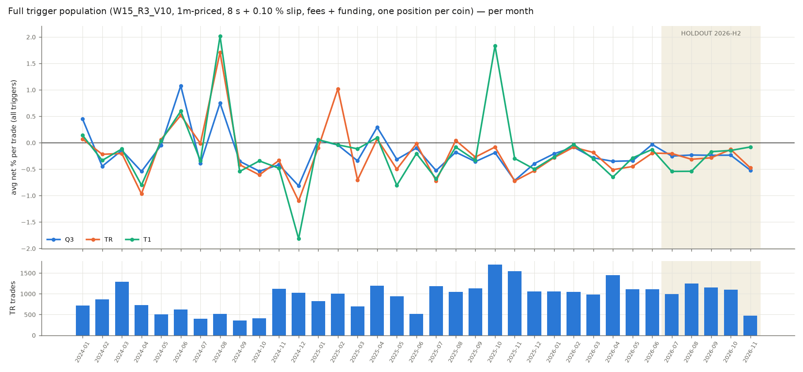
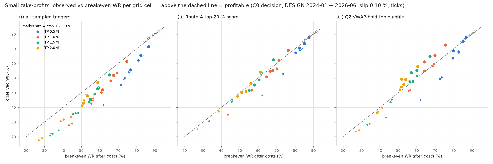

# ROUTE A FOLLOW-UP — holdout check · "price holding above the burst VWAP" · small take-profits (2026-11-19)

**Pre-registered:** `ROUTE_A_FOLLOWUP_2026-11-19_PREREG.md`, frozen 16:30 UTC, before any new outcome was computed. Research only.
No engine, config, test or CLAUDE file was changed (report-only commit). Every number below is pre-registered unless it is marked
EXPLORATORY. All numbers are UNVERIFIED research reads: they assume the fill model stated in each method section and they have not been through a dual review.

## Plain answer
1. **Q1, the HOLDOUT caveat: it is noise from the sample. It is not a model edge and not a regime.**
   - Across all **33,399 triggers** priced on 1m klines, 2026-H2 is **negative** on every exit: Q3 −0.27, TR −0.26, T1 −0.32 % per trade.
     The day-CI is below 0 on all three, and all 5 HOLDOUT months are negative on all three exits.
   - 2026-H2 is not unusual. It ranks 3rd–5th of 6 half-years depending on the exit. 7 of 35 months were positive on TR, and none of them is in 2026-H2.
   - The 321 sampled HOLDOUT events were luckier than their own population. Priced with the same 1m method, they average +0.00 to +0.15
     against −0.26 to −0.33 for the whole population.
   - The top-20 % model lift is not significant: C2 TR top-20 % minus bottom-80 % = +1.23, CI [−0.66, +3.31].
     In DESIGN-OOF the lift on the same cell is −0.42, and it changes sign from one half-year to the next.
2. **Q2, the VWAP-hold selector, picks future Frenzies, not profitable longs.**
   - Its runner AUC is 0.59–0.64. Its PATH AUC (+X % before −X %) is 0.47–0.55 in DESIGN and 0.45–0.58 in HOLDOUT.
   - Its top quintile is ≤ 0 in DESIGN at C1 / C2 / C5. At C0 it is +0.37 / +0.35 on Q3 / TR, but the CI crosses 0.
     In HOLDOUT the same C0 cells are −0.07 / −0.20.
   - On the full population, the 1m proxy is ≤ 0 on Q3 / TR in both blocks.
   - **0 cells pass. FAIL.**
3. **Q3, small take-profits (0.5–2 %), lose on all 576 cells of all three selections once costs are paid.**
   - The win rate equals the random-walk "no-edge" rate set by where the TP and the stop sit. For example, TP 0.5 / SL 0.5 has a
     41 % observed WR against 40 % no-edge, and it needs 62 % to break even.
   - The ≈ 0.27 % round-trip cost (0.10 % slip in, 0.05 % taker fee, then 0.02 % on a maker TP or 0.05 % fee + 0.10 % slip on a
     stop) takes most of a 0.5 % TP.
   - On all sampled triggers, **0 of 192 cells are positive** in DESIGN and 0 of 192 in HOLDOUT. The random-entry family-wise null
     is not beaten in any selection (p 0.32 / 0.90 / 0.95).
   - One DESIGN cell has a CI above 0: VWAP-hold, C0, TP 1 / SL 3 / 60 min, +0.27, CI [+0.02, +0.50]. It fails the null
     (p_cell 0.11, family p 0.32), it is −0.66 in HOLDOUT, and it is +0.05 at 0.20 % slip.
   - This matches the 10-01 / 10-03 / 10-06 scalp studies.
   - **NO BUILD on any of the three questions. No observe line.**

## Data & coverage
| item | value |
|---|---|
| Q1(a) population | all **33,399** W15_R3_V10 triggers 2024-01-01 → 2026-11-17 (≈ 31.8 / day), 100 % priced (status ok) |
| 1m klines | local caches (`backtest_cache/k1m`, `backtest_cache_2025/k1m`), plus **7,734 data.binance.vision 1m zips (5.08 GB, CHECKSUM verified, 0 missing, 0 API weight)** fetched with ≤ 8 connections into `ROUTE_A_FOLLOWUP_data/k1m/` (8.3 GB csv) |
| entry calibration | median (first trade ≥ sig + 8 s ÷ 1m open at sig − 1) = **0.000 %** (mean −0.02 %, n 1,550), so the primary entry is the 1m open × (1 + slip) |
| 1m vs tick cross-check (1,550 events, C0 gross) | Q3 corr 0.91, bias −0.05 · TR corr 0.94, bias +0.06 · T1 corr 0.99, bias −0.02 (pessimistic +60 s entry: corr 0.80–0.98, bias −0.05 to −0.11) |
| Q2 / Q3 sample | Route A's 1,550 tick events (DESIGN 1,066 + HOLDOUT 321 not-yet-flagged at C0), population-weighted |
| tick resolution in Q3 | exact trade order until sig + 10 min. Then 1m bars from ticks. The share of outcomes decided on ticks is 90 % at 5-min holds and 72 % at 15 / 60-min holds. A 1m bar where both the TP and the stop trade counts as a stop. The TP-first bound changes no cell mean by more than 0.05; it turns 2 of 1,152 cells from ≤ 0 to ≥ 0 (top-20 % C0 TP 1.5 or 2 / SL 1 / 60 m: +0.03 / +0.01), and neither passes |

---

## Q1 — model edge, regime artefact, or noise?

### Q1(a) Full population, per half-year (1m, entry 8 s + slip, fees, funding, one position per coin)
| half | trades/day | Q3 net (CI) | TR net (CI) | T1 net (CI) | TR @0.30 % |
|---|---|---|---|---|---|
| 24-H1 | 26.2 | −0.00 [−0.28, +0.30] | −0.16 [−0.48, +0.13] | −0.11 [−0.38, +0.16] | −0.56 |
| 24-H2 | 21.1 | −0.37 [−0.88, +0.16] | −0.27 [−1.07, +0.56] | −0.48 [−1.61, +0.47] | −0.67 |
| 25-H1 | 28.9 | −0.05 [−0.26, +0.14] | **+0.01** [−0.47, +0.49] | −0.16 [−0.43, +0.10] | −0.39 |
| 25-H2 | 42.0 | −0.40 [−0.55, −0.25] | −0.38 [−0.65, −0.05] | **+0.11** [−0.48, +1.02] | −0.78 |
| 26-H1 | 37.7 | −0.23 [−0.35, −0.10] | −0.30 [−0.44, −0.13] | −0.30 [−0.51, −0.05] | −0.70 |
| **26-H2 (HOLDOUT)** | 35.8 | **−0.27** [−0.36, −0.17] | **−0.26** [−0.40, −0.11] | **−0.32** [−0.53, −0.10] | −0.66 |
| ALL | 31.8 | −0.23 [−0.32, −0.15] | −0.24 [−0.40, −0.07] | −0.18 [−0.40, +0.08] | −0.64 |

- Not-yet-flagged triggers only: 26-H2 Q3 −0.26, TR −0.27, T1 −0.33. The pessimistic +60 s entry gives TR −0.24 for 26-H2.
- **Per month** (`_q1a_month.csv`, chart below): TR > 0 in 7 / 35 months, Q3 in 5 / 35, T1 in 7 / 35. The best months are
  2024-06 / 2024-08 / 2025-02 / 2025-10, all before the HOLDOUT. **0 / 5 HOLDOUT months are > 0 on any exit.**
- **Is 2026-H2 positive for all triggers?** No. **Is it unique?** No; it is an ordinary half-year.

*Average net per trade, every trigger, per month. The shaded HOLDOUT is flat at −0.1 to −0.5 %. The only positive spikes are earlier months
(2024-08, 2025-02 TR, 2025-10 T1) carried by a few huge runners.*

**Why Route A saw positive HOLDOUT "all" numbers (EXPLORATORY reconciliation):**
- Priced with the same 1m method, the 321 sampled HOLDOUT C0 events average Q3 +0.04 / TR +0.00 / T1 +0.15. The whole HOLDOUT population is −0.26 / −0.27 / −0.33.
- The month × class re-weighting fixes the runner share but not the luck *within* a class. With ~35 fizzles a month out of ~900, one or two fat
  T1 / TR winners move the mean by tenths of a percent. Route A's own CI ([−0.68, +1.11] for C0 T1) already said this.

### Q1(b) Does selection add anything beyond the tape? (sampled events, net %, day-block bootstrap of the lift)
| ckpt | exit | HOLDOUT all / top-20 / bottom-80 | **HOLDOUT lift top − bottom [CI]** | DESIGN-OOF lift [CI] | lift by DESIGN half 24-H2 / 25-H1 / 25-H2 / 26-H1 |
|---|---|---|---|---|---|
| C0 | TR | −0.02 / +0.20 / −0.04 | +0.25 [−1.61, +2.23] | +0.12 [−0.96, +1.22] | −2.23 / +0.96 / +0.95 / −0.49 |
| C1 | TR | +0.24 / +0.50 / +0.21 | +0.29 [−1.76, +2.40] | +0.09 [−0.98, +1.19] | −1.34 / +0.73 / +0.58 / −0.42 |
| **C2** | **TR** | −0.02 / **+1.08** / −0.15 | **+1.23 [−0.66, +3.31]** (p ≤ 0: 0.10) | **−0.42** [−1.39, +0.57] | −1.10 / +0.82 / −1.13 / −0.01 |
| C5 | TR | +0.06 / +1.21 / −0.05 | +1.26 [−0.94, +3.35] | −0.02 [−0.91, +0.89] | +0.62 / −0.05 / −0.61 / +0.59 |
| C2 | Q3 / T1 | — | +0.44 [−1.03, +1.89] / +0.63 [−3.47, +5.61] | +0.01 / −1.25 | |

All 24 cells: `_q1b_lift.csv`.
- The pre-registered model-edge test needs HOLDOUT C2 TR lift CI low > 0 **and** DESIGN-OOF lift > 0. **Both fail.**
- Across the 4 DESIGN halves the lift is positive in 2 and negative in 2 on every checkpoint, which is what noise looks like.
- The HOLDOUT C2 / C5 lift rests on 38 trades.

### Q1(c) Regime in WINDOW units (full population, TR shown; Q3 and T1 agree; `_q1c_summary.csv`, `_q1c_windows.csv`)
Windows are same-sign runs of ≥ 7 days.
| variable | 2026-H2 sign (share of days) | earlier windows with that sign: N · positive · mean | other-sign windows: N · positive · mean | binomial p | can it be called? |
|---|---|---|---|---|---|
| R1 BTC 1d EMA50 > 200 | mixed (47 % ON, 2 windows) | 0 | 1 · 0 · −0.19 | — | **no**: 3 windows in 35 months |
| R5 breadth > 50 % | low (28 % high) | 6 · 3 · −0.08 | 6 · 0 · −0.58 | 0.66 | low breadth is less bad (perm p 0.004), but its windows are not positive, and 2026-H2 itself is −0.26 |
| RF Frenzy 7-d count high | high (100 %) | 8 · 1 · −0.67 | 8 · 4 · −0.00 | 0.996 | high Frenzy count is the *worse* side |
| B30 BTC 30-d return > 0 | up (68 %) | 11 · 5 · +0.08 | 10 · 3 · −0.03 | 0.73 | no difference (perm p 0.36) |

- Monthly Spearman of all-trigger TR against regime shares (35 months, descriptive): R1 +0.20, breadth −0.27, Frenzy count −0.32, BTC 30 d −0.20. All are weak.
- **No regime variable has ≥ 5 earlier same-sign windows that are positive.** The tape in 2026-H2 (low breadth, high Frenzy count, BTC
  30 d up about two-thirds of the time) has occurred before, and those windows were flat to negative too.
- The one robust regime read repeats the 11-19 finding: high-breadth windows are worse, 0 / 6 positive. It does not make the trigger positive.

### Q1 verdict
- **Noise / sampling artefact.** The full population shows no positive HOLDOUT; selection lift is not significant and has no stable sign; no regime switch can be claimed.
- Route A's NO BUILD stands, and the HOLDOUT caveat is retired.

---

## Q2 — "price holding above the burst's average price" as a long selector
**Method.**
- **Feature:** `vwap_gap` = last price ÷ VWAP of [sig − 15 min, decision) − 1.
- **Selectors:**
  - S_VW = top quintile of `vwap_gap`.
  - S_VA = top quintile of z(vwap_gap) + z(trade-rate acceleration).
  - Thresholds are frozen on DESIGN per checkpoint.
- **Sample:** the tick events, population-weighted, with already-flagged events excluded.
- **PATH labels:** +X % before −X % (X = 1, 2, 3, 5) from the first trade ≥ decision + 8 s.
- **Priced:** Route A's tick-priced Q3 / TR / T1.

### Does it pick runners or winners? (weighted AUC, `_q2_auc.csv`)
| ckpt | block | RUNNER AUC vwap_gap / S_VA | PATH +1/−1 | PATH +2/−2 | PATH +3/−3 | PATH +5/−5 |
|---|---|---|---|---|---|---|
| C0 | DESIGN | **0.59 / 0.66** | 0.52 | 0.54 | 0.55 | 0.53 |
| C1 | DESIGN | **0.62 / 0.67** | 0.51 | 0.51 | 0.50 | 0.51 |
| C2 | DESIGN | **0.64 / 0.69** | 0.50 | 0.49 | 0.49 | 0.49 |
| C5 | DESIGN | **0.64 / 0.67** | 0.47 | 0.50 | 0.54 | 0.51 |
| C0 / C1 / C2 / C5 | HOLDOUT | 0.53 / 0.54 / 0.57 / 0.61 (vwap_gap) | 0.45 / 0.50 / 0.56 / 0.53 | 0.48 / 0.47 / 0.47 / 0.56 | 0.51 / 0.49 / 0.49 / 0.51 | 0.52 / 0.52 / 0.49 / 0.58 |

The feature ranks *which pops become a Frenzy*. It does not rank *whether a long from here goes up first*: every PATH AUC is between 0.45 and 0.58, and the signs do not agree between DESIGN and HOLDOUT.

### Priced, top quintile vs all (net % at 0.10 % slip; `_q2_selector.csv`)
| ckpt | select | DESIGN Q3 / TR / T1 | DESIGN best CI | HOLDOUT Q3 / TR / T1 | @0.30 % DESIGN Q3 / TR | trades/day |
|---|---|---|---|---|---|---|
| C0 | all | −0.11 / −0.23 / −0.64 | | +0.13 / −0.02 / +0.20 | −0.40 / −0.63 | 30 |
| C0 | **S_VW** | **+0.37 / +0.35** / −0.23 | Q3 [−0.22, +0.95] | −0.07 / −0.20 / +2.63 | +0.09 / −0.05 | 6.1 |
| C0 | S_VA | +0.22 / +0.22 / −0.16 | [−0.34, +0.80] | −0.02 / +0.26 / +1.52 | −0.06 / −0.18 | 6.1 |
| C1 | S_VW | −0.43 / −0.48 / −1.79 | | −0.39 / +0.52 / +0.62 | | 6.1 |
| C2 | S_VW | −0.28 / −0.62 / −1.85 | | −0.48 / −0.12 / +1.48 | | 6.1 |
| C5 | S_VW | −0.22 / −0.24 / −1.44 | | +0.40 / +0.60 / +2.89 | | 6.0 |

**Dose-response** by DESIGN quintile of vwap_gap (`_q2_dose.csv`):
- **Runner share** rises Q1 → Q5 at every checkpoint: 8 → 16 % at C0 and 4.5 → 16 % at C2.
- **Net % (DESIGN, Spearman of quintile vs net):** monotone only at C0 (TR −0.72 → +0.35, ρ 0.9). It is reversed at C1 and C2
  (ρ −0.6 / −0.7 on Q3) and mixed at C5.
- **HOLDOUT C0:** flat (ρ 0.0 on TR); its best quintiles are Q2 and Q3.

**Full-population 1m proxy** (`vwap1m`, C0, top quintile with the DESIGN cut; `_q2_vwap1m.csv`):
- DESIGN: Q3 −0.15, TR −0.07, T1 +0.43 (T1 CI [−0.67, +1.84], a fat tail).
- HOLDOUT: Q3 −0.27 (CI below 0), TR −0.01, T1 +0.16.
- At 0.30 % slip: DESIGN Q3 −0.43, T1 +0.03.
- Half-years on TR: −0.33 / −1.30 / +0.89 / −0.07 / +0.01 / −0.01. The sign changes half to half.

**Meaning.**
- "Holding above the burst VWAP" is a measure of how strong the pop is *now*. It raises the chance that the coin is flagged as a Frenzy within 2 h,
  as Route A found. It does not tell whether the next few percent come before the drop.
- The C0 +0.35 in DESIGN is one checkpoint out of four. It has no HOLDOUT replication, and the full-population proxy does not reproduce it.
  That is the shape of a selection-on-noise result.

**Verdict:**
- **FAIL.** No cell meets the PASS bar (DESIGN CI low > 0, monotone, HOLDOUT > 0, > 0 at 0.30 %).
- **Answer to the operator:** it picks future Frenzies, not profitable longs.

---

## Q3 — small take-profits (0.5 / 1 / 1.5 / 2 %)

### The cost arithmetic first (0.10 % slip)
| leg | cost |
|---|---|
| entry | the first trade ≥ decision + 8 s, × 1.001 (0.10 % slip), + 0.05 % taker fee |
| TP exit (maker) | 0.02 % fee. The resting TP is relative to the slipped fill, so the *market* must travel TP + 0.10 % |
| stop / time exit (taker) | 0.05 % fee + 0.10 % slip, plus any gap past the stop |
| **net win** | ≈ TP − 0.07 % (TP 0.5 → **+0.43**, 1.0 → +0.93, 2.0 → +1.93) |
| **net loss** | ≈ −(stop + 0.20 %) (stop 0.5 → **−0.70**, 1.0 → −1.20, 3.0 → −3.2) |
| breakeven WR | |loss| ÷ (win + |loss|): TP 0.5 / SL 0.5 → **62 %** · TP 1 / SL 1 → 56 % · TP 0.5 / SL 3 → 87 % · TP 2 / SL 3 → 61 % |
| random-walk no-edge WR | (stop − 0.10) ÷ (TP + stop): TP 0.5 / SL 0.5 → **40 %** · TP 1 / SL 1 → 45 % · TP 0.5 / SL 3 → 83 % · TP 2 / SL 3 → 58 % |

**Why a small TP cannot work here:**
- With a 0.5 % TP, a third of the gross move goes to costs (0.07 %) and to the 0.10 % entry slip. The loss side carries 0.20 % of costs.
- The hit rate an unbiased walk gives is 22 points short of breakeven. A tighter TP raises the hit rate, but by less than it raises the breakeven.

### Observed (C0, DESIGN · HOLDOUT, net % at 0.10 %; full grid `_q3_grid.csv`, 576 rows per block)
| cell | **all triggers** DESIGN (CI) · HOLDOUT | WR / BE WR (DESIGN) | @0.20 % | **top-20 % score** DESIGN · HOLDOUT | **VWAP-hold S_VW** DESIGN (CI) · HOLDOUT |
|---|---|---|---|---|---|
| TP 0.5 / SL 0.5 / 5 m | −0.24 [−0.28, −0.19] · −0.25 | 41 / 62 | −0.41 | −0.16 · −0.13 | −0.20 · −0.38 |
| TP 0.5 / SL 1 / 15 m | −0.23 [−0.29, −0.16] · −0.27 | 59 / 73 | −0.33 | −0.18 · −0.07 | −0.22 · −0.46 |
| TP 0.5 / SL 3 / 60 m | −0.17 [−0.28, −0.06] · −0.28 | 81 / 87 | −0.25 | −0.00 · −0.01 | +0.03 · −0.69 |
| TP 1 / SL 1 / 15 m | −0.24 [−0.32, −0.15] · −0.39 | 45 / 56 | −0.39 | −0.11 · −0.04 | −0.10 · −0.67 |
| TP 1 / SL 3 / 60 m | −0.12 [−0.26, +0.02] · −0.22 | 71 / 75 | −0.30 | +0.10 · −0.15 | **+0.27 [+0.02, +0.50]** · **−0.66** |
| TP 1.5 / SL 1 / 15 m | −0.27 [−0.36, −0.16] · −0.34 | 36 / 47 | −0.42 | −0.04 · −0.20 | −0.07 · −0.75 |
| TP 2 / SL 0.5 / 60 m | −0.25 [−0.33, −0.17] · −0.08 | 18 / 27 | −0.47 | −0.06 · +0.06 | −0.09 · −0.31 |
| TP 2 / SL 3 / 60 m | −0.09 [−0.28, +0.10] · −0.03 | 57 / 59 | −0.28 | +0.14 · +0.18 | +0.36 [−0.09, +0.76] · −0.35 |

*Each dot is one grid cell at C0 (DESIGN). On all triggers (left) every cell sits below the breakeven line, and the gap is widest at the smallest
TP. The two selections (centre, right) move cells onto the line. They do not move them clearly above it, and HOLDOUT pulls them back down.*

**Grid totals (DESIGN, 192 cells per selection = 4 checkpoints × 48):**
| selection | trades/day (full pop.) | cells > 0 | cells with CI low > 0 | best cell | best @0.20 % | HOLDOUT cells > 0 | cells > 0 in both blocks | Kelly > 0 at WR floor |
|---|---|---|---|---|---|---|---|---|
| (i) all triggers | 30.3 | **0** | 0 | −0.09 | −0.25 | 0 | 0 | 0 |
| (ii) top-20 % score | 6.3 | 8 | 0 | +0.20 (C0 TP1.5/SL3/60) | −0.07 | 42 | 2 | 0 |
| (iii) VWAP-hold S_VW | 6.1 | 17 | 1 | +0.36 (C0 TP2/SL3/60) | +0.21 | 4 | **0** | 3 |

- **Later checkpoints are not better.** The C1 / C2 / C5 averages over all 48 cells, all triggers, are −0.24 / −0.24 / −0.25 (C0 −0.22).
- The HOLDOUT best for top-20 % is C5 TP2/SL2/15m at +0.41, CI [−0.54, +1.23], N 38. That is the same 38-trade window as Q1.

### Random-entry family-wise null (`_q3_null.csv`)
**Method.** Each selected event's entry time is replaced by a random minute on the same coin-day (300 draws). The observed and null entries
are priced at the same 1m convention. The statistic is the best DESIGN cell mean over all 192 cells.

| selection | observed best (1m conv.) | null mean of the max | null p95 | **family p** |
|---|---|---|---|---|
| all triggers | −0.10 | −0.03 | +0.05 | **0.90** |
| top-20 % | −0.02 | +0.15 | +0.34 | **0.95** |
| VWAP-hold | +0.10 | +0.06 | +0.25 | **0.32** |

- Random minutes on the same coin-days do **as well or better** than the trigger entries. The trigger moment carries no scalp edge over just being in that coin that day.
- The single CI > 0 cell (S_VW C0 TP1/SL3/60m) has p_cell 0.11 against its own random entries.

### Daily compound at Kelly-at-floor
- **All triggers and top-20 %:** the Kelly fraction at the one-sided 95 % Wilson WR floor is **0 on every cell**, so the size is 0 and the rate is 0 %/day.
- **VWAP-hold:** 3 DESIGN cells have Kelly > 0. The in-sample DCR is ≈ 1.4–1.8 %/day at ~6 trades/day (after a 30–50 % haircut: ≈ 0.7–1.3 %/day).
  All three are negative in HOLDOUT (−0.35 to −0.66 %) and fail the null, so the honest size is 0.

### Prior evidence (engaged, not repeated)
- **HOT_SCALP_BACKTEST_2026-10-01** (1 s data, 82 k trades):
  - The hit rate equalled the no-edge rate on every exit (e.g. A: 65 % vs 65 %), for −0.07 to −0.12 %/trade.
  - The same mechanism is seen here on a different trigger, with tick-exact fills and the full grid down to 0.5 %.
- **FRENZY_SCALP_1M_SEARCH / MODEL_WF_2026-10-03:**
  - 0 cells passed.
  - The gradient-boosted model could shift WR by ~6 points across deciles, which was not enough to cover 0.11 % of costs.
  - Here, Route A's model shifts WR by ~5–7 points (top-20 vs all) and falls short the same way.
- **FRENZY_ON_SCALP_2026-10-06** (0 / 1,205 cells):
  - "+1 % is usually reached", but the misses sink 4.8× deeper.
  - The same asymmetry shows here: the TP 1 / SL 3 / 60 m cell wins 71 % and still loses.
- **New in this study:**
  - The grid is on the *earliest* pump trigger (before the Frenzy flag), with exact trade order, at four post-trigger delays and three selections.
  - It adds a random-entry null on the same coin-days. That null shows the trigger moment is not a better scalp entry than a random minute in the same coin.

### Q3 verdict
- **FAIL (0 / 576 cells pass; family p ≥ 0.32 everywhere).** 1 % or 0.5 % TPs do not help: the smaller the TP, the larger the share of the move that costs take.
- At 30 trades a day on all triggers, every grid cell loses 0.09–0.30 % per trade. A small-TP scalp makes more trades at a loss, not more money.

---

## Overall verdict
| question | result | verdict |
|---|---|---|
| Q1 HOLDOUT caveat | full pop 26-H2 −0.26 to −0.32 (CI < 0); lift CI crosses 0 and flips sign by half-year; no regime has ≥ 5 agreeing windows | **noise (sampling luck), not model, not regime** |
| Q2 VWAP-hold selector | runner AUC 0.59–0.64, PATH AUC ≈ 0.5; 0 cells pass | **picks Frenzies, not winners: FAIL** |
| Q3 small TPs | WR = no-edge rate; 0 / 192 cells > 0 on all triggers; null p 0.32–0.95 | **FAIL, NO BUILD** |

- **No build and no observe line.**
- What remains open is the same as in Route A: order-book state at pump starts (Route B, a live depth recorder), testing the PATH label rather than the Frenzy label.
- The capacity caveat stands. Thin-book fills at pump starts are modelled as the next trade + slip; real fills are unverified.

## Discipline notes and blind spots
- **Pre-registration was kept.** The HOLDOUT was read once per question. Thresholds were frozen on DESIGN. The sample-vs-population
  reconciliation in Q1(a) is EXPLORATORY.
- **Window units:**
  - R1 has 3 windows in 35 months, so nothing can be said about it.
  - R5 / RF / B30 have 6–11 windows per side.
  - Q3 is not a market-wide filter, so day-block bootstraps are used there.
- **1m pricing (Q1a):** the first minute's range after entry is not used, and a bar with both stop and target hit counts the stop first.
  The tick cross-check bias is ≤ 0.06 % on the primary entry.
  Funding is real where cached; missing months are charged at 0.01 %/8 h (flag `fund_missing` in `pop1m.pkl`).
- **Q3 resolution:** only the first 10 min after the trigger are tick-exact. Later outcomes use 1m bars (and 5m at a day boundary).
  The TP-first bound on same-bar ties changes no cell mean by more than 0.05. Same-coin-day random entries are restricted to minutes with
  trades in the npz bars.
- **Not tested:**
  - maker *entries* (a resting bid instead of a taker buy), which would remove 0.10 % slip + 0.03 % fee from each trade but add fill risk;
  - order-book features;
  - triggers other than W15_R3_V10;
  - checkpoints inside the first 5m bar.

## Files
- **Report and pre-registration:** `reports/ROUTE_A_FOLLOWUP_2026-11-19.md` (this file) · `_PREREG.md`
- **Q1:** `_q1a_half.csv` · `_q1a_month.csv` · `_q1a_xcheck.csv` · `_q1b_lift.csv` · `_q1c_windows.csv` · `_q1c_summary.csv` · `_q1c_monthly.csv`
- **Q2:** `_q2_selector.csv` · `_q2_dose.csv` · `_q2_auc.csv` · `_q2_vwap1m.csv` · `_q2_vwap1m_dose.csv`
- **Q3:** `_q3_grid.csv` · `_q3_null.csv`
- **Charts:** `_monthly.png` (per-month full population) · `_frontier.png` (small-TP cost / WR frontier)
- **Data:** `reports/ROUTE_A_FOLLOWUP_data/`
  - `k1m/` (fetched 1m klines)
  - `ticks.pkl` (Q2 / Q3 tick pass + null)
  - `pop1m.pkl` (full-population pricing)
  - `q1.pkl`, `eval_q23.pkl`
  - `fetch1m_log.csv`
- **Scripts:**
  - `scripts/route_a_followup_fetch1m.py`: run with `-I`
  - `scripts/route_a_followup_ticks.py`
  - `scripts/route_a_followup_price1m.py`
  - `scripts/route_a_followup_q1.py`
  - `scripts/route_a_followup_eval.py`
  - `scripts/route_a_followup_common.py`
  - `scripts/route_a_followup_charts.py`

**Data note (review):** the `*_data/` folders these reports cite (tick windows, 1m klines, pickles, kline caches) are LOCAL ONLY — not in the repo (multi-GB); every script rebuilds them.
