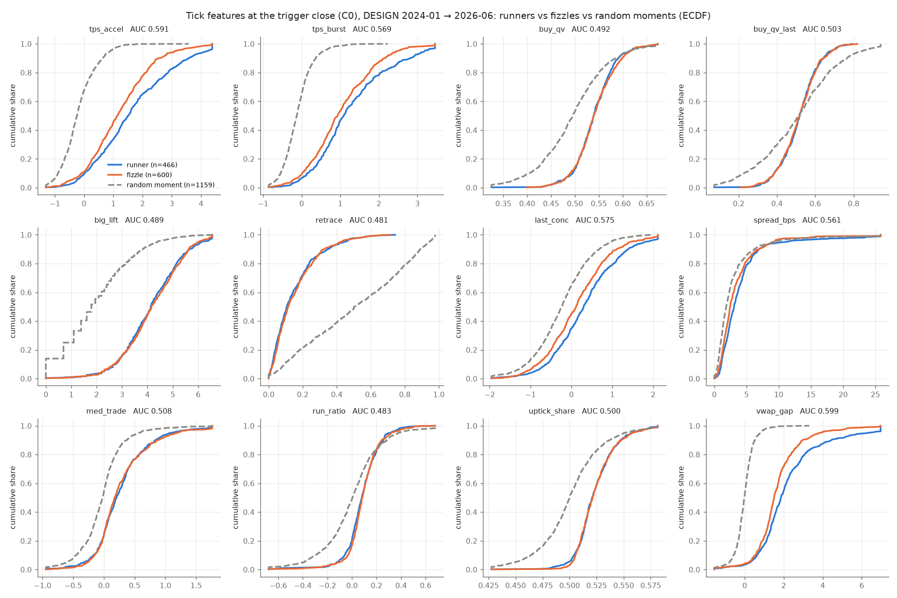
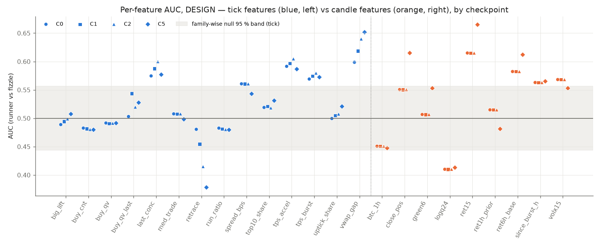
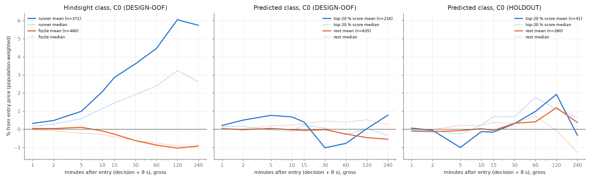

# ROUTE A — does tick data inside the early Frenzy candles separate runners from fizzles? (2026-11-19)

**Pre-registered:** `ROUTE_A_TICKS_2026-11-19_PREREG.md` (frozen 15:01 UTC, before the first download at 15:02 UTC). Everything below
is pre-registered unless marked EXPLORATORY. Research only. No engine, config, tests or CLAUDE files were changed (report-only commit).

## The question
Frenzy pumps build over several green 5m candles before our flag. Buying at the 6 h base would earn +8.8 %/trade gross with
hindsight. On candles, the early pops that become a Frenzy look like the ~87 % that fizzle (FRENZY_LONG_SEARCH 11-19 §5).
**Route A:** does trade-level data (Binance aggTrades) inside those early candles separate runners from fizzles in real time? Does it
add anything over candles? Is a long on it profitable after real costs, at many trades a day?

## Plain answer
1. **Yes, tick data separates *runners* from *fizzles*, modestly, and it holds out of sample.** At 1–2 minutes after the trigger, a
   6-feature tick model has an out-of-fold AUC of **0.62–0.65**. The label-shuffle null p95 is 0.53 (p < 0.005). HOLDOUT
   (Jul–Nov 2026, read once) gives **0.63–0.64**. Tick data **adds a little** over candles: ΔAUC +0.014 (C1) and +0.026 (C2),
   both beating the tick-permutation null (p < 0.005, 200 permutations). HOLDOUT gives +0.026 / +0.012. The pre-registered separation gate passes at
   **C1 and C2**, and fails at C0 (Δ p 0.08) and C5 (HOLDOUT BOTH < CANDLE).
2. **It does not separate *winning longs* from *losing longs*.** On the PATH label (did the long reach +5 % before −5 % after
   entry), the tick and tick+candle models sit at **AUC 0.42–0.53** (tick model 0.48–0.51 in DESIGN, 0.42–0.48 in HOLDOUT); the candle-only model reaches 0.58 at C5 in HOLDOUT only. The features that
   say "this will become a Frenzy" do not say "a long from here makes money".
3. **Why:** the model picks the pops that are **already further along**. Among runners at C0, those in the top-20 % score have ret15 7.1 % vs 4.3 % for all runners and
   vwap_gap is 2.8 % vs 1.9 % (C0). Its runners have only half the remaining run: median reach +6.3 % vs +11.3 % for all runners,
   and TR net +1.9 % vs +2.9 %. Its fizzles fall harder: T1 −2.0 to −2.7 % vs −1.1 to −1.2 %. The share of runners does go up, from 4 % in
   the lowest score quintile to 19 % in the top. P&L does not follow: T1 net goes from 0 to −0.2 % in the bottom quintile to −1.4 to −2.3 % in the top.
4. **Priced (8 s latency, next trade, 0.10 % slip, taker fees, real funding):** the top-20 % selection trades **≈ 6.3 times a day**
   and is ≤ 0 in DESIGN-OOF on every checkpoint × exit (best: C1 TR −0.02 %, CI [−0.92, +0.88]). It gets worse at 0.30 % slip
   (−0.42 … −2.2). **0 of 12 DESIGN cells pass.** The trading gate fails, so it is **NO BUILD**.
5. **What tick data said about the theory:** the "informed buyer" features (taker-buy share by count or $, large lifting prints,
   buy-run length, up-tick share, trade size) are **identical for runners and fizzles** (AUC 0.48–0.52). Both differ sharply from a
   random moment. Every pump start has the same buyer footprint. What separates runners is **intensity**: trade-rate acceleration,
   last-minute volume, price above the burst VWAP. That is a finer measure of how big the move already is, so it predicts the label
   but is priced in.

## 1. Data & coverage
| item | value |
|---|---|
| source | data.binance.vision, USDT-M daily aggTrades zips, SHA-256 checked against `.CHECKSUM` |
| files / volume | **1,674 pair-days, 15.95 GB downloaded** (in memory; only the cut windows were kept: 683 MB in `ROUTE_A_TICKS_data/ev/`) |
| missing | **0** (no 404 among the sampled events, delisted coins included) |
| events | **1,550** = DESIGN 600 runners + 600 fizzles (20 + 20 per month, 2024-01 → 2026-06) + HOLDOUT 175 + 175 (35 + 35 per month, 2026-07 → 11-17) |
| coins | 522 pairs (505 with full features) |
| baseline | 1,484 random moments on the same pair-days, ≥ 2 h from any trigger of any grid cell |
| population | 33,399 W15_R3_V10 triggers 2024-01 → 2026-11 (≈ 31.6 / day, 12.2 % runners). All rates and P&L are re-weighted from the 50/50 sample to this population |
| fetch | 4 parallel connections, ~64 min, back-off on errors, 0 Binance API weight |

**Already-flagged exclusion (pre-registered):** in 163 of 775 sampled runners (21 %), the flag closes on the trigger bar itself. At C5 the
count is 300. These are today's flag entry (−0.53 %/trade, 11-19 §5), so they are left out of that checkpoint's classification. The runners that
remain are the ones the trigger fires *before* the flag, which is the population Route A is about.

## 2. Theory (written before data) and what came out
| theory | expected | found |
|---|---|---|
| crowd arrival (trades/s accelerating) | runner + | **yes**: tps_accel AUC 0.59–0.61, tps_burst 0.57–0.58 |
| informed buying (taker-buy share, by $ > by count) | runner + | **no**: buy_cnt 0.48, buy_qv 0.49, buy_qv_last 0.50–0.54 |
| large prints lifting price | runner + | **no**: big_lift 0.49–0.51 (both classes ≈ 60 such prints vs ≈ 5 at a random moment) |
| whale vs retail (median trade $, top-decile share) | runner + | **no**: 0.50–0.53 |
| price holds between bursts (retracement) | runner = less retrace | **only after the trigger** (C0 0.48 → C2 0.42 → C5 0.38): this is the post-trigger path itself |
| sweeping algos (buy-run / sell-run length) | runner + | **no**: 0.48 |
| thin book makes fakes (spread proxy) | runner − | **opposite**: runners have a *wider* spread proxy (AUC 0.56). That is volatility, not thinness |
| still accelerating (last-minute volume) | runner + | **yes**: last_conc 0.58–0.60 |
| price above the burst VWAP | runner + | **yes**: 0.60 → 0.65 by C5 |
| counter-theory: tick data re-measures the move and adds ≤ 0.02 AUC | — | **mostly right**: +0.00 / +0.014 / +0.026 / +0.005 |

*Runners (blue) and fizzles (orange) overlap almost fully on every buyer-side feature. Both sit far from a random moment (grey). Only the
intensity features (tps_accel, tps_burst, last_conc, vwap_gap) shift.*

## 3. Method (frozen)
- **Trigger:** W15_R3_V10 from the 11-19 earlier-detector grid. That is 15-min return ≥ +3 % and 15-min quote volume ≥ 10× normal,
  with 24 h volume ≥ $20 M and a 6 h debounce. **RUNNER** = a Frenzy flag closes within 2 h; **FIZZLE** = none.
- **Checkpoints:** C0 = trigger close, C1 / C2 / C5 = +60 / +120 / +300 s. Features use only trades before the decision time.
- **Windows:** BASE [sig − 75, sig − 15 min) · BURST [sig − 15 min, decision) · LAST [decision − 60 s, decision).
- **Features:** 14 tick features (list and signs in the PREREG) plus candle features from the local 5m cache.
- **Models:** logistic L2 on TICK = {tps_accel, buy_qv, buy_qv_last, retrace, last_conc, spread_bps} · CANDLE = {ret15, volx15,
  ret6h_base, close_pos, logq24, since_burst_h} · BOTH.
  - Expanding half-year CV: OOF on 24-H2 … 26-H1, N 851 at C0 (765 at C5).
  - Nulls: labels shuffled within month (1,000 draws for the 56-cell feature family, 200 for models); the tick block permuted within month for ΔAUC (200).
- **Fills:** entry at the first trade ≥ decision + 8 s (median delay 8.08 s), × (1 + 0.10 %); stress 0.30 / 0.50 %.
  - Fees: taker 0.05 % in and out, exit slip on non-TP exits, maker 0.02 % on TP.
  - Funding: real funding over the hold.
  - Exits run on 1 s bars from ticks, then 1m bars from ticks, then 5m bars.
  - Cross-check: the C0 exits match the 11-19 5m study (corr 0.97 TR / 0.85 Q3 / 0.997 T1).
- **Exits:** Q3 (TP +3 % maker / SL −4 % / 4 h) · TR (arm +3 %, trail 3 % off the high, SL −5 %, 24 h) · T1 (1 h).
- **PATH label:** +5 % before −5 % within 24 h. REACH = best price before −5 %.

## 4. DESIGN — per feature (family-wise null) and models
Family-wise label-shuffle null over 14 tick features × 4 checkpoints: observed max |AUC − 0.5| = 0.152 (retrace at C5) vs null p95 0.056, **p < 0.001**.
Survivors at C0: tps_accel 0.591, vwap_gap 0.599, last_conc 0.575, tps_burst 0.569, spread_bps 0.561 (inverse sign). Full table: `_feature_auc.csv`.

| checkpoint | target | TICK AUC (null p95, p) | CANDLE | BOTH | ΔAUC (null p95, p) | BOTH by half 24-H2 / 25-H1 / 25-H2 / 26-H1 |
|---|---|---|---|---|---|---|
| C0 | runner | 0.604 (0.532, <0.005) | 0.653 | 0.653 | −0.000 (0.000, 0.08) | 0.74 / 0.67 / 0.60 / 0.59 |
| C1 | runner | 0.624 (0.531, <0.005) | 0.653 | 0.667 | **+0.014** (0.000, <0.005) | 0.75 / 0.69 / 0.61 / 0.61 |
| C2 | runner | 0.651 (0.528, <0.005) | 0.653 | 0.680 | **+0.026** (0.001, <0.005) | 0.75 / 0.67 / 0.66 / 0.65 |
| C5 | runner | 0.648 (0.529, <0.005) | 0.667 | 0.672 | +0.005 (0.002, 0.035) | 0.74 / 0.69 / 0.63 / 0.66 |
| C0 | PATH worked | 0.477 (p 0.77) | 0.498 | 0.481 | −0.017 | 0.43 / 0.40 / 0.53 / 0.59 |
| C1 | PATH worked | 0.513 (p 0.21) | 0.506 | 0.488 | −0.017 | 0.45 / 0.44 / 0.47 / 0.61 |
| C2 | PATH worked | 0.492 (p 0.67) | 0.500 | 0.486 | −0.015 | 0.43 / 0.49 / 0.42 / 0.63 |
| C5 | PATH worked | 0.513 (p 0.21) | 0.525 | 0.502 | −0.023 | 0.38 / 0.57 / 0.50 / 0.60 |

The runner AUC fades over time (0.74 → 0.59–0.66 from 24-H2 to 26-H1).

## 5. HOLDOUT (read once; model refit on all DESIGN)
| checkpoint | target | N (runners) | TICK | CANDLE | BOTH | separation gate (TICK ≥ 0.58 and BOTH ≥ CANDLE) |
|---|---|---|---|---|---|---|
| C0 | runner | 321 (146) | 0.618 | 0.646 | 0.669 | holdout ✓ (DESIGN Δ failed) |
| C1 | runner | 321 (146) | 0.638 | 0.646 | 0.672 | **✓ PASS** |
| C2 | runner | 321 (146) | 0.629 | 0.646 | 0.658 | **✓ PASS** |
| C5 | runner | 290 (115) | 0.615 | 0.664 | 0.659 | ✗ |
| C0 / C1 / C2 / C5 | PATH worked | — | 0.436 / 0.475 / 0.419 / 0.449 | 0.53 / 0.53 / 0.53 / 0.58 | 0.49 / 0.50 / 0.49 / 0.52 | no separation |

## 6. Priced result (population-weighted, net of costs; `_priced.csv`)
| ckpt | set | exit | N | trades/day | WR | gross | **net avg** | day CI | best-5 %-out | @0.30 % | @0.50 % | LOO coin / day min | runner share |
|---|---|---|---|---|---|---|---|---|---|---|---|---|---|
| C0 | all triggers (DESIGN-OOF) | TR | 851 | 31.6 | 53 % | +0.12 | −0.15 | [−0.58, +0.31] | −0.52 | −0.55 | −0.94 | −0.19 / −0.21 | 9.6 % |
| C0 | **top-20 % score** | Q3 / TR / T1 | 216 | 6.3 | 58 / 51 / 36 % | +0.10 / +0.23 / −0.78 | **−0.12 / −0.05 / −1.07** | TR [−1.01, +0.92] | −0.27 / −0.55 / −1.65 | −0.40 / −0.45 / −1.46 | | | 16.9 % |
| C1 | **top-20 %** | Q3 / TR / T1 | 219 | 6.3 | 53 / 53 / 39 % | −0.20 / +0.26 / −1.49 | **−0.43 / −0.02 / −1.77** | TR [−0.92, +0.88] | −0.50 / −0.67 / −2.18 | −0.72 / −0.42 / −2.16 | −1.01 / −0.81 / −2.55 | TR −0.17 / −0.17 | 17.4 % |
| C2 | **top-20 %** | Q3 / TR / T1 | 220 | 6.3 | 58 / 51 / 38 % | +0.14 / −0.22 / −1.44 | **−0.07 / −0.50 / −1.74** | TR [−1.28, +0.30] | −0.21 / −0.77 / −2.12 | −0.35 / −0.90 / −2.13 | | | 17.5 % |
| C5 | **top-20 %** | Q3 / TR / T1 | 194 | 6.2 | 57 / 54 / 35 % | +0.05 / −0.05 / −1.51 | **−0.18 / −0.35 / −1.80** | TR [−1.08, +0.54] | | | | | 13.9 % |
| C0 | hindsight runners only | TR | 371 | 3.0 | 78 % | +3.19 | +2.89 | [+2.10, +3.68] | | | | | 100 % |
| C0 | hindsight fizzles only | TR | 480 | 28.5 | 51 % | −0.21 | −0.47 | [−0.93, 0.00] | | | | | 0 % |
| C1 | HOLDOUT top-20 % | TR | 39 | 4.0 | 63 % | +0.80 | +0.50 | [−1.28, +2.39] | −0.23 | +0.10 | | | 8.4 % |
| C2 | HOLDOUT top-20 % | TR | 38 | 3.6 | 72 % | +1.38 | +1.08 | [−0.74, +3.10] | +0.74 | +0.68 | | | 11.6 % |
| C2 | HOLDOUT all triggers | TR | 321 | 35.2 | 56 % | +0.26 | −0.02 | [−0.66, +0.64] | | | | | 8.3 % |

**Pre-registered trading gate:** DESIGN-OOF top-20 % avg > 0 with day-CI low > 0, HOLDOUT > 0, > 0 at 0.30 %, best-5 %-out > 0, ≥ 3/day.
**0 of 12 DESIGN cells have avg > 0 and none has a CI low > 0, so it FAILS.**

- **HOLDOUT C2 / C5 TR is positive** (+1.08 / +1.21, N 38). The CIs include 0, it covers ~32 days, and it is one window (R1 ON).
  The prior 30 months say the opposite, so this is **not** evidence; acting on it would refit on the holdout.
- The HOLDOUT period was also a better tape for all triggers: C1 TR +0.24 and C5 T1 +0.44 with no selection at all.

**One-size DCR:** no cell has a positive Kelly at its WR floor, so the near-Kelly size is 0 and the DCR is 0 %/day (no sleeve).
For reference, at 0.18 × equity notional the best DESIGN cell (C1 TR) is ≈ 6.3 × −0.02 % × 0.18 ≈ **−0.02 %/day**, and C2 TR ≈ −0.57 %/day.

**Regime (window units):**
- R1 (BTC daily EMA50 > 200): only **1 window per side** inside DESIGN-OOF and inside HOLDOUT, so it cannot count as more than 1 observation.
  On the R1 ON side, the top-20 % TR reads +0.37 (C0), +0.14 (C1), −0.44 (C2).
- R5 breadth: 15–19 windows per side. Low breadth is better (TR C0 +0.37 vs −1.19 high, C1 +0.57 vs −1.40), the same inversion as 11-19.
  Even the better side of every cell has a CI that crosses 0 (`_priced.csv`).

### Dose-response (EXPLORATORY, added after the pre-registered reads; `_dose_response.csv`)
| C1 score quintile | runner share | PATH worked | Q3 net | TR net | T1 net |
|---|---|---|---|---|---|
| Q1 (lowest) | 4.2 % | 54 % | +0.28 | +0.58 | +0.24 |
| Q2 | 6.9 % | 41 % | −0.59 | −0.90 | −1.30 |
| Q3 | 9.4 % | 55 % | +0.15 | +0.29 | −0.04 |
| Q4 | 12.1 % | 44 % | −0.34 | −0.42 | −1.16 |
| Q5 (top) | 19.5 % | 49 % | −0.52 | −0.09 | −1.88 |

- The runner share climbs steadily across quintiles; worked % and P&L do not.
- T1 is worst in the top quintile at every checkpoint (−1.4 … −2.3).
- Inside the top 20 %, the runners have already done more: ret15 6.3–7.2 % vs 4.3 %, median reach +6.0–8.0 % vs +10–12 %.
  The fizzles drop harder: T1 −2.0 … −2.7 vs −1.1 … −1.2.

## 7. Event study (`_event.png`)

- **Left panel (hindsight):** after the decision + 8 s, runners still climb +6 % mean (+3 % median) over 2 h, and fizzles drift to −1 %.
  The prize after the trigger is real, but only for the hindsight class.
- **Middle panel (predicted, DESIGN-OOF):** the top-20 % pops 0.5–0.8 % in the first 5–10 min, gives it back to −1 % by 30 min, and
  ends near 0. The median top-20 % path is flat to negative. The class the model can see in real time has no drift worth trading.
- **Right panel (HOLDOUT):** the curves are noisy (n = 41) and the top-20 % does not stay above the rest.

## 8. Meaning
- Tick data **does** see something candles do not: in the first 1–2 minutes after an early green burst, the pace of trading and the
  last-minute volume say a little more about whether the pop reaches the Frenzy flag. It is worth ≈ +0.01–0.03 AUC.
- The extra information is about the **size of the move so far**, not about **who** is buying. The buyer-side footprint (taker share,
  large lifting prints, runs, trade size) is the same for every pump start, real or fake.
- So a better runner predictor picks pops that have already run further. Their remaining upside is smaller and their failures are
  sharper. "Will become a Frenzy" and "a long from here is profitable" are different targets, and the tick features predict the first
  and not the second (PATH AUC ≈ 0.5, sometimes below).
- This matches 11-19: the first leg's money is spent before anything at a 1–5-minute horizon can confirm it. Going from 5m candles to
  aggTrades does not change that.

## 9. Verdict
- **NO BUILD. No observe line.** The separation gate passes at C1 and C2 for the RUNNER label. The trading gate fails at every checkpoint × exit
  (0 / 12 DESIGN cells > 0; worse at 0.30 % slip). The PATH label shows no separation in DESIGN or HOLDOUT. The positive HOLDOUT C2 / C5 TR
  (N 38, CI crosses 0) contradicts 30 months of DESIGN and is not promoted.
- **What is ruled out:**
  - the trigger W15_R3_V10 plus any of the 14 pre-registered aggTrades features (rate, acceleration, taker-buy share by count or $,
    large lifting prints, trade-size mix, top-decile share, retracement, buy/sell run lengths, last-minute concentration, spread proxy,
    up-tick share, VWAP gap) or a logistic model on them, with candles, at 0 / 60 / 120 / 300 s after the trigger, with long exits
    Q3 / TR / T1 at real costs.
- **Not ruled out (and not testable from aggTrades):**
  - order-book state: resting bid depth, ask-wall pulls, book imbalance, depth refill;
  - sub-trigger timing: a tick detector firing *inside* the first 5m bar, before the 15-min trigger completes. Every checkpoint here
    starts at the trigger close;
  - other triggers (only W15_R3_V10 was sampled);
  - cross-coin flow and announcement timing.
- **Capacity caveat (stands for anything above):** aggTrades carries no book. Fills at pump starts are modelled as the next trade + slip.
  Real fill quality there is **unverified** and needs ROUTE B (a live websocket recorder with depth) before any trading. Route B is
  also the only way to test the order-book items above. If the operator wants to go on, Route B should record depth around triggers
  and test first whether **book** features separate the PATH label, not the Frenzy label. Today's result says the two labels diverge.

## Files
- **Report and pre-registration:** `reports/ROUTE_A_TICKS_2026-11-19.md` (this file), `_PREREG.md`
- **Results:** `_feature_auc.csv`, `_models.csv`, `_holdout.csv`, `_priced.csv`, `_dose_response.csv` (exploratory)
- **Charts:** `_features.png`, `_auc.png`, `_event.png`
- **Data:** `reports/ROUTE_A_TICKS_data/`
  - `order.csv`: the frozen sampling order for all 33,399 triggers
  - `ev/*.npz`: tick windows + 1m bars per event
  - `features.pkl`, `eval.pkl`, `fetch_log.csv`, `fetch.log`
- **Scripts:**
  - `scripts/route_a_ticks_sample.py`
  - `scripts/route_a_ticks_fetch.py`: run with `-I`; downloads data.binance.vision zips in memory and keeps only the windows
  - `scripts/route_a_ticks_features.py`
  - `scripts/route_a_ticks_eval.py`: `ROUTE_A_DRYRUN=1` scrambles the labels for pipeline tests
  - `scripts/route_a_ticks_charts.py`

## Assumptions and blind spots
- **Sampling:** a stratified sample (≈ 3.6 % of triggers), re-weighted to the population. One position per coin and a 10-slot book were
  not simulated literally. Selections run at ≈ 6 trades/day over a ≤ 24 h hold, so the book rarely binds; the 6 h debounce limits overlaps.
- **Features:** the BASE window is a single hour, so coins that were already active in the prior hour have a lower tps_accel. "Normal"
  here is local, not the 10-day normal the candle trigger uses.
- **Not tested:**
  - quote-size thresholds scaled per coin beyond BASE p99 (big_lift);
  - BTC 1 h on 2024-01 → 05 (BTC 5m cache starts 2024-06, so btc_1h is NaN for 17 % of rows; it is not in any model).
- **Path label and exits:**
  - the PATH label uses 1 s bars, then 1m, then 5m; a same-bar +5 / −5 counts as −5 first;
  - exits after the downloaded day continue on 5m bars (24 h TR); same-bar stop + TP counts as a stop.
- **Regime:** R1 has one window per side in both the DESIGN-OOF span and HOLDOUT, so it carries no regime evidence.

**Data note (review):** the `*_data/` folders these reports cite (tick windows, 1m klines, pickles, kline caches) are LOCAL ONLY — not in the repo (multi-GB); every script rebuilds them.
