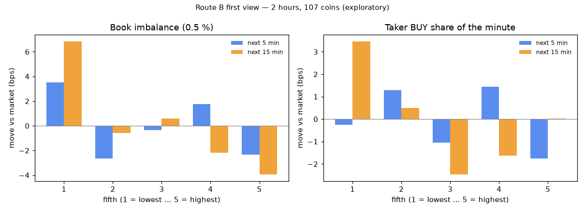

# 📡 Route B — first view of the recorded data (2026-11-20, 00:00–02:00 UTC)

**EXPLORATORY.** Two hours of one night, one market regime. Nothing here is a filter, a sleeve or a ship input — it shows what the data can answer and the first shapes worth testing properly once weeks are recorded. Raw data: s3 (private bucket); features: `scripts/route_b/features.py` (one row per coin per minute); this report: `scripts/route_b/first_view.py`.

## ① What was recorded

- **Full detail (order book every 0.5 s + every trade):** 107 coins · 9,935 coin-minutes with book data · 993,063 book snapshots · 2,288,994 trades.
- **Whole market (mark price, funding, liquidations):** 909 coins.
- **The bot's own coins at report time:** 0 open · 11 Frenzy-flagged · 29 tracked by EXHAUSTION / FLATBASE · 31 followed by the Frenzy pass. Covered in full detail: 30 of 30 open / flagged / tracked.

## ② What it costs to trade at our size (the real order book)

Cost = how far from the middle price a MARKET order of that size fills, walking the real book (one side; a round trip pays both sides + fees ≈ 0.10 %). Median over the two hours per coin.

| Group | coins | spread (bps) | $ within 0.5 % (bid / ask) | cost $2.5k buy / sell (bps) | cost $10k buy / sell (bps) |
|---|---|---|---|---|---|
| Bot coins (open / flagged / tracked) | 30 | 4.6 | $16k / $18k | 8.8 / 9.2 | 16.0 / 16.8 |
| Followed by the Frenzy pass | 13 | 2.6 | $30k / $23k | 4.8 / 5.2 | 9.2 / 9.9 |
| Other hot coins (movers / volume) | 64 | 4.2 | $15k / $16k | 8.9 / 9.0 | 14.4 / 15.2 |

**Thinnest bot coins** (where our size moves the price most):

| Coin | role | spread (bps) | $ within 0.5 % bid / ask | $10k buy / sell cost (bps) | traded $/hour |
|---|---|---|---|---|---|
| BULLAUSDT | tracked | 10.0 | $9k / $9k | 30.7 / 32.5 | $468k |
| FHEUSDT | tracked | 7.6 | $13k / $17k | 21.6 / 28.1 | $518k |
| TLMUSDT | tracked | 10.5 | $15k / $14k | 25.9 / 25.3 | $201k |
| USUSDT | tracked | 3.8 | $13k / $13k | 25.4 / 24.6 | $237k |
| STABLEUSDT | tracked | 5.2 | $22k / $17k | 25.2 / 22.5 | $112k |
| THEUSDT | flagged | 7.9 | $14k / $15k | 23.5 / 24.4 | $153k |
| PHAROSUSDT | tracked | 5.0 | $10k / $10k | 21.0 / 21.2 | $528k |
| ZKPUSDT | tracked | 4.3 | $16k / $19k | 17.7 / 21.0 | $361k |

*Why it matters:* this is the slippage our model ESTIMATES today (EXH / DIST / Flatbase sizing, the depth guard); from now on it can be checked against the real book at every entry and every stop.

## ③ Does the book or the trade flow predict the next minutes? (first look)

For every coin separately: the rank correlation between a reading at the end of a minute and the price move over the next 1 / 5 / 15 minutes, measured AGAINST THE MARKET that same minute (the night drifted down; a market-wide drift is not a signal). Then the average across coins (each coin = one vote) and how many coins agree. The control re-runs it with the future moves shuffled inside each coin (what pure luck looks like).

| Reading | horizon | coins | mean correlation | coins positive | t (across coins) | luck control mean | hour 1 / hour 2 mean |
|---|---|---|---|---|---|---|---|
| Book imbalance within 0.5 % (more bids = +) | 1 min | 91 | +0.012 | 54% | +1.1 | -0.000 | +0.026 / +0.016 |
| Book imbalance within 0.5 % (more bids = +) | 5 min | 91 | +0.014 | 55% | +0.7 | -0.015 | -0.025 / +0.053 |
| Book imbalance within 0.5 % (more bids = +) | 15 min | 90 | +0.022 | 58% | +0.8 | +0.003 | -0.013 / +0.031 |
| Taker BUY share of the minute's trades | 1 min | 91 | -0.010 | 43% | -0.9 | +0.014 | -0.031 / -0.004 |
| Taker BUY share of the minute's trades | 5 min | 91 | -0.025 | 38% | -2.3 | +0.004 | -0.025 / -0.052 |
| Taker BUY share of the minute's trades | 15 min | 90 | -0.067 | 28% | -5.0 | -0.002 | -0.089 / -0.086 |

**How big is it?** Next 5 / 15-min move vs the market, by fifth of the reading (fifths built per coin, then pooled):

| Fifth | Book imbalance: coin-minutes · 5 min · 15 min (bps) | Taker buy share: coin-minutes · 5 min · 15 min (bps) |
|---|---|---|
| 1 (most asks / most selling) | 1,537 · +3.5 · +6.8 | 1,647 · -0.3 · +3.5 |
| 2 | 1,644 · -2.7 · -0.6 | 1,619 · +1.3 · +0.5 |
| 3 | 1,687 · -0.4 · +0.6 | 1,619 · -1.0 · -2.5 |
| 4 | 1,684 · +1.8 · -2.2 | 1,624 · +1.4 · -1.6 |
| 5 (most bids / most buying) | 1,649 · -2.4 · -3.9 | 1,672 · -1.7 · +0.0 |

*Reading it:* a correlation of a few hundredths with most coins agreeing and both hours the same sign is a real but SMALL effect; compare the bps move with the ≈ 10 bps a market round trip costs before calling anything tradable. Two hours can't separate a lasting effect from tonight's tape — this is the list of things to test properly, not a finding.

## ④ Liquidations (a sample — Binance sends at most one per coin per second)

- Longs force-sold: $45.47M · shorts force-bought: $5.18M over the two hours.
- Most liquidated: ETHUSDT $9.36M (longs) · XAUUSDT $8.32M (longs) · BTCUSDT $6.89M (longs) · XAGUSDT $5.62M (longs) · NEARUSDT $2.13M (longs) · ZECUSDT $1.58M (longs)

## What this first view says

- **Recording works end to end** and covers every coin the bot holds, flags or tracks.
- **Cost at our size is now measurable from the real book** (section ②) — the first practical use (slippage model, depth guard, thin-coin sizing).
- **Book / flow → next minutes (section ③):** read the table as *direction of travel only*. The proper test needs weeks: per-coin + per-day consistency, the shuffled null, held-out days, and the cost of trading it.
- **Per-sleeve reads** (book at entry, winners vs losers) start as fills accumulate — none can be read from two hours.

## Data and caveats

- Book = top 20 levels each side; for liquid coins 20 levels may not reach 1 % (the band is then a lower bound).
- Mid-price moves vs the cross-coin average of the same minute, not tradable fills; no fees in section ③.
- The coin-level t ignores that coins move together in the same minutes — it overstates confidence; weeks + day-blocks fix that.
- One quiet night (00:00–02:00 UTC); the first 30 min of recording (23:36–24:00) are left out.
