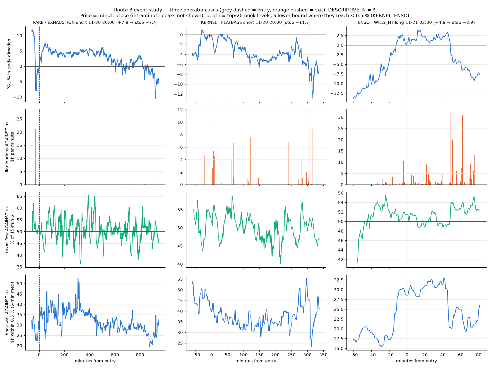

# 📡 Route B — what the recorder holds after 44 hours, and what it can do for each sleeve (2026-11-21)

**Short version.** The recorder has run almost without a break since 2026-11-19 23:23 UTC: 43.6 hours, 337 coins with the full order book and every trade, and mark price, funding and liquidations for all 912 USDT coins. Every bot fill opened since recording began has its order book recorded at entry and for the whole trade (18 of 18). **That is far too little to decide anything.** There are 15 closed fills plus 3 still open, spread over four sleeves and about 1.5 market days, in a single regime (BTC fell from 61.9k to 55.4k and came back to 60.1k). Everything below is **descriptive**. Nothing in it is a filter, an exit or a ship input. The useful outputs today are a list of questions the data *can* answer, the date each can first be read, and one data-quality gap (the 20-level book is too shallow on fine-tick coins).

Research only: no engine, config or recorder change. S3 was only read. Scripts: `scripts/ROUTE_B_REPORT_2026-11-21_load.py` (pull, cached) and `scripts/ROUTE_B_REPORT_2026-11-21.py` (per-fill tables + chart; `STEP3=1` gives the data-quality and trigger counts). Tables are in `reports/ROUTE_B_REPORT_2026-11-21_data/`.

---

## 1 · Data inventory

| Item | Value |
|---|---|
| Recording window | 2026-11-19 23:23 → 2026-11-21 18:59 UTC (the last closed hour; the recorder is live) = **43.6 h** |
| Outages | Two restarts during setup (11-19 23:32 / 23:36, ~1 s each). One restart for the DL 598 deploy (11-20 02:59, 2 s). Four websocket drops on 11-20 (14:43 ×3, 17:45), **13 s in total**. None on 11-21. Health: ✅ |
| Order book (top 20 levels every 0.5 s) + every trade | **337 coins**, 291,674 coin-minutes, 27.8 M book snapshots, 66.4 M trades (11-19: 84 coins · 11-20: 263 · 11-21: 284, ≤ 120 at any one time) |
| Mark / index / funding every 1 s + liquidations | 912 USDT coins (coin-margined contracts are excluded: their size is in contracts, not $) |
| Liquidations (a SAMPLE: Binance sends at most one per coin per second) | longs force-sold **$959 M**, shorts force-bought **$222 M** (USDT coins only). Most of it came in two BTC dumps: 11-20 15–19 h and 11-21 03–04 h |
| Hourly per-minute summaries (built on the server) | 44 of 44 hours, 0 failures, ≈ 1.2 MB each |
| Raw data on S3 | **12.0 GB** compressed: book 7.5 · mark 2.7 · trades 1.76 · liquidations 0.006 GB (≈ 6.5 GB/day; costs are as in DL 597) |
| Bot's coin list (open / flagged / tracked) | Published since 11-20 02:59 (474 lists). The last one: 3 open positions, all sleeves on/off as expected |
| Market context | BTC 61.9k → **low 55.4k** → 60.1k. **One regime**: a sharp dump and a recovery |

### Coverage of the bot's real fills

The fills come from `exports_archive/scalpars_orders_paper_2026-11-21_19-22-18.csv` plus the earlier November exports, deduplicated on (opened_at, pair, direction) and CLOSED only. Open positions come from the bot's last published list. There are no probes in this window.

| Sleeve | Fills since recording began | Book recorded at entry | Recorded through exit | Note |
|---|---|---|---|---|
| FRENZY_WILLY_HT | 8 closed (4 W · 4 L) | 8 / 8 | 8 / 8 | all on 11-20 / 11-21 |
| FRENZY_WILLY (plain) | 0 | – | – | |
| EXHAUSTION_SHORT | 3 closed (1 W · 2 L) + 3 open | 6 / 6 | 3 / 3 closed (the open ones are recorded so far) | ENSO, RARE (14:30) and ORCA are open |
| DISTRIBUTION_SHORT | 3 closed (1 W · 2 L) | 3 / 3 | 3 / 3 | |
| FLATBASE_SHORT | 1 closed (L) | 1 / 1 | 1 / 1 | **PHAROS** (opened 11-19 08:00) entered *before* recording; only its last 17 % and the stop are recorded. **MMT** closed 11-19 13:23, before recording, so it is not covered |
| **Total** | **15 closed + 3 open** | **18 / 18** | **15 / 15** | |

**Data-quality gap (important for capacity work).** A 20-level book only reaches a short way on coins with a fine price tick. The median reach of the 20 levels is **< 0.5 % on 41 % of recorded coins**, and on **20 % of coins the cost of a $10k market order cannot be computed in most minutes**. Among the fill coins:

| Coin | Reach of the 20 levels | $10k order not computable |
|---|---|---|
| EVAA | 0.05 % | 97 % of minutes |
| BLESS | 0.17 % | 84 % |
| PHAROS | 0.38 % | 84 % |
| KERNEL, ENSO | 0.44 % | – |

On those coins, "depth within 0.5 / 1 %" is a **lower bound**, and the cost at our ~$6k notional is unknown. Fixing it means recording the full order book (Binance's diff-depth stream) for at least the bot's open and flagged coins. That is a recorder change, so it is the operator's call; I have not made it.

---

## 2 · Per-sleeve first look (DESCRIPTIVE · N tiny · one regime)

How to read the tables:
- "At entry" = the last full minute before the fill, or the 5 / 15 minutes before it.
- "Against us" = the side a move against the trade would hit. For a short, that means short liquidations, taker buying and asks above the price. For a long, it is the mirror.
- Funding is shown per settlement. Negative funding means shorts pay.

### 2a · State at entry, winners and losers side by side

| Sleeve | Coin · entry (UTC) | Result % (peak) | Spread bps | $ within 0.5 % bid / ask | Imbalance | Cost to enter at our size, bps | Taker buy share 5 / 15 min | 15-min traded $ vs coin's usual | Liquidations 15 min, longs / shorts $k | Funding % | Move 15 / 60 min % |
|---|---|---|---|---|---|---|---|---|---|---|---|
| DIST | CYBER 11-20 09:00 | **W +9.9** (9.96) | 4.9 | 36k / 43k | −0.09 | 8.9 | 0.50 / 0.50 | 24× | 41 / 33 | −1.49 | +1.2 / +26.9 |
| DIST | KERNEL 11-20 12:30 | L −6.1 (2.3) | 6.5 | 15k / 20k | −0.13 | 13.6 | 0.45 / 0.49 | 14× | 15 / 31 | −1.61 | −4.9 / +3.4 |
| DIST | BLESS 11-21 09:30 | L −6.0 (0.0) | 6.9 | 7k / 7k* | −0.04 | n/a* | 0.50 / 0.48 | 48× | **352** / 95 | +0.06 | **−21.0 / −24.0** |
| EXH | KERNEL 11-20 14:15 | **W +10.0** (9.95) | 2.8 | 43k / 53k | −0.10 | 6.7 | 0.50 / 0.48 | 13× | 24 / 0 | −2.00 | −1.9 / −2.7 |
| EXH | RARE 11-20 20:00 | L −7.4 (**7.9**) | 7.3 | 27k / 24k | +0.05 | 11.1 | 0.49 / 0.52 | 8× | 2 / 0 | −1.76 | −1.0 / +13.0 |
| EXH | RARE 11-21 13:45 | L −5.0 (0.7) | 6.7 | 36k / 38k | −0.04 | 16.2 | 0.44 / 0.45 | 5× | 1 / 0 | −1.31 | −3.0 / +1.8 |
| EXH | ENSO 11-21 03:30 | open | 4.3 | 21k / 30k | −0.18 | 10.2 | 0.51 / 0.47 | 29× | 62 / 13 | −0.78 | −7.7 / −5.3 |
| EXH | RARE 11-21 14:30 | open | 6.4 | 42k / 39k | +0.04 | 10.2 | 0.47 / 0.47 | 6× | 0 / 0 | −1.04 | −1.5 / +0.3 |
| EXH | ORCA 11-21 15:15 | open | 8.1 | 52k / 41k | +0.11 | 11.6 | 0.59 / 0.52 | 4× | 12 / 0 | −0.42 | −2.1 / +3.9 |
| FB | KERNEL 11-20 20:00 | L −11.7 (0.3) | 3.0 | 42k / 37k* | +0.05 | 7.7 | 0.51 / 0.52 | 1.4× | 0 / 0 | −0.19 | −0.3 / −3.4 |
| HT | BLESS 11-20 07:10 | L −4.9 (**4.0**) | 4.6 | 9k / 9k* | −0.01 | 9.1 | 0.44 / 0.48 | 3× | 4 / 6 | +0.01 | +1.1 / +9.8 |
| HT | EVAA 11-20 07:50 | W +5.0 | 2.1 | 3k / 4k* | −0.07 | n/a* | 0.48 / 0.53 | 2.6× | 0 / 3 | +0.03 | +1.2 / −0.8 |
| HT | CYBER 11-20 08:30 | W +5.0 | 6.0 | 46k / 53k | −0.06 | 7.1 | 0.48 / 0.50 | 29× | 15 / 52 | −1.03 | +8.3 / +29.9 |
| HT | EVAA 11-20 10:25 | W +5.0 | 0.8 | 5k / 4k* | +0.07 | 2.6 | 0.50 / 0.52 | 0.6× | 1 / 0 | +0.03 | +0.5 / −0.3 |
| HT | NAORIS 11-20 10:35 | L −4.0 (2.7) | 4.3 | 23k / 24k | −0.01 | 6.8 | 0.47 / 0.53 | 11× | 0 / 7 | +0.02 | +3.1 / +2.3 |
| HT | EVAA 11-20 12:55 | W +5.0 | 1.0 | 5k / 4k* | +0.11 | n/a* | 0.51 / 0.54 | 0.8× | 0 / 0 | +0.04 | +0.8 / −0.7 |
| HT | EVAA 11-20 23:20 | L −4.1 (**3.9**) | 0.9 | 4k / 3k* | +0.14 | n/a* | 0.52 / 0.54 | 1.4× | 0 / 12 | +0.03 | +1.6 / +4.9 |
| HT | ENSO 11-21 02:30 | L −3.9 (**4.95**) | 6.0 | 28k / 29k* | −0.03 | 8.6 | 0.47 / 0.49 | 27× | 14 / 29 | −0.39 | +2.2 / +16.4 |

\* The 20 levels reach less than 0.5 %, so the depth is a lower bound. "n/a" means the $6k cost cannot be measured from 20 levels.

**What it shows (descriptive, not a finding):**
- **No entry column separates winners from losers in any sleeve.** That is what N = 2–8 per sleeve should give.
- Deeply negative funding (crowded shorts, −1.3 to −2.0 % per settlement) shows up on **both** short winners (CYBER DIST, KERNEL EXH) and short losers (KERNEL DIST, RARE ×2). This matches DL 602's KERNEL / CYBER read.
- **Cost at our size, where it can be measured, is 7–16 bps per side.** That is 0.15–0.3 % for a round trip with fees. It is not the source of these losses; the losers lost 4–12 %.
- One fill stands out. **BLESS DIST (11-21 09:30) went short after the coin had already fallen 21 % in 15 minutes**, with $352k of long liquidations in those 15 minutes, a ~$7k book within 0.5 % on each side (our $6k notional ≈ the whole band), and a 5.5 % paper entry drift. The 6 % stop was hit 7 minutes later at the top of a bounce, and the price was back at the entry ~15 minutes after that. It is one fill. It becomes a **question for the scan**: "DIST entries after a ≥ X % 15-minute fall with a long-liquidation cascade". It is not a filter.

### 2b · During the trade: the operator's cases

| Case | What the recording shows |
|---|---|
| **RARE EXH 11-20 20:00** (+7.9 → stop −7.4, held 15 h, funding paid $97) | The peak came 49 min in. After that, **a slow 14-hour drift up with almost no liquidations** (12k against us over the whole trade, against the coin's 99th-percentile 1-minute burst of 22k). Funding was deeply negative all along (−1.8 → −0.25 → −1.0 %), so the short paid hourly. The ask wall within 0.5 % thinned slowly, 35k → 25k. The stop came on one burst (11:00, $2.7 M traded in 30 min). **No liquidation-burst or flow signature ahead of the give-back.** If anything, it is a time / funding-cost problem. |
| **RARE EXH 11-21 13:45** (stop −5.0 in 27 min) | Never worked (peak +0.7). The ask side was thinner than the bid side for the whole trade (25–30k vs 38–42k, imbalance bid-heavy). Zero liquidations. A quiet drift up into the stop. |
| **KERNEL FB 11-20 20:00** (stop −11.7 incl. funding −$108) | Never worked (peak +0.3). A 5-hour grind up with small short-liquidation spikes (≤ 18k per 15 min). At the stop minute (01:06–01:07) the ask wall dropped 50k → 28k → 21k **in the same minute** as an 8.5k short-liquidation spike: simultaneous, not a warning. |
| **KERNEL DIST 11-20 12:30** (DL 602) | Already in DL 602: the squeeze came 35 min in, one leg with a short-liquidation burst, and the stop was hit inside it. |
| **ENSO WILLY_HT 11-21 02:30** (+4.95, TP missed by 0.05 % → stop −3.9) | Peak at minute 13. Then **the bid side within 0.5 % thinned 33k → 24k → 20k → 17k from 03:13 to 03:16, 3–5 minutes before the 03:19 drop**, while the price still sat around +3 %. The drop minute itself had $32k of long liquidations (above the coin's 99th percentile), 60 % taker selling and an 8 % fall in two minutes. **The only case of 3 where book thinning came *before* the move.** |
| **BLESS WILLY_HT 11-20 07:10** (+4.0 → stop −4.9 in 15 min) | Peak at minute 8. Taker buy share fell to 0.37–0.44 in the four minutes after it. Then a one-minute dump (07:23: bids 12k → 7k, spread 3.8 → 7.2 bps, $21k of long liquidations), all **in the same minute**. Paper exit slip 0.93 %. |
| **EVAA WILLY_HT 11-20 23:20** (+3.9 → stop −4.1) | Peak at minute 148. A slow fall over 2 h with no long-liquidation burst until the last leg (02:30, 24k). The book is unreadable at 0.5 % (20 levels reach only 0.05 %). |
| **MMT / PHAROS FB** | MMT is not recorded (closed before recording began). PHAROS's last 17 % is recorded: it was stopped at 02:30 on 11-20 inside a 2.6k short-liquidation spike (≈ the coin's 99th percentile, a very thin coin: ~$9k within 0.5 %). Its entry is not covered. |

The chart (`reports/ROUTE_B_REPORT_2026-11-21_chart.png`) shows RARE EXH, KERNEL FB and ENSO HT. For each it plots price in the trade's direction, liquidations against us, taker flow against us (rolling 15 min) and the book wall against us within 0.5 %, from 60 min before entry to 30 min after exit.

**Give-back exits, summarised (descriptive):**
- **Taker flow after the peak.** In all 4 HT give-backs, taker flow tilted against us after the peak (taker buy share 0.43–0.48). That cannot be judged without the false-alarm rate: HT winners exit *at* their peak (the TP), so they have no after-peak window here. The test needs shadow paths of every signal (section 3).
- **Book thinning.** It came before the move in 1 of 3 sharp stops (ENSO) and in the same minute in 2 (KERNEL, BLESS).
- **Liquidation bursts.** They come *with* the sharp stops, not before them, and are absent from the slow give-backs (RARE 11-20, EVAA).
- So **two different loss shapes**: a sharp leg (liquidations + thinning, seconds to minutes) and a slow drift (no burst at all). Only the first is something a book / tape exit could catch.

---

## 3 · What Route B can add, sleeve by sleeve

**Fill rate in this window.** Over the ~36 h with fills: HT ≈ 5 / day, EXH ≈ 4, DIST ≈ 2, FB ≈ 0.7. The short sleeves cluster on the same coins and days (KERNEL ×3 on 11-20, RARE ×3), so in window units (the locked rule) they accumulate more slowly still.

**The locked gates on fills alone** need ≥ 15 blocked fills and ≥ 8 windows. A W/L read on 30 fills of a ~60 % WR sleeve has ~12 losers, which detects only very large effects. **The realistic route is SIGNAL-level evidence:** every journal signal on a recorded coin (taken, skipped or blocked), priced on its own 1-minute path under today's exit, with book / tape state attached. That multiplies N by 3–10× and keeps the master-over-backtest rule intact. There is no backtest equivalent: book data cannot be downloaded for the past, so Route B evidence is forward-only.

| Sleeve | Open questions Route B can answer that klines could not | Already visible (N tiny, descriptive only) | Earliest valid read |
|---|---|---|---|
| **FLATBASE_SHORT** | ① **Squeeze build at entry**: ask-wall thinning, short-liquidation pressure, taker-buy share in the 4 h before the FB_CONFIRM bar · ② **real funding paid while held** (1 s mark/funding; KERNEL paid $108 hourly) against the DL 601 funding stamp · ③ **real stop cost**: a −10 % market stop on a thin coin (PHAROS ~$9k book) · ④ capacity: book $ at 0.2 / 0.5 / 1 % against the planned size | 1 recorded fill. Nothing | The fill route needs ~40 days for 30 fills (≈ early Jan). **Signal route** (every tracked FB episode on recorded coins, priced) at the **12-10 scan** |
| **EXHAUSTION_SHORT** | ① Entry: taker-flow exhaustion (buy-share collapse after the run) and liquidation state (short-squeeze still running vs finished) at the signal minute · ② **exit**: a short-liquidation burst / ask-wall-thinning exit (DL 602 queue), judged two-sided on the LIVE-stopped cohort (locked exit rule) · ③ the cost of the slow give-back (RARE 11-20: 15 h, funding −$97): a **time / funding-aware exit** is now measurable | Both stopped RARE fills drifted, with no burst. The KERNEL winner had funding −2.0 % like the losers | Fills: 30 recorded ≈ **11-29**, but the short sleeves cluster; window-count gate ≈ mid-Dec. Signal route at the **12-10 scan** |
| **DISTRIBUTION_SHORT** | ① **"Already crashed" entries**: 15-min fall + long-liquidation cascade at entry (BLESS) · ② the post-entry short-liquidation-burst exit (DL 602) · ③ real entry cost vs DL 599's fast-entry lag (book drift between the 15m close and the fill) | BLESS: −21 % in 15 min and $352k of long liquidations before entry, stopped in 7 min. CYBER (W) had a +27 % 60-min run before entry | Fills: 30 ≈ **12-06**. Signal route at the **12-10 scan** |
| **FRENZY_WILLY_HT** | ① **Give-back exit**: after-peak taker-flow reversal, bid-side thinning, long-liquidation burst; the exits klines could not test (DL 600 found HT leaks on the EXIT side) · ② entry: book depth / flow at the signal (Route A tape AUC 0.60–0.65 was on the tape only) · ③ real exit slip on −4 % stops (BLESS paper 0.93 %) | After-peak taker flow was against us on all 4 losers (no winner comparison possible). Bid thinning led the drop in 1 of 3 sharp stops | Fills: 30 recorded ≈ **11-27**. A two-sided exit test needs shadow paths of all HT/WILLY signals, so the **12-10 scan** at the earliest; the locked gates and LOO apply |
| **All sleeves: cost / capacity** | The real book cost at entry and stop for every fill, against the paper drift and the model slip (`entry_exh_model_slip_pct`, `entry_dist_model_slip_pct`); capacity per signal (CLAUDE.md capacity rule) | 7–16 bps per side where measurable. **Not measurable on EVAA / BLESS / PHAROS-type fine-tick coins** (20-level limit) | Usable now for coins with reach; the fine-tick coins need the deeper-book decision (section 1) |

**Pre-register before the data arrives.** These are exactly the variables a fishing trip would find: dozens of book / tape columns × 4 sleeves × 2 sides. So the hypotheses and directions above should be frozen in a PREREG file *before* the 12-10 scan. DESIGN = the first ~2 weeks and HOLDOUT = the rest, with a shuffled-time null, a window-clustered bootstrap, and per-pair and per-window concentration checks.

---

## 4 · New-sleeve ideas the data can test (counts only, no outcomes looked at)

I counted how often each candidate trigger fires. Counting rules: alts only (BTC / ETH excluded), coins with the book recorded, **one possibility per coin per 60 min** (24 h for funding), and distinct 15-min windows next to it. **I deliberately did not compute the forward moves.** With 1.8 days and one BTC dump-and-recover, any return would be a story rather than evidence (operator rule: no performance claims from a few days).

| # | Hypothesis | Trigger as counted | Possibilities / day | 15-min windows / day | The test it needs | Earliest read |
|---|---|---|---|---|---|---|
| H1 | **Long-liquidation cascade bounce** (alt longs flushed, then a bounce) | 5-min long liquidations ≥ the coin's 99th percentile and ≥ $50k | 37 | 12 | Long at the next minute's ask, fixed TP/SL grid frozen on DESIGN, cost from the recorded book; random-minute same-coin control; **clustered by market moment** (cascades come in BTC dumps: count DAYS / dump episodes, not events) | 12-10 scan, but it needs several separate dump episodes; realistically 4–6 weeks |
| H2 | **Short-squeeze fade** (shorts flushed, then a fade); doubles as an EXH / DIST timing filter | 5-min short liquidations ≥ the coin's 99th percentile and ≥ $50k | 14 | 8 | Same as H1, short side; also checked against EXH / DIST signals on the same coins | 12-10 (as an EXH / DIST timing question), 4–6 weeks as a sleeve |
| H3 | **Thin-book imbalance breakout** | 0.5 % imbalance ≥ +0.5 (or ≤ −0.5) for 3 minutes, book < $40k | 35 + 34 | 29 + 29 | Follow the heavy side, 5–15 min. **Low prior**: the 11-20 first view found the imbalance → next-minutes correlation ≈ +0.01 (no effect) | 12-10 |
| H4 | **Book vacuum** (one side < 35 % of its usual depth) | ask- or bid-side 0.5 % depth < 0.35 × the coin median | 73 (ask) / 96 (bid) | 47 / 53 | Does price move toward the vacuum? Also tested as an **exit warning** for open positions (ENSO case) | 12-10 |
| H5 | **Taker-climax fade** | 15-min traded $ ≥ 5× usual and ≥ 60 % one-sided | 82 (buy) / 162 (sell) | 49 / 58 | Fade the climax. The 11-20 first view: taker-buy share → 15-min underperformance (ρ −0.027, 10 / 10 hours), but only ~2 bps against 10–30 bps cost; the climax subset is the only place it could clear cost | 12-10 |
| H6 | **Funding extremes** | funding ≤ −0.5 % per settlement (crowded shorts) · ≥ +0.1 % (crowded longs) | 17 · 36 (one per coin per day) | 14 · 20 | Squeeze-long / crowded-long fade, *net of the funding received or paid* (1 s funding recorded); also as an avoid-filter for the short sleeves (section 2a shows it on both W and L) | 12-10, in DAY units |

All of these go to the 12-10 scan as pre-registered lines. Any survivor faces the locked promotion gates, theory first, the in-sample haircut and the capacity read, then operator OK. A live trigger is phase 3 (DL 597).

---

## 5 · The weekly research scan

- **Status:** **not set up yet.** The scheduled tasks are the 09:09 daily Route B report and the 4-hourly opportunity scout; there is no weekly-scan task. The daily report's countdown targets **≈ 2026-12-10** (day 21 since 11-19), which matches DL 597 and memory ("set up the WEEKLY research scan at ~3 weeks of data").
- **To prepare before 12-10** (none of it done here; it needs the operator's OK):
  1. **A PREREG file** freezing the sleeve questions in section 3 and H1–H6: variables, directions, horizons, DESIGN / HOLDOUT split, null and gates. Ideally by ~11-28, before anyone looks at outcomes.
  2. **A signal-level dataset**: the decision-journal signals (taken, skipped, blocked) on recorded coins, joined to the per-minute summaries, each priced on its 1-minute path under today's exit. This report's two scripts are the starting loader for fills.
  3. **A decision on the deeper book** for the bot's open and flagged coins (diff-depth). Without it, capacity and stop-cost reads on fine-tick coins (EVAA, BLESS, PHAROS) stay blind.
  4. **A regime caveat in every read**: the recording so far is one BTC dump-and-recover. The scan should report per BTC daily-trend sign (locked live-mode lesson) and say so if only one sign has been seen.
  5. **Create the scheduled weekly task** (e.g. Wednesdays from 12-10), running the pre-registered scan and writing one organised report.

## Blind spots

- **N = 15 closed fills** across 4 sleeves; per sleeve ≤ 8. Every observation above is anecdotal.
- **One regime**: 1.8 days, one BTC −11 % / +9 % swing.
- **20-level book depth** is a lower bound on fine-tick coins.
- **Liquidations are a 1-per-second sample.**
- **Paper fills**: the entry/exit "slippage" in the export is price drift in the paper model, not a real book walk.
- **MMT is not covered** and **PHAROS is only partly covered**.
- **The three open EXH positions have no result yet.**
- **The per-minute summaries have no sub-minute order**: "before vs same minute" is at 1-minute resolution; the raw 0.5 s files on S3 can refine it.
