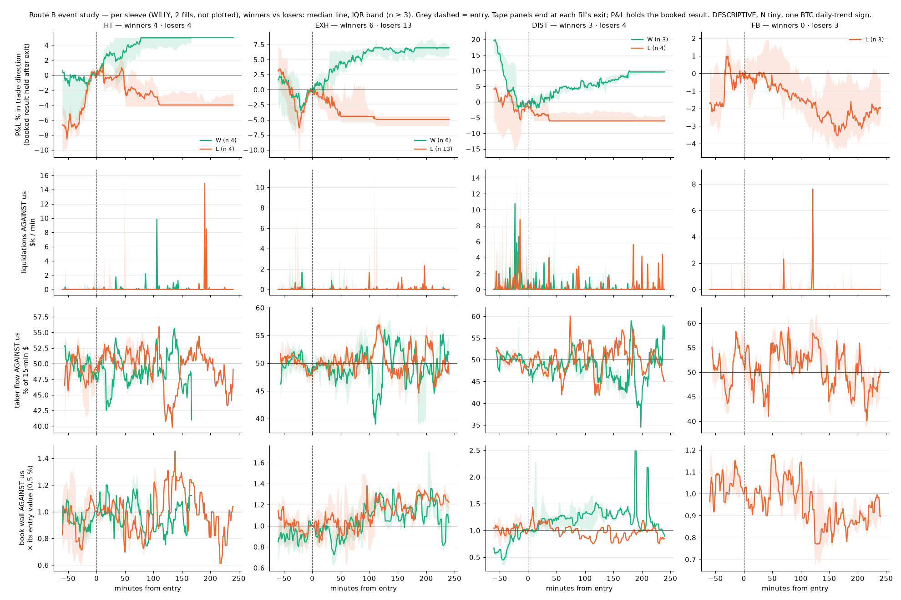

# 📡 Route B — what the recorder holds after 8 days, and what it can do for each sleeve (2026-11-28)

**Short version.** The recorder has run with no real break since 2026-11-19 23:23 UTC: **194.6 hours**, 434 coins with the order book and every trade, and mark price, funding and liquidations for all 914 USDT coins. The full order book on the bot's own coins (71 coins so far) and open interest / crowd positioning (386 coins) have run since 11-21 22:02. **The bot traded again after the 47-hour dry spell:** **40 closed fills** across five sleeves (was 18) and 3 open. Every fill opened since recording began has its book recorded at entry (39 of 39; the 40th opened before recording began). For the first time **many fills have the full book at entry (18 of 40) and open interest (23 of 40) during the trade**. That is still far too little to decide anything: ≤ 19 fills per sleeve, all in one BTC daily-trend sign. Everything below is **descriptive**. Nothing in it is a filter, an exit or a ship input.

**The two things that stand out (descriptive, N tiny):**
- **Flatbase: all 4 closed fills stopped** (avg −10.5 %, −$2,034). Their best move our way was small (median +2.7 %, max +4.9 %) before the price ground up to the stop over 5–18 hours, and taker flow ran against us after the peak on all 4. This matches the batch review (Flatbase is the open problem, next-review priority ①).
- **Most EXH losers never got going:** median best move +0.8 % (7 of 13 peaked in the first minute; the range runs to +9.3 %), median hold 41 min; the winners' median best move was +8.5 %. For most losers this is the "entry never worked" shape, not a give-back.

Research only: no engine or config change; the one recorder change (full-book cap 30 → 40, DL 658) came after this data's cut-off. S3 was only read. Built with `scripts/ROUTE_B_REPORT_2026-11-28_load.py` + `scripts/ROUTE_B_REPORT_2026-11-28.py` (local research scripts) and the local, uncommitted `reports/ROUTE_B_REPORT_2026-11-28_data/`. **Format (operator 11-23): summaries only — per sleeve, never per trade; coverage rows carry the 11-20 colour marks.** Previous edition: [ROUTE_B_REPORT_2026-11-23.md](ROUTE_B_REPORT_2026-11-23.md).

### What changed since the 11-23 edition

| Item | 11-23 edition | Now (2026-11-28) |
|---|---|---|
| Data | 86.6 h, to 11-23 13:59 UTC | **194.6 h**, to 11-28 01:59 UTC (the last complete hourly summary). No gap second on any stream since 11-21 |
| Bot fills | 18 closed, 0 open; no entry since 11-21 15:15 | **40 closed + 3 open** (24 new since 11-23 14:00). The dry spell ended 11-23 14:35 |
| Sleeves with fills | HT · EXH · DIST · FB | + **plain FRENZY_WILLY** (2 fills, 11-23 and 11-26) |
| Full book / OI at entry | 0 of 18 | **Full book at entry 18 of 40 · OI during the trade 23 of 40** |
| Rules the new fills ran | – | EXH: TP 7 (DL 609) · BEAR80 + EARLY_SPIKE blocks armed 11-27 (DL 650). DIST: crash-funding block armed 11-27 (DL 651). FB: net take profit armed 11-27 (DL 653). HT: no new fill (DL 655 audit: all 20 setups refused by armed blockers) |
| Related research since | – | DL 637: no "don't sell at the TP" signal in Route B order flow · DL 640: the **interim new-sleeve look** (below, §4) · DL 641: the H4 ask-vacuum study + two lines frozen for HOLDOUT |
| Weekly scan | pre-registered, task not created | **Task created 11-28** (Thursdays 07:11 local, first real run 12-10). **The scan runner itself is not built yet** — being built next (§5) |
| Market | BTC → 63.8k on 11-23 | BTC **64.5k** high on 11-23, then 57.4k (11-25), **60.2k** now. Daily EMA50 still below EMA200 — **one daily-trend sign for every fill** |

---

## 1 · Data inventory

| Item | Value |
|---|---|
| Recording window | 2026-11-19 23:23 → 2026-11-28 01:59 UTC = **194.6 h** (8.1 days; the recorder is live) |
| Outages | 3 restarts (setup 11-19, DL 598 deploy 11-20, DL 611 deploy 11-21 22:01, 2–3.5 s each) and 4 websocket drops on 11-20 (**13 s in total**). **None since 11-21 22:01.** Health now: ✅ HEALTHY (02:40 UTC: 0 gap seconds today on every stream, 0 failed uploads, 29.6 GB disk free) |
| Order book (top 20 levels every 0.5 s) + every trade | **434 coins**, 1.20 M coin-minutes, 113.3 M book snapshots, 271.5 M trades. Coins with a book per day: 263 / 289 / 172 / 238 / 166 / 241 / 187 / 233 (11-20 → 11-27), ≤ 120 at once |
| **Full order book** (DL 611) | **71 coins** (≤ 30 at once), 262,402 coin-minutes. The 30-coin cap left **3–5 wanted coins out** on 11-27 / 11-28 (the bot wanted 33–35) |
| **Open interest / positioning** (DL 611) | **386 coins** each, 867,735 coin-minutes of OI · coverage 97.5–98.5 % a day, no 429 / 418 |
| Mark / index / funding every 1 s + liquidations | 914 USDT coins (coin-margined contracts excluded) |
| Liquidations (a SAMPLE: ≤ 1 per coin per second), USDT coins | longs force-sold **$1,523 M**, shorts force-bought **$720 M**. By day (longs / shorts, $M): 11-20 689 / 58 · 11-21 264 / 165 · 11-22 31 / 66 · 11-23 105 / 172 · 11-24 112 / 38 · 11-25 167 / 87 · 11-26 33 / 50 · 11-27 114 / 82 |
| Hourly per-minute summaries | **195 of 195 hours**, 0 failures |
| Raw data on S3 (health check, 11-28 02:40) | **52.2 GB** (full book 1.16 · 30-s snapshots 1.28 · OI 0.01 GB) ≈ $1.20 / month |
| Bot's coin list | **2,262 lists** published. The last in this data (11-28 01:57): 3 open, 17 flagged, 35 tracked, paper |
| Market context | BTC 61.9k → **55.4k** (11-21) → **64.5k** (11-23) → 57.4k (11-25) → 60.2k. Daily EMA50 < EMA200 throughout: **one daily-trend sign for every fill** |

### Coverage of the bot's real fills

Fills: every November export in `exports_archive/` plus the newest dashboard export (`scalpars_orders_paper_2026-11-27_16-16-13.csv`), deduplicated on (opened_at, pair, direction), CLOSED only, no probes; open positions from the bot's last published list.

Colour marks (data quality only — never a finding): 🟢 ≥ 90 % of the sleeve's fills with the book recorded at entry · 🟡 50–90 % or the recorder degraded · 🔴 < 50 % or down · ⚪ no fills.

| | Sleeve | Closed fills (W · L) | Book at entry | Recorded through exit | Full book at entry | OI during the trade | Note |
|---|---|---|---|---|---|---|---|
| 🟢 | EXHAUSTION_SHORT | 19 (6 · 13) + 2 open | 19 / 19 | 19 / 19 | 13 / 19 | 15 / 19 | 13 of the 19 ran TP 7; BEAR80 / EARLY blocks armed only 11-27 |
| 🟢 | DISTRIBUTION_SHORT | 7 (3 · 4) | 7 / 7 | 7 / 7 | 3 / 7 | 4 / 7 | crash-funding block armed only 11-27 |
| 🟡 | FLATBASE_SHORT | 4 (0 · 4) + 1 open | 3 / 4 | 3 / 4 | 2 / 4 | 2 / 4 | one fill opened before recording began (11-19 08:00, only its last 17 % recorded) |
| 🟢 | FRENZY_WILLY_HT | 8 (4 · 4) | 8 / 8 | 8 / 8 | 0 / 8 | 0 / 8 | all on 11-20 / 11-21 under the old TP +5; **no HT fill since** (DL 655) |
| 🟢 | FRENZY_WILLY (plain) | 2 (2 · 0) | 2 / 2 | 2 / 2 | 0 / 2 | 2 / 2 | |
| 🟢 | **Total** | **40 closed + 3 open** | **39 / 40** | **39 / 40** | **18 / 40** | **23 / 40** | |
| 🟢 | Hourly summaries | 195 of 195 hours | | | | | 0 failures |

**Data-quality gap (unchanged in kind, bigger sample).** Across all 434 recorded coins, the 20-level book reaches **< 0.5 % on 43 %**, and on **21 %** a $10k market order cannot be costed in most minutes. On the 71 full-book coins the full book reaches past 0.5 % on **every** coin and the $10k cost is computable in **100 %** of minutes. On the fill coins (medians since 11-21 22:02, **not at those fills' entries**):

| Coin group (fill coins) | Reach of the 20 levels | $10k order not computable (20 levels) | Full book: $ within 0.5 % (bid / ask) | Full book: $6k order, bps (buy / sell) |
|---|---|---|---|---|
| Fine-tick, 20 levels badly short: EVAA · BLESS · MORPHO · ACE · PHAROS | 0.08–0.33 % | 60–95 % | $11–66k / $11–66k | 7–18 |
| 20 levels partly short: INIT · CFG · PROM | 0.22–0.40 % | 14–33 % | $17–47k | 6–15 |
| 20 levels adequate: the other 15 fill coins | 0.34–1.83 % | ≤ 5 % | $11–61k | 6–20 |
| **Thin at our size** (full book): NAORIS · ON · PHAROS · SLX | – | – | $10–20k | **15–20** |

---

## 2 · Per-sleeve first look (DESCRIPTIVE · N tiny · one regime)

How to read the tables (every cell is a sleeve aggregate):
- "At entry" = the last full minute before the fill, or the 5 / 15 minutes before it.
- "Against us" = the side a move against the trade hits. Short: short liquidations, taker buying, asks above. Long (HT, WILLY): the mirror.
- Funding is per settlement; negative = shorts pay. Result % = the export's P&L % on notional, funding included.

### 2a · State at entry, winners and losers side by side

Each cell = the **median** of the winners / the losers of that sleeve.

| Sleeve | Fills (W · L) | Avg result % | Spread bps | $ within 0.5 % against us | Against-us depth vs the coin's usual | Cost to enter, bps | Taker share against us, 15 min | 15-min traded $ vs usual | Liquidations against us, 15 min $ | Funding % | Move 15 min % |
|---|---|---|---|---|---|---|---|---|---|---|---|
| EXH | 19 (6 · 13) | −1.93 | 3.6 / 5.4 | 31k / 29k | 0.95 / 1.08 | 9.6 / 10.4 | 0.49 / 0.48 | 41× / 12× | 0.2k / 1.6k | −0.40 / −0.44 | −1.9 / −4.0 |
| DIST | 7 (3 · 4) | +0.66 | 4.9 / 6.7 | 20k / 18k | 1.12 / 0.97 | 12.5 / 13.6 | 0.48 / 0.48 | 83× / 25× | 19.8k / 34.0k | −0.41 / −0.15 | −1.3 / −4.4 |
| FB | 4 (0 · 4) ¹ | −10.48 | – / 3.0 | – / 37k | – / 1.04 | – / 7.7 | – / 0.52 | – / 2× | – / 0 | – / −0.19 | – / −0.4 |
| HT | 8 (4 · 4) | +0.38 | 1.5 / 4.4 | 4.9k* / 16.3k | 1.06 / 1.14 | 4.8 / 8.6 | 0.47 / 0.49 | 2× / 16× | 0.8k / 2.0k | +0.03 / +0.01 | +0.8 / +1.4 |
| WILLY | 2 (2 · 0) | +0.72 | 3.8 / – | 9.4k* / – | 0.52 / – | 8.8 / – | 0.50 / – | 24× / – | 0.1k / – | −0.20 / – | +0.8 / – |

¹ Entry state from the 3 fills recorded at entry. \* The 20 levels reach < 0.5 % on most of these fills, so the depth is a lower bound. "Usual" = the coin's median over the whole recording (it moves as the window grows).

**What it shows (descriptive, not a finding):**
- **No entry column cleanly separates winners from losers** in any sleeve — expected at 2–13 fills per side.
- **EXH: winners came in on heavier traffic** (41× the coin's usual 15-min $ vs 12× for losers) **and fewer short liquidations against us** (0.2k vs 1.6k). With 6 winners this is an anecdote; it is exactly the kind of line the pre-registered scan tests on signals (S1-a short-liquidation pressure is one of its frozen EXH lines).
- **DIST losers entered after a bigger 15-min drop** (−4.4 % vs −1.3 %) — the "already crashed" question the scan holds as HOLDOUT-only line S2-a (low prior: DL 612's after-crash study went the other way on history).
- **Crowded shorts (negative funding) sit on both sides** in EXH and DIST, as in the 11-23 edition (DL 602 / 627: not a separator).
- **Cost at our size is 5–14 bps per side** (0.1–0.3 % round trip with fees). Losers lost 3–12 %: cost is not the source of the losses.
- **Flatbase: the four losers entered into quiet books** (15-min traffic 2× usual, no liquidations, flat price) — nothing in the tape at entry marks them. Its losses are a direction problem, not a cost problem.

### 2b · During the trade (summary)

Counts per sleeve, winners / losers. "Against us after the peak" = 15 min of taker flow tilted to the side that hurts the trade.

| Sleeve | Best move our way (median W / L) | Worst move against (median W / L) | Minutes to the best move (W / L) | Taker flow against us after the peak | Liquidation burst > the coin's p99 against us | Funding paid while held | OI change over the trade (median W / L) |
|---|---|---|---|---|---|---|---|
| EXH | +8.5 / +0.8 % | −1.4 / −5.8 % | 141 / 1 | W 2 of 2 · L 10 of 13 | W 1 of 6 · L 2 of 13 | 7 of 19 paid > $20; max $307 | −0.2 / +1.6 % (15 fills: 4 W · 11 L) |
| DIST | +10.9 / +1.8 % | −3.0 / −7.0 % | 178 / 2 | W – (0 measurable) · L 2 of 4 | W 2 of 3 · L 0 of 4 | 1 of 7 > $20 | −5.1 / +16.7 % (4 fills) |
| FB | – / +2.7 % | – / −10.1 % | – / 174 | L 4 of 4 | L 0 of 4 | median $60, max $117 | −12.9 / +5.8 % (2 fills) |
| HT | +5.1 / +3.9 % | −2.2 / −4.6 % | 54 / 31 | W – (0 measurable) · L 4 of 4 | W 0 of 4 · L 1 of 4 | ≈ 0 | – (pre-DL 611) |
| WILLY | +1.2 / – % | −1.0 / – % | 1 / – | W 0 of 1 | W 0 of 2 | 0 | +0.8 % |

"x of n" counts only fills with a measurable after-peak window: a take-profit exit ends AT the peak, so most winners have none (EXH 2 of 6 measurable, DIST / HT 0) — the winner-vs-loser contrast in that column is mostly this selection, not a signal. Best / worst move and minutes to the best move use minute bars from the fill's minute on, so a peak "at minute 0–1" can include seconds just before the fill.

The chart is the **aggregate** event study (median line, IQR band where n ≥ 3), anchored at the entry minute; after a fill's exit its booked result is held in the P&L panel (outcomes, not survivors) and the tape panels stop (they show our trades only). WILLY (2 fills) is not plotted.

**What it shows (descriptive):**
- **Many EXH and DIST losers never worked**: 7 of 13 EXH losers and 2 of 4 DIST losers peaked in the first minute, with a median best move under 2 %; others went our way first (best +9.3 % EXH, +7.9 % DIST) and gave it back. The winners peaked after 18–406 min (median 141 EXH, 178 DIST) at +6–11 %. More of the loss sits on the **entry** side, which is where the batch review already points (CLAUDE.md entry × exit rule: study the larger realised side first).
- **Open interest rose during EXH / DIST losers and mostly fell during winners** (EXH median +1.6 vs −0.2 % on 11 L · 4 W; DIST +31.2 / +2.3 vs −5.0 / −5.3 on 2 L · 2 W). New shorts piling in while the price rises against us is the squeeze story; it is visible here for the first time because OI only exists since 11-21. It is measured **during** the trade, so it is not an entry filter as it stands — the scan's S1-b line (OI and price both up at the signal) is its pre-registered entry form (HOLDOUT-only).
- **Taker flow against us after the peak** marks 10 of 13 EXH losers, 4 of 4 HT losers and 4 of 4 FB losers — but winners rarely have a measurable window (see the note above), and the 2 EXH winners that do were also against. DL 626 / 637 found no order-flow exit that beats today's exits on shadow paths; this is more data for their re-read, not a new rule.
- **Flatbase drifts, it does not squeeze**: no liquidation burst on any of the 4; OI mixed (−12.9 / +5.8 % on 2); the price grinds up over 5–18 h (median hold ≈ 16 h) to the −10 % stop while the short pays funding. Only a slow-drift exit or a better entry could change that — DL 652 / 656 already tested the exits on history and found nothing.

---

## 3 · What Route B can add, sleeve by sleeve

**Fill rate in this window** (8.1 days): EXH ≈ 2.6 / day · DIST ≈ 0.9 · FB ≈ 0.6 · HT ≈ 1.0 (all on day 1–2) · WILLY ≈ 0.25. The short sleeves still cluster on the same coins and days (BIGTIME, MANTRA, INIT, ME, PORTAL, RARE and KERNEL carry 3 fills each), so in window units (the locked rule) they accumulate more slowly.

The realistic route is still **signal-level** evidence (DL 612 loader: every journal signal on a recorded coin, taken or blocked, priced under today's exit and today's filters) — multiplying N by 3–10× with no look-ahead. Book data cannot be downloaded for the past, so Route B evidence is forward-only.

| Sleeve | Open questions Route B can answer that klines could not | Already visible (N tiny, descriptive only) | Earliest valid read |
|---|---|---|---|
| **FLATBASE_SHORT** | ① squeeze build before the entry (ask thinning, short liquidations, OI, long/short ratios in the 4 h before the confirm bar — scan lines S3-a / S3-b) · ② real funding paid · ③ real cost of a −10 % market stop on the full book · ④ capacity | **4 of 4 stopped; quiet books at entry; slow drift, no burst; funding $60 median** | Fills ~0.6 / day → 30 by ~mid-Jan. Signal route: **12-10 scan** (DESIGN), verdict on HOLDOUT |
| **EXHAUSTION_SHORT** | ① entry: liquidation pressure, OI direction, traffic at the signal (S1-a / S1-b / S1-c) · ② the DL 626 capitulation exit re-read · ③ the no-spot cohort split (S5) | 19 fills, 6 W. Losers never worked (best +0.8 %); OI rose during losers; winners had heavier traffic and fewer short liquidations at entry | Fills: 30 at ~2.6 / day ≈ **12-02**; window gate later. **12-10 scan** |
| **DISTRIBUTION_SHORT** | ① "already crashed" entries (S2-a) · ② thin asks (S2-b) · ③ crowded shorts × crowded accounts (S2-c) | 7 fills, 3 W. Losers entered after bigger 15-min drops; OI +17 % during losers | Fills: 30 ≈ late Dec. **12-10 scan** |
| **FRENZY_WILLY_HT** | ① give-back exit on book / tape · ② entry depth (S4-a) and buy share (S4-b) · ③ real stop slip · ④ price what the armed blockers refuse | 8 fills (old TP +5), none since 11-21 — the armed blockers refused all 20 setups (DL 655) | Fills under TP +6: **0**. Shadow paths at the 12-10 scan |
| **FRENZY_WILLY** | entry depth / flow (the loader cannot price its V2b exit — UNTESTABLE in the scan) | 2 fills, both winners | – |
| **All sleeves: cost / capacity** | the real book cost at entry and stop vs the paper drift and model slip; capacity per signal | 5–14 bps per side; full-book $6k cost 6–20 bps on the fill coins; four fill coins thin at our size (15–20 bps) | Usable now on the priority coins |

---

## 4 · New-sleeve ideas the data can test

**Counts** (alts only, coins with the book recorded, one possibility per coin per 60 min — 24 h for funding; rates per day over 8.11 days, the OI rows over 6.16 days):

| # | Hypothesis | Possibilities / day (11-23 → now) | 15-min windows / day | Prior |
|---|---|---|---|---|
| H1 | Long-liquidation cascade bounce (LONG) | 24 → **17.6** | 10.5 | low (history REFUTED) |
| H2 | Short-squeeze fade (SHORT) | 16 → **13.7** | 9.5 | low (history REFUTED) |
| H3 | Thin-book imbalance, follow the heavy side | 35 + 31 → **31.2 + 31.9** | 26 + 27 | low; HOLDOUT-only |
| H4 | Book vacuum: ask side (LONG) / bid side (SHORT) | 64 / 81 → **77.1 / 78.7** | 48 / 48 | new (needs the book) |
| H5 | Taker-climax fade: buy / sell | 97 / 159 → **101.6 / 173.2** | 57 / 71 | low; HOLDOUT-only |
| H6 | Funding extremes: ≤ −0.5 % (LONG) · ≥ +0.1 % (SHORT) | 11 · 37 → **10.1 · 31.4** | 9 · 20 | low; only ~6 / day have a book |
| H7 | OI flush down (LONG) · flush up (SHORT) · build up (SHORT) | 4.8 · 2.4 · 4.2 → **11.0 · 3.7 · 7.3** | 10.6 · 3.7 · 6.8 | new (needs the recorder's OI) |

**The one look at outcomes so far** (operator-ordered INTERIM, 11-24, 4.7 days, DL 640 — labelled **not a verdict**, everything to its cut-off counts as seen):

| | Idea | What it showed (vs random entries on the same coin, after cost) |
|---|---|---|
| 🔴 | H5 taker-climax fade (both sides) · H3 imbalance | lose −0.08 … −0.66 % per trade; no better than random |
| 🔴 | H4 bid vacuum · H2 squeeze fade | nothing |
| 🟡 | **H4 ask vacuum (LONG, ~77 / day)** | beat random by +1.0 pt per trade, but only +0.17 % on its own (Kelly < 0); 65 % from one coin and 11-21 = 279 % of its net → fails concentration. The DL 641 study found no winners-vs-losers separator; it behaves like a long-alts-when-BTC-rises trade. **Two lines frozen for HOLDOUT (≥ 12-07):** H4-T (ask depth ≥ $12k, TP 5 / stop 3 / 24 h) and H4-B (the same, split by BTC's 4 h direction, in day units) |
| ⚪ | H1 · H6 · H7 · all depth-conditioned variants | too few to read |

So on 4.7 days, **no new sleeve has an edge**; one idea (H4 ask vacuum) is worth watching on fresh data. Every idea goes to the 12-10 scan as a pre-registered line; any survivor still faces the locked promotion gates, theory first, the in-sample haircut, capacity, then operator OK.

---

## 5 · The weekly research scan

| | Item | Status |
|---|---|---|
| 🟢 | Pre-registration | frozen 11-23 + Addenda 1–9 (`reports/ROUTE_B_WEEKLY_SCAN_PREREG.md`) |
| 🟢 | Signal / trigger datasets (DL 612 loader, DL 611 columns, today's filters DL 635) | built; refreshed daily by the Route B daily task |
| 🟢 | Scheduled task | **created 11-28** (operator OK): Thursdays 07:11 local (≈ 10:11 UTC). It does nothing before 12-10; from 12-10 it refreshes the data, runs the scan and writes `reports/ROUTE_B_WEEKLY_SCAN_<date>.md`. It never changes the bot and never commits |
| 🔴 | **Scan runner** (the program that runs the 12-10 DESIGN screen once, writes SURVIVORS.json, then reads each HOLDOUT verdict once) | **not built** — being built next (operator 11-28), with tests and both reviews, committed only on "commit" |
| 🟢 | Full-book cap | the 30-coin cap left 3–5 wanted coins out on 11-27 / 11-28 → **raised 30 → 40 on 11-28 02:47 UTC** (DL 658, operator OK; ≈ 3 s restart gap; all 35 wanted coins now in the set) |
| ⚪ | Regime | every row so far in one BTC daily-trend sign — any pass is capped at OBSERVE ("one regime", §6 B4) until the other sign is seen |

**Timeline:** DESIGN window closes 12-07 00:00 → first scan 12-10 (DESIGN screen once + HOLDOUT starts) → HOLDOUT verdicts as each line reaches its N (Q1 / Q2: ≥ 15 a side on ≥ 8 days; Q3: ≥ 30 on ≥ 10 days) — realistically late December for the busiest triggers, months for Flatbase.

## Blind spots

- **N = 40 closed fills** across 5 sleeves; per sleeve ≤ 19, winners ≤ 6. Every observation above is anecdotal.
- **One BTC daily-trend sign** (EMA50 < EMA200) for the whole window.
- **Mixed rule eras.** HT fills ran TP +5 (today +6); EXH fills before 11-21 ~21:00 ran TP 10 (today 7); the EXH / DIST blocks of 11-27 (DL 650 / 651) and the Flatbase net TP (DL 653) cover almost none of these fills. Results are as booked.
- **The full book covered ≤ 30 priority coins in this window** (3–5 wanted coins left out on 11-27 / 11-28; cap 40 from 11-28 02:47, after this data's cut-off); everything else, and every minute before 11-21 22:02, has only the 20-level book (a lower bound on fine-tick coins).
- **Liquidations are a 1-per-second sample.**
- **Paper fills:** the export's "slippage" is the paper model's drift, not a real book walk.
- **One Flatbase fill opened before recording began** (its entry is not recorded).
- **During-trade OI / taker-flow differences are measured after entry** — they describe what happened, they are not entry filters.
- **The per-minute summaries have no sub-minute order**; the raw 0.5 s / 1 s files on S3 can refine "before vs same minute".
- **Trigger counts and "usual" baselines move with the window.**
