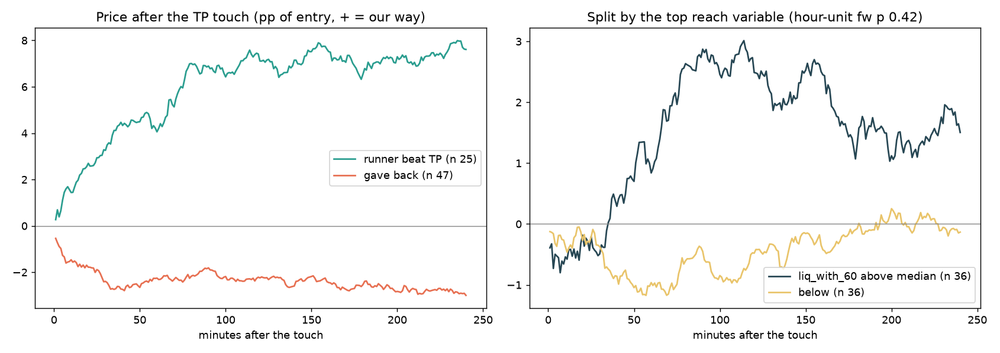

# TP touch × Route B order flow — is there a "don't sell, trail" signal? (2026-11-24, research only)

**Question (operator):** at the TP touch, does Route B (order book, trade tape, liquidations, premium, open interest, positioning) show
"no buyers, sellers in control" so the trade should keep running instead of taking the TP?
**Prior-study check:** TP_HOLD 11-24 (kline taker share / OI / top-trader at the touch) → none · DL 626 (Route B at the PEAK, sell signal) → none.
New here: Route B order flow at the TP touch as a CONTINUATION signal.

**Method:** scripts/TP_RUNNER_ROUTEB_2026-11-24.py (every number below is in reports/TP_RUNNER_ROUTEB_2026-11-24_results.txt). Every Route B
signal (taken or blocked) whose today's-exit walk reached the TP, 11-20 → 11-23: 88 touches → **72 after one per coin per 60 min** (EXH 39 ·
DIST 26 · HT 7; 9 taken; 4 days; **46 hours**). Outcomes: ① the TP_RUNNER rule (the committed DL 636 scout walk: 4 × 15m ATR trail, HT floor +5,
EXH / DIST own stop, 24 h, funding) Δ vs the TP · ② REACH = best further move in 4 h (rule-free). 30 variables from the minutes BEFORE the touch,
signed + = our way (premium = side × (mark ÷ index − 1); coverage 72 / 72, OI / positioning 29 / 72;
an unrecorded coin = unknown, not "no liquidations"). **The test runs on HOUR units** (one row per touch hour — the window-units rule: touches in
the same hour share the market), median split per variable × outcome × block (all · EXH · DIST), **one family-wise null across all 172 tests**
(2,000 shuffles). Trade-level splits, exhaustive 2D quadrants (1,458 cells, N ≥ 8, rows scored on both), and follow-ups per day / sleeve / coin.

## Result
| test | strongest | high vs low half | luck test | read |
|---|---|---|---|---|
| runner Δ, 1D (hour units) | DIST · taker B/S ratio (12 hours) | +8.5 vs −11.4 | fw p 0.998 | nothing |
| reach 4 h, 1D (hour units) | EXH · liquidations with us, 60 min | +7.6 vs +2.5 pp | fw p 0.42 (bar t 3.55) | luck |
| reach 4 h, 1D | DIST · price speed 15 min | +17.6 vs +2.2 | fw p 0.68 | luck |
| runner Δ, 2D (trade level) | heavy selling WITH us (5 min) × shorts being liquidated (15 min) | **−8.95 vs +0.51 (N 12)** | t 4.75 vs null 4.66 | at the edge — and it says DON'T run |
| reach, 2D | — | | t 4.51 < 4.69 | luck |

**The liquidation read (first pass p 0.026, withdrawn):** the first version tested trades as independent and each block on its own; on hour
units with one family it is luck. What is real in the data: before a liquidation burst with us (5 min), price goes further both ways in raw pp
(reach median 4.4 vs 2.6, adverse 6.0 vs 3.6; ATR 3.9 vs 2.9 %); per unit of ATR a mild tilt our way (reach − adverse median +0.29 vs −0.93) —
but the runner books no more there (Δ −1.35 vs −0.78, day-block CI of the gap −2.65 … +2.58; better in DIST +3.6, worse in EXH −4.1), and a
second resting target +2 / 3 / 5 / 8 % past the TP loses in the burst half on all four (−0.7 … −1.6 pp) while the quiet half gains a little.
Reach is tail-heavy (AKE + IDOL + BLESS = 61 % of the burst half's reach).

**Against the intuition:** the one cell at the edge of the 2D null is "sellers dominate the tape + shorts are being liquidated" → the runner
does much worse (12 touches, trade level, not hour units). The "no buyers at all" moment looks like the end of the push, not a new leg.

## Verdict
No Route B variable says "don't sell" at the TP: nothing beats luck on what the runner books, and the only borderline cell argues for taking
the TP. No change, no new line (the DL 636 TP_RUNNER lines already track the runner on every real TP hit). Limits: 4 days, one regime, mostly
blocked signals, 7 HT; the liquidation stream is a sample (≤ 1 print per coin per second); OI / positioning on 29 / 72. Re-open by re-running
the script unchanged when Route B holds ≥ 3 weeks (the 12-10 weekly scan).
