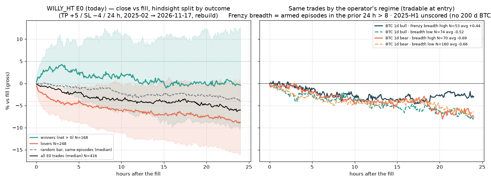

# WILLY_HT from theory: why the backtest loses, and whether entry timing, exits or the regime fix it (2026-11-19)

Research only. No engine, config, test or CLAUDE file was changed (report-only commit).

- **Pre-registration:** `WILLY_HT_THEORY_2026-11-19_PREREG.md`. It was frozen before any new number was computed.
- **Scripts:** `scripts/willy_ht_theory_build.py`, `_eval.py`, `_master.py`, `_chart.py`.
- **Files:**
  - `_combos.csv`: 90 entry × exit combos, per half-year plus DESIGN / HOLDOUT / D;
  - `_cuts.csv`: FAILED_SPIKE and turnover cuts;
  - `_regime.csv`;
  - `_pathfacts.csv`;
  - `_master.csv`: 49 real fills × 5 entries × 18 exits;
  - `_trades.csv`: E0 × today, with features;
  - `_event_study.png`.

## 1. Question

The operator: "The market is bullish and more coins are in frenzy, yet you find no LONG. WILLY_HT is my bet. Find WHY it does not work in the backtest and what fine-tuning fixes it."

This is an audit of our own null. I checked what had already been tested, derived from first principles what must hold for a Frenzy dip-buy to work, then tested the gaps.

## 2. Plain answer

- **Nothing fixes HT across the history.** 90 entry × exit combos were tested; 0 are positive over the full period, and 0 are positive on the 2026 HOLDOUT.
- **The best combo fails out of sample.** It is a confirmation entry (buy when a 5m bar closes back above the red bar's high) with TP +8 / SL −6 / 24 h.
  - DESIGN 2025: +1.39 %/trade. That beats the family-wise random-entry null (p < 0.005).
  - HOLDOUT 2026: −1.06. D 2023-H2: −0.30.
  - On the real fills: −0.43. Real fills under today's exit make +0.39 on the same fills.
  - This is the same signature as every earlier WILLY candidate: it worked in 2025-H2 and flipped in 2026.
- **The operator's regime thesis is directionally right, but not strong enough to switch on.**
  - **Frenzy breadth** (> 8 armed Frenzy episodes market-wide in the prior 24 h): HT does better than when breadth is low in 3 of 4 half-years. In-regime it is positive in 3 of 4 halves.
  - But over the whole period it is still −0.15 %/trade (135 trades, 101 days, CI [−0.90, +0.63]).
  - 2026-H1 is the exception: −1.68 in-regime, worse than out of regime.
  - **BTC 1d bull** (EMA50 > EMA200) alone: −0.12. Better than bear (−0.67), but 2025-H2 bull was worse than 2025-H2 non-bull.
  - **Bull × high breadth** (exploratory, not pre-registered): 53 · 49 % · +0.44, positive in both bull periods. CI [−0.85, +1.62], Kelly at floor −0.14. This is an observe line, not a switch.
- **"More coins in frenzy now" is not what the data show.**
  - Nov 2026 median Frenzy breadth is 8.5, an ordinary month.
  - Oct 2025 was 13. Apr 2026 was 10, and it was HT's worst month (32 trades, −2.11).
  - BTC has been 1d-bull since Oct 2026. Under today's exit the rebuild makes +0.50 in November and −0.75 in October.
- **Why the backtest loses: the drift.**
  - The median HT fill is −0.6 % after 1 h, −2.0 % at 3 h and **−6.0 % at 24 h**.
  - A random bar of the same episodes ends at −4.1 % after 24 h, so the whole episode window drifts down. Frenzy coins mean-revert.
  - Winners are the fills that pop in the first 1–3 h (median +4.3 % at 3 h). Even they are back to −0.4 % by 24 h.
  - The TA catalog (336 cells) found the same: long signals on Frenzy coins lose before costs.
- **The master is not wrong. It is a narrow, favourable window.**
  - Re-priced on today's exit: **49 real fills · 49 % · +0.39** (19 days). The 15 FAILED_SPIKE-kept fills make +2.07, the 34 blocked −0.35.
  - The rebuild over the same window (10-23 → 11-17) is close: 33 · 45 % · +0.12.
  - Real and rebuilt agree that the live window is mildly positive. The 21 months before it are not.

**Verdict: no proposal passes the frozen bar. Keep HT as it is** (paper, 0.5 × 5×, TP +5 / SL −4 / 24 h, operator-declared). Register two OBSERVE lines (§9). Nothing is armed.

## 3. Inventory: what was already tested (before this study)

| area | what | where | result |
|---|---|---|---|
| Exit, fixed grid | TP 2/3/4/5/6/today × SL 4/6/8/10/12 × hold 90 m / 4 / 12 / 24 / 48 h (150 cells) | WILLY_EXIT_V2 11-18 | no cell positive on DESIGN + SEEN + D; best family-wise p 0.25; TP5/SL4/24 h DESIGN −0.49, SEEN −0.09, D −0.08 |
| Exit, structural | spike-low / VWAP / base stops, BE +0.75/1/1.5, trails +1/2/3 × 1/2/3, grace 15/30/60 | WILLY_EXIT_V2 | none passes |
| Exit, wide stop | SL −10 / 24 h on HT stops | WILLY_EXIT_V2 | saved +373 vs deeper −393 (net −7 pts); the "stopped then recovered" trades dip to −8 % first |
| Exit, HT +2 / runners / RUN15 | HT master + WILLY backtest | WILLY_HT_EXIT_STUDY 11-12 | luck p ≥ 0.28; master and backtest point opposite ways |
| Exit by 1 h trend, TP at spike high | S3/S25/S2/TP2/TP3/RUN10; spike-high target | WILLY_TREND_EXIT 11-13, WILLY_HIGHTARGET 10-23 | no pass |
| Entry separators | 46 variables (crowding, OI, funding, premium, taker, spot share, vol decay, off-peak, run %, 4 h trend, BTC, breadth, Frenzy count …), 1D + 2D, 244 + 1,980 rules, shuffle null | HT_TP6_WL 11-18 | null p 0.08–0.37; crowded-long family = OBSERVE (blocks 9 of 15 master winners) |
| Entry separators | 153 variables W/L, AUC by period | WL_DEEP_WILLY_HT 11-17 | no variable agrees with the master |
| Stacks / 3D | C2–C6 stacks, 230 3D rules | STACK3D_WILLY_HT 11-17 | "improves but not proven"; Kelly after < 0; master DCR falls |
| Top-trader position > 1 | HT best | WILLY_DEEP 11-18 | DESIGN + SEEN +0.86, p 0.01; D −0.38; blocks 13 of 15 master fills → OBSERVE |
| FAILED_SPIKE | parity + filter separation per half | HT_FAILED_SPIKE_PARITY 11-19, WILLY_BACKTEST_WHY H7 | 47/49 parity; no out-of-sample separation before 10-08 (HT kept −0.35 vs blocked −0.36) |
| Turnover filter (the HT definition) | v1 / v2 gate, re-price | WILLY_TURNOVER_* 10-09 → 10-21 | hold zone; on the old WILLY exit only |
| Regime | BTC 1d trend, regime.py labels, breadth / Frenzy terciles | WILLY_BACKTEST_WHY H6 (old exit), FRENZY_LONG_REGIME (FRENZY_LONG, not HT) | "same regime, opposite sign"; no stable sign |
| Entry timing | FIRST_GREEN, RED2, random bar, depth buckets | WILLY_THEORY 10-16 | old +1.25 / −4 / 90 m exit, all WILLY: the first red is not special; random-bar Δ +0.02 (engine fills +0.19) |
| Late joiners / re-anchor | R1 / R2 late windows; re-anchored episodes | WILLY_LATE_JOIN 10-22, BACKTEST_WHY H3 | lose in every period |
| Backtest fidelity | exits 119/121, entries 36/39, ticks, costs, survivorship | WILLY_BACKTEST_WHY / _AUDIT 11-18 | faithful; G1 cap and re-anchor rate are small corrections |

**Never tested before this study (the gaps):**

1. Entry mechanics under today's big-target exit:
   - confirmation entry;
   - resting bids below the red bar (−3 %, spike VWAP);
   - a breakout buy-stop at the spike high.
   - Earlier entry tests used the +1.25 / 90 m exit.
2. The entry × exit joint grid with an exit tied to the entry.
3. TP 8 and SL 3 at a 3 h time stop (WILLY_EXIT_V2 had 90 m / 4 h and no TP 8).
4. The FAILED_SPIKE cut and the turnover cut at other thresholds under today's exit.
5. Regime in window (day) units under today's exit, at sign granularity, with Frenzy breadth as its own axis.
6. "Today's" regime values compared with history.

**Still untestable:**
- liquidation flow;
- order-book depth history;
- live DISLOC at its 1 s scale;
- the restart / re-anchor gap;
- the Alpha-listing flag (no full-history stamp; audit window 7 · −2.65).

## 4. Theory: why a Frenzy dip-buy could work, and what must hold

A Frenzy coin has spiked ≥ 5 % in 30 min on ≥ 20× volume. A dip-buy after the first red candle profits only if a second wave of buying comes. The theory names four sources. Each implies a condition I could measure, and each condition was tested (here or before):

| mechanism | must hold at entry | testable variable | status |
|---|---|---|---|
| Late buyers / FOMO | demand still arriving, not decaying | vol_decay, taker_15/30, spot share Δ | screened (HT_TP6): no stable separator |
| Short squeeze | shorts crowded, OI building, funding negative | top_acc / glob_acc (inverse), oi_chg, funding | crowded **longs** lose (the contrarian side works in-sample), but it blocks the master's winners; OBSERVE |
| Momentum re-acceleration | the second leg proves itself | **E4 breakout entry**, **E1 confirm entry** | tested here: breakout loses badly (−1.22 over the period); confirm wins 2025-H2 only |
| Liquidity provision | buying panic sellers inside a live episode | **E2 −3 % bid, E3 VWAP bid** | tested here: −0.58 / −0.40 over the period |
| Market tailwind | BTC up, alts bid, many coins in frenzy | BTC 1d EMA50/200, 1d return, 4h slope, breadth, Frenzy breadth | tested here in day units (§6) |
| Early in the episode | first spike, shallow dip | late, wait_bars, off_peak, spike_age | screened: no pass |

**The counter-theory the data support.**
- A Frenzy spike is a liquidity event. The coins mean-revert over 24 h: a random bar of the same episodes ends at −4.1 %.
- A dip-buy is a long bet against that drift. It wins only when the second wave comes fast (1–3 h). Nothing measurable at entry says when it will come.
- That is why every separator found so far works in one half-year and flips in the next.

## 5. Method

- **Episodes.**
  - Rebuilt from the validated independent rebuild (`sig_all.pkl`, today's `trading_config.json`), 2025-01-13 → 2026-11-17.
  - The decisive red bar follows today's routing: nomiss floor, unreadable turnover stays armed, DISLOC ends the entry, R ≥ 1.0 = HT, FAILED_SPIKE vs_vwap ≤ 0 blocks.
  - Plain WILLY off; one trade per pair; HT slots 10.
  - **Parity:** 416 of the 417 earlier rebuild HT trades are reproduced. The HT + FAILED_SPIKE-pass count per half matches exactly: 51 / 91 / 113 / 161.
- **Paths.** 1m where every day is cached (25 %), else 5m. A same-bar TP and stop is booked as the stop; this happens in 0.7 % of E0 trades, and the optimistic bound moves E0 −0.40 → −0.33.
  - D (2023-H2) is 97 % 5m. Every WILLY setup is treated as HT there, because 2023 market caps are unknown.
- **Costs.**
  - Taker 0.05 %, maker 0.02 %, 0.10 % slippage on market fills.
  - Limit entries fill only when the price trades through.
  - Real funding.
- **Null.** 200 replicates. Each draws 5 independent random 5m entries per DESIGN episode, inside [decisive bar, +4 h], prices them on all 18 exits, and keeps the max DESIGN average. This is the same family and the same statistic as the 90 observed combos.

## 6. Results

### 6a. Entries under today's exit (TP +5 / SL −4 / 24 h), portfolio level, N · WR · avg %

| entry | 2025-H1 | 2025-H2 | 2026-H1 | 2026-H2 | DESIGN 2025 | HOLDOUT 2026 | ALL | D 23-H2 | master (real fills) |
|---|---|---|---|---|---|---|---|---|---|
| **E0 RED (today)** | 51 · 39 % · −0.53 | 91 · 49 % · +0.41 | 113 · 31 % · −1.25 | 159 · 42 % · −0.22 | 142 · +0.08 | 272 · −0.65 | **414 · 40 % · −0.40** | 199 · −0.04 | 49 · 49 % · +0.39 (kept 15 · +2.07) |
| E1 CONFIRM | 31 · −0.65 | 53 · 60 % · +1.46 | 61 · −1.11 | 85 · −0.21 | 84 · +0.68 | 146 · −0.59 | 230 · −0.12 | 113 · −0.28 | 29 · +0.31 |
| E2 DIP −3 % | 31 · −0.50 | 55 · −0.72 | 88 · −0.33 | 109 · −0.72 | 86 · −0.64 | 197 · −0.55 | 283 · −0.58 | 106 · −0.19 | 32 · −0.96 |
| E3 VWAP bid | 39 · −0.56 | 66 · −0.08 | 95 · −1.08 | 133 · −0.02 | 105 · −0.26 | 228 · −0.46 | 333 · −0.40 | 168 · +0.05 | **14 · 79 % · +3.15** |
| E4 BREAKOUT | 35 · −0.22 | 55 · −0.10 | 76 · −1.57 | 105 · −1.90 | 90 · −0.15 | 181 · −1.76 | 271 · −1.22 | 131 · −0.52 | 32 · −2.61 |

D routes every 2023 WILLY setup as HT (market caps unknown), so it is a cross-check only. E3 is the one entry ≥ 0 on D (+0.05).

**Today's full-history verdict (E0):**
- 414 trades on 281 days · WR 40 % vs breakeven 45 %.
- CI [−0.84, +0.04].
- Kelly at the 95 % Wilson floor −0.17.
- DCR at 0.61 × equity **−0.175 %/day**. HOLDOUT 2026 −0.37 %/day; 2025-H2 +0.10.
- LOO: dropping the best pair gives −0.47; dropping the best day gives −0.45.

### 6b. Path read under today's exit, before booked P&L

WORKED = +1 % before −4 % within 24 h.

| entry | N | WORKED % | median reach before stop | reach +5 % | CAPTURED N · pts | GAVE_BACK N · pts | NEVER_WORKED N · pts |
|---|---|---|---|---|---|---|---|
| E0 | 416 | 73 | +3.4 | 40 | 168 · +844 | 137 · −554 | 111 · −454 |
| E1 | 231 | 74 | +3.7 | 43 | 99 · +496 | 72 · −284 | 60 · −244 |
| E2 | 285 | 73 | +3.4 | 38 | 110 · +548 | 97 · −388 | 78 · −318 |
| E3 | 334 | 70 | +3.0 | 40 | 135 · +678 | 97 · −388 | 102 · −418 |
| E4 | 272 | 57 | +1.9 | 34 | 92 · +457 | 64 · −257 | 116 · −536 |

**What this shows.**
- Three of four entries do pop: 70–74 % go +1 % first.
- Only about 40 % reach +5 before −4. The breakeven at +5 / −4 is 44–45 %.
- GAVE_BACK (went +1, ended at −4) is the largest loss bucket for E0. The fix the exit studies looked for (lock in early) was already priced: BE locks, trails, 90 m caps and TP 2–3 all lose (WILLY_EXIT_V2, and the TP3 cells here).
- No entry changes the reach-to-+5 rate by more than 3 points, except breakout, which lowers it.

### 6c. Family-wise result (90 combos)

- **Best DESIGN combo:** E1 CONFIRM × TP8 / SL6 / 24 h. Episode-level DESIGN +1.38 vs today +0.08. The null median is +0.18 and its 95th percentile +0.49, so **p < 0.005**.
- **Out of sample it fails every check:**
  - HOLDOUT 2026: 146 · 35 % · −1.06 (2026-H1 −1.52, 2026-H2 −0.73);
  - D −0.30;
  - master 29 · 41 % · −0.43 (kept 12 · −0.14);
  - full-history Kelly at floor −0.13;
  - DCR −0.07 %/day.
- The DESIGN "edge" is 2025-H2 alone (52 · 60 % · +2.43).
- No combo is positive over ALL or on HOLDOUT. No combo is positive in ≥ 3 of 4 halves.
- **Pass bar:** ① ✓ for the best combo · ② ✗ · ③ ✗ · ④ ✗ · ⑤ ✗ · ⑦ ✗.

### 6d. FAILED_SPIKE and turnover cuts (E0 × today's exit)

| rule | DESIGN 2025 | HOLDOUT 2026 | ALL |
|---|---|---|---|
| FS ≤ 0 (today) | 142 · 46 % · +0.08 | 272 · 38 % · −0.65 | 414 · −0.40 |
| FS off | 368 · +0.08 | 772 · −0.53 | 1,140 · −0.33 |
| FS ≤ −1 | 261 · +0.18 | 518 · −0.41 | 779 · −0.21 |
| FS ≤ +1 | 60 · +0.15 | 136 · −0.52 | 196 · −0.32 |
| FS ≤ +2 | 48 · +0.26 | 91 · −0.57 | 139 · −0.28 |
| FS-blocked cohort only | 226 · +0.09 | 500 · −0.46 | 726 · −0.29 |
| R ≥ 0.7 | 193 · +0.25 | 369 · −0.49 | 562 · −0.24 |
| R ≥ 1.5 | 95 · −0.06 | 191 · −0.60 | 286 · −0.42 |
| R ≥ 2.5 | 56 · +0.29 | 110 · −0.43 | 166 · −0.19 |

**FAILED_SPIKE** does not separate in the history:
- kept −0.40 vs blocked −0.29;
- every cut is negative on HOLDOUT.

On the 49 real fills it does separate: kept +2.07 vs blocked −0.35 on today's exit. That is the in-sample layer WILLY_BACKTEST_WHY already flagged (armed 11-11 on these fills).

**Turnover:** no cut turns HOLDOUT positive. The dose-response is non-monotonic.

## 7. Regime: the operator's thesis, at sign granularity, in day units (E0 × today's exit)

Cells are in-regime / out-of-regime, N · WR · avg · days. 2025-H1 has no BTC 1d EMA200 read (it needs 200 days of history), so 2025-H1 is unscored for the first two axes.

| axis | 2025-H1 | 2025-H2 | 2026-H1 | 2026-H2 | ALL in-regime (CI) | halves in > 0 / in > out | PASS |
|---|---|---|---|---|---|---|---|
| BTC 1d EMA50 > EMA200 | unscored | 47 · −0.22 · 39 d / 36 · +0.47 | none in / 113 · −1.25 | 80 · −0.06 · 47 d / 81 · −0.37 | 127 · −0.12 · 86 d [−0.89, +0.67] | 0 / 1 | ✗ |
| BTC prior-day return > 0 | unscored | 42 · +0.03 / 41 · +0.13 | 48 · −1.60 / 65 · −0.99 | 83 · −0.02 / 78 · −0.42 | 173 · −0.44 [−1.14, +0.23] | 1 / 1 | ✗ |
| BTC 4h EMA20 slope > 0 | 33 · −1.05 / 18 · +0.44 | 42 · +1.32 / 49 · −0.36 | 49 · −1.65 / 64 · −0.94 | 76 · −0.59 / 85 · +0.12 | 200 · −0.53 [−1.16, +0.07] | 1 / 1 | ✗ |
| Alt breadth > median (0.48) | 28 · −1.16 / 23 · +0.25 | 47 · +0.18 / 44 · +0.67 | 47 · −1.76 / 66 · −0.89 | 60 · +0.19 / 101 · −0.45 | 182 · −0.53 [−1.16, +0.15] | 2 / 1 | ✗ |
| **Frenzy breadth > 8** (armed, 24 h) | 11 · +0.04 · 10 d / 40 · −0.68 | 31 · 61 % · +1.48 · 27 d / 60 · −0.14 | 42 · 26 % · −1.68 · 29 d / 71 · −0.99 | 51 · +0.09 · 35 d / 110 · −0.36 | 135 · −0.15 · 101 d [−0.90, +0.63] | **3 / 3** | ✗ (CI) |

**What it means.**

- **Frenzy breadth is the one axis that behaves as the operator's theory predicts.**
  - More coins in frenzy at once is better in 3 of 4 half-years.
  - It still does not make HT profitable: in-regime avg −0.15, Kelly at floor −0.17.
  - In 2026-H1 (BTC 1d bear all half) high breadth was the worst cell.
- **Exploratory 2D, not pre-registered:** BTC 1d bull AND Frenzy breadth > 8.
  - 53 trades · 40 days · 49 % · **+0.44**, CI [−0.85, +1.62], Kelly at floor −0.14.
  - It exists in two periods only: 2025-H2 +0.83 (24) and 2026-H2 +0.12 (29).
  - The other three cells are −0.52 to −0.69 (chart, right panel).
  - In window units it is about 2 regime episodes, so it is far below the gate.
- **"Now":**
  - BTC is 1d bull (since Sep/Oct 2026).
  - Frenzy breadth over the last 24 h of data (11-16 → 11-17) is 6–9, around the median.
  - Monthly medians: Nov 2026 8.5; Oct 2025 13; Apr 2026 10, which was HT's worst month at −2.11.
  - So today is not an unusually "frenzied" market by this measure. Today's bull + median-breadth cell has been −0.52 in the history.

**Monthly E0 × today's exit (rebuild):**
- 2025: Jul +2.26 · Aug +0.45 · Sep −2.58 · Oct +0.48 · Nov +1.28 · Dec −0.60.
- 2026: Jan −0.92 · Feb −1.56 · Mar +0.02 · Apr −2.11 · May −1.26 · Jun −1.02 · Jul −0.07 · Aug −0.40 · Sep −0.16 · Oct −0.75 · Nov (to 17th) +0.50.
- Profitable months cluster in Jul–Nov 2025. Since then, only Mar (flat) and Nov 2026 are ≥ 0.

## 8. Master check (real fills re-priced on each entry × exit)

| entry × exit | all real HT fills | FS-kept | FS-blocked |
|---|---|---|---|
| E0 × TP5/SL4/24 h (today) | 49 · 49 % · +0.39 (19 days) | 15 · 67 % · +2.07 | 34 · 41 % · −0.35 |
| E0 × TP8/SL6/24 h | 49 · 35 % · −1.01 | 15 · −0.27 | 34 · −1.34 |
| E1 × TP8/SL6/24 h (best DESIGN combo) | 29 · 41 % · −0.43 | 12 · −0.14 | 17 · −0.63 |
| **E3 VWAP bid × TP5/SL4/24 h** | **14 · 79 % · +3.15 (10 days)** | 14 · +3.15 | (none fill) |

Newer export fills, booked: IRYS 11-19 +5.00 (TP), KAVA 11-19 −3.87 (stop), EVAA 11-18 +2.00 (the old +2 TP).

**E3 is the one entry the master likes.**
- Rest a bid at the spike-anchored VWAP after an FS-passing red bar.
- On the real fills: 14 · 79 % · +3.15. Rebuild over the same window: 31 · 52 % · +0.65.
- But E3 loses over the full history (−0.40, HOLDOUT −0.46, DESIGN −0.26, 2026-H2 −0.02) and fails bar ① outright.
- Under "master over backtest" the master leads, but 14 fills on 10 days inside the one known-good window is far below any gate. It is an OBSERVE candidate, frozen below, not an arm.

**FS-kept master on today's exit: +2.07 here vs +2.57 in the brief.** The difference is path resolution: 5m in 61 % of these fills here vs 1m / ticks in the earlier re-price. 5m is pessimistic.

## 9. Event study

**Left panel.** 414 E0 trades on today's exit, split by outcome with hindsight.
- Winners pop to +4 % within 3 h, then fade back to about 0 by 24 h.
- Losers slide from the first minutes to −9 %.
- A random bar of the same episodes (grey) drifts to −4 %, so the whole post-spike window is a down-drift.
- The 24 h hold only helps a trade that hit +5 early. Everything still open after 3 h keeps drifting down.

**Right panel.** The same trades by regime, a split you can make at entry.
- Only bull + high Frenzy breadth stops drifting after about 10 h (≈ −3 % at 24 h vs −7 % for the other three).

## 10. What it means and the verdict

1. **Why HT fails in the backtest:**
   - A Frenzy coin's post-spike window drifts down about 4–6 % in 24 h.
   - The dip-buy needs the second wave inside 1–3 h, and only about 40 % of entries get +5 before −4 (breakeven 44–45 %).
   - Every entry mechanic tested (confirm, deeper bid, VWAP bid, breakout) moves that rate by ≤ 3 points or lowers it.
   - The exits were exhausted earlier.
   - This is not a backtest bug: parity 416/417, and the live window reproduces to within about 0.3 %/trade.
2. **What the operator is right about:**
   - Frenzy breadth and a BTC 1d bull market do tilt the odds in HT's favour, 3 of 4 halves for breadth.
   - The live window (Oct 23 → Nov 17) is mildly positive in both the master (+0.39 all fills) and the rebuild (+0.12).
3. **Why it is still not a switch:**
   - In-regime HT is still negative over 21 months.
   - The favourable cell (bull × high breadth) is about 2 regime episodes, Kelly < 0.
   - Today is a median-breadth day, not a high-breadth one.
4. **Verdict:** no change to entry, exit, FAILED_SPIKE or turnover. HT stays as the operator set it (DL 587, paper, operator-declared). No combo passes the frozen bar. Breakout entries (−1.22) and deeper bids (−0.58) are refuted.

**OBSERVE lines (frozen here, alert only, read on fills opened after this report):**
- **HT_REGIME_BULL_FZ:** tag every HT fill with BTC 1d EMA50 > EMA200 AND armed-Frenzy-24 h > 8.
  - Read at ≥ 30 tagged fills on ≥ 10 days.
  - Promote only if the tagged cohort beats untagged by > 0 with a day-clustered lower bound > 0, and the tagged avg is > 0.
- **HT_VWAP_BID:** shadow-price a resting bid at the spike VWAP (valid 120 min) on every FS-passing HT episode, under TP5 / SL4 / 24 h.
  - Same read gate.
  - Compare it with the E0 fill of the same episode, fill for fill.

**Haircut / Kelly / DCR for the closest candidates, full history at 0.61 × equity, before → after:**
- Today: −0.175 %/day.
- Best combo: −0.07 %/day.
- Frenzy-breadth-only: −0.06 %/day.
- None has Kelly at floor > 0, so the haircut is moot.

## 11. Caveats and blind spots

- 75 % of the history paths are 5m. A same-bar ambiguity hits 0.7 % of trades, and the optimistic bound moves E0 by only +0.07.
- The live window's own fills are partly 5m too.
- The rebuild trade set ≠ the live set:
  - the rebuild takes extra in-window trades (WILLY_BACKTEST_WHY);
  - G1 cap and re-anchor rate are not applied here; those corrections move HT about +0.08/trade.
- The BTC 1d EMA200 axis cannot score 2025-H1. D (2023-H2) routes every setup as HT.
- HOLDOUT 2026 was read by earlier studies for other rules. It is new for these entry variants only.
- Exploratory reads (the 2D bull × breadth cell, monthly table) are post-hoc. They are reported, not tested.
- Still not measurable:
  - liquidation flow;
  - order-book depth history;
  - the live 1 s DISLOC;
  - the Alpha-listing flag;
  - restart effects.

**Review note (2026-11-19):** the BTC-bull and Frenzy-breadth CIs were printed identical ([−0.93, +0.62]) by the stored run; an independent day-block recompute from `_trades.csv` (2,000 draws, two seeds) gives bull [−0.89 … −0.93, +0.67] and breadth [−0.89 … −0.92, +0.62 … +0.65] — the coincidence was bootstrap noise, not a copy bug; the table shows the recompute. No verdict changes.
